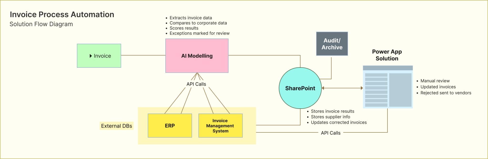

Today, we will be providing a business process automation example using AI and the work we performed for “Company X.” In this blog, we will be highlighting how you can use AI for business process automation tools and why a solution such as this can have a meaningful impact on your operations.

Company X approached us with the issue of having a significant number of yearly invoices (around 100,000 per year). Clerks were processing the invoices manually, which wasn’t efficient and consumed valuable time.

## The Initial Meeting

Having an initial meeting is an important step in the business process automation process because it leads to discovery of issues and allows us to determine the best way to solve these issues. During the initial meeting with Company X, we discovered that the accounts payable team was tasked with manually processing invoices – around 100,000 yearly. Due to the inefficient manual processing, AP clerks were struggling to meet payment deadlines and, at times, were facing penalties for late payment.

100,000 invoices per year plus manual invoice processing including the manual entry of invoice fields into their existing system is a recipe for untimely payments. This process needed to be automated. It’s important to us to provide our clients with options. There is no “one-size-fits-all” approach and ensuring our clients have a say and an opinion for the project is essential.

2 options were explored by improving consultants regarding digitizing these invoices automatically. Pros and cons of these 2 options were discussed internally and with our client.

- Option 1: Create a [Microsoft](https://www.microsoft.com/en-ca/) custom AI model, train it to extract key fields for the business, use this model as part of the Accounts payable Invoice automation solution.
- Option 2: Use an existing Microsoft prebuilt Invoice Processing Model.

## The Business Process Automation Tools Solution

It was determined, with Company X, that a quick deployment was necessary. Company X receives different kinds/formats of invoices from various suppliers yearly. Training a custom model with all the different expected invoice formats would require an extensive amount of time and effort. Additionally, maintenance and retraining the custom model after deployment will fall to Company X. A quicker deployment would not have been possible if we opted to train a custom model. Therefore, option 2 was the best choice for this particular project.

Company X has a shared inbox where suppliers submit their invoices. Using the pre-built AI model, we created an automatic workflow where key fields in the invoice could be extracted, and those specific fields would be populated in SharePoint.

We used the pre-built invoice processing model to extract important fields out of the PDFs of incoming invoices and store them somewhere that made sense from a business standpoint (like a secured central location).

They also have a local database where information about each supplier lives (name, address, phone number, etc.). Because this information was already available to Company X, we created a custom connector, and once the invoice fields are extracted using the AI model and available in SharePoint, we use a purchase order (PO) number as the identifier to send the API call to the local database to retrieve any matching supplier information back to SharePoint.

Why is this important? Once the local database responds with information specific to the PO number, the retrieved information from the databases is used as a validation point.

A confidence output score for each AI extracted field indicated how likely the AI model extracted a specific field accurately. Combined with the retrieved local database data, validation checks are performed. When invoices pass all the validation checks, they get auto-validated. For Company X, there are 13 validation checks. If the information matches and the confidence score is 70% or greater, then it is marked as auto validated.

*(A basic visual of the workflow of an incoming invoice using AI modelling)*

## What Happens if the Data Isn’t Auto Validated?

There are some exceptions Company X needs to be aware of. Sometimes, the model will recognize the information is there, but it doesn’t feel confident about the extracted value. Perhaps the confidence score is low. In cases where local database retrieved data does not match the AI extracted field value and cannot be auto validated, the invoice is flagged accordingly. We created a power up interface as part of this solution to manually further validate these exceptions.

The AI extracted data and local database retrieved data is shown alongside the original PDF invoice itself. This way, the clerk has everything they need on one screen. Low confidence scores are flagged within the power up and grabs the clerks’ attention.

The greatest feature of the app is a search functionality for each field. For example, let’s say the supplier name is unreadable. When trying to auto process that specific invoice, the invoice was marked as unreadable because of a low confidence score. When the clerk is on the power up, they can click on the search button next to the supplier name and it will highlight where it is extracted from the invoice within the PDF. This way, the clerk doesn’t have to spend any time scrolling for no reason. The validation process is quicker.

If the supplier’s name or number is indeed wrong, the clerk can reject that invoice – we automated this process as well. In this case, an automated email is sent to the supplier indicating/listing all he reasons for rejection and advising them to resubmit a corrected invoice they would resubmit the invoice to the supplier.

## The Benefits of Business Process Automation Tools and AI

Manual tasks are time-consuming and prone to human error. There is an immediate loss of efficiency and in Company X’s case, late payment penalties. But automation solves these issues and gives time back to employees. This allows them to process invoices efficiently and quickly without the need for spending too much of their valuable time performing repetitive manual tasks.

*(Invoice processing statistics ****without**** the use of AI and Business Process Automation Tools)*

Sure, there are risks involved. There is risk with any solution. Sometimes AI might extract something not related to a specific field and feel very confident about it. But the risks with the automated solution pale in comparison to the risks involved with manual entry. Additionally, added validation checks help in capturing issues such as this.

AI should be used as a tool to bring better business value. Leveraging it effectively and appropriately can create room for your employees to flex their skills in other areas. And the good news is, you have your people to fall back on when AI can’t perform with 100% accuracy. A win-win.

Additionally, this solution is highly customizable and can be further tailored to meet the unique requirements of any business. Whether it’s adjusting the validation criteria, incorporating additional data sources, or optimizing the workflow for specific invoice types, the solution can be easily adapted to fit a wide range of business needs and operational preferences.

## The Benefit of Business Process Automation Tools in Numbers

This initiative will improve performance and reduce Company X’s invoice processing time by **1 ($75,000)** FTE per year. As the process is fully automated, human error will also reduce drastically.

Thanks for reading! If you’re looking for Business Process Automation tools, [reach out to us and we will help you on your journey.](https://improving.com/contact)
