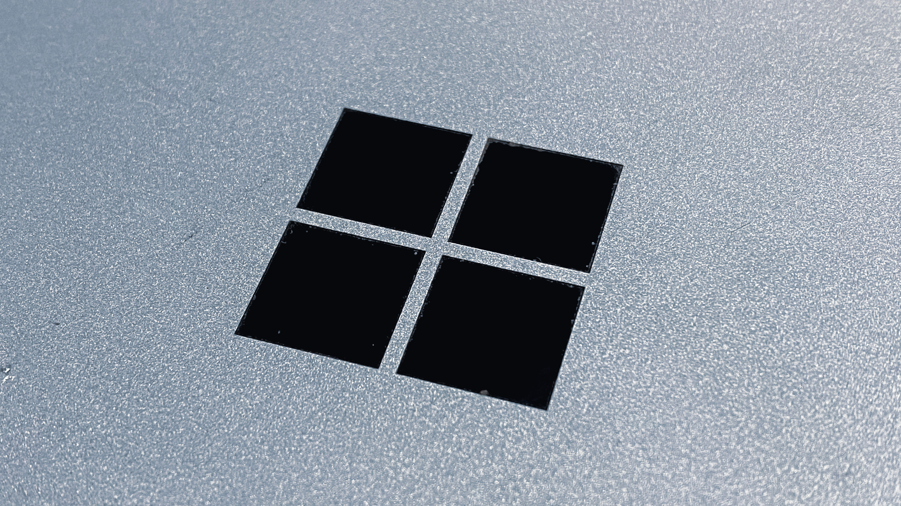

Companies need agile, comprehensive data solutions to harness their data effectively. Microsoft Fabric has emerged as a transformative solution for enterprises, promising to simplify data integration, streamline analytics, and boost organizational insights. This blog delves into the key aspects of Microsoft Fabric, its value proposition, and how it meets modern data challenges.

### **The Need for a Unified Data Platform**

Traditional data environments often involve multiple tools and systems, creating data silos and increasing complexity. Each component, from storage and extraction to processing, often requires unique skill sets and separate billing structures, leading to fragmentation. Microsoft Fabric addresses these issues by consolidating these components into a single, unified platform that manages data seamlessly.

Microsoft Fabric serves as a comprehensive ecosystem, integrating capabilities from platforms like Azure Synapse and Data Factory into a Software-as-a-Service (SaaS) solution. It combines data engineering, real-time analytics, machine learning, and business intelligence (BI) in a singular environment, making it an ideal platform for organizations seeking efficient and accessible data management.

### **Key Components of Microsoft Fabric**

Microsoft Fabric’s structure revolves around several key pillars and underlying technologies that support diverse data needs:

##### **1. OneLake: The Data Foundation**

OneLake acts as the foundation of the Fabric ecosystem. Similar to OneDrive for Office applications, OneLake provides a centralized repository for all analytics data. This shared data lake minimizes the need for redundant copies and streamlines data accessibility. Built on Azure Data Lake Storage (ADLS) Gen 2, it offers robust capabilities without requiring additional setup, making data accessible for various applications within the Fabric environment.

##### **2. Data Factory**

Data Factory serves as the primary tool for data movement within Fabric. It enables seamless data ingestion, transformation, and movement across different parts of the ecosystem. Two main features in Data Factory are data flows, which facilitate data transformations, and pipelines, which handle data orchestration. Together, they streamline the ETL (Extract, Transform, Load) process, making it easy to bring in data from APIs, on-premises sources, or other cloud environments.

##### **3. Data Engineering and Data Warehousing**

Fabric’s data engineering and data warehousing components cater to both structured and unstructured data. Users can create data lakehouses using Spark notebooks, working with Python or R to process massive data sets. Meanwhile, data warehousing offers SQL-based data management, familiar to database developers and ideal for structured data, such as customer records or financial transactions. This dual support allows companies to leverage their existing data structures and skillsets within a unified ecosystem.

##### **4. Copilot for Analytics**

Copilot, Fabric’s built-in AI assistant, enhances productivity by providing suggestions and assistance across various analytics tasks. It can help with data wrangling, automate report generation, and even assist in coding for data science applications. This tool greatly reduces time-to-value, particularly for data professionals and citizen developers who may need guidance in building out complex models and queries.

##### **5. Power BI Integration**

Fabric deeply integrates Power BI, Microsoft’s renowned BI tool, extending its capabilities with new features such as Direct Lake storage mode. This feature enables users to query data directly from their lakehouse without moving it, significantly reducing query times and enhancing report generation. The result is a faster, more efficient BI experience that is tightly interwoven with other Fabric components.

##### **6. Real-Time Analytics**

With Real-Time Hub, Fabric provides an organized space for managing streaming data, making it easy to track events and monitor key metrics in real-time. This capability is vital for industries and business cases that depend on instantaneous data analysis, such as **manufacturing**, logistics, and IoT asset monitoring. Fabric’s Data Activator toolset enables companies to set up alerts and triggers for real-time decision-making, which can automatically execute tasks or provide notifications based on predefined conditions.

##### **7. Data Science**

Fabric’s data science experience is designed to streamline AI and machine learning (ML) processes, enabling seamless collaboration between data scientists and analysts. It supports industry-standard frameworks and toolsets such as SparkML, MLlib, Scikit, PyTorch, and Tensorflow, ensuring compatibility and ease of use. Users can create, train, and deploy machine learning models within the Fabric environment, benefiting from the integration with Azure Machine Learning and Azure Synapse Analytics. This setup ensures that data science solutions can continuously leverage advancements and developments in data science platforms and libraries, maintaining high performance and delivering valuable insights.

### **Benefits of Microsoft Fabric for Enterprises**

Microsoft Fabric offers several key advantages over traditional data solutions including:

- **Reduced Overhead**: Fabric’s SaaS model eliminates the need for costly infrastructure and the specialized knowledge required to maintain it. All data components reside in a single ecosystem, minimizing the need for maintenance and reducing costs.
- **Unified Platform**: Fabric brings together data engineering, warehousing, BI, and real-time analytics, facilitating data sharing across departments and enhancing collaboration.
- **Scalability and Flexibility**: Fabric’s compute capabilities can scale to meet changing demands, from intensive data engineering projects to lightweight BI queries. This flexibility is essential for businesses with fluctuating workloads.
- **Interoperability**: Fabric’s support for open standards and compatibility with other cloud environments—such as Google Cloud and AWS—makes it easier to integrate with external data sources and existing data lakes.

### **Use Cases and Adoption Scenarios**

Microsoft Fabric is suitable for organizations at various stages of data platform maturity:

##### **1. Greenfield Projects**

Organizations starting from scratch can adopt Fabric as their primary data platform, benefiting from its holistic, SaaS-based environment. This setup is ideal for companies that want to streamline their data processes without worrying about backend infrastructure.

##### **2. Brownfield Projects**

Businesses that already have some cloud infrastructure or data solutions in place can gradually migrate specific workloads to Fabric. For example, data warehousing tasks currently managed in Azure Synapse can be transitioned to Fabric’s unified environment.

##### **3. Legacy Systems and On-Premises Environments**

Even for companies using legacy or on-premises data systems, Fabric offers pathways to leverage its advanced analytics and BI tools. Through features like Shortcuts and Mirroring, businesses can connect their legacy systems with Fabric, enabling a modernized approach without a full migration.

### **Embracing the Future of Data Analytics**

Microsoft Fabric represents a significant step forward in data analytics, with its ability to unify diverse data needs under a single platform. This approach allows organizations to focus on deriving value from their data rather than managing multiple, disparate systems. For companies looking to simplify data processes and empower teams with actionable insights, Fabric provides an accessible, scalable, and future-ready solution.

### **Next Steps: Exploring Microsoft Fabric**

To understand how Microsoft Fabric can transform your organization’s data landscape, consider attending an Improving Fabric Roadshow or engaging with Microsoft’s learning modules. These resources offer hands-on experience with each Fabric component, from setting up data flows to leveraging Copilot for analytics.

In an era where data-driven decision-making is paramount, Microsoft Fabric stands out as a versatile and powerful tool that enables organizations to adapt, grow, and innovate. By embracing Fabric, companies can streamline their data operations, reduce overhead, and harness the full potential of their data for transformative insights and outcomes.

*If you missed the full presentation, make sure to explore the *[*Tomorrow Technology. Today*](https://www.improving.com/tomorrow-technology-today/webinar-series/)* series for more insights on AI, data ecosystems, and platform engineering.*
