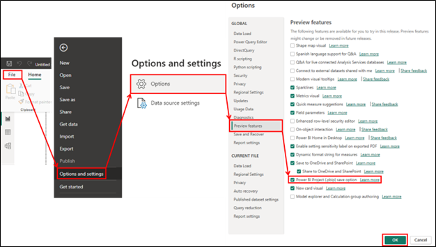
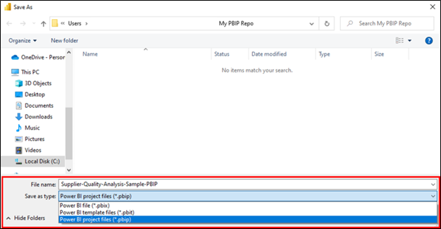
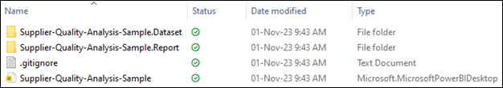
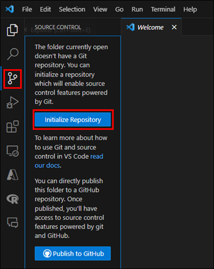
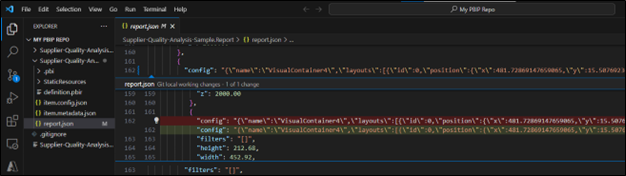
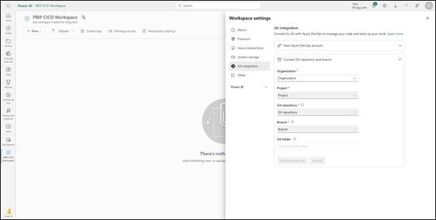
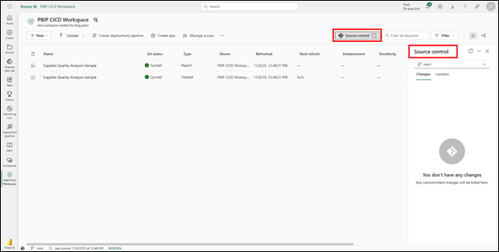
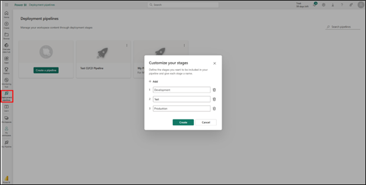

## Collaborating in Power BI

Microsoft Power BI is a platform for business intelligence (BI) that allows users to connect to multiple data sources, to transform data into and obtain business insights through powerful visualizations. Power BI is part of Microsoft’s low-code/no-code suite ‘Power Platform’, and its ease of use is one of many reasons why it has been widely adopted in the industry.

While it is common to have teams collaborating on Power BI report development, having multiple developers work on the same Power BI report can be tricky. To begin with, **Power BI report files (PBIX)** are not directly diffable since these are binary files. What this means is that users cannot easily track changes that have been made by other developers as they normally would when working on a coding project (for example, using Git version control in python machine learning project). With OneDrive, Microsoft allows users to have access to versioning for a given PBIX file, but that does not allow users to easily see what changes were made to the visuals and data model. There are other third-party tools and extensions that could be used, such as Tabular Editor to save the data model in a human-readable (and diffable) format, but these could be complicated to new Power BI developers and/or business users.

Thankfully, this all changed with the announcement of **Fabric** and **Power BI Desktop Developer Mode**. This release introduced many important features for collaboration such as the addition of **Power BI Project files (PBIP)**, which in turns allows capabilities such as version (or source) control and Continuous Integration and Continuous Delivery (CI/CD). But before diving deeper into PBIP files, how about learning more about version control and CI/CD?

## What is version control and CI/CD?

Version control is a common practice in software development that refers to managing changes to files and projects, such as coding script. Among its main features are the possibility to correct mistakes or restoring previous work by reverting to an earlier version of a file; possibility of multiple developers working on the same project without overwriting each other’s work; and the creation of branches to develop potential new features or for bug fixing. Nowadays, the most popular system for version control is **Git**, which supports work using a repository model. Different platforms utilize Git for version control, such as **GitHub** and **Azure DevOps**. It is important to highlight that Git and GitHub are different things: the first is the system used for version control, while the latter is a platform for implementation.

CI/CD refers to Continuous Integration and Continuous Delivery. This is a method that involves *continuously* developing coding changes, testing them, and delivering them in a production environment (i.e., making it available to end users). A main aspect of this method is automating different steps in the process leading to a new feature transitioning faster from development to production environments, as well as an improved ability to detect and address bugs earlier in the development process.

Both version control and CI/CD are commonly used in software development teams for improved work efficiency and better product quality, and it is great that these can now be more easily implemented in Power BI.

## Enabling Power BI Project as a Save Option

Now that we know more about version control and CI/CD, it is time to learn how to use these features with the new Power BI Desktop Developer Mode. The first step is enabling the PBIP save option. This can be done by visiting the Options page, as displayed in Figure 1. Once in the Options menu, the PBIP save option can be enabled by visiting the **Preview Features** pane.

Once that new feature has been enabled, the user can now proceed to save their report as a PBIP file by clicking on **File > Save As, **then select on **Browse this device **to choose the save location and also changing the file type to “Power BI project files (*.pbip)”, as shown in Figure 2.

Once the file has been saved as a project, several artifacts will appear in the selected folder. These artifacts contain text files that define the report and dataset. Text files are diffable, and therefore these folders can be tracked using Git in a repository to track changes that are done to the data model and to the visual (report).

## Using Version Control with a PBIP File

Now that text files representing the Power BI report and dataset are available, it is possible to use a code editor such as Visual Studio Code (VS Code) to make changes to the project. More importantly, these changes can be tracked using Git. As Power BI Desktop does not have native Git integration (yet), VS Code may also be used for this purpose. In VS Code, a repository may be initialized using the “source control” icon as shown in Figure 4. Please note that other tools may be used in this step other than VS Code.

Once the repository has been initialized, any changes in the PBIP file will be reflected in one of the files in the dataset or report folder. For example, formatting a visual in the PBIP file, such as changing the line colour in a line chart, causes changes in the *report.json* file as shown in Figure 5.

## Report Co-development

Using a repository to track changes enables teams of developers to work on a single Power BI project file and forms the basis for CICD work. Their changes can be submitted and merged with the use of hosting tools such as GitHub or Azure DevOps, which transforms the local repo created in the previous section into a remote repo. Using DevOps is particularly interesting, since this allows the repo to be integrated with a Power BI Service workspace. For those more familiar with GitHub, a GitHub repo may be cloned to DevOps, and that cloned copy can be used for Power BI Service integration.

To set up Git integration, create a new workspace and navigate to the ‘Workspace settings’ page. A new ‘Git integration’ blade can be found, where the details for the DevOps need to be entered, as shown in Figure 6. Note that this feature does require using **Fabric** in a **Premium** workspace.

Once the connection between the DevOps repo and workspace is made, the workspace will be populated with the corresponding report and dataset files, as if a report had been published through Power BI Desktop. The difference in this case is that Fabric monitors and tracks changes between the workspace and the repo, eliminating the need to republish a report. Rather, users with the appropriate roles can start the process to ensure changes are accepted or rejected, and the workspace version of both the report and dataset are up to date with the repo (Figure 7).

## CI/CD Pipelines

Taking one step further in improving the performance of Power BI development teams, there is a new **Deployment pipelines** feature that can automatically promote reports from development to test, and from test to production environments (please note that this feature also requires Fabric). That way, a manager can promote a report and dataset from a Git-enabled workspace to test once the project is ready to be moved to the next environment.

To start, simply navigate to the *Deployment pipelines* page on the left-hand side in Power BI Service. It is possible to choose a name, add a description, and define the pipeline stages, as can be seen in Figure 8.

Once the pipeline has been created, the user can choose which workspace is used in each stage. In practice, only the development stage workspace needs to be set up, as the test and production workspaces can be automatically created by clicking on the *Deploy* button (highlighted in Figure 9). However, other workspaces may also be manually selected for the test and production environment.

## Conclusion

Collaborating on a single Power BI report used to be problematic when several developers had to work at the same time. With the new features released with Power BI Desktop Developer Mode and Fabric. Power BI reports can now be saved as Power BI Projects, which split the report and dataset definitions into different text files. Since text files are diffable, version control now becomes an option when working with Power BI. Together with the addition of a Deployment feature in Power BI Service, users now can seamlessly transition between Power BI Desktop and Power BI Service, with every change being backed up by Git.

## References

[Power BI Desktop developer mode documentation - Power BI | Microsoft Learn](https://learn.microsoft.com/en-us/power-bi/developer/projects/)

[Deep dive into Power BI Desktop Developer Mode (Preview) | Microsoft Power BI Blog | Microsoft Power BI](https://powerbi.microsoft.com/en-us/blog/deep-dive-into-power-bi-desktop-developer-mode-preview/)

[Track Changes in Power BI: Part 1 - Introduction — DATA GOBLINS (data-goblins.com)](https://data-goblins.com/power-bi/version-control)
