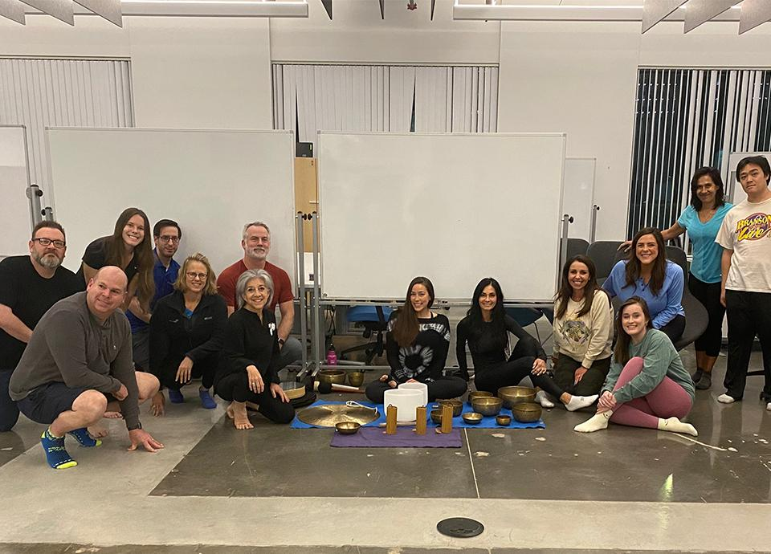
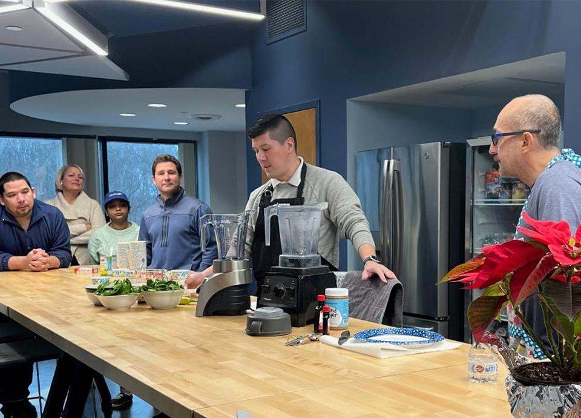
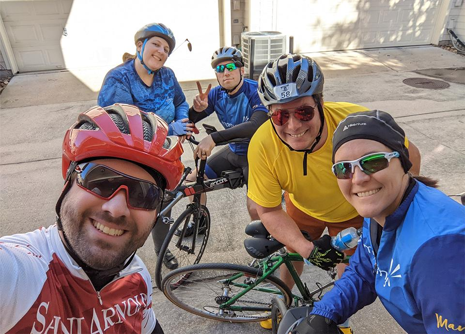

As many organizations have adjusted to having either remote or hybrid workspaces, it’s harder than ever to connect with colleagues. Improving knows firsthand how critical it is to have a positive work environment, and we are taking action to make sure this continues for every single Improver.

So, we have started what we call the Come Together Initiative! It is designed to bring all Improvers closer, no matter the distance.

Each month in 2022 has an assigned theme and will be jam-packed with diverse activities. This will not only create new bonds amongst fellow Improvers, but also provide knowledge and awareness of our work and ourselves.

We kicked off January with the theme of **Wellbeing**, and it generated both energy and tranquility across all of our enterprises!

The company as a whole held virtual talks on mental health, finances, and life balance in both English and Spanish to accommodate our employees. Each enterprise also hosted its own event throughout the month. Here is what each office did to “come together” last month:

### Dallas

Our office in Dallas held a yoga and sound bath session. Employees had the option of coming into the office or watching online as [Lauren Margolies](https://www.linkedin.com/in/lauren-margolies-9919ab26/) taught a restorative yoga class that ended with the sound bath experience.

### Minnesota

They also held a Yoga class, but virtually. The yoga teacher customized a class for the team, and talked about ways to get up and away from the desk, which can be difficult during the harsh winter temperatures.

### Atlanta, Ohio, Guadalajara, and Aguascalientes

These offices all decided to hold a Smoothie Day in their offices. They learned how to create delicious drinks from healthy fruits and vegetables to boost nutrition in their everyday lives.

### Chicago

Our newest enterprise, Chicago, held a mindfulness event. They spent time learning different mindfulness techniques, tried them out, and figured out ways to incorporate them into everyday routines. They worked on breathing techniques and walked through a mindfulness body scan too!

### Calgary

The Calgary team welcomed Tahira Jamani from [The Chain Reaction](https://www.linkedin.com/company/chainreactionlife/about/) into a video call for a session on emotional intelligence. This discussion focused on leadership development through mindfulness.

### Houston

Houston really got into the exercise portion of the well-being initiative. Over the past few years, they have formed the Houston Improving MS 150 team and they used their time to train with the first ride of the year.

We are thrilled to continue this initiative throughout the rest of the year. If you would like to learn more about it, [reach out](https://improving.com/contact)!
