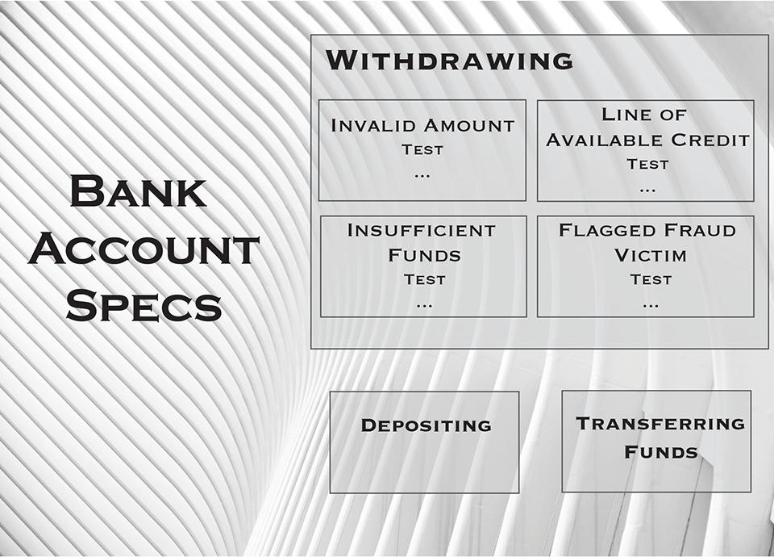

Several developers and organizations give up on certain automated testing practices because the tests become brittle and hard to maintain.

Let's take a peek at the life of our fictional character Don, the charismatic developer son of Mrs. Aido Test'alot and Mr. Telme Moore. At his current job, Don Testa'lot Moore has taken an “Intro to Unit Testing” course and learned about test frameworks and test runners. He goes “unit test crazy” and writes several tests for a class he is creating. He feels great looking at the high code coverage achieved with those tests. Teammates are intrigued by the great work done by Mr. Testa'lot Moore, and he happily sets up a meeting to share his new knowledge with the team.

He shows the tests to his co-workers, explaining that the tests live in a *test fixture* file. Each test is organized following the “arrange-act-assert” (aka, AAA) template. Facial expressions show concern as they see hundreds of lines of code in the file; way more lines of code than the actual class under test. “That’s a lot of effort,” one person says, "and I'm afraid the boss will think so, too."

Weeks later, a defect is found. The fix is easy; a simple *if-block* will take care of things. But Mr. Testa'lot Moore has learned that we're supposed to first write a unit test that reproduces the defect. He navigates through the long test fixture trying to find one that looks like a good starting point for the new test. That turns out to be a difficult task since several tests look awfully similar. He settles on one of them and takes a copy-and-paste approach, and proceeds to make adjustments so it reproduces the defect reported. By the time he's done, he looks at the code changes and notices that there are *50 new lines* of test code for the *one line* of implementation code (a simple use of the ternary operator did the trick).

The time taken to turn around a fix to the defect was noticed by both teammates and the boss, who called her developer into her office to have a little talk, telling him **not** to waste that kind of time in the future. After that strike, the developer has to stop his newly-found practice, so now Mr. Don Testa'lot Moore questions his confidence in delivering code without proper automated tests. To his relief, a mentor enters his life and provides the guidance he needs.

This is what Don hears from his mentor...

Let's take that *BankAccount *class, for which you said you wrote many tests. You have a test fixture file named *BankAccountTests*, which contains all the tests for that class. I see almost 1,000 lines of code in there. The BankAccount class has several methods, including *Deposit*, *Withdraw*, and *TransferFunds*. The fixture includes at least one test for each method, and most methods require multiple tests to verify the different branches that are hit-based on parameters passed in. There are also tests that verify exceptional cases.

The first step to improve these tests is to organize the fixture by grouping the tests for the same methods, so we can see all of the tests for the Deposit method together, as well as for Withdraw, TransferFunds, etc.

Next, create a *BankAccountSpecs* folder (yes, let's start thinking of those things as *specs*, instead of *tests*). Move the *BankAccountTests* file in there.

Now, create one file for each method that you're testing. Simply copy the BankAccountTests file and paste it as many times as needed. A good way to name those files is *Depositing*, *Withdrawing*, T*ransferringFunds*, and so on. Get in each file and remove all tests that are not the ones for the respective method under test.

That change alone already yields benefits. The next time you have to do something to the BankAccount class in the context of depositing, you'll be able to focus only on the tests in that area.

Moving on, let's pick one of those contexts. Say, Depositing, since we just mentioned it. Look at the *arrange* section of each test in there. Identify what they have in common. Find code that looks **exactly** the same in some tests. Extract such code into separate methods and reuse it in all tests. Find code that looks **mostly** the same, except for minor things (maybe there's a *true* value here and a *false* there). Extract those lines into a separate method, turn those variable values into parameters, and reuse the method where applicable. Follow the same process with the *act* and *assert* sections of each test. The file should have far fewer lines of code now and each test should be much more palatable! Do the same to the test files for the other methods.

When all the test files have been cleaned up, go through them, look at the methods you created to handle the arrange, act, and assert sections, find out methods that look exactly the same across all files, cut them out of there, and paste them in a brand-new file, named *BankAccountSpecsBase *(or something like that). Guess what? Yup, reuse the code in your spec files! If those are written in a language that supports inheritance (C#, TypeScript, Java), you just got a base class for your BankAccount specs. In languages that don't support inheritance, you just got a module, or whatever mechanism is at your disposal to reuse code.

Keep going through those files and identify any other code that can be used across specs. At the end of this process, you'll have a better understanding of things. For example, you may find out that the BankAccount class is *always instantiated the exact same way*. Or, maybe it is instantiated *the same way based on what method* is being called on it (such as initialized with an initial balance of $0 when testing the Deposit method, and an initial balance of $1000 on tests for the Withdraw method).

At this point, take a look at each spec file again. Let's revisit *withdrawing*, for example. Look through its tests and see if there's any redundant code across them. Right now, anything left in there should be specific to *withdrawing*. There may be still a dozen tests in the file. Can you guess what's coming next? Create a folder named *withdrawing* and move the spec file in there. Identify which tests have similar *arrange* sections; those are specific contexts in which withdraws happen. Group them together, move them into separate files named after the context (for instance, "invalid amount", "insufficient funds", "line of credit available", "flagged fraud victim"). Look through those files, identify any common code, pull it out, and paste it into a new file, named *WithdrawingContext* (or something along those lines).

What do we get out of this approach?

- Spec files that are very small and easy to grasp;
- The organization by context makes it easier to find the specs as needed (
  *"hmm, a defect was found when withdrawing money from a bank account that has been flagged as a victim of fraud. I know exactly how to immediately find the tests in that area!" *);
- Writing new specs become much easier because there's a lot of "test code" that can be reused;
- From here on, new specs for any area are written with this thought process in mind (
  *"What are the scenarios? What are the contexts? How are they either similar or different?"*);
- When changes are made to the code and tests fail, it's now quicker to see the features and scenarios impacted by the changes;
- The approach works regardless of the type of tests (unit, integration, end-to-end) part of the software (front end, back end), test frameworks, and runners (MS-Test, NUnit, JUnit, xUnit, Jest, Jasmine, Cypress.io...);
- Tests won't rot and get abandoned since they're now clean, well-organized, and easier to maintain.

After this experience of enlightenment with his mentor, Don decides to drop his first name and now only goes by Mr. Testa'lot!
