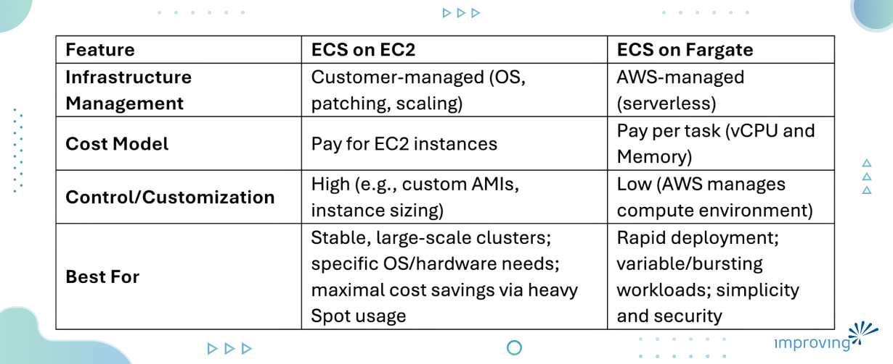
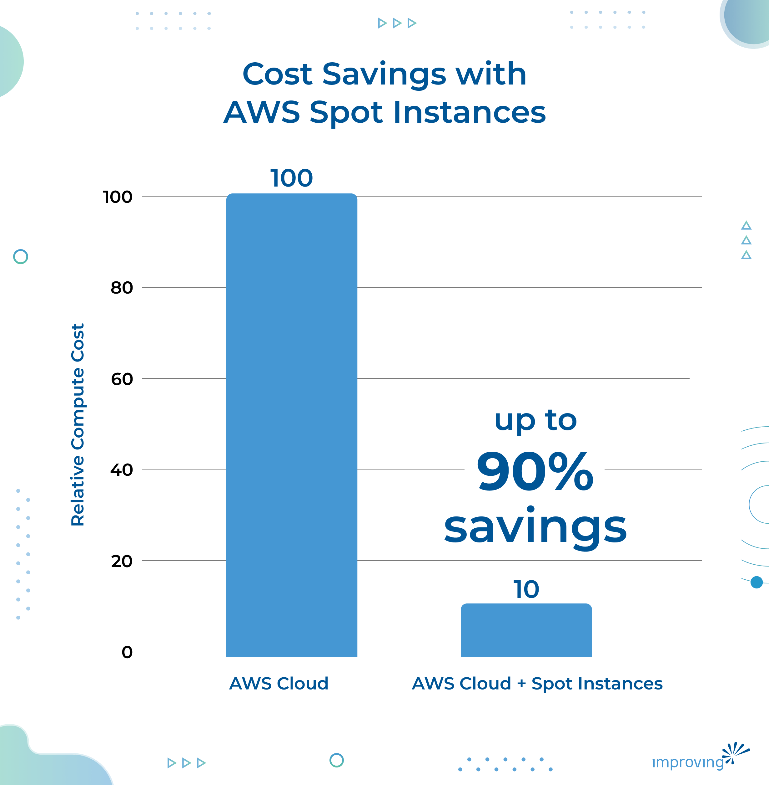
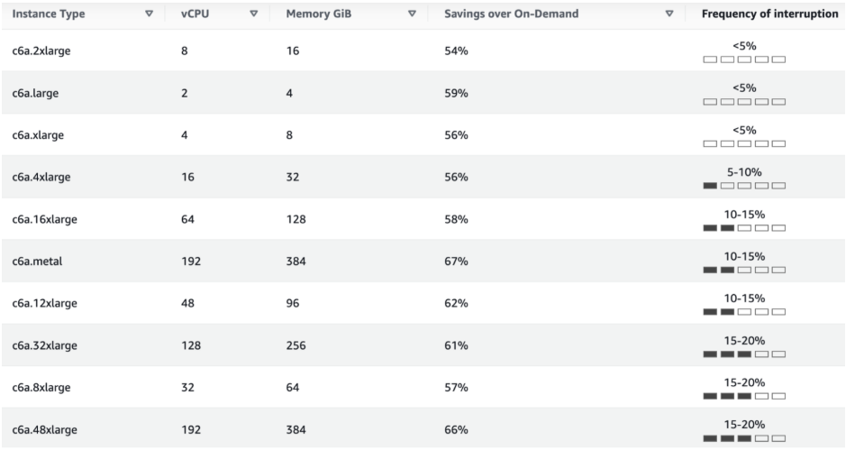
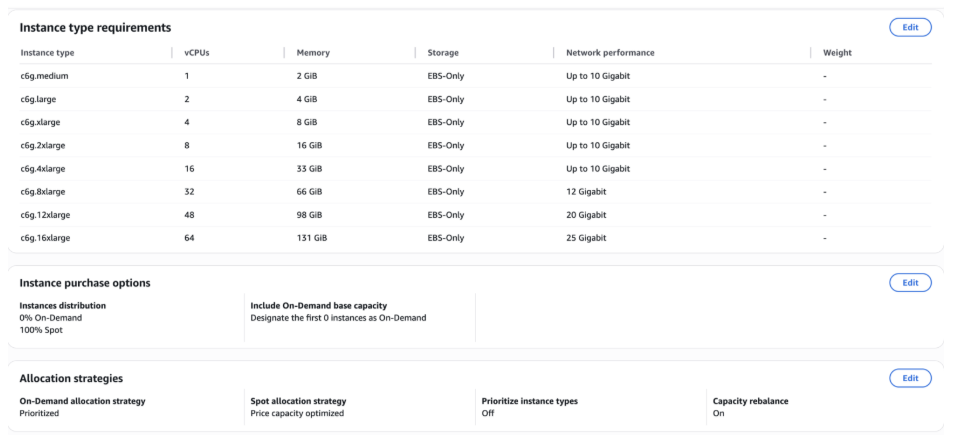
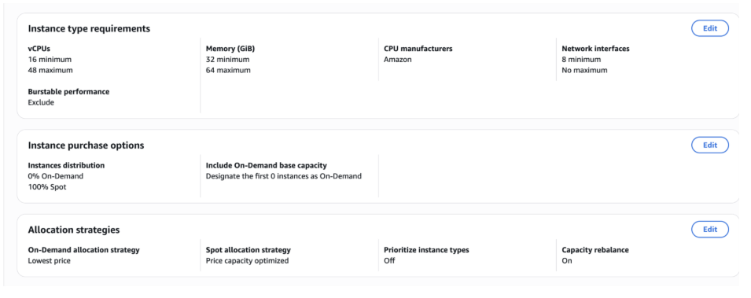
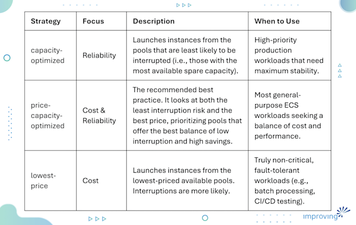
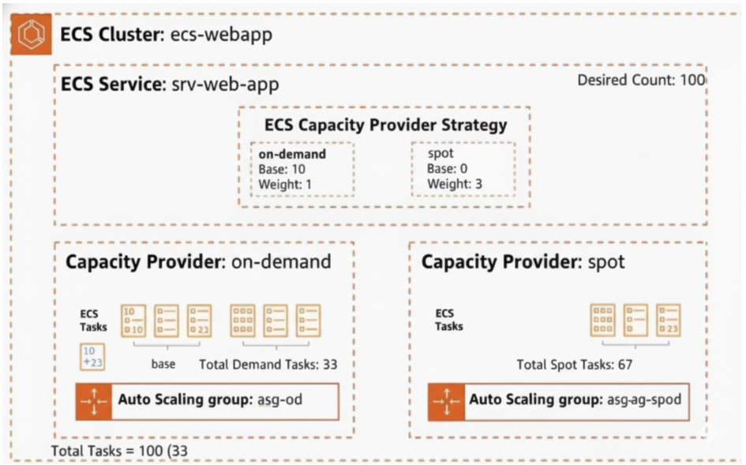
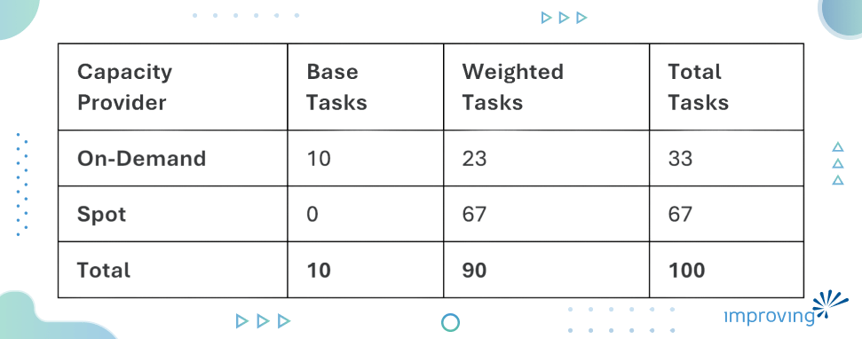
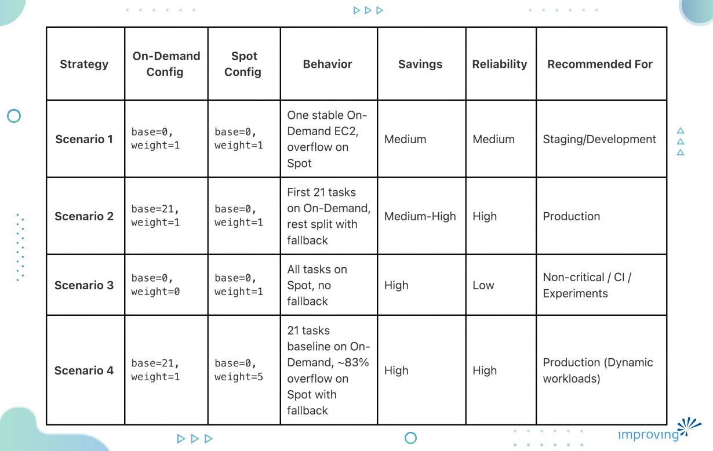

Cost efficiency is often as critical as performance and scalability. For modern containerized applications, the need to manage infrastructure costs becomes important, as microservices often translate to a large number of continuously running tasks. If not managed properly, these costs can spiral quickly.

We aren't just talking about a few extra dollars; we are talking about the kind of financial disaster where a team chose CloudWatch for a small project because it was "quick to set up," only to find it [eating up 40% of their entire budget](https://www.reddit.com/r/aws/comments/1bhz7jp/aws_billing_surprises_lessons_learned/). Or another instance where a recursive loop in a Lambda Edge function caused their application to essentially [DDoS itself through CloudFront](https://news.ycombinator.com/item?id=31907374).

> *"Basically, running on default is expensive." *

For Amazon Elastic Container Service (ECS) , the "default" is often to run every task on On-Demand or FARGATE capacity. While safe, it means you are paying a 70-90% premium for every single microservice, regardless of its priority.

In this blog post, we’ll move past the fear of a surprise bill. We will explore how to build a high-reliability, cost-optimized engine using [ECS Capacity Providers](https://docs.aws.amazon.com/AmazonECS/latest/developerguide/asg-capacity-providers.html). You’ll learn how to blend the guaranteed stability of On-Demand with the massive discounts of AWS Spot Instances so you can transform your computing spending from a risk into a strategic advantage.

## Understanding ECS Launch Types

Before diving into Spot Instances, it's essential to understand the two fundamental Launch Types available for running tasks in ECS: EC2 and Fargate. These are the distinct compute models that determine how your containers are hosted and managed.

### Running Tasks on EC2 Launch Type

With the EC2 launch type, we have full control over the underlying infrastructure. We provision and manage a cluster of EC2 instances that act as container hosts for our ECS tasks.

### Running Tasks on Fargate Launch Type

[Fargate ](https://docs.aws.amazon.com/AmazonECS/latest/developerguide/AWS_Fargate.html)is the serverless compute engine for containers. It removes the need for us to provision, configure, or scale clusters of virtual machines. We simply specify the CPU and memory required for our task, and Fargate handles the underlying infrastructure management.

### Fargate vs. EC2

**When to choose which type of instance:**

- **EC2 instance: **When we need maximum cost control, have consistent resource utilization, or require specialized instance types. This is where we can realize the highest savings by aggressive use of Spot Instances.
- **Fargate instance:** When simplicity, security isolation, and a rapid deployment model are our priorities. While Fargate is premium-priced, we can still leverage a form of Spot via Fargate Spot (discussed below).

## Why Cost Optimization Matters in ECS

Running containerized workloads on AWS involves paying for the underlying compute resources, whether they are Amazon EC2 instances or AWS Fargate compute units. In an ECS environment, controlling this expenditure is key to maintaining a healthy operational budget. Leveraging smart cost-saving mechanisms means we can run the same, or even larger, workloads for significantly less money, maximizing our return on investment (ROI).

## Where Spot Instances Fit in the Cost Optimization

Cost optimization for containers often begins with choosing the right deployment model (e.g., whether to use AWS Fargate for serverless management or Amazon EC2 for full control). Once we select the underlying compute, the next step is tapping into AWS's surplus capacity, the unused virtual machine capacity within an AWS Region, which is offered at a steep discount.

**Spot Instances allow us to utilize this spare compute capacity in the AWS cloud, typically offering savings of up to 90% compared to on-demand prices**. Such discounts are game changers for fault-tolerant and flexible ECS workloads.

## Optimizing Cost with ECS on Spot

AWS offers two ways to leverage discounted Spot capacity for our ECS workloads.

### Fargate Spot

Fargate Spot is a specialized version of Fargate that allows us to run interruptible Fargate tasks at a discount, similar to EC2 Spot Instances.

- **Pros:** Serverless simplicity, instant provisioning, high savings (typically 70% off Fargate On-Demand).
- **Cons:** Less granular control than EC2 Spot; not suitable for tasks that cannot tolerate interruption.

### EC2 Spot Capacity Providers

Capacity Providers allow ECS to manage the scaling of the underlying EC2 Auto Scaling Group (ASG), automatically requesting and maintaining the desired capacity. We configure one or more ASGs (for On-Demand and Spot) and define a strategy for how tasks should be distributed across them. This is the most flexible and powerful mechanism for cost optimization in ECS.

## Choosing the Right Spot Instance: Manual Data vs. Automated Selection

To successfully integrate EC2 Spot Instances, we must understand their interruptible nature. [AWS can reclaim a Spot Instance with a two-minute warning](https://docs.aws.amazon.com/AWSEC2/latest/UserGuide/spot-instance-termination-notices.html) if the capacity is needed elsewhere. The key is to select instance types that are less frequently interrupted and to diversify our fleet.

### 1. Manual Selection and Diversification using Spot Capacity Advisor

The initial step is to understand the core trade-offs: cost savings versus interruption risk.

The AWS EC2 [Spot Instance Advisor](https://aws.amazon.com/ec2/spot/instance-advisor/) is a vital tool for making informed decisions. It provides historical data on an instance type's saving potential and, critically, its Frequency of Interruption.

We can see a clear trade-off:

We might find that an instance type offering a slightly lower discount (e.g., 54% for c6a.2xlarge) is worth the trade-off for its <5% interruption rate, making it a more reliable choice for critical, cost-optimized workloads.

**Reducing interruptions by diversifying capacity**

For EC2 Spot instances, we must create a dedicated Auto Scaling Group (ASG) for our Spot fleet. Within this ASG, using a Mixed Instance Policy is critical for both cost and reliability.

1. **Select Multiple Instance Types:** Instead of relying on a single instance size (e.g., only c6a.4xlarge), the Mixed Instance Policy allows us to specify a mix of suitable** instance families and sizes** (e.g., c6a.2xlarge, c5.xlarge, c4.xlarge, etc.). This diversification is paramount, as the loss of one type won't halt our cluster, reducing the chance of complete capacity loss.
2. **Use Different Availability Zones (AZs):** Spread our Spot requests across multiple AZs. Capacity availability varies by AZ, ensuring greater capacity stability.

### 2. Automated Selection with Attribute-Based Selection (ABS)

Manually listing a diverse set of instance types in ASG works but managing that list becomes complex as AWS constantly releases new generations. Attribute-Based Instance Type Selection (ABS) provides a superior, future-proof approach for configuring our Spot fleet.

ABS allows you to express your workload requirements (such as minimum/maximum vCPU, memory, networking bandwidth, and instance generation) rather than listing specific instance types.

**How it helps Spot: **ABS automatically translates your requirements into a vast list of hundreds of potential instance types that meet your criteria. The massive diversification ensures your ASG can access the broadest possible pool of Spot capacity, dramatically lowering the risk of interruption.

**Maintenance-Free:** When AWS releases a new instance type (e.g., a new generation of C7 or M7), ABS automatically considers it for provisioning if it matches your specified attributes, meaning you never have to update your configuration manually.

### Understanding Spot Allocation Strategies

When using a Mixed Instance Policy in our ASG, we must choose an allocation strategy that dictates how AWS fulfills our Spot capacity request across the specified instance types. The right strategy directly impacts the stability and cost of our ECS cluster:

## Capacity Provider Strategies

Capacity Provider Strategies are the engine behind the flexible provisioning of tasks. They allow us to define a logic for distributing tasks across our available capacity pools (e.g., On-Demand ASG and Spot ASG).

### Baseline Reliability Strategy

The main idea for achieving both high reliability and significant cost savings simultaneously is to use On-Demand capacity to establish a reliable baseline and rely on Spot capacity only for dynamic scale-out.

It means we ensure a minimum number of critical ECS tasks are always running on guaranteed On-Demand compute. Only the tasks created as part of horizontal scaling or traffic surges are directed to the highly discounted, but interruptible, Spot Instances. This strategy is precisely what the base and weight parameters allow us to implement.

### Base and Weight Explained

As the name suggest, base and weight strategy is a strategy composed of capacity providers, each with a base and a weight:

- **base**: The minimum number of tasks (or task units) that *must* run on a specific capacity provider. Tasks are placed on the base capacity provider *before* considering any weight distribution.
- **weight**: The relative proportion of the **remaining capacity** that should be fulfilled by the associated capacity provider *after* the base is satisfied. It determines the relative percentage of tasks launched using that capacity provider.

ECS Capacity Provider Strategy distributing tasks across On-Demand and Spot instances based on base and weight configuration.

**Example of Weight Distribution:**

Imagine we need to run a total of **100 tasks** and we define the following strategy:

1. **On-Demand Capacity Provider:** base = **10**, weight = **1**
2. **Spot Capacity Provider:** base = **0**, weight = **3**

Here's how ECS places the tasks:

## Cost vs. Reliability Tradeoff

In this table, we can see how we have to tradeoff between cost and reliability when choosing strategies.

## Step-by-Step: Running ECS Workloads on Spot

Here's how to implement a high-reliability, cost-optimized strategy using Capacity Providers:

1. **Create an ECS cluster with capacity providers:** Define an ECS Cluster that is linked to two separate EC2 Auto Scaling Groups: one for On-Demand and one for Spot.
2. **Configure Spot and On-Demand in the strategy:** Define the Capacity Provider Strategy when creating an ECS service.
3. **On-Demand Capacity Provider:** Set a high base for guaranteed resources.
4. **Spot Capacity Provider:** Set a higher weight to ensure most flexible tasks land here.
5. **Run a service/task with the Spot strategy:** Deploy our ECS service, referencing the defined Capacity Provider Strategy.

We can explore a practical, infrastructure-as-code implementation of this setup using Terraform by checking out my GitHub [project](https://github.com/Nikhilpurva/blog-code-examples).

## **Final Words**

[Cost optimization](https://www.improving.com/thoughts/managing-cloud-cost/) within Amazon ECS is a continuous process, and mastering AWS Spot Instances is the most powerful lever for maximizing our savings without sacrificing critical performance.

By adopting the right approach, we move beyond simply requesting the cheapest compute and embrace a strategic methodology:

1. **Establishing a resilient baseline:** We use the On-Demand base in our Capacity Provider Strategy to ensure our most critical ECS tasks are always running on guaranteed capacity.
2. **Optimizing scale:** We leverage a high Spot weight to ensure all scale-out tasks are launched on deeply discounted capacity, maximizing cost savings for dynamic workloads.
3. **Enhancing stability:** We mitigate interruptions by utilizing the Spot Capacity Advisor and diversifying our EC2 fleet through Mixed Instance Policies and intelligent allocation strategies like price-capacity-optimized.

Ultimately, leveraging ECS Capacity Providers with Spot Instances transforms infrastructure management from a high cost overhead into a strategic advantage, allowing our team to scale faster and smarter while maintaining excellent resilience. If you are struggling with cloud and infrastructure overspending, [contact our experts](https://www.improving.com/contact/) to learn why various Fortune 500 companies and enterprises rely on our teams to help them identify waste, optimize resource usage, and build cost-efficient cloud platforms that scale sustainably.
