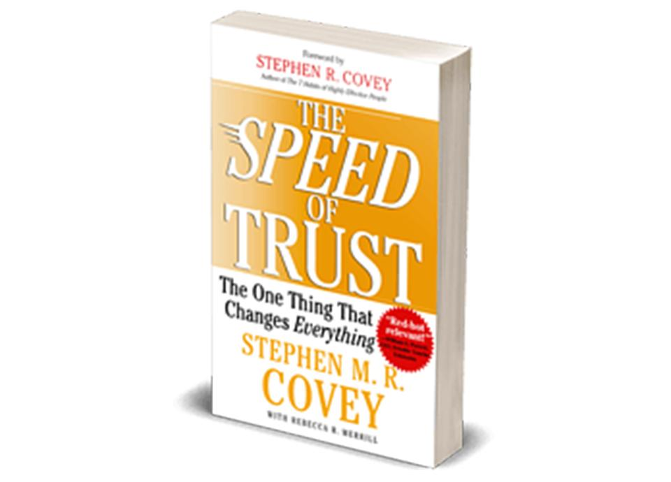

***In this series, we will be looking at the four cores of credibility and 13 trust behaviors highlighted in Stephen M. R. Covey’s book The Speed of Trust. Check-in every Monday for the latest installment in this series.***

We’ve all been in situations where we are trying to piece together the truth from an imperfect set of facts. Whether we are unwinding a discussion where the two parties do not see eye to eye, or we’re considering buying a used car, certain things remain hidden from view. We can ask questions and do research to try to piece together a complete picture But usually, we are forced to extend some measure of trust so we don’t fall victim to decision paralysis.

If trust is given too freely, it can bite us. If we consistently fail to trust, we risk overworking ourselves, becoming micromanagers, and creating a toxic work culture. *We must find the balance.*

Creating transparency is a vehicle to build a healthy work environment poised for innovation and anchored on trust. As humans, we innately seek out what is hidden from us. If I suddenly put my hand behind my back, my three-year-old instinctively moves around me to see what I’m hiding.

The more we hide, the more we dent our honesty and integrity. As Stephen M. R. Covey states in *The Speed of Trust*, we should “tell the truth in ways people can verify for themselves. Err on the side of telling too much rather than too little.”

It’s critical to be open and authentic with others. Leaning on Covey’s framework for his third trust behavior Create Transparency, let’s explore ways creating transparency can build trust in our everyday business relationships.

### Be Open

At the heart of transparency is openness. We should look to share information for everyone’s benefit. In the Conscious Capitalism model, this includes being open with employees, customers, vendors, and other stakeholders. The free flow of information breeds innovative thinking.

First Round Capital CEO Keith Raabois put it well when he said, “If you want people to make the same decisions that you would make, but in a more scalable way, you have to give them the same information you have”. As leaders, we should share how decisions are made and map out our companies’ financial health and plans. Employees won’t have to wonder if their job is secure, or if ownership is steering this ship in the right direction. All the information is there for the taking.

This also helps to create buy-in for corporate initiatives when others can see the why behind them. We should also seek to create a culture of transparency in our organizations where open feedback is rewarded and given not only freely but frequently.

### Timing is Key

Timing is a key component of transparency. Imagine our team is working on a critical feature for our client that we’ve committed to delivering by Friday. On Tuesday, we find out there are blockers that put our Friday deadline at high risk. We aren’t being transparent if we wait until Thursday or Friday to voice our concerns to the client.

When we don’t raise the red flag as soon as we know there is an issue, we are carrying hidden agendas and obscuring the truth, hoping some miracle will save us. Although these are tough conversations to have, they are much easier than waiting. When we voice problems in the moment, we create a window where things can potentially be salvaged. We can game plan with the client to find an acceptable solution.

Perhaps we release the feature with a reduced scope or, we could communicate with the business ahead of time about the new delivery date so they can plan with their partners accordingly. In doing so, we open up possibilities and help retain trust.

### Own Your Failures

I once worked with a software developer who never took responsibility for her failures. They would consistently throw others under the bus for her screw-ups and quickly became a person that no one wanted to work with. Over time, their responsibilities slowly diminished until they were ultimately let go.

It's hard to admit when we drop the ball. There is a certain sense of self-preservation that kicks in, wanting to find somewhere else to park the blame. This could be shifting the blame to others, attributing external factors, or simply not taking responsibility.

While there is often some truth to this, failing to own our failures is the quickest way to lose trust. It is best to take ownership of our space and your commitments in order to create transparency. Outlining what went wrong, how we are going to heal the situation, and putting measures in place ensures it likely won’t happen again and we are learning from our mistakes. People tend to see this and respect it.

### Be Concise

Have you ever asked someone for a status update only to have them dance around the topic? Regardless of whether they are being truthful or not, it seems like they are hiding something due to their approach.

If someone asks for an update, we should be transparent and concise with them. If we have open questions or potential issues, we should raise awareness of them. If we are waiting on another team to move forward, we should bring that to light so we can potentially get help. When we answer transparently and concisely, people walk away with an understanding they can act on instead of questioning if what they heard was grounded in truth.

### Boundaries of Transparency

Some may call this whole topic pollyannaish, and a distinction does need to be drawn. As business professionals, we shouldn’t share *everything*. Coca-Cola isn’t opening up its vaults anytime soon to share its secret formula with Pepsi. Every business has trade secrets and information that shouldn’t leave the walls of the organization.

Covey reminds us in his book that some information is confidential and sharing it could trigger legal consequences. In some cases, it can be essential to be very deliberate in our conversation so sensitive topics are delivered with tact and in the right way. In other cases, we are involved in private conversations where the message isn’t ours to deliver.

Setting and enforcing boundaries doesn’t mean we are failing to be transparent. Not every audience needs a deep dive into every minute detail of our business. It’s important to tailor your message to the audience.

A [Tiny Pulse survey](https://www.tinypulse.com/resources/employee-engagement-survey-2013) found that transparency was the number-one factor contributing to employee happiness. A [Harvard Business Review study](https://hbr.org/resources/pdfs/comm/achievers/hbr_achievers_report_sep13.pdf) discovered that 70 percent of employees felt most engaged when leaders communicated goals and strategy. The benefits of creating a culture of transparency should be evident so why aren’t more companies embracing this fundamental aspect of trust?

It’s tough to be vulnerable. Creating transparency means putting it all out there. We open ourselves up to criticism and second-guessing. Our goals and ambitions are on the record, so we must explain when we fall short. We’re forced to have uncomfortable conversations and take ownership when things go wrong.

All these things push us outside of our comfort zone and force us to grow. Although these can be challenging to face, without transparency we face a continual erosion of trust that eats away at our relationships and our business. The good news is that creating transparency in an organization is possible! We are doing it right here at Improving.

If you would like to learn more about how we prioritize trust, [reach out](https://improving.com/contact).
