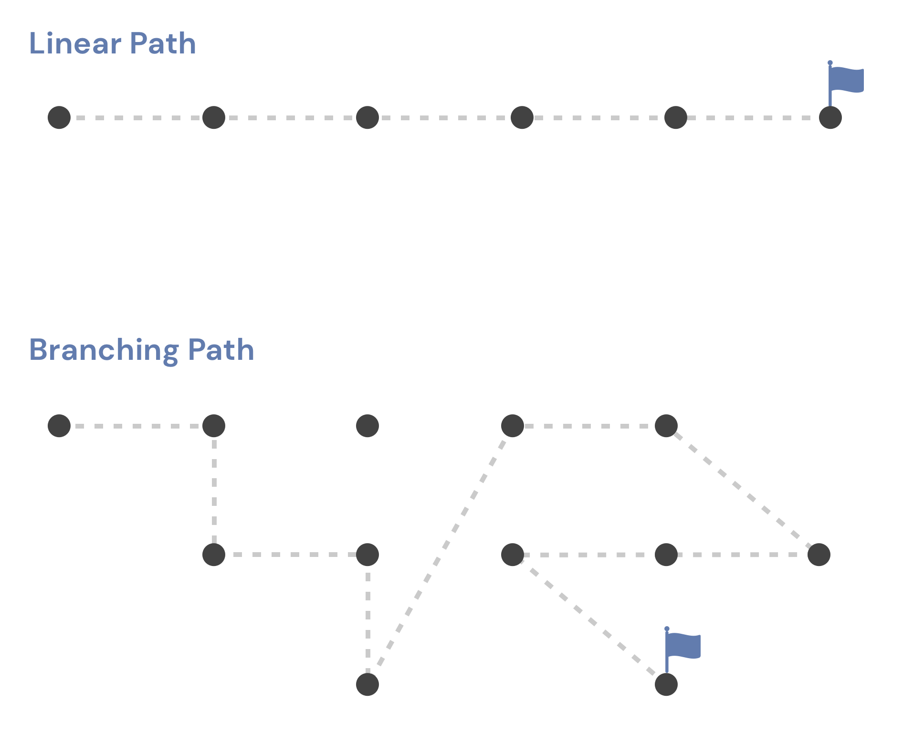
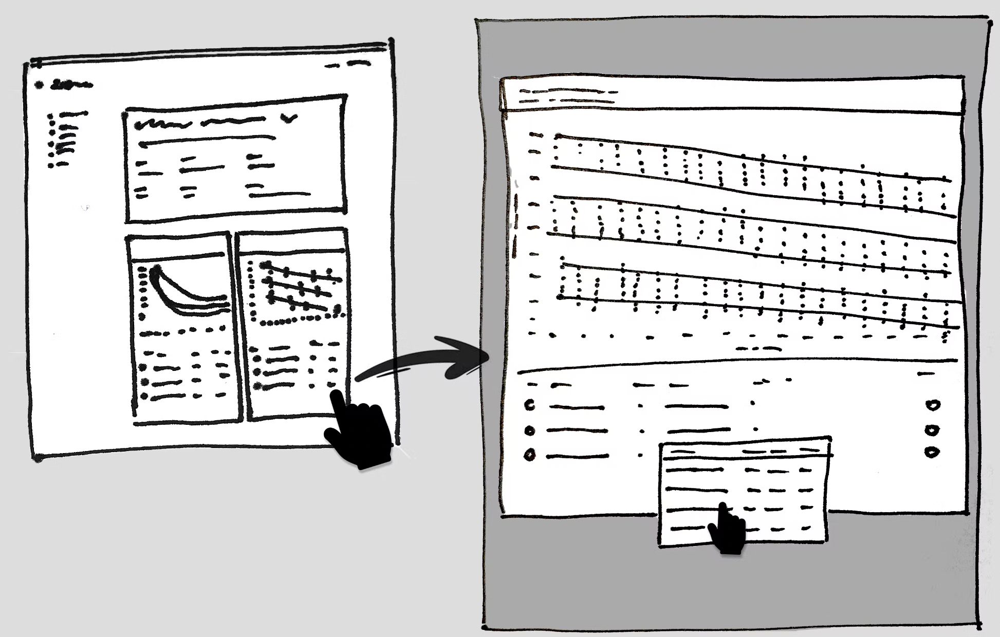

We need a better understanding of the people who will be using our data visualization products in order to build them. However, I have found that creating a product utilizing data visualizations with the goal of providing insight is fundamentally different from a typical user-centric web experience, although traditional UX process methods can help.

This is the first of a two-part series written to create better data visualization experiences. The first part of the series will talk about UX processes that are unique to data visualization and analytical exploration. In the second part, we'll talk about some of the questions to ask before making a user experience.

A typical user flow funnels users toward a set of actions they must take in order to achieve a desired outcome.

3 Fundamental Rules of User Flow:

- The purpose of the user flow should be crystal clear
- Guide the user along a single path
- Demonstrate the completion of a desired task

The linear model breaks down for websites designed to offer data-driven insights. Users no longer need to be directed to another page after accessing the most critical exploration and discovery sections. The goal is to go out and explore. We don't want users to leave this page, even if they have the option to do so; we would like them to stay and actively engage.

On the other hand, using a dashboard expands the number of activities that may be taken exponentially. There are many things a user can do on this page, but how many options are there? Count the number of charts and then multiply that number by the number of filters you have. To get this amount, multiply it by the number of sortable fields and/or toggles you have available. It quickly turns into a maze of divergent paths.

Charts and graphs don't always reveal the full picture regarding complex questions. As a rule of thumb, it's best to start by looking at a single chart, then filtering it to a specific time period, and so on. Uncovering the information you're looking for may take some time and effort. Most designers assume that a user's path through a product is straight when creating its user experience (UX). A branching journey is required for most data-driven products.

Complexity and unpredictability are the hallmarks of branching user flows. It's a welcome change to be allowed to explore hundreds of different paths of discovery.

In recent years, UX designers have begun to view user experience as task-based rather than personality-based. Many UX experts advocate for a Jobs to Be Done (JTBD) framework rather than relying on stereotyped user personas.

*"The Jobs-to-be-Done Theory provides a framework for defining, categorizing, capturing, and organizing all your customers’ needs. *

*Jobs-to-be-Done Theory provides a framework for defining, categorizing, capturing, and organizing all your customers’ needs.”*

*Tony Ulwick 2017 *

*https://jobs-to-be-done.com/jobs-to-be-done-a-framework-for-customer-needs-c883cbf61c90*

We, as humans, have a limited amount of time on this planet. Because of these restrictions, we can only use a few products to complete complicated tasks. Once the task is completed, the story's beginning, middle, and end are clearly delineated.

Data visualization products can be developed more effectively with the help of JTBD. People turn to data to complete tasks and achieve goals that were previously beyond their reach. In contrast, data comes with its own set of challenges. It is not uncommon for us to face more questions than tasks.

Users of data visualization software have a predetermined set of questions they want answered. If you're looking at data, you do so because you have a specific goal. Our job is to anticipate these questions, so we create datasets that make it easy for users to find the information they need.

It's not always clear what the questions are at first. To prepare for workshops, it's helpful to use tried-and-true UX methods like user interviews and empathy mapping. Describing a user's role, desire, and motivation through user stories is possible.

Telling stories about the people who use data can get the ball rolling on discussions about its potential applications. In addition, it illuminates the motivations behind the pursuit of specific insights. What can we do with these tales now? Each of them can be asked a question (or multiple questions). We begin by creating a list of features for our data-driven site to address these concerns and questions.

The design process typically begins with a list of features! Rough sketches, wireframes, and mockups are then created to get it right the first time.

This initial "discovery" phase is critical for the best data visualization product. The first step in creating a solution is to figure out what we're building and what questions we need to answer.

Your first questions as you begin to develop data visualization should be about the value it provides to your consumers about their objectives, as well as how best to display it, and how to ensure that your data is high-quality.

Who are the data and information being created for?

Many users may have mental models pre-established within the material's context that should be leveraged to create more intuitive experiences.

Additionally, the following questions may be beneficial:

- What particular benefit does this visualization provide?
- What type of exploration might a user choose to explore in?
- What is the efficient and effective method to convey the key data?
- Which data points are most crucial?
- What mental models and terminology may divide data into subsets?
- Is it to be interactive, dynamic, or simply present relevant information?
- How can it be tested?

The second part of the series will address many technical aspects to consider when creating a user experience focused on [data visualization](https://gregchartrau2012.myportfolio.com/) and analytical exploration of information.
