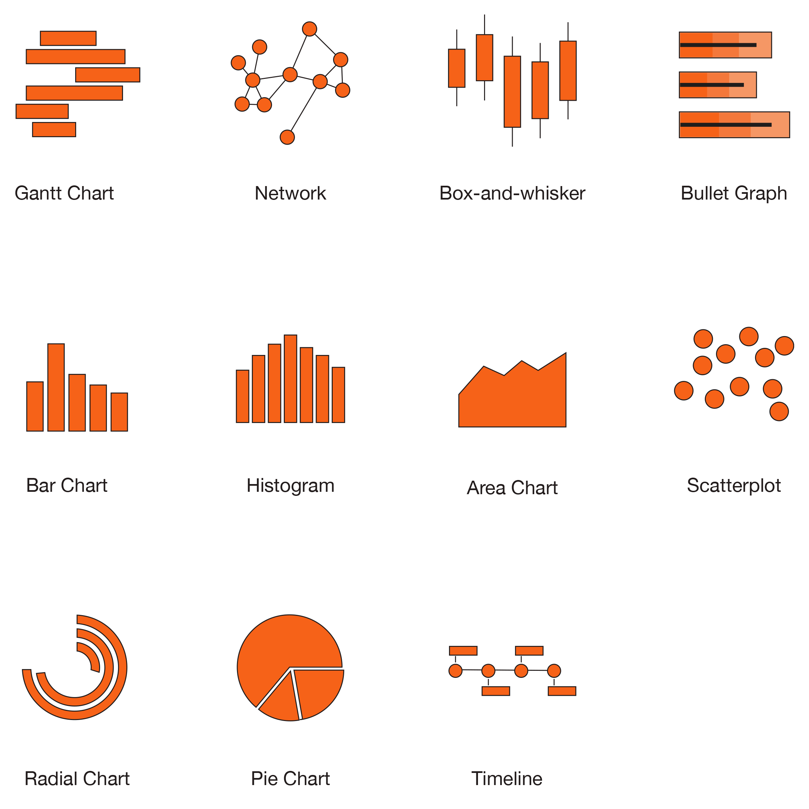

As early as 2006, Clive Humby, a renowned British mathematician and marketing genius, declared, "Data is the new oil." Business intelligence (BI) and data visualization are still ever-growing concerns. Data went from being scarce, expensive, and difficult to collect and process to being abundant, inexpensive, and incredibly difficult to analyze.

This is when the idea of big data emerged. Large amounts of information were so vast that they were hard to capture, store, understand, and analyze using traditional software. This information is useless if individuals can't understand it. A gigabyte of data housed in a data center is a nuisance, but if properly handled, it may be transformed into digital gold.

However, if you don't have a Ph.D. in data science, the raw data might be difficult to comprehend. This is where data visualization comes in. Big data is frequently coupled with algorithms to develop predictive analytics for various learning methods that continue to highlight the value of the data. It allows us to change the way we perceive the data in order to gain a more vertical understanding of the information presented and identify new patterns and trends. Data visualization truly empowers users of almost any kind because it gives them specific and actionable perspectives.

## Modeling of Graph Data

Data modeling is the process of turning your ideas about your data into a logical model that can be used to make sense of it. During the graph data modeling process, you decide which entities in your dataset should be nodes, which should be links, which should be discarded, etc. The result is a blueprint of your data’s fundamental elements, relationships, order, and properties. You can use that blueprint or schema to create a chart visualization model.

"You can add significant value to your users' experience simply by adding some custom interactivity to your data visualizations using an API and an embedded framework." - João Matos, Data Scientist, Walgreens

## Flexible Business Intelligence

The resulting schema allows for flexibility when creating data visualizations. Business intelligence systems come in two types: one is for reporting, and the other is for making analysis fun and easy with interactive, graphical tools. In data storytelling, visualizations tell stories about how analytical conclusions are reached and why they are essential to the user. This helps people work together. The more people use self-service visual analytics solutions, the more opportunities they have to uncover why something is happening. This can help people bridge the gap between reporting-focused enterprise BI systems and more advanced analytics systems. The tools can make changes as their needs change. Are they getting the right information at the right time, in the right format, to the right person?

## Common Visualization Methods

## Choosing the Right Visualization Style

With so many available, choosing the best method can be critical. Some kinds of data visualization are uniquely suited to how our minds operate, and we begin to make meaning of them instantly. For example, while humans are exact and efficient in estimating objects' length and location in two-dimensional space, we are less adept at rapidly and accurately estimating angles, area, or color.

For this kind of thing, pie charts aren't handy. They take integers and encode them as circular slices. This implies that the numerical data is shown in three ways. The angle of the slice, the area, and the outside circumference's arc length. It is easier to compare lengths on straight lines than on curved lines, especially when they do not begin in the exact location. That implies these charts are less effective for comparing statistics with any degree of accuracy. If you have a few slices of the chart that are all drastically different in size, this is OK but requires significantly more effort to interpret than a bar chart containing the same data.

In the case of a dashboard, there are likely going to be several of these on the same page. Thus, the cumulative impact is that it is far harder to discern the information. Along with this, because the statistics on a dashboard change rapidly, there will be frequent and minute changes.

## Choosing the Right JavaScript Data Visualization Library

JavaScript has a lot of libraries that make it easy to show data, graphs, charts, animations, and even add interactivity. These are a few important reasons that choosing the correct library is critical to how we build things and what we will be able to do with them in future development. One particular thing to consider when making your final selection of a JavaScript Data Visualization Library is the ability to customize the content.

*Here is a list of the popular JavaScript data visualization libraries. *

## Choosing the Right Visualization Type

As mentioned earlier, there are many types of data visualization. Some methods are better suited for customization or ease of use, whereas others may provide more advanced interactivity. Deciding which method is best suited for your needs is essential. Some things to consider are listed below.

- **Customization** - What kind of style and design features are available? Some situations require rigorous [control of color](https://gregchartrau2012.myportfolio.com/) and styling to stay in line with the brand's rules.
- **Rendering Methods** - The render method draws the chart on the page. It is the primary method that has to be called after configuring the options.
- **Easy-to-use** - One often overlooked area is the learning curve associated with the library. The ability to add new team members and transfer knowledge are important to think about.
- **Support and Documentation** - In the current era of constantly changing trends in development, documentation is more critical than ever. Without good support, developers are limited in the value they can extract from the data.
- **Interactivity** - Consider if the data needs to be interactive for the user. Some of the libraries are much more robust in their interactive capabilities.

In the realm of enhancing data visualization, embracing innovative tools is crucial. The integration of an [**artificial intelligence photo extender**](https://picsart.com/ai-image-extender/) can significantly shift how we perceive graphical storytelling. By expanding imagery in data presentations without losing context or detail, we offer a more immersive understanding of the underlying narratives.

## In Conclusion

Many solutions for integrating your data into custom and powerful data visualization tools are available these days. Choosing the right tool and fully understanding how the users intend to use the tool is critical. These kinds of products have UX processes and technical problems unique to the tasks they are meant to help people with.

Throughout this article, we introduced several important factors to consider before undertaking a data visualization and analytics product design project. These include data modeling, libraries, requirements, and more. I hope that in your next project, you can ask the right questions and use your user-centered tools to help individuals learn.
