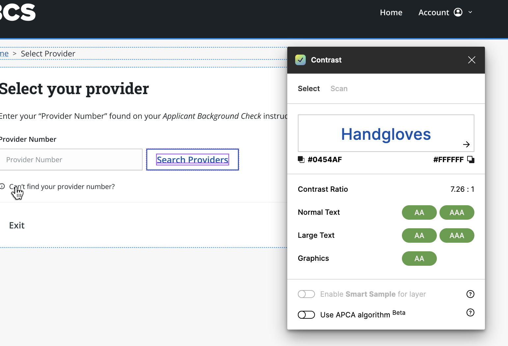

In 1990, the Americans with Disabilities Act (ADA) was a landmark civil rights law enacted in the United States. On a broad scale, the ADA ensured equal rights for individuals with disabilities. In the digital world, the ADA focuses on accessibility in applications and websites. Designing for all abilities can be achieved by ensuring products aren’t focused solely on visual, auditory, and motor-specific aids.

When creating an accessible product, the four foundational solutions are:

*Keyboard navigation as a primary function*. For most users, relying on a mouse is expected, but for individuals with motor impairments, designers need to allow an application to be fully functional through a keyboard. This includes navigation and actions.

*Using proper labeling for form fields*. For users with visual impairments (including other impairments), forms can be confusing without proper structure and labeling. Structuring form inputs in a vertical layout can ensure the relationship between labels and input fields is clear.

*Text alternatives to images*. If an application relies on images to convey information, such as icons for navigation or illustrations for messaging, designers must provide alternative text to users with visual impairments. Though this is enacted in the HTML of the product, UX Designers can assist developers in providing the proper alternative text to convey the message that was designed. Designers can also add tooltips to imagery that stands alone (without labels) to allow clarity to all users.

*Color accessibility and font-sizes*. Constraints can be a useful tool when setting up a product because it can require a designer to create systemically. For all users, products using colors to convey messaging that fail the WCAG accessibility standards can be confusing and disruptive. The Web Content Accessibility Guidelines (WCAG) provides a standard of testing for colors and font sizes in the form of 3 levels (A, AA, and AAA) that can be used as a system for decisions. All products should be rated as AA at a minimum (with exceptions to decorative messaging), but in some cases, AAA should be the goal. This rating checks the ratio of foreground and background colors to make sure a product is accessible. With colors, the guidelines also provide rules for text-sizing in different circumstances.

It is our responsibility as designers and developers to create compliant products to usher in an accessible future, but in some instances, it is *required* to follow these guidelines when creating products for government agencies that are audited. When viewing all users as a diverse group, we can create software that empowers and continues to promote an accessible future.

Let's make accessibility a priority! [Contact us to get started on your journey towards an inclusive digital world. ](https://www.improving.com/contact)

*Note that there are many recommendations set in the WCAG that were not mentioned. If you are in the process of creating an accessible product, or in the planning stages, I would recommend you start exploring the guidelines today.*
