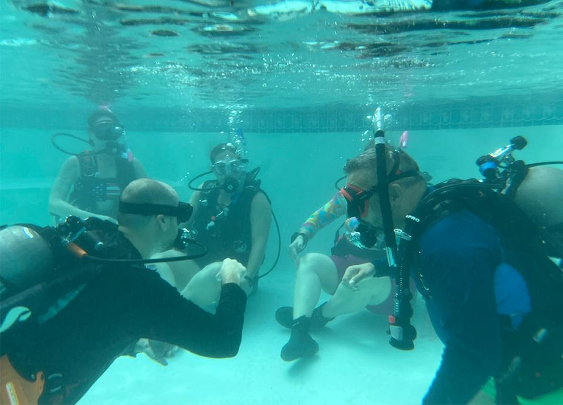
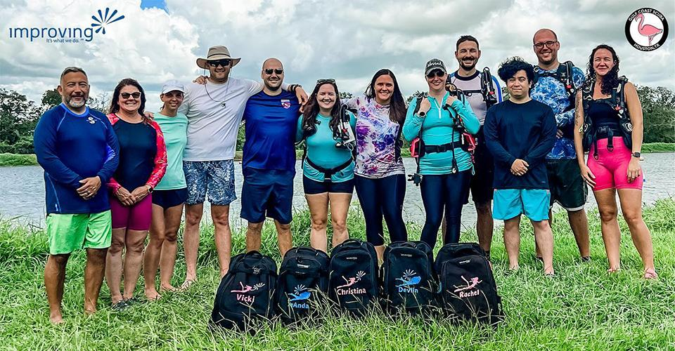

Crossing off a bucket list item feels amazing. And thanks to Improving, several improvers (including myself) got to do just that this summer!

Improvers are known for going above and beyond. If you’ve been to one of our BBQ or movie night events, then you have seen this firsthand. When it comes to hobbies, It’s no surprise that the list spans far and wide.

We have golfers, skydivers, cyclers, ranchers, and specific food enthusiasts. We even have race car drivers, surfers, dancers, and marathon runners! Need a photographer? We have one on hand. Music for an event? No problem. The list goes on and on!

When a group of adventurous Improvers gets an idea, we tend to find a way to make it a reality. It’s even more fun when a fellow Improver and her husband are Dive Masters and Instructors! So…they make an ImprovingU SCUBA class! ImprovingU is our Internal training program, similar to an internal university, that is dedicated to personal and professional growth.

In Houston this summer, seven Improvers and our significant others spent two weekends in and out of the water learning how to SCUBA dive. These days were packed with lots of review and practice but getting to share this experience and memories with friends was so worth it. The first weekend, we were in the controlled environment of a swimming pool. We got comfortable with the gear, used skills we learned in the classroom and started to understand the physics of it all.

I was amazed by the mix of scientific breakthroughs, the understanding of human physiology, and the practical use of modern technology that enables a SCUBA unit to operate so efficiently and allows us to breathe normally underwater. With that, a sense of deep relaxation immediately took over because I was focused on my breathing. All other senses were quieted. I heard nothing else and thus nothing came in the way of me enjoying the underwater world.

The second weekend, we ventured out into the open water of Mammoth Lake, which is a specially designed SCUBA diving park in Lake Jackson, TX. Here, we repeated the skills we learned in the pool, but in a real-world environment. Descending to about 25 feet, we worked on our buoyancy, how to react if something goes wrong with our equipment, and basic rescue drills.

It was an exhilarating feeling to be down that deep and breathing underwater. One of the best parts of SCUBA diving so far has been the feeling of weightlessness and freedom of movement. You are freed from gravity. You feel weightless as if you are flying! It's an interesting feeling knowing how heavy the equipment is while you stand on land compared to how it feels when you dive underwater. Experiencing the freedom of movement and the feeling of being able to fly up, down, left, and right, with just a small movement is amazing.

After everyone Aced the drills, we got to do a little exploring of the SCUBA park.

Mammoth Lake has a variety of attractions that have been placed all over the bottom of the lake. There were boats, metal sculptures, vehicles, a submarine, and even an Air Force C130 Cargo plane. We spent about 45 minutes depth swimming around and exploring the incredible underwater world.

After the weekend was over, all of us came away with SCUBA Schools International (SSI) Open Water Certifications. We didn’t even make it out of the parking lot before we were scheduling our next dives. We were hooked and could not wait to get back in the water.

For me, learning how to SCUBA dive had been on my bucket list for several years. The thought of exploring the underwater world was exciting and the community that comes along with SCUBA diving is vast! I have loved getting to hear the excitement in veteran divers’ voices when they find out we’re new to this world. They give us so many dive spot recommendations that we don’t think we’ll be able to make it to all of them, but we are determined to try.

What is next for the group of SCUBA diving Improvers? We will be working on our deep-water certification. Getting to share this experience with friends has been an amazing adventure and I can’t wait to see what adventure awaits us next!
