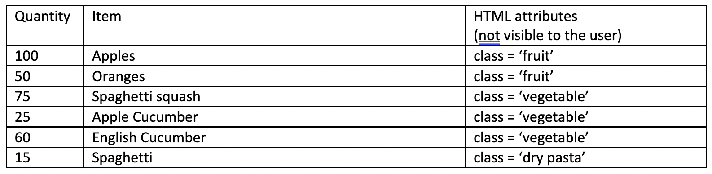

I’ve been using Cypress.io for software testing for the last 7 months or so it’s been a really enjoyable learning experience. Much of the goodness of Cypress is that it constrains you in the right ways to encourage reliable, readable, and well-organized test code. But it can make things a bit unintuitive at times, so I thought I'd make a series of blog posts about real-world usage tips I've learned to make your life easier as a Cypress.io user. The basics are easy to pick up. For maximum reliability, you're encouraged to add attributes to your Html to help find the elements you want to test:

`
32767
`

`<button data-cy="submit" class="submit-button">Submit</button>`

You can also test based on other attributes, such as the **class=”submit-button”** in the above example, but in many web projects, it can be more reliable to just use the proposed **data-cy.**

So, to test these you can write something like:

`cy.get('[data-cy=submit]').click();`

or

`cy.get('[data-cy=PO-number]').contains('32767');`

Simple, right? But testing is often about things that don't quite match up! Not long after I started using Cypress.io, I realized I needed to use **cy.get() **on some elements that used a randomly-generated GUID in the **data-cy** attribute, like

`<list-item data-cy="item-7774db2d-5eb5-40d9-9a02-ed9b380d47df-detail-view">Red Delicious Apples</list-item>`

So, my code to click this would look like:

`cy.get('[data-cy=item-7774db2d-5eb5-40d9-9a02-ed9b380d47df-detail-view]').click();`

Don't get me wrong, this does work! However:

- Selecting that item by GUID in my code was not very readable. I'd have to add a comment reminding me which item I was trying to click or find some other way to make this maintainable when it broke in the future.
- The GUID changed periodically when the list was updated, meaning the breakage was going to happen pretty often! Fortunately, Cypress.io provides some useful tools for this situation. You can find elements that BEGIN with known text:

`cy.get('[data-cy^=item-]');`

Also, elements that END with known text:

`cy.get('[data-cy$=-view]');`

And, even elements that CONTAIN known text:

`cy.get('[data-cy*="-detail-"]');`

These statements, as written, will return ALL the items that meet those criteria, which is not useful if you're looking at a list and want to click on one specific element. For that, in this case, I’ll chain the **.contains() **method. So, in my case this is exactly what the doctor ordered:

`cy.get('[data-cy^=item-]').contains('Red Delicious Apples');`

This command will find the items that have a **data-cy** attribute that STARTS with "item-" *and* that contain the string "Red Delicious Apples", regardless of the GUID or other attributes. Now let’s talk about **cy.contains(),** which I’ve found has a lot of unexpected utility. It’s commonly used to find text on a page, such as in this block which verifies all the items in a purchase order are displayed somewhere on a summary screen:

`for (var lineItem in purchaseOrder) { `

`cy.contains(lineItem); `

`}; `

However, it can also be used to return a list of items on a page or in a list based on text contents instead of tag contents. You’re going to get very familiar with chaining methods in cypress! Take the following table:

Using **cy.contains()**, we can easily return all the elements that contain a string, and using **cy.get()** we can return all the elements that contain an attribute. Similar, but useful in different ways.

**cy.get(‘[class = vegetable]’)** selects all the items with that attribute, and you can narrow them down with **cy.contains()**, like:

`cy.get(‘[class = vegetable]’).contains(‘Apple’).click();`

The above line finds items with the **[class = vegetable]** property, and narrows them down to the ones that also contain the string “Apple.”

Now we’re going to get a bit ahead of ourselves, but it will illustrate the power of **cy.contains()** and gives you a taste of what’s coming up in the next post!

`cy.contains(‘Apples’).closest(‘[data-cy=PO_line_item]’).contains(‘100’); `

This statement finds the string “Apples”, then looks for the closest chunk of Html with the **[data-cy=PO_line_item] **property, which happens to be that entire table row. In practice, you'll often need to use your browser to inspect the HTML to make sure you understand the structure of the nearby data.

Then we use **cy.contains()** again and verify that the table row *also* contains the text “100”! Since our table is very simple, this test is not terrible. There is some value in a vague test; it will often continue to work even if the page layout is changed.

I’ll talk about using some of Cypress’s other chainable methods to write more specific tests in future posts! To learn more about Cypress.io [reach out](https://improving.com/contact)!
