## What Is Power BI?

The reporting channels and standards for global enterprises have been changing drastically with the growing use of data-driven decisions. In a highly competitive environment, businesses need to drill into every nook and corner of their enterprises to make critical decisions. This has led to a growing challenge in the field of Reporting and Business Intelligence which has led to the evolution of market leaders in this field.

One prime player in this space who has remained consistently on top is Microsoft’s Power BI. Power BI is a powerful tool for data analysis and visualization. The key difference that makes this tool special is its monthly updates. Each update leverages the latest algorithms, advanced machine learning, and AI to build in some unique features which make this tool stand out in the market.

Power BI as a tool provides the end-to-end implementation of reporting analytics. Starting from data cleansing, to architecting the data model, building relationships/joins, visualizing the data, and finally publishing the report on web Power BI has it all. It is a one-stop solution.

Power BI is available as a desktop tool and as Power BI service which is the online web version. The key components for report creation in Power BI desktop are:

*Power Query Editor:* is a data transformation and data preparation tool available within Power BI Desktop. (Refer to Fig 1 & 2)

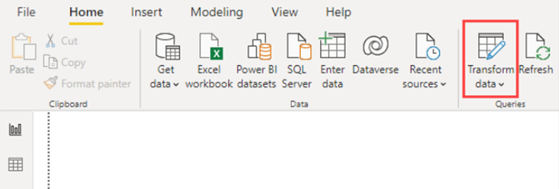

Fig. 1

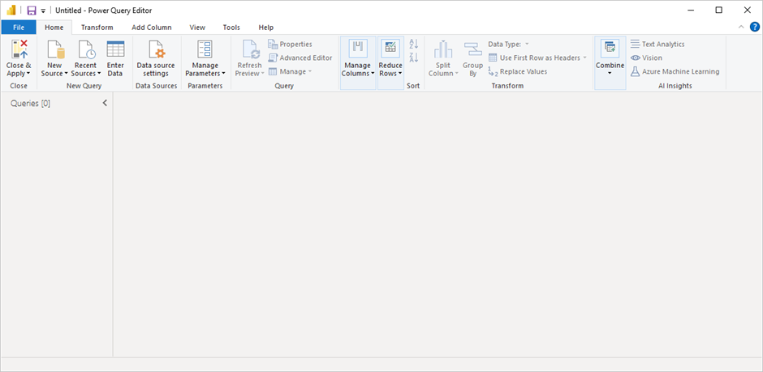

Fig. 2

*Model View:* this is the section where you design and manage the data model for your report. (Refer to Fig. 3)

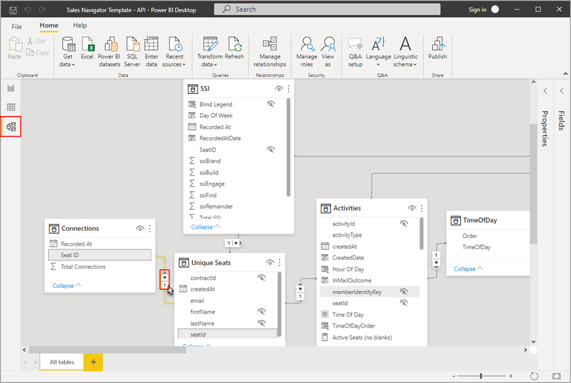

Fig. 3

*Report View:* this is the section where you create the report using different visualizations. (Refer to Fig. 4 & 5)

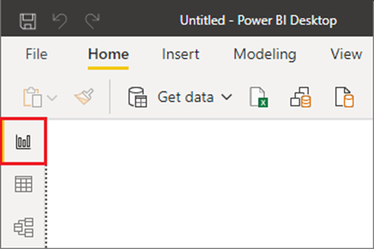

Fig. 4

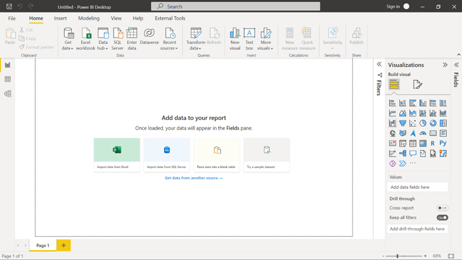

Fig. 5

Notable features are in the visualization section of Power BI. Here businesses can visualize and analyze their data using all the existing data analytics techniques and visualizations which anyone can possibly imagine. Visualizations like Q&A, key influencers, smart narratives, and customized R/Python visuals are unique and readily available in Power BI.

In this blog post, we will be deep diving into Power BI’s intensive visualization capacity using some of these unique visualizations.

## Power BI Q&A to explore your data and create visuals

For any data analyst, the fastest way to analyze data is to ask questions. Supporting the same context Power BI has a dedicated visual which does that for you. The Q&A feature in Power BI lets you explore your data in your own words. (Refer to Fig. 6 & 7)

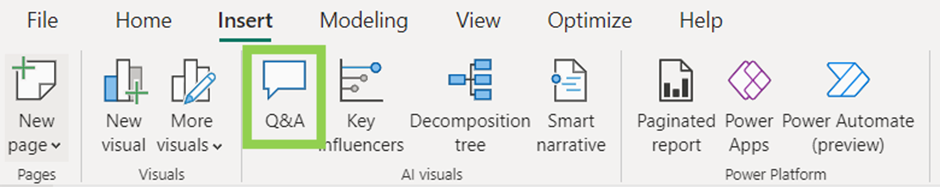

Fig. 6

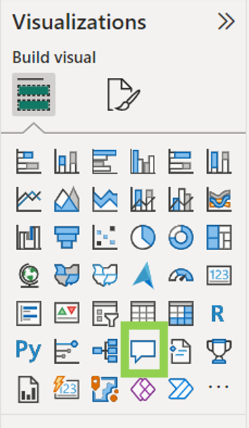

Fig. 7

The visual can either be inserted from the heads-up ribbon under the insert section or via the visualizations pane on the right in Power B desktop. After inserting the visual a Q&A question box displays on your report canvas. (Refer to Fig. 8)

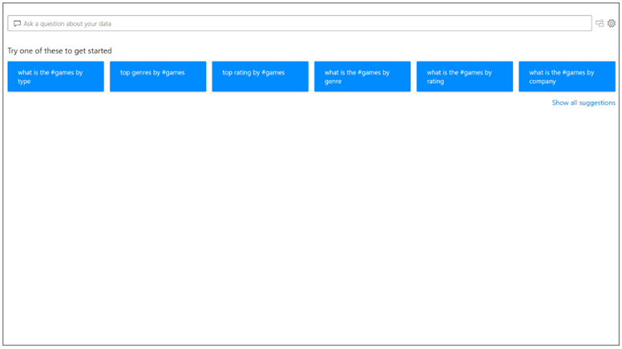

Fig. 8

Even before you start typing, Q&A displays a new screen with suggestions to help you form your question. Start from one of the suggested questions or type your own question. It supports a wide range of questions.

As you type your question, Q&A shows relevant and contextual suggestions to help you quickly become productive with natural language. As you type, you get immediate feedback and results. The experience is similar to typing in a search engine. (Refer to Fig. 9)

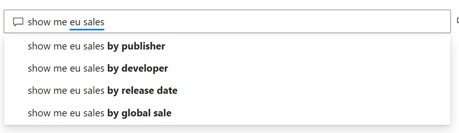

Fig. 9

Q&A shows words with underlines to help you see which words the system recognized or didn't recognize. A solid blue underline indicates that the system successfully matched the word to a field or value in the data model. (Refer to Fig. 10)

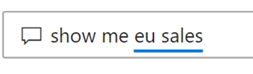

Fig. 10

An orange dotted underline indicates that the word or phrase is categorized as low confidence. If you enter a vague or ambiguous word, the field is underlined in orange dots.

A red double-underline means Q&A didn't recognize the word at all. (Refer to Fig. 11)

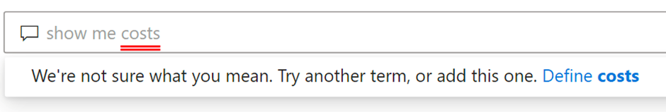

Fig. 11

As you enter your question, Q&A tries to instantly interpret and visualize the answer. It tries to interpret the question and plot the fields automatically to the correct axis.

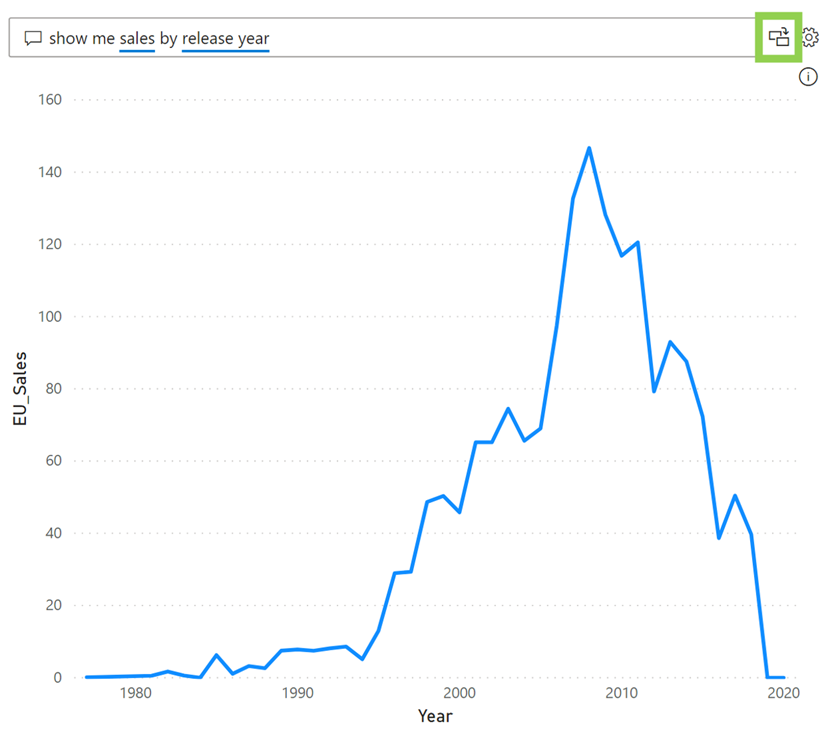

Fig. 12

(For example, if you enter 'Sales by year', Q&A detects that year is a date field and always prioritizes placing this field on the X axis. The generated answer can be converted into another visual by selecting the icon highlighted in the above image. Refer to Fig. 12)

## Power BI Key Influencers Visual

Key Influencers visual is a powerful tool used to identify the factors that most significantly influence a particular metric or outcome in your data. It helps you understand which variables have the strongest impact on a chosen measure.

Identifying Top Contributors, Optimization and Decision Making, Root Cause Analysis, Predictive Modelling, Performance Evaluation, User Behaviour Analysis, Product Analysis, and Risk Assessment are some of the use cases where this visual can be easily used.

To create this visual simply click on the key influencers’ visual icon on the visualisations pane as shown below. (Refer to Fig. 13)

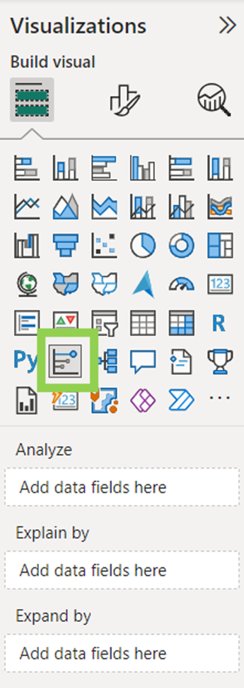

Fig. 13

Move the metric you want to investigate into the Analyse field. Move fields that you think might influence the metric into the Explain by field. The Expand by field can be left empty. (It is only used when analyzing a measure or summarized field.)

Below is a simple example of a key influencer visual. (Refer Fig. 14) Here, we are analyzing what influences Income Level to be high. The top influencer is Current Age; if your current age is between 47 and 90 then your income level is 11.96 times more likely to be high.

Fig. 14

The Top Segments tab is used to determine how a combination of factors affects the metric being analyzed. (Refer to Fig. 15)

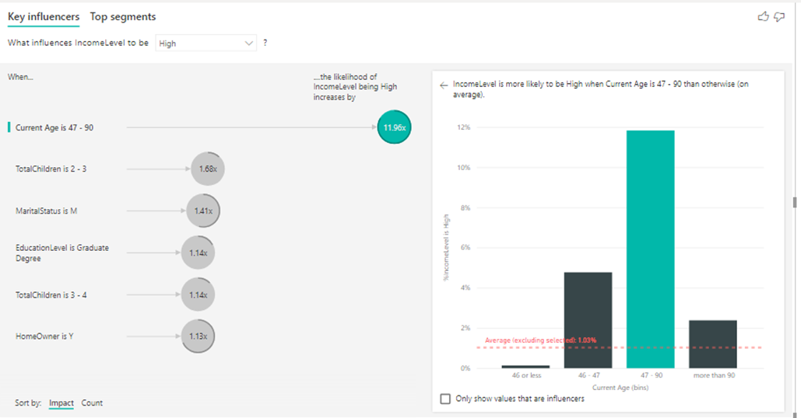

Fig. 15

Here the visual has found the top 5 segments where the income level is more likely to be high. The segments are ranked by the percentage of high levels of income within the segment. The higher the bubble the higher the proportion of high-income levels. The size of the bubble represents how many individuals are within that segment.

If we select segment 2, we can find a detailed description, shown below. (Refer to Fig. 16)

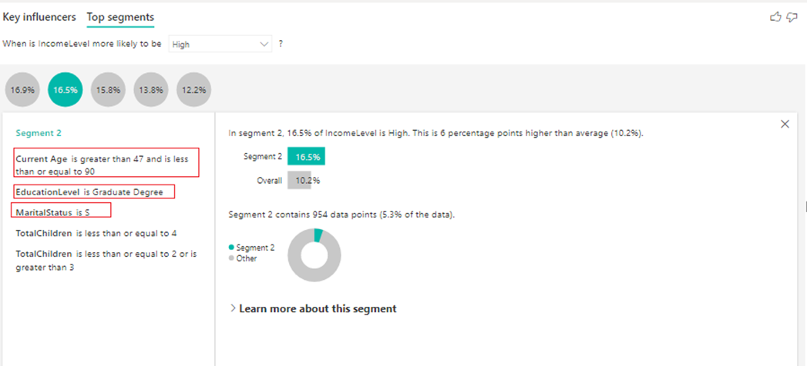

Fig. 16

(16.5% of people indicated a higher level of income. On average a higher level of income was indicated 10.2% of the time. So, this segment has a larger proportion of high levels of income. It’s 6 percentage points higher. It also contains approximately 5.3% of the data. Each of the other segments are analyzed in a similar manner.)

## Power BI Smart Narratives Visual

Power BI Smart Narratives visual is a feature that allows you to automatically generate narratives or natural language explanations for your data insights. It transforms the data analysis and visualizations into human-readable text, making it easier for business users to understand and communicate the findings effectively. It leverages natural language generation (NLG) technology, which is a subset of artificial intelligence that converts structured data into human language. It analyses the data, identifies patterns, trends, and key insights, and then generates a written description of those findings.

Smart Narratives can be used for narrating an entire page, a single visual, or as an icon to a visual.

***Smart narrative for a page:*** Simply select a page in your report and click on smart narrative visual in the visualizations pane. The narrative can be edited and pinned to the report. (Refer to Fig. 17 & 18)

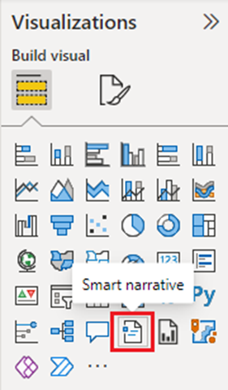

Fig. 17

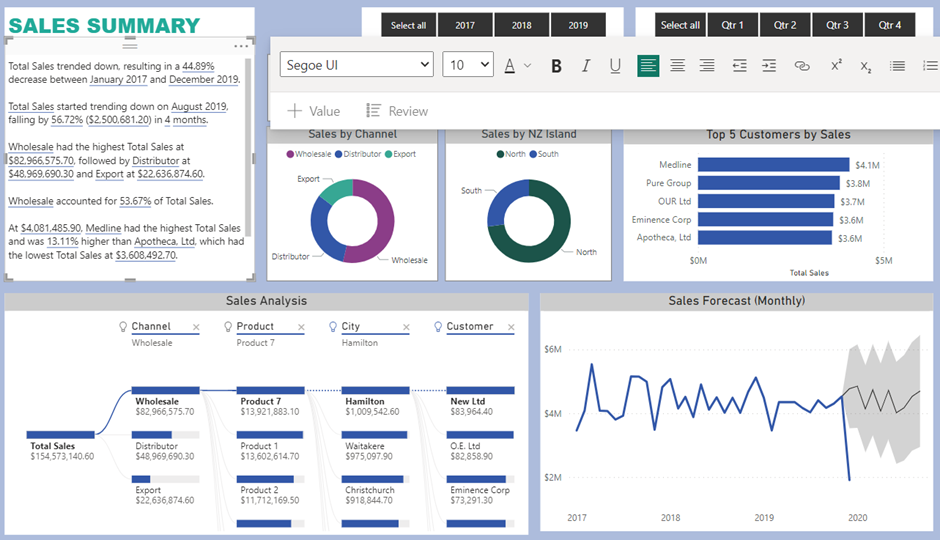

Fig. 18

***Smart Narrative for a visual:*** Simply right-click on a visual and click on summarise. The narrative can be edited and pinned to the report. (Refer to Fig. 19 & 20)

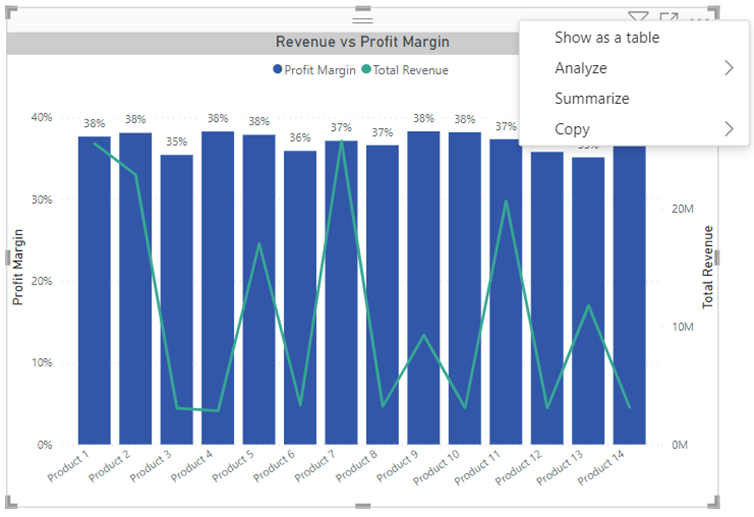

Fig. 19

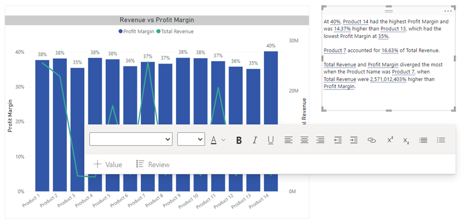

Fig. 20

***Smart Narrative icon to a visual:*** Select a visual, and in the Format pane, select General. Expand the Header icons section, then expand the Icons section, and set Smart narrative to “On” (Refer Fig. 21). When your report readers hover over that visual, they can see and select the Smart narrative icon, to expose a text explanation of the visual. Only in this case, the narrative can't be pinned to the report.

Want help with your Power BI journey? [Reach out to us.](https://improving.com/contact)
