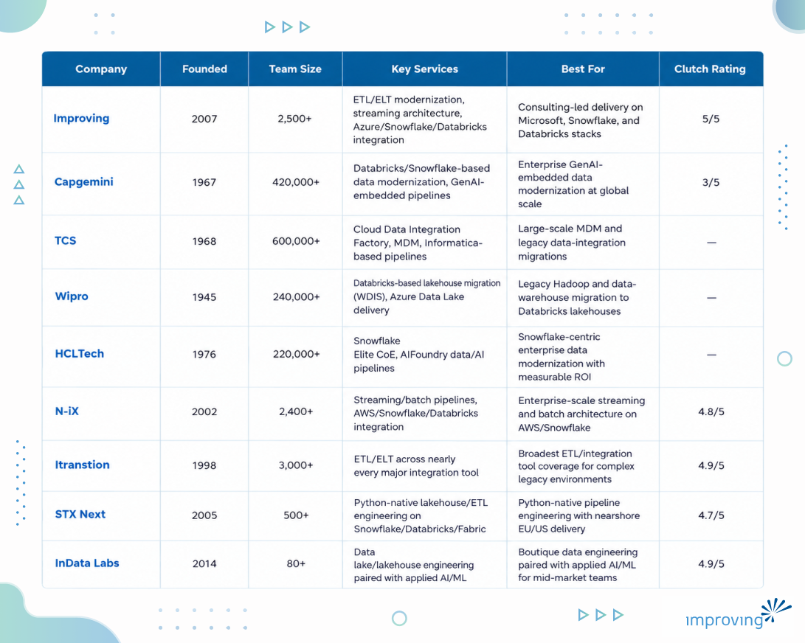

A stalled analytics rollout. A legacy pipeline nobody wants to touch because it might break if you look at it wrong. A pile of point-to-point integrations that quietly fail every time a source system changes. For most enterprises, the moment they realize they need a data integration and engineering partner is also the moment they can least afford to pick the wrong one. This guide breaks down what actually separates a dependable delivery partner from a risky one, and where nine of the field's most established names land on that spectrum.

## **Executive Summary**

Data integration and engineering is the discipline of connecting fragmented systems, moving data reliably between them, and shaping it into a form analytics, applications, and AI models can actually use. Done well, it replaces manual reconciliation and stalled reporting with a single trusted data foundation the rest of the organization can build on.

This guide walks through nine established data integration and engineering companies and outlines how to assess partners based on platform certifications, real-time and streaming capability, governance discipline, delivery model fit, and a proven, quantified track record. It also breaks down when to bring in outside help versus building in-house, with the goal of choosing a partner who can operate as a long-term data foundation rather than a one-off project team.

## **Who Is This Guide For?**

- **Chief Technology Officer (CTO):** Evaluating whether to build an internal data engineering team or bring in a partner to accelerate a stalled integration or modernization program.
- **VP of Engineering or Data:** Comparing platform-specific delivery expertise (Databricks, Snowflake, Azure, AWS) across vendors before committing budget to a multi-quarter program.
- **Procurement or Sourcing Lead:** Benchmarking pricing models, delivery locations, and contract structures across global systems integrators and boutique specialists.
- **Head of Data Governance or Compliance:** Assessing which partners build lineage, quality, and access controls into delivery from the outset rather than as an afterthought.
- **Director of Analytics or BI:** Looking for a partner who can unblock downstream reporting and AI initiatives stalled on unreliable or fragmented source data.

> *Each of these roles shares the same underlying goal: a data foundation reliable enough to support real-time decisions, not just periodic reports.*

## **What Is Data Integration & Engineering & How Does It Work?**

Data integration and engineering is the practice of connecting disparate systems, applications, and data sources, then designing the pipelines, architecture, and orchestration that move and transform that data reliably at scale. It covers everything from batch ETL jobs that run overnight to real-time streaming architectures that move events as they happen, and it underpins nearly every downstream analytics, reporting, and AI initiative an enterprise runs. Buyers typically engage a partner either to build this foundation from scratch, modernize a legacy pipeline that has become too brittle or expensive to maintain, or extend an existing platform to new data sources.

### Common models and approaches

- **Batch ETL/ELT:** Data is extracted, transformed, and loaded on a schedule, still the backbone of most enterprise reporting and data warehousing workloads.
- **Real-time and streaming integration:** Event-driven architectures (Kafka, Confluent, Azure Event Hubs) move data continuously, supporting use cases like fraud detection and live inventory tracking.
- **API-led integration:** REST, GraphQL, and iPaaS platforms connect applications directly, often replacing brittle point-to-point connections.
- **Cloud data warehouse and lakehouse modernization:** Migrating legacy on-premises warehouses to platforms like Snowflake, Databricks, or Microsoft Fabric.
- **Managed or fully outsourced data engineering:** A partner operates the pipeline and platform on an ongoing basis rather than handing off a one-time build.

### Key Advantages of Data Integration & Engineering

- **Unified, trusted data** by consolidating fragmented source systems into a single governed pipeline, giving business teams one accurate view of operations instead of reconciling conflicting reports.
- **Faster time to insight** through automated, fully managed ELT pipelines that free engineering teams from constant maintenance work. Organizations using this model are [nearly twice as likely to exceed ROI targets on the reclaimed time](https://www.fivetran.com/blog/the-enterprise-data-infrastructure-benchmark-report-2026), according to Fivetran.
- **Reduced integration overhead** by replacing custom point-to-point connections with reusable APIs and orchestration layers. [IT teams currently spend 39% of their time building custom integrations](https://www.salesforce.com/blog/mulesoft-connectivity-benchmark-2025/), according to Salesforce, a burden that shrinks once integration patterns are standardized and reused.
- **Real-time decision-making** enabled by streaming and event-driven architectures that move data continuously rather than in nightly batches, supporting operational use cases like fraud detection and inventory alerts.
- **Lower total cost of ownership** as consolidated pipelines and reusable connectors reduce the duplicated engineering effort that comes with maintaining dozens of one-off integrations.
- **Stronger governance and compliance posture** by centralizing lineage, access controls, and data quality checks in one architecture instead of scattering them across disconnected systems.

## **When To Use Data Integration & Engineering Services**

Most organizations do not go looking for a data integration partner until one of the following starts costing them real time or money.

- Analytics or BI initiatives are stalled because source data lives in disconnected systems that do not reconcile.
- Legacy ETL jobs are breaking frequently or taking too long to run as data volumes grow.
- A cloud migration or platform consolidation (to Snowflake, Databricks, Azure, or AWS) is on the roadmap.
- Real-time use cases, such as fraud detection, personalization, or operational dashboards, require data faster than nightly batch jobs can deliver.
- Compliance or governance requirements demand better data lineage and access control than current pipelines provide.
- Internal engineering capacity cannot keep pace with the number of new data sources being onboarded.

## **How To Choose the Best Data Integration & Engineering Partner?**

Use the criteria below to separate a partner who can execute from one who can only pitch.

1. **Platform and hyperscaler certifications:** Confirm the partner holds current certifications across the specific clouds and data platforms in your stack (Azure, AWS, GCP, Snowflake, Databricks). Certification depth is a reliable proxy for how quickly a team can operate independently in your environment.
2. **Real-time and streaming capability:** Ask whether the partner has delivered production streaming or event-driven architectures (Kafka, Confluent, Azure Event Hubs), not just batch ETL. This matters increasingly as [73% of organizations now operate hybrid cloud environments that require integration across heterogeneous platforms](https://www.flexera.com/about-us/press-center/flexera-finds-cloud-value-is-rising-while-ai-waste-grows), according to Flexera.
3. **Integration track record, not just staffing history:** Review named case studies with quantified outcomes rather than generic staff-augmentation claims. A partner who cannot point to a specific before-and-after metric has not proven they can execute at scale.
4. **Governance and data quality discipline:** Evaluate how the partner builds lineage, access controls, and data quality checks into pipelines from day one, since bolting governance on later is far more expensive than designing for it up front.
5. **Vendor evaluation transparency:** Look for partners willing to share security, compliance, and integration-capability documentation early in the sales process.
6. **Delivery model fit:** Determine whether a fully offshore, hybrid onshore/nearshore, or fully onshore team best matches your governance requirements, budget, and time-zone overlap needs.
7. **Cultural alignment and communication cadence:** Assess how the partner runs stand-ups, status reporting, and escalation paths across distributed teams, since data engineering programs typically run 12 months or longer and depend on consistent collaboration.
8. **Questions to ask directly:** How quickly can your team ramp up on our existing Snowflake or Databricks environment? What happens if our data volumes double mid-contract, does pricing or team size change? Can you show us a reference client at a similar data maturity level to ours?

> ***The right partner combines certified platform depth with a proven, quantified track record, not just headcount or a logo slide.***

## **Data Integration & Engineering Companies Compared**

## **Top 9 Data Integration & Engineering Companies**

### **1. Improving**

Improving Enterprises delivers data integration and engineering services built around modern pipeline architectures, real-time and batch data flows, and enterprise system integration, drawing on named partnerships with Microsoft, Snowflake, and Databricks. Its engineers hold platform certifications across Azure, AWS, GCP, Databricks, and Snowflake, and its delivery approach spans streaming and event-driven architecture (Kafka, Azure Event Hubs), ETL and ELT modernization (dbt, Spark, Azure Data Factory), and API design and management. This combination of platform-agnostic delivery and certified expertise positions Improving as a strategic contributor to enterprise data integration and engineering initiatives across industries.

#### Why Is Improving the Best Data Integration & Engineering Partner?

We pair consulting-led data strategy with engineering-led delivery, hybrid teams that combine onshore governance with distributed nearshore engineering capacity to keep large-scale integration programs both accountable and cost-efficient. Our platform-agnostic stance means we architect solutions around each client's actual data environment rather than a fixed technology stack.

- **NPS 90+:** among the highest in modern enterprise technology services.
- **7.5-year average partnership length:** built around long-term relationships, not one-off projects.
- **Global footprint:** 7+ countries, 3 continents, 21 offices, and 2,500+ consultants delivering data and engineering programs worldwide.
- **Key verticals:** healthcare, energy and utilities, financial services, manufacturing, retail, telecom, life sciences, and the public sector.
- **Platform stack:** Azure Data Factory, Synapse, Purview, Snowflake, Databricks, Confluent/Kafka.
- **Relevant strengths:** certified across Azure, AWS, GCP, Databricks, and Snowflake data-engineering tracks; proven streaming and ELT modernization delivery; platform-agnostic data architecture design.

> *As a Confluent Elite Systems Integrator and Premier Partner, we are proud to showcase our deep expertise in data streaming, integration, and engineering.*

> *- Ehren Seims, Lead, Global Alliances, Improving*

**Global Delivery Access**

Improving operates from 21 offices spanning the United States, Canada, Mexico, Argentina, Chile, Guatemala, Costa Rica, and India, giving data integration and engineering programs follow-the-sun coverage across time zones. This distributed delivery model lets clients pair onshore data architects and governance leads with nearshore and offshore engineering teams sized to the scope of each integration program.

**Proven Track Record**

[Integra Connect](https://www.improving.com/case-studies/integra-connect/), a healthcare technology company serving oncology and precision-medicine practices, ran on a legacy SQL Server data warehouse that could not scale within Azure, driving long processing times, rising costs, and blocked real-time analytics. Improving migrated the warehouse to Snowflake, using dbt for transformation, Azure Data Factory for orchestration, and Power BI for reporting. The result: data processing times dropped from several days to minutes, sharply improving operational efficiency.

**Strategic Advantage**

Improving's strategic advantage in data integration and engineering rests on three verified pillars: named technology partnerships with Microsoft (Azure Data Factory, Synapse, Purview), Snowflake, and Databricks; a certified engineering bench spanning Microsoft Azure Data Engineer, AWS Data Analytics Specialty, GCP Data Engineer, Databricks Data Engineer Professional, and SnowPro credentials; and delivery experience across Fortune 500 healthcare, energy, and financial services environments. That combination of platform-agnostic certification depth and named partner status is what lets Improving design integration architectures suited to each client's actual technology footprint rather than a one-size-fits-all stack. [Explore Improving's Data Integration & Engineering expertise →](https://www.improving.com/expertise/data/integration-engineering/)

### **2. Capgemini**

Capgemini delivers enterprise-scale data integration and engineering programs anchored in two branded offerings: Databricks on IDEA, an industrialized delivery framework the firm says accelerates workload deployment by roughly 40% over traditional approaches, and Capgemini RAISE, which embeds generative AI directly into data pipelines built on Databricks infrastructure. The firm also holds a strategic Snowflake partnership for cloud data-warehouse migration and modernization work.

**Quick Facts**

- Headquartered: Paris, France
- Team Size: 420,000+
- Key verticals: Financial services, manufacturing, retail/CPG, life sciences
- Key platforms/technologies: Databricks, Snowflake, AWS, Azure, GCP
- Relevant strengths: Industrialized migration accelerators, GenAI-embedded pipeline delivery, dual elite Databricks and Snowflake partner status

**Why Consider Capgemini?** Capgemini suits large enterprises that want generative AI capability built directly into their data engineering delivery, backed by elite-tier partnerships with both Databricks and Snowflake.

**Talent Pool Access:** Capgemini draws on a global workforce of more than 420,000 professionals across dozens of countries, giving programs access to specialized Databricks and Snowflake delivery teams regardless of region.

**Proven Track Record:** Capgemini holds global systems-integrator status with both Databricks and Snowflake, and publishes its "40% faster deployment" claim for Databricks-based data engineering work delivered through its IDEA framework.

### **3. TCS**

TCS delivers data integration through its Cloud Data Integration Factory, a migration engine built specifically for large-scale moves and running on Informatica's Intelligent Data Management Cloud, alongside a Master Data Management Center of Excellence for hybrid MDM programs. The firm has held Informatica Global Systems Integrator status for multiple decades, layering Talend, Apache Airflow, and cloud-native platforms like Databricks and Snowflake on top of that core delivery model.

**Quick Facts**

- Headquartered: Mumbai, India
- Team Size: 600,000+
- Key verticals: Finance and insurance, manufacturing, retail, life sciences and health, aviation and transportation
- Key platforms/technologies: Informatica IDMC/IICS, Talend, Apache Airflow, Databricks, Snowflake, Microsoft Azure
- Relevant strengths: In-house MDM Center of Excellence, cloud migration factory (CDIF) built for large-scale legacy moves, multi-decade Informatica GSI relationship

**Why Consider TCS?** TCS fits organizations running complex, multi-decade legacy environments that need a partner with an established master-data-management practice and a cloud migration factory built for exactly that kind of legacy complexity.

**Talent Pool Access:** TCS operates one of the largest global delivery workforces in IT services, giving clients access to specialized Informatica, Databricks, and Snowflake delivery pods across multiple time zones.

**Proven Track Record:** TCS has published data-integration case studies for Alstom, unifying data across the transportation manufacturer's operations, and Equifax UK, supporting the credit bureau's data modernization program.

### **4. Wipro**

Wipro built the Wipro Data Intelligence Suite specifically to migrate enterprises off Hadoop and legacy warehouses such as Teradata, Oracle, and SQL Server onto Databricks lakehouses, including a Unity Catalog upgrade path. In 2026 the firm stood up a self-contained Databricks business unit to concentrate this migration expertise, building on more than 125 documented use cases across over 75 clients.

**Quick Facts**

- Headquartered: Bengaluru, India
- Team Size: 240,000+
- Key verticals: Healthcare, aerospace, retail, energy, finance and back-office operations
- Key platforms/technologies: Databricks (Global Elite), Snowflake, Microsoft Azure Data Lake, AWS Redshift, SAP
- Relevant strengths: Legacy-to-lakehouse migration tooling built specifically for this shift (WDIS), 1,500+ Databricks-focused engineers, Global Elite Databricks partner status

**Why Consider Wipro?** Wipro is a strong fit for enterprises still running Hadoop or legacy on-premises warehouses, offering a proven, tooled migration path straight to a modern lakehouse instead of a from-scratch rebuild.

**Talent Pool Access:** Wipro backs its Databricks practice with more than 1,500 engineers and consultants, supporting delivery across its global footprint.

**Proven Track Record:** Wipro's Azure Data Lake deployment, documented directly by Microsoft, unified order-to-cash, finance, and record-to-report data for an enterprise client over an 18-month engagement, and its Databricks partnership spans more than 125 documented use cases across over 75 clients.

### **5. HCLTech**

HCLTech runs its data integration and engineering practice through a Snowflake Center of Excellence, upgraded three times in eighteen months to Elite Services Partner status, alongside AIFoundry, a joint platform with Databricks spanning data modernization, migration frameworks, and AI-engineering pipelines. The firm pairs Snowflake and AWS in combined lakehouse delivery for enterprise clients.

**Quick Facts**

- Headquartered: Noida, India
- Team Size: 220,000+
- Key verticals: Financial services, manufacturing, life sciences and healthcare, retail and CPG, telecom and media, public sector
- Key platforms/technologies: Snowflake (Elite Services Partner), Databricks (AIFoundry), AWS, Matillion, Tibco
- Relevant strengths: Elite-tier Snowflake Center of Excellence, combined Snowflake and AWS lakehouse delivery model, published Data and AI case-study library with quantified outcomes

**Why Consider HCLTech?** HCLTech suits enterprises standardizing on Snowflake who want a partner with elite-tier certified status and a track record of publishing specific, quantified data-modernization outcomes.

**Talent Pool Access:** HCLTech's Snowflake Center of Excellence concentrates certified data engineering talent specifically around Snowflake and AWS delivery, supported by the firm's broader global workforce.

**Proven Track Record:** HCLTech's published healthcare data-modernization case study on Snowflake and AWS documented a 7 to 8% increase in data-sharing revenue opportunity, a 5% improvement in clinical-trial site-enrollment data quality, and roughly 6,000 annual hours saved through automation.

### **6. N-iX**

N-iX builds enterprise-scale ETL and ELT pipelines, batch and streaming data architectures, and production data warehouses and lakes, holding Premier or Advanced partner status with AWS, Snowflake, and Databricks specifically for this work. ISG has recognized N-iX as a Rising Star in data engineering, backed by a team of more than 150 certified data and cloud specialists.

**Quick Facts**

- Headquartered: Valletta, Malta (engineering hubs based in Lviv, Ukraine)
- Team Size: 2,400+
- Key verticals: Finance, retail, healthcare, manufacturing, telecom, energy and utilities, logistics, automotive, agritech
- Key platforms/technologies: Databricks, Snowflake, Palantir Foundry, AWS (Premier Tier), Microsoft Azure, Google Cloud, SAP
- Relevant strengths: Premier-tier AWS and Snowflake partner status, in-house DataOps and observability practice, 150+ certified data engineers
- Clutch Rating: 4.8/5

**Why Consider N-iX?** N-iX fits enterprises that want deep hyperscaler and data-platform partnership credentials paired with a data-observability practice built into every pipeline from day one, not bolted on afterward.

**Talent Pool Access:** N-iX draws primarily on its Eastern European engineering base, concentrated in Lviv, Ukraine, giving European and North American clients strong time-zone overlap alongside a certified data-and-cloud specialist bench.

**Proven Track Record:** N-iX built an end-to-end big data delivery pipeline for in-flight internet provider Gogo that used predictive analytics to cut the connectivity provider's no-fault-found equipment rate by 75%.

### **7. Itransition**

Itransition runs a data engineering practice covering ETL and ELT pipeline development, data warehouse and lakehouse builds, and legacy BI and data-platform modernization, backed by one of the broadest documented tool benches in the category, spanning Informatica PowerCenter, Talend, Matillion, Fivetran, SSIS, MuleSoft, Azure Data Factory, AWS Glue, and Databricks.

**Quick Facts**

- Headquartered: Denver, Colorado, USA (delivery hubs across 11+ countries)
- Team Size: 3,000+
- Key verticals: Healthcare, finance, manufacturing, retail, insurance, software and hi-tech, automotive, media and entertainment, logistics, telecom
- Key platforms/technologies: Databricks, Snowflake, Informatica PowerCenter, Talend, Matillion, Fivetran, Apache Airflow/NiFi, AWS Glue, Azure Data Factory, MuleSoft Anypoint
- Relevant strengths: Broadest documented ETL and integration tool coverage in the category, 15+ years of focused data-engineering delivery, combined BI-plus-data-warehouse offering
- Clutch Rating: 4.9/5

**Why Consider Itransition?** Itransition is a strong match for organizations running a mixed, multi-vendor integration stack who need a partner equally comfortable across nearly every major ETL and integration tool, not locked into pushing one preferred platform.

**Talent Pool Access:** Itransition delivers from more than a dozen global offices spanning the Americas, Europe, and Asia, giving clients flexible time-zone coverage and access to specialists across its broad tool bench.

**Proven Track Record:** Itransition built a new ETL process and data warehouse for an international software company, migrating 150 BI reports and reducing the underlying dataset size by roughly two-thirds in the process.

### **8. STX Next**

STX Next, Europe's largest Python-focused engineering firm, pivoted its backend engineering heritage toward data engineering in 2020 and now builds unified lakehouses and ETL systems on Databricks, Snowflake, and Microsoft Fabric, with documented pipelines processing more than 100 million records per day for enterprise clients.

**Quick Facts**

- Headquartered: Poznań, Poland
- Team Size: 500+
- Key verticals: Financial services, manufacturing and industrials, healthcare, energy, EdTech, e-commerce
- Key platforms/technologies: Snowflake, Databricks, Apache Iceberg, Microsoft Fabric, dbt
- Relevant strengths: Largest Python-native engineering talent pool in Europe, nearshore Poland-plus-Mexico delivery model, enterprise clients including Mastercard, Decathlon, Canon, GSK, and Nestlé Purina
- Clutch Rating: 4.7/5

**Why Consider STX Next?** STX Next suits teams that want Python-native data engineering talent paired with a nearshore delivery model built for European and North American time-zone overlap.

**Talent Pool Access:** STX Next delivers from Poland and Mexico, giving clients nearshore coverage across both European and North American business hours without offshoring the entire engagement.

**Proven Track Record:** STX Next built a production Microsoft Fabric lakehouse platform ingesting 110 source tables into 218 dbt models for Agro-Sieć, and built an automated reconciliation and unified data platform for UK wealth manager Mattioli Woods that saves more than 14,000 staff hours annually.

### **9. InData Labs**

InData Labs is a boutique data science and AI firm whose data engineering practice builds data lakes, lakehouses, and warehouses across batch, streaming, and lambda architectures, primarily on AWS and Databricks, positioned as a technology partner for mid-market clients that want data engineering and applied AI delivered by the same team.

**Quick Facts**

- Headquartered: Nicosia, Cyprus
- Team Size: 80+
- Key verticals: FinTech, healthcare and pharma, marketing and MarTech, transport and logistics, e-commerce, retail, manufacturing, gaming
- Key platforms/technologies: Databricks, Delta Lake, AWS, Microsoft Azure, Apache Spark, Apache Airflow, Apache Kafka, Snowflake, dbt
- Relevant strengths: Combined data-engineering and applied-AI/ML delivery under one team, AWS and Databricks technology partner status, close-knit boutique engagement model
- Clutch Rating: 4.9/5

**Why Consider InData Labs?** InData Labs fits mid-market teams that want data pipelines built by the same team that will eventually feed machine learning models, avoiding a handoff between separate data-engineering and data-science vendors.

**Talent Pool Access:** InData Labs operates as a boutique team of more than 80 data scientists, engineers, and architects, favoring smaller, focused pods over large offshore staffing pools.

**Proven Track Record:** InData Labs built an anti-fraud data solution for Wargaming's Creative Research division, documented in a client review from the company's Head of Machine Learning, and delivered freight-rate prediction software for logistics firm AsstrA.

## **Building a Data Integration and Engineering Partnership That Scales With You**

Data integration and engineering is not a one-time project. Pipelines, warehouses, and the data flowing through them need to keep working as data volumes grow, new sources come online, and reporting demands shift from static dashboards toward real-time, AI-ready answers. The organizations getting the most value from their data are the ones treating integration and engineering as an ongoing discipline, not a single migration project with a defined end date.

We have seen this firsthand in our own client work: a healthcare technology client's data warehouse migration to Snowflake turned multi-day processing runs into a matter of minutes, freeing analysts to focus on decisions instead of waiting on reports. The constraint in that engagement, as in most, was never ambition, it was whether the underlying data could be trusted, unified, and queried fast enough to act on.

That is the same gap we work through with clients across healthcare, energy, and financial services: unifying fragmented source data into a single foundation that reporting, analytics, and AI can actually rely on. [Explore Improving's Data Integration & Engineering expertise →](https://www.improving.com/expertise/data/integration-engineering/)

## **Frequently Asked Questions**

**1) What is the difference between data integration and data engineering?**

Data integration focuses on connecting systems and moving data between them, while data engineering covers the broader design, transformation, and operation of the pipelines and architecture that data moves through. In practice, most enterprise partners deliver both as a single combined service.

**2) How long does a typical data integration or engineering engagement take?**

Most enterprise-scale programs run from six months to well over a year, depending on the number of source systems, the complexity of transformation logic, and whether the work includes a full platform migration. Smaller, single-pipeline projects can complete in a matter of weeks.

**3) Should we choose a global systems integrator or a boutique data engineering firm?**

Global systems integrators typically offer broader bench strength, established MDM and governance practices, and experience with very large, multi-year programs. Boutique firms often move faster, offer closer collaboration, and specialize deeply in specific platforms like Databricks or Snowflake. The right choice depends on program size, budget, and how much hands-on platform expertise you need versus scale.

**4) What certifications should a data integration and engineering partner have?**

Look for current certifications on the specific platforms in your stack, such as Microsoft Azure Data Engineer, AWS Data Analytics Specialty, Databricks Data Engineer Professional, SnowPro, or Google Cloud's data engineer credential. Certification depth signals how quickly a team can operate independently in your environment.

**5) Can a data integration partner also support real-time or streaming data needs?**

Not all partners have production streaming experience. Ask specifically about delivered event-driven architectures using tools like Kafka, Confluent, or Azure Event Hubs, rather than assuming batch ETL experience transfers directly to real-time use cases.

**6) How do we evaluate a vendor's data integration track record?**

Ask for named case studies with specific, quantified outcomes, such as a reduction in processing time or a measurable cost or efficiency gain, rather than general claims about experience or headcount. A partner who cannot point to a concrete before-and-after metric has not proven they can execute at scale.
