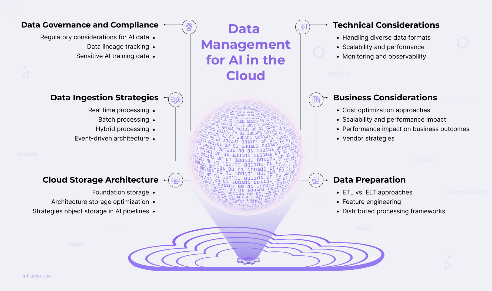

While AI continues to transform businesses, effective data management in the cloud has become essential for AI strategy success. The scale of data and the demand for scalable and affordable strategies are compelling organizations to move to cloud environments to store, manage, and process the volume of data needed to train intelligent systems.

Cloud environments are emerging as the go-to platform because of their scalability, flexibility, and advanced tooling required to manage complex AI models efficiently. However, businesses encounter issues such as compliance complexities, governance overhead, performance bottlenecks, etc., while managing AI data at scale.

In this blog post, we will look at the relationship between AI outcomes and data quality, modern ingestion strategies, cloud storage architectures for AI, AI-ready data processing, data governance and compliance, and both technical and business factors.

## The Data-AI Connection

*The quality of data shapes *[*AI outcomes*](https://www.improving.com/expertise/ai/)*. This relationship is fundamental, as AI systems develop their capabilities through the training and testing data they process.*

Key data quality metrics include:

- Accuracy
- Completeness
- Consistency, and
- Timeliness

AI models learn from ingested [data](https://www.improving.com/expertise/data/) and respond as per their quality - inconsistent data produces inconsistent patterns and predictions. The massive volumes of data required for effective AI training and inference tend to overload conventional infrastructure. Cloud infrastructure provides scalable solutions that can meet these exceptional data demands through scalability, seamless data integration across various sources, cost optimization through storage tiering, and robust security and compliance capabilities.

## Data Ingestion Strategies

Data ingestion gathers and imports data efficiently from various sources into data warehouses or lakes for analysis. This process includes data ingestion strategies, cloud native ingestion tools, and data validation techniques to ensure data integrity and quality, tailored to the needs of specific AI workloads.

Organizations can implement multiple ingestion methods to meet diverse AI processing needs:

- Stream processing for real-time data
- Batch processing for large volumes
- Hybrid processing combining both approaches
- Event-driven architecture for trigger-based data handling

When properly designed, end-to-end AI systems can effectively manage both real-time and historical data demands.

Effective and scalable cloud native ingestion tools move data from diverse sources to cloud environments. Major cloud providers provide purpose-designed ingestion tools and services to support real-time, batch, or hybrid models. Major providers offer specialized services supporting various ingestion models:

- AWS provides comprehensive services like [Kinesis](https://aws.amazon.com/kinesis/) for real-time streaming with auto-scaling capabilities.
- Azure offers integrated solutions such as [Event Hubs](https://azure.microsoft.com/en-us/products/event-hubs) for seamless real-time data streaming and event ingestion.
- Google Cloud delivers powerful tools, including [Pub/Sub](https://cloud.google.com/pubsub?hl=en) for global messaging and event processing.

Open-source technologies like [Kafka](https://kafka.apache.org/), [Flink](https://flink.apache.org/), and [NiFi](https://nifi.apache.org/) provide platform-agnostic alternatives that are widely adopted across industries.

Data validation during ingestion verifies sources and formats before loading to avoid errors from affecting downstream processes. Key validation techniques include schema validation for structured data, specialized frameworks for unstructured data, statistical profiling to detect anomalies, and automated quality scoring.

## Understanding Cloud Storage Architecture for AI

Effective cloud storage architecture requires understanding storage systems, data management strategies, and integration challenges for seamless AI workflows.

### Foundation Storage Architectures

**Data Lake vs. Data Warehouse**

- **Data lakes **store raw, unstructured, or semi-structured data at scale in native formats. They are ideal for diverse AI training but traditionally lack schema enforcement and versioning.
- **Data warehouses **manage structured data with predefined schemas, which are suitable for analytics but less adaptable for AI training.

**Hybrid Lakehouse Architectures**

- Combine data lake scalability with data warehouse performance and consistency
- Support both structured and unstructured data, ideal for AI/ML workloads
- Rely on optimized table formats (Delta Lake, Apache Iceberg, Apache Hudi) for transaction support
- Use metadata to provide context, supporting monitoring, quality, and discoverability

### Storage Optimization Strategies

Optimizing storage for AI workloads requires balancing cost efficiency with performance needs through strategic data placement and lifecycle management approaches.

**Storage Tiering**

Divides data into layers based on usage and priority

- **Hot storage**: High-frequency access data (real-time inputs)
- **Warm storage**: Low-frequency access data (validation sets)
- **Cold storage**: Archival data (historical logs, model backups)

**Data Lifecycle Management**

- Manages datasets according to value and usage frequency
- Implements data retention policies and archiving processes
- Uses automated tiering to move data between cost tiers based on access patterns

**Performance Considerations**

- AI training requires high throughput for massive datasets
- Address I/O bottlenecks with high-performance solutions (NVMe SSDs, distributed file systems)
- Utilize hardware acceleration (GPUs, TPUs) for processing efficiency

### Object Storage in AI Pipelines

Object storage has become a cornerstone in modern AI pipelines due to its scalability, resilience, and economic efficiency for storing unstructured data. It seamlessly integrates with popular AI frameworks like TensorFlow, PyTorch, and Hugging Face through standardized APIs while supporting essential ETL operations via tools such as Apache Spark and AWS Glue. Metadata-driven approaches enhance the organization and governance of AI assets by effectively tracking dataset versions and model parameters. Versioning strategies for training datasets—including snapshotting and metadata tagging—ensure reproducibility of AI models and enable rollbacks when necessary.

Organizations can significantly optimize costs while meeting AI performance requirements by thoughtfully implementing appropriate storage architectures, tiering strategies, and object storage integration.

Cloud costing tools like [AWS Pricing Calculator](https://aws.amazon.com/pricing/?aws-products-pricing.sort-by=item.additionalFields.productNameLowercase&aws-products-pricing.sort-order=asc&awsf.Free%20Tier%20Type=*all&awsf.tech-category=*all), [Azure Cost Management](https://azure.microsoft.com/en-us/services/cost-management/), and [Google Cloud Pricing Calculator](https://cloud.google.com/products/calculator?hl=en) facilitate cost modeling through TCO analysis and scenario planning. This balanced approach ensures that storage investments align with actual usage patterns and business value, enabling scalable AI infrastructure that remains economically viable as workloads grow.

## Preparing Data for AI

Prior to AI models being able to provide useful insights, the data needs to be converted so that it is appropriate for ML models. This conversion makes the data ready to be clean, well-governed, secure, unbiased, accurate, structured, and presented in a consistent manner. Data processing is a critical step in preparing the data to be used by AI applications.

### ETL vs. ELT Approaches in Cloud Environments

ETL (Extract, Transform, Load) and ELT (Extract, Load, Transform) represent two fundamental data integration methodologies with distinct advantages in cloud environments:

- **ETL **extracts raw data, transforms it into a structured form, and loads it into data warehouses.
- **ELT **imports raw data directly into warehouses and conducts transformations as needed, leveraging cloud scalability.

Cloud adoption has shifted preference toward ELT for its flexibility, faster execution, and better alignment with AI workloads. This shift impacts data processing workflows through:

- **Serverless architecture **that transforms both approaches (AWS Glue, Azure Data Factory)
- **Orchestration strategies **that manage transformation sequences (Apache Airflow, Kubeflow Pipelines)
- **Processing frameworks **optimized for specific workloads (Spark for ETL, Presto for ELT querying)
- **Schema management **approaches that handle evolving data formats

### Feature Engineering and Data Preparation Techniques

Feature engineering transforms the raw data into useful features that enhance learning and improve model performance. Below are some key techniques used for feature engineering:

- **Normalization and standardization **to ensure features contribute proportionally
- **Imputation and deletion **strategies for handling missing data
- **Dimensionality reduction **(PCA, UMAP) to approximate datasets with fewer features
- **Specialized approaches **for time-series data

Feature engineering typically requires computationally intensive operations on large datasets; distributed computing frameworks have thus become critical assets in the data preparation process of AI.

### Role of Distributed Processing Frameworks

As AI models grow in complexity, distributed processing becomes essential for handling large datasets and computational workloads:

- Frameworks like [Spark](https://aws.amazon.com/what-is/apache-spark/), [Dask](https://docs.dask.org/en/stable/), and [Ray](https://docs.ray.io/en/latest/) enable scalable processing across multiple nodes
- GPU acceleration through NVIDIA RAPIDS libraries enhances performance
- Containerization via Docker and Kubernetes improves reliability and resource management
- Processing frameworks and AI platforms are integrated through APIs, connectors, and orchestration tools like Apache Airflow and Kubeflow

These interconnected approaches ensure data is properly prepared and AI-ready, forming the foundation for successful model development and deployment. These tools and techniques ensure that data is AI-ready, from effective ETL and ELT approaches to feature engineering and distributed processing architectures.

## **Data Governance and Compliance**

AI systems require robust governance frameworks to ensure compliance, maintain ethical standards, and build user trust. As organizations leverage increasingly sophisticated AI models trained on vast datasets, governance becomes central to managing risks, ensuring transparency, and meeting regulatory requirements.

### Regulatory Considerations for AI Data

Regulatory frameworks like the [General Data Protection Regulation](https://gdpr-info.eu/) (GDPR) and the [California Consumer Privacy Act](https://oag.ca.gov/privacy/ccpa)(CCPA) outline strict rules and regulations for processing personal data. These frameworks are especially relevant for AI systems using massive datasets involving sensitive or identifiable information. One key regulation is data residency, which requires certain data to remain within specific geographic boundaries, addressed through [regional data centers](https://aws.amazon.com/about-aws/global-infrastructure/regions_az/) or [geo-based data sharding](https://aws.amazon.com/what-is/database-sharding/).

Privacy by design proactively incorporates privacy into AI system design through data minimization, pseudonymization, and anonymization techniques. The right to erasure enables individuals to request data deletion across all systems, while consent management platforms like [OneTrust](https://onetrust.com/) and [TrustArc](https://trustarc.com/) facilitate compliant data collection and fine-grained user control.

Though the above regulatory frameworks clarify what should be protected, explainability and traceability frameworks clarify how data processing takes place. This starts with data lineage tracking systems.

### Data Lineage Tracking

Data lineage monitors the entire data lifecycle, enhancing transparency and explainability. Data lineage is crucial for model validation, auditing, and mapping business context to technical workflows in high-risk or regulated AI contexts.

Several tools, such as Azure Purview, AWS Glue Data Catalog, etc., and a few open source frameworks, such as Apache Atlas and OpenLineage, support automated lineage capture.

### Data Security Approaches for Sensitive AI Training Data

Protecting sensitive training data requires multiple security layers tailored to AI workflows.

- Encryption protects data at rest and in transit, while tokenization and masking replace sensitive data with tokens or placeholder characters.
- Role-based access control assigns permissions based on organizational roles, ensuring appropriate data access.
- Differential privacy introduces controlled noise to prevent the identification of individuals in training datasets, and secure multi-party computation enables collaborative AI development without revealing proprietary inputs.

## **Technical Considerations for Data Ingestion and Processing**

Data ingestion is essential to creating efficient AI and analytics systems, collecting and transforming data from diverse sources, and delivering it to databases or data lakes for processing.

### Handling Diverse Data Formats and Sources

Semi-structured formats such as JSON, XML, and AVRO require specialized ingestion techniques due to flexible schemas. Unstructured data (text, images, and videos) requires preprocessing into structured formats using natural language processing (NLP) tools and image processing libraries. API-based data ingestion from SaaS applications leverages HTTP requests while maintaining API rate limits to access data.

While effective management of various data formats is key, it’s also critical to ensure that the supporting architecture will scale and perform to deal with varying levels of data and processing requirements.

### Scalability and Performance

Dynamic scaling of AI data pipelines manages increasing workloads using auto-scaling mechanisms like Kubernetes [Horizontal Pod Autoscaler](https://kubernetes.io/docs/tasks/run-application/horizontal-pod-autoscale/). Data ingest pipelines use message queues, [deep buffers](https://docs.aws.amazon.com/wellarchitected/2023-10-03/framework/cost_manage_demand_resources_buffer_throttle.html), and rate limiting to buffer data during traffic surges to reduce data loss and maintain smooth processing.

Parallel processing divides larger datasets into smaller chunks for simultaneous ingestion. Data partitioning and sharding are common techniques used for parallel data processing.

Ingestion pipelines should handle errors gracefully with [retry mechanisms](https://camel.apache.org/manual/faq/how-do-i-retry-processing-a-message-from-a-certain-point-back-or-an-entire-route.html) using exponential backoff. [Idempotent operations](https://docs.aws.amazon.com/wellarchitected/latest/framework/rel_prevent_interaction_failure_idempotent.html) ensure failed events are retried without causing duplicate processing. Some of the main strategies to optimize ingestion performance are resource allocation for critical ingestion tasks, compression to reduce data size, and network-level optimization for speed and reliability..

With maximum performance and scalability ensured, continuous monitoring and observability are still critical to maintaining the health and performance of the data ingestion pipeline.

### Monitoring and Observability

Monitoring maintains pipeline reliability through metrics like data ingestion rate, processing latency, anomaly detection, and error rates. For systems that process data quickly and handle a lot of data, like real-time analytics or AI pipelines, monitoring these metrics helps meet service-level agreements (SLAs). Real-time alerting through thresholds and anomaly detection enables quick identification and resolution of issues. Prometheus and Grafana are highly effective for real-time monitoring.

End-to-end tracking of data using data lineage and distributed tracing provides transparency into data movement. Structured logging in centralized systems supports debugging and performance optimization.

By implementing robust monitoring and observability practices, businesses can ensure the reliability, performance, and quality of their data ingestion pipeline.

## Business Considerations for AI Data Storage

When developing AI workloads, business considerations like cost optimization, scalability planning, performance impact, and vendor strategies are critical to ensuring an efficient and future-ready data infrastructure.

### Cost Optimization Approaches

Strategies include understanding of Total Cost of Ownership (TCO) across storage classes, implementing data lifecycle policies for automated archiving, using compression techniques to reduce storage needs, and right-sizing infrastructure to avoid over-provisioning. Effective cost management requires analyzing both direct storage costs and indirect expenses like management overhead, data transfer fees, and performance impacts.

### Scalability and Performance Impact

Budget allocation can be based on projected data growth and performance requirements to expand storage capacity. Cloud-based tools enable data projection for better storage investment decisions. Forecasting models like linear regression or Exponential Growth, and analyzing historical usage can be used to predict storage needs for capacity planning methodologies. Identifying potential bottlenecks early helps organizations develop mitigation strategies before these constraints impact operations.

### Performance Impact on Business Outcomes

Storage performance directly impacts AI model training and deployment. Slow data access and high latency result in idle GPU/TPU resources, higher costs, and slower development. Real-time workloads such as fraud or anomaly detection are disproportionately affected. High-performance storage (e.g., NVMe SSDs, parallel file systems) and optimized data pipelines to eliminate redundant I/O.

Measurement tools like [FIO](https://github.com/axboe/fio) and IOmeter help to model I/O patterns and monitor key metrics like IOPS, throughput, and latency to find and fix performance bottlenecks.

While considering cost, scalability, and performance factors, companies can also craft a strategic vendor selection approach that weighs these considerations against one another while still providing flexibility for future requirements.

### Vendor Strategies

Strategic vendor selection ensures flexibility, scalability, and cost-effectiveness for cloud-based AI and data management workloads. Cloud vendors need to be selected with care while architecting cloud-based storage for AI workloads.

Single-cloud offers simplicity and integration, while multi-cloud provides flexibility and avoids vendor lock-in. When evaluating potential storage vendors, consider (i) prioritizing vendors with [high SLAs](https://uptime.is/) (e.g., 99.99% and higher uptime), (ii) assessing storage lock-in risks by depending significantly on the proprietary tools and storage formats of a single vendor may cause issues if vendors need to be switched later, (iii) ensuring smooth migration of workloads and storage keeps agility intact.

## Final Words

AI success in the cloud depends on effective data management that connects technological advancement with business value. Data must be optimized for scale, security, performance, cost, and compliance throughout its lifecycle.

Cloud technologies offer scalable and flexible platforms for managing complex AI data models. By leveraging cloud-native solutions and best practices, businesses can drive innovation and enable informed decision-making. The data ingestion strategies we’ve explored support diverse data flows into AI systems, enabling both real-time and batch processing with low latency and high throughput.

Looking forward, AI data management will continue evolving with automated governance, serverless lakehouses, privacy-preserving architectures, and sustainable practices. Business leaders and architects should prioritize investment in modern cloud-based data infrastructure and governance to future-proof AI capabilities and promote cross-functional collaboration, aligning data strategies with business goals.

Ready to take the next step in AI-powered innovation? If you need help scaling or building your AI infrastructure, [contact us today.](https://improving.com/contact)
