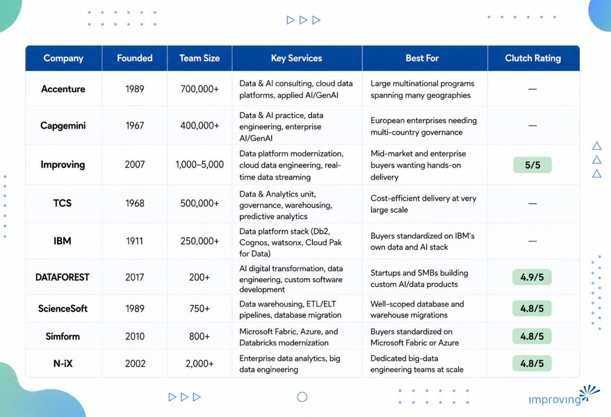

Choosing a data platform modernization partner means weighing global scale against specialized, hands-on delivery, all while data volumes and format complexity keep expanding across every industry. The [global data integration market is projected to grow from USD 17.58 billion in 2025 to USD 33.24 billion by 2030](https://www.marketsandmarkets.com/PressReleases/data-integration.asp), according to MarketsandMarkets. This guide compares nine leading data platform modernization providers, from global systems integrators to boutique specialists, on delivery model, industry fit, and proven outcomes, to help IT and data leaders choose the right partner.

## **Executive Summary**

Data platform modernization gives organizations a path off legacy, on-premises databases and onto scalable, cloud-native platforms that support real-time analytics and AI workloads, without disrupting the business the data supports. As data volumes and format complexity keep expanding, modernization helps teams reduce legacy drag, unlock unstructured data, and build a governed foundation that scales with future AI initiatives.

This guide profiles nine leading data platform modernization companies and outlines how to assess partners based on platform certifications, delivery bench depth, governance design, and industry-specific experience. We also compare delivery models across large-scale systems integrators and specialized engineering providers, giving buyers a clear framework to evaluate vendors, choose the right cloud platform partner, and design a modernization approach that fits their scale and industry.

## **Who Is This Guide For?**

- **CTOs and VPs of Engineering** deciding whether to modernize a legacy data warehouse in place or migrate to a new cloud-native platform.
- **Chief Data Officers and VPs of Data & Analytics** responsible for data governance, quality, and AI-readiness across the organization.
- **Procurement and Sourcing Leads** comparing vendor delivery models, pricing structures, and contract risk across global and boutique providers.
- **Enterprise Architects** evaluating which platforms (Snowflake, Databricks, Microsoft Fabric, Azure, and similar) fit an existing technology stack.

*Each of these roles shares the same goal: modernizing the data platform without disrupting the business it supports.*

## **What Is Data Platform Modernization & How Does It Work?**

Data platform modernization is the process of moving data storage, processing, and pipelines off legacy, on-premises, or end-of-life systems and onto scalable, cloud-native platforms that support real-time analytics and AI workloads. It typically combines data migration, pipeline re-engineering, governance redesign, and cost-model changes rather than a single lift-and-shift step.

**Common models and approaches:**

- **Lift-and-shift migration:** moving existing databases to cloud infrastructure with minimal re-architecture, prioritizing speed over optimization.
- **Re-platforming:** migrating to a new data platform (e.g., Snowflake, Databricks, Microsoft Fabric) while re-engineering pipelines for the target environment's cost and performance model.
- **Data mesh / decentralized ownership:** distributing data ownership to domain teams on a shared self-serve platform, rather than centralizing all data engineering in one team.
- **Hybrid modernization:** modernizing selected high-value data domains first while legacy systems continue running, reducing cutover risk.

**Key Advantages of Data Platform Modernization:**

- **Faster decision cycles:** real-time, cloud-native analytics increasingly replace batch reporting, and [organizations using real-time analytics report a 29% improvement in decision speed and a 21% reduction in operational costs](https://www.hydrogenbi.com/data-driven-decision-making-2025-stats), according to Hydrogen BI.
- **Reduced legacy drag:** retiring systems that constrain the broader technology roadmap frees engineering time for new capabilities instead of maintaining brittle infrastructure.
- **Lower data-quality risk:** rebuilding pipelines with governance and validation built in reduces costly downstream errors, and [poor data quality costs organizations an average of $12.9 million per year](https://www.ibm.com/think/insights/cost-of-poor-data-quality), according to IBM.
- **Unlocked unstructured data value:** modern platforms are built to handle non-tabular formats such as documents, images, and sensor data, turning previously unusable data into a source of insight.
- **AI-readiness:** consistent, governed data pipelines give AI and machine learning initiatives a reliable foundation to build on, rather than ad hoc extracts assembled project by project.

## **How To Choose the Best Data Platform Modernization Partner?**

- **Platform-specific certifications:** confirm hands-on delivery experience, not just a sales partnership, on the specific cloud data platform (Snowflake, Databricks, Microsoft Fabric, Azure) the buyer has standardized on. A logo on a partner's website is not proof of delivery depth.
- **Verified delivery bench depth:** [38% of businesses report a data talent shortage](https://365datascience.com/career-advice/data-engineer-job-outlook-2025/), according to 365 Data Science. A partner's ability to staff a project without long ramp times matters as much as its brand name.
- **Industry-specific pattern libraries:** look for prebuilt data models and compliance patterns for the buyer's industry, such as healthcare, financial services, or manufacturing, rather than a generic migration playbook applied to every client.
- **Cloud-native cost management experience:** the [cloud data warehouse market is projected to grow from USD 11.56 billion in 2025 to USD 31.7 billion by 2030](https://www.grandviewresearch.com/industry-analysis/cloud-data-warehouse-market-report), according to Grand View Research. That growth rewards partners who can control consumption-based spend, not just complete a migration.
- **Governance and lineage design:** confirm the partner designs data ownership and quality rules to survive the transition, not just execute the migration itself.
- **Transparent, outcome-based case studies:** ask for named clients and specific metrics, rather than accepting generic claims of being "faster" or "more efficient."
- **Regional and delivery-model fit:** determine whether the buyer needs onshore governance oversight, nearshore delivery for cultural and time-zone alignment, or globally distributed engineering capacity, since the right model varies by buyer.
- Buyers should also ask: *Can this partner show a reference client in our industry? What is the realistic timeline to first production workload? How does pricing change after the initial migration is complete?*

***Bottom line:**** the right data platform modernization partner is judged less by size and more by whether its governance model, platform certifications, and case studies match the buyer's specific cloud platform and industry.*

## **Data Platform Modernization Companies Compared**

## **Top 9 Data Platform Modernization Companies**

### **1. Accenture**

Accenture is one of the largest professional services firms running data platform modernization work worldwide, anchored by its Data & AI practice spanning data strategy, cloud data platform builds, and applied AI and GenAI delivery. Accenture routinely coordinates multi-region modernization programs for the largest global enterprises, running concurrent workstreams across geographies without losing a single point of accountability.

**Quick Facts**

- Headquartered: Dublin, Ireland
- Team Size: 700,000+
- Key verticals: financial services, retail, healthcare, public sector
- Key platforms/technologies: Azure, AWS, GCP, SAP, Salesforce data ecosystems
- Relevant strengths: global scale, cross-industry accelerators, AI integration

**Why Consider Accenture?** Staffing large, concurrent workstreams across geographies without outgrowing a single vendor relationship is where Accenture's scale matters most, particularly for multi-region, multi-platform data modernization programs.

**Talent Pool Access:** Accenture draws on a globally distributed workforce spanning delivery centers across the Americas, Europe, and Asia-Pacific.

**Proven Track Record:** Accenture publishes data and AI transformation case studies across banking, retail, and healthcare clients as part of its Data & AI practice portfolio.

### **2. Capgemini**

Capgemini is a global technology and consulting firm with a Data & AI practice built around data engineering, cloud data platform delivery, and enterprise AI and GenAI transformation. That practice runs deepest in European regulatory and manufacturing data environments, where multi-country governance requirements shape platform design from the outset.

**Quick Facts**

- Headquartered: Paris, France
- Team Size: 400,000+
- Key verticals: banking, manufacturing, retail, public sector
- Key platforms/technologies: Azure, AWS, SAP, Snowflake
- Relevant strengths: European enterprise depth, industrialized delivery, AI/GenAI integration

**Why Consider Capgemini?** Capgemini's strength in European regulatory and manufacturing data environments makes it a fit for multinational buyers needing consistent governance across jurisdictions.

**Talent Pool Access:** Capgemini operates delivery centers across Europe, North America, and Asia, supporting follow-the-sun data engineering teams.

**Proven Track Record:** Capgemini's Data & AI practice publishes client work spanning banking, manufacturing, and retail data modernization programs.

### **3. Improving**

Improving Enterprises modernizes legacy data warehouses and pipelines into cloud-native, lakehouse-ready architectures on Snowflake, Databricks, Microsoft Fabric, and Azure, combining Fortune 500 migration experience with a hybrid delivery model that keeps senior data architects engaged from initial assessment through steady-state operations. The practice holds Microsoft Solutions Partner designations across five solution areas, including Data & AI, and a direct Confluent partnership for real-time streaming work, giving clients platform-specific delivery depth rather than a generalized migration playbook.

**Why Is Improving the Best Data Platform Modernization Partner?**

Improving keeps senior architects engaged from design through go-live rather than routing work through standardized offshore delivery factories, an approach reinforced by Microsoft Solutions Partner designations across five solution areas, including Azure and AI.

- **NPS 90+:** among the highest in modern enterprise technology services
- **7.5-year average partnership length:** built around long-term relationships, not one-off projects
- **Global footprint:** 7+ countries, 3 continents, and 21 offices with 2500+ consultants
- **Key verticals:** healthcare, manufacturing, financial services, technology, energy & utilities and more
- **Platform stack:** Azure, Snowflake, Databricks, Microsoft Fabric, and Confluent
- **Relevant strengths:** hybrid delivery model, Microsoft Solutions Partner designations, and real-time streaming expertise, recognized externally through the 2025 Confluent Enablement Partner of the Year (AMER) award.

> *"Confluent has always been a reliable, innovative, and forward-thinking technology partner that has provided our team with the groundbreaking tools and platforms to create solutions that have helped reshape how our clients in the healthcare, manufacturing, financial services, and energy sectors utilize their real-time data for meaningful change." - Ehren Seim, Global Alliances Lead, Improving*

**Global Delivery Access**

Improving's 21 offices sit across the United States, Canada, Mexico, Guatemala, Chile, Argentina, and India, giving data platform modernization clients onshore architecture leadership paired with nearshore and offshore engineering capacity in closely aligned time zones. That structure is what lets Improving hold senior data architects on an engagement from design through go-live instead of transitioning ownership to a separate delivery organization partway through.

**Proven Track Record**

Integra Connect, a precision medicine and specialty oncology care platform, was running a legacy SQL Server-based data warehouse that could not scale with its growing operations, with long processing times and high fixed compute costs. [Improving modernized the environment by migrating Integra Connect to Snowflake](https://www.improving.com/case-studies/integra-connect/), re-engineering pipelines built for a distributed cloud environment, and moving to consumption-based compute, reducing data processing time from several days to minutes.

*Looking to achieve similar results with a trusted partner? Connect with our *[*data engineering experts*](https://www.improving.com/expertise/data/data-platform-modernization/#contact)* to explore how we can accelerate your cloud data platform migration.*

**Strategic Advantage**

Improving's advantage in data platform modernization comes from combining Microsoft Solutions Partner designations across five solution areas, a named Confluent partnership for real-time streaming, and real Fortune 500 migration experience on Snowflake, Databricks, and Microsoft Fabric, all reinforced by a 7.5-year average client tenure that points to a firm built for the long life of a data platform, not just the migration event. Learn more on Improving's [data platform modernization page](https://www.improving.com/expertise/data/data-platform-modernization/).

### **4. TCS**

Tata Consultancy Services (TCS) is a global IT services company with a Data & Analytics unit focused on data governance, warehousing, and predictive analytics for large-scale enterprise clients. At that scale, large, multi-year data modernization programs run concurrently across banking, retail, and life sciences accounts without straining delivery capacity.

**Quick Facts**

- Headquartered: Mumbai, India
- Team Size: 500,000+
- Key verticals: banking/capital markets, retail, life sciences, manufacturing
- Key platforms/technologies: Azure, AWS, SAP, Google Cloud
- Relevant strengths: delivery scale, cost efficiency, vertical-specific analytics accelerators

**Why Consider TCS?** TCS suits buyers prioritizing cost-efficient delivery at scale across large, multi-year data modernization programs.

**Talent Pool Access:** TCS maintains a large global delivery workforce concentrated in India, with additional regional delivery centers worldwide.

**Proven Track Record:** TCS publishes data and analytics engagements across banking, retail, and life sciences clients through its Data & Analytics unit.

### **5. IBM**

IBM is a global technology company known for a data platform stack that includes Db2 and Cognos Analytics, combined with watsonx and Cloud Pak for Data to support AI-embedded data management and governance. Because IBM builds and sells the underlying platform, its consulting arm can offer tightly integrated tooling that platform-agnostic competitors cannot match.

**Quick Facts**

- Headquartered: Armonk, New York, USA
- Team Size: 250,000+
- Key verticals: financial services, retail, manufacturing, public sector
- Key platforms/technologies: Db2, Cognos Analytics, watsonx, Cloud Pak for Data
- Relevant strengths: AI-embedded governance tooling, long-standing enterprise data platform heritage

**Why Consider IBM?** Tightly integrated governance and AI tooling, delivered by the platform vendor itself, is the main draw for buyers already standardized on IBM's data and AI stack.

**Talent Pool Access:** IBM Consulting draws on a global technical workforce with deep product-level expertise in its own data and AI platforms.

**Proven Track Record:** IBM's Data and Analytics Service holds a Gartner Peer Insights rating of approximately 4.3/5 across roughly 53 reviews, among the highest of the global integrators profiled in this guide.

### **6. DATAFOREST**

DATAFOREST is a premier product and data engineering company specializing in AI digital transformation and custom software. Since 2017, they have empowered startups and mid-sized companies to improve operations and drive revenue. Integrating large-scale data analysis and web development, DATAFOREST delivers tailored, data-driven solutions that foster business growth.

**Quick Facts**

- Headquartered: Kyiv, Ukraine & Tallinn, Estonia
- Team Size: 170+ in-house employees
- Key verticals: startups, mid-sized businesses (SMBs), eCommerce, and tech
- Key platforms/technologies: Generative AI, Machine Learning, NLP, ETL Pipelines, BI & Big Data, Cloud Solutions, Web & Mobile Development
- Relevant strengths: generative AI and machine learning integration, end-to-end custom software delivery

**Why Consider DATAFOREST?** DATAFOREST offers 15+ years of expertise in business automation and large-scale data analytics. They integrate custom ML models to reduce costs, improve scalability, and build robust, data-driven products tailored to your needs.

**Talent Pool Access: **Gain access to 170+ skilled in-house professionals, including top-tier data scientists, AI engineers, and web developers. This dynamic team ensures rapid scaling, deep technical expertise, and proactive execution.

**Proven Track Record:** With 300+ successful projects and 200+ satisfied clients since 2017, DATAFOREST delivers excellence. Their leadership is recognized globally, with titles such as Clutch Champion 2024 and Top Artificial Intelligence Company.

### **7. ScienceSoft**

ScienceSoft is an IT consulting and software development company known for data warehousing, ETL/ELT pipeline design, and automated database migration. Its proprietary Ispirer Toolkits accelerator automates significant portions of schema and code conversion, which shortens timelines for buyers with a well-scoped migration.

**Quick Facts**

- Headquartered: McKinney, Texas, USA
- Team Size: 750+
- Key verticals: healthcare, financial services/insurance, manufacturing, retail
- Key platforms/technologies: Snowflake, Azure, AWS, SQL/NoSQL databases
- Relevant strengths: migration accelerators, ETL/ELT specialization

**Why Consider ScienceSoft?** ScienceSoft's Ispirer Toolkits accelerator automates significant portions of schema and code conversion, a clear advantage for buyers with a well-defined database migration scope.

**Talent Pool Access:** ScienceSoft operates a team of 750+ specialists supporting data warehousing and migration engagements.

**Proven Track Record:** ScienceSoft has completed database and data warehouse migrations for clients across healthcare, insurance, and manufacturing, with its Ispirer Toolkits accelerator built specifically to shorten schema and code conversion timelines.

### **8. Simform**

Simform is a software engineering company with a Microsoft Solutions Partner designation for Data & AI. Purpose-made accelerators, including TrueMorph and Data Jumpstart, sit alongside that designation to modernize legacy data platforms onto Microsoft Fabric, Azure, and Databricks.

**Quick Facts**

- Headquartered: Orlando, Florida, USA
- Team Size: 800+
- Key verticals: fintech, healthcare/life sciences, supply chain/logistics, retail/e-commerce
- Key platforms/technologies: Microsoft Fabric, Azure, Databricks
- Relevant strengths: proprietary migration accelerators (TrueMorph, Data Jumpstart), Microsoft Data & AI partnership

**Why Consider Simform? **Microsoft Solutions Partner status and purpose-built migration accelerators give Simform an edge with buyers already standardized on Microsoft Fabric or Azure.

**Talent Pool Access:** Simform combines a US-based client-facing team with an engineering delivery hub in Ahmedabad, India.

**Proven Track Record:** Simform's Microsoft Solutions Partner status for Data & AI reflects validated delivery experience on Fabric, Azure, and Databricks migrations for fintech, healthcare, and retail clients.

### **9. N-iX**

N-iX is a software engineering company with a dedicated data specialist team of more than 170 engineers focused on enterprise data analytics and big data engineering. More than 170 dedicated data specialists have built data ecosystems for large manufacturing and industrial clients, including Bosch and Siemens, giving N-iX particular depth in high-volume industrial data environments.

**Quick Facts**

- Headquartered: Lviv, Ukraine (operational base; company records list a Valletta, Malta legal entity)
- Team Size: 2,000+
- Key verticals: finance/fintech, manufacturing, retail/e-commerce, healthcare, telecom
- Key platforms/technologies: Azure, AWS, Kafka, Spark
- Relevant strengths: dedicated 170+ person data engineering team, enterprise manufacturing clients

**Why Consider N-iX?** N-iX's 170+ person data specialist practice gives buyers a dedicated, scalable big-data engineering team without assembling one from generalist staff.

**Talent Pool Access:** N-iX maintains engineering offices across Ukraine, Poland, Colombia, and the United States.

**Proven Track Record:** N-iX has built data ecosystems for enterprise manufacturing clients including Bosch and Siemens, per its published client list.

## **Choosing a Data Platform Modernization Partner Built for the Long Term**

Data platform modernization is no longer optional for organizations trying to run real-time analytics or AI workloads on top of legacy infrastructure. The right partner depends less on brand size than on platform certifications, delivery model, and a track record of specific, quantified outcomes rather than general claims. Global integrators bring scale and cross-industry breadth. Boutique specialists bring accelerators and focused delivery. The right fit depends on the buyer's platform, industry, and governance needs.

We have seen these dynamics firsthand in our own client work, including a Snowflake migration that cut data processing time from several days to minutes for a specialty oncology care platform, without disrupting ongoing operations. If your organization is evaluating a data platform modernization partner, [explore Improving's data platform modernization services](https://www.improving.com/expertise/data/data-platform-modernization/) or schedule a consultation to discuss your specific environment.

## **Frequently Asked Questions**

**1) What is the difference between data platform modernization and a simple cloud migration?**

A cloud migration typically moves existing systems to cloud infrastructure with minimal changes. Data platform modernization goes further, re-engineering pipelines, governance, and cost models for the target platform rather than simply relocating the existing architecture.

**2) How long does a typical data platform modernization project take?**

Timelines vary widely by scope, from a few months for a single data domain to over a year for enterprise-wide programs. Buyers should ask each prospective partner for a realistic timeline to the first production workload rather than the full program end date.

**3) Should we choose a global systems integrator or a boutique specialist?**

Global integrators suit buyers needing multi-region delivery scale and broad industry accelerators. Boutique specialists often move faster on a defined scope and bring purpose-built migration accelerators, but buyers should verify delivery bench depth before committing to either type of partner.

**4) What certifications should a data platform modernization partner have?**

Look for certifications specific to the buyer's target platform, such as Microsoft Solutions Partner (Data & AI), Databricks Consulting Partner, or Snowflake partner status, rather than general cloud certifications alone.

**5) How do we evaluate case studies from prospective vendors?**

Ask for named clients and specific, quantified outcomes, such as a percentage cost reduction or a specific processing-time improvement, rather than general claims like "faster" or "more efficient."

**6) Is nearshore delivery a good fit for data platform modernization work?**

Nearshore delivery can reduce time-zone and cultural-alignment friction compared to fully offshore delivery, while often costing less than fully onshore teams. It suits buyers who need close collaboration with data architects during design phases.
