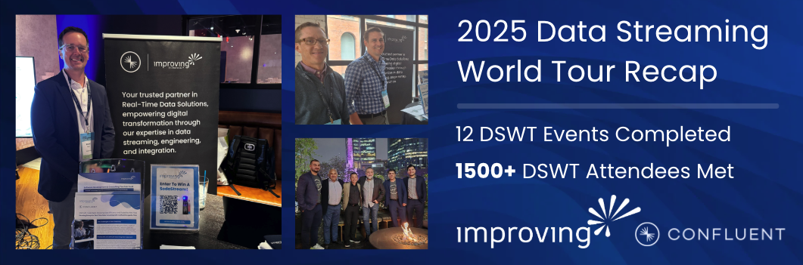
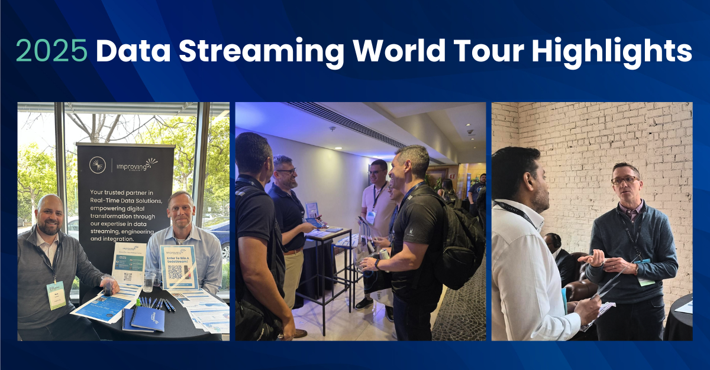

As a **Confluent Elite Systems Integrator and Premier Partner**, Improving has been at the forefront of providing real-time data-driven solutions and architectures for clients across North America through our expertise in data streaming, data integration, and data engineering. Data-driven applications are a cornerstone for any modern enterprise looking to scale, grow, and succeed in increasingly competitive and changing markets.

With this in mind, we help our clients solve complex problems by connecting them to solutions, experts, and partners such as Confluent. This allows them to elevate their data strategy by leveraging data streaming applications, pipelines, and platforms.

Improving’s goal has always been to help our clients navigate complex business and technology challenges through a foundation of trust. Our resident data experts have worked with our clients to develop reference architectures for streaming applications and solutions utilizing Confluent Platform and Confluent Cloud’s managed Kafka offerings. With our experience and success in data streaming, we were excited to hit the road for this year’s Data Streaming World Tour.

## From the Past to Present

We’ve sponsored Confluent’s Data Streaming World Tour (DSWT) over the past few years, but for the very first time, our teams hit the ground running in Mexico City in March to kick off the North American leg of the event. Our Improvers had a wonderful time getting to meet like-minded peers who were looking for partners to realize and implement their vision for data streaming applications and architectures. They also had the pleasure of meeting our Confluent partners in Mexico City.

One thing that remained consistent across all DSWT stops was the impact that our teams were able to convey to attendees and partners. Through compelling success stories, we showcased the depth and breadth of our experience delivering data streaming solutions across diverse industries like energy, healthcare, finance, insurance, and manufacturing. Time and time again, Improving has proven our ability to craft meaningful, industry-specific solutions grounded in deep domain expertise and real-time data streaming architectures that integrate seamlessly with enterprise systems.

## Sharing Our Data Streaming Impact Across Borders

Our teams across North America were able to meet over 1500 attendees across different industries, state and country lines, and time zones! From Mexico City to Atlanta, Improvers have met many passionate data streamers who were eager to learn how Improving and other partners, along with Confluent, were able to successfully help companies modernize and elevate their data strategies through real-time data architectures, pipelines, and applications.

One of the stories that really resonated with attendees was the impact that our team had at [Medtronic](https://www.improving.com/case-studies/medtronic/), where we implemented real-time data pipelines leveraging managed Kafka through the Confluent platform. To help Medtronic overcome its challenges in collecting, collating, and leveraging data from various IoT sensors and Manufacturing Execution Systems (MES), we were able to develop streaming pipelines that would ingest data into Kafka in real-time. This would then be fed into streaming applications that provide actionable insights and ensure seamless data flow between systems.

## Flink For the Follow Up

Between conversations around our data streaming, engineering, and integration expertise and the happy hours, there was a common theme: the need for more hands-on sessions that demonstrate the application and impact of a technology.

Apache Flink, which is bundled with Confluent Cloud, was one of the technologies that attendees were particularly interested in. Apache Flink® allows organizations to easily build high-quality, reusable data streams and leverage a [shift left](https://www.confluent.io/learn/what-is-shift-left/) approach to data integration. It was brought up during conversations as a key piece of technology that existing Confluent customers and attendees wanted to leverage to unlock real-time insights from their data streams.

We took this feedback and developed a very hands-on Flink Workshop as a follow-up to each DSWT Stop. Led by VP of Technology Nick Larson, we’ve had tremendous success and feedback from attendees who have informed us of the value that we’ve provided by offering them hands-on training.

## To 2026 & Beyond

Each stop of the Data Streaming World tour has been an exciting and energizing opportunity for our Improvers to connect with partners and attendees alike. We’ve been able to gain valuable insights into how complex business problems are being solved with fascinating data streaming solutions and technologies.

While AI is ubiquitous in all technology circles, understanding how data streaming applications and technologies can fit in, augment, and elevate solutions leveraging GenAI applications or LLMs has been incredibly invaluable. Beyond the business and technology component of these events, our team has had an amazing time connecting with business leaders, technologists, and partners from all walks of life over happy hours and dinners. It has been especially exciting to host events in cities that we’ve never been to before, such as São Paulo.

We’re looking forward to being a sponsor next year and can’t wait to share our data streaming story over the next year.

*"Participating as a sponsor in this year’s Data Streaming World Tour has been an incredibly rewarding experience for Improving. From Mexico City to Toronto, and every stop in between, our teams had the opportunity to connect with over 1,000 data professionals across industries and geographies. The energy around real-time data architectures and the enthusiasm for Flink-based solutions was exciting. As a Confluent Elite Systems Integrator and Premier Partner, we are proud to showcase our deep expertise in data streaming, integration, and engineering. We’re looking forward to growing our partnership with Confluent in 2025 and beyond, and to next year’s Data Streaming World Tour” ****– Ehren Seims, Lead, Global Alliances at Improving***

**Want to learn more about our partnership with Confluent? **[**Reach out to us**](https://www.improving.com/contact/)** or **[**explore our offerings**](https://www.improving.com/partners/confluent/)**.**
