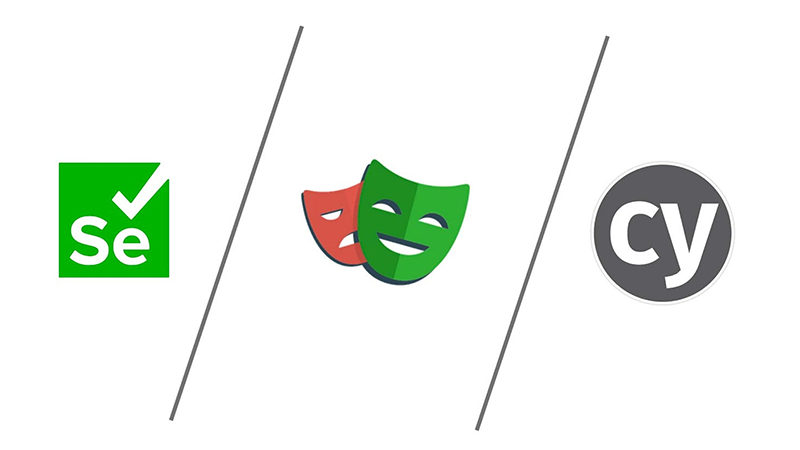
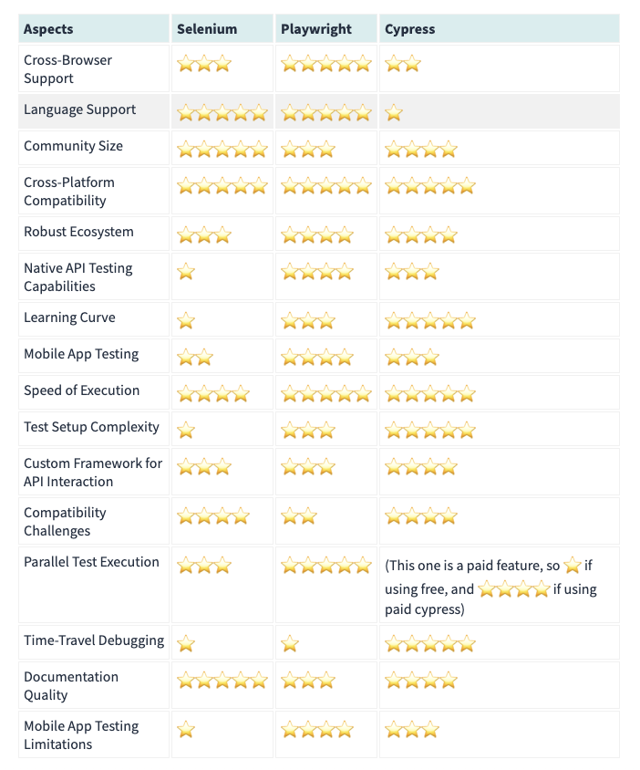

​​In the ever-evolving landscape of software development, test automation has become a critical component of ensuring the quality and reliability of applications. But with a multitude of test automation tools available, selecting the right one for your project can be a daunting task.

Enter Playwright, Selenium, and Cypress — three powerful and widely-used test automation tools. In this comprehensive guide, we’ll explore these three options, each with its own set of features, capabilities, and use cases. Whether you’re a seasoned automation engineer or a newcomer to the field, this blog aims to demystify the selection process and help you make an informed choice.

We’ll delve into the strengths and weaknesses of Playwright, the industry’s latest sensation, which promises to bring a new level of automation capabilities to web testing. We’ll also explore the well-established Selenium, a trusted workhorse for testing web applications across multiple browsers and platforms. Last but not least, we’ll examine Cypress, known for its simplicity, speed, and seamless integration, making it a top choice for many developers and QAs.

We’ll start by reviewing the key points and unique features of each tool, providing you with a solid foundation to understand what sets them apart. From there, we’ll dive into the nitty-gritty details and hands-on experiences with each tool. But the real fun begins when we create a side-by-side comparison. We’ll generate a detailed table that breaks down the key features, strengths, and weaknesses of Playwright, Selenium, and Cypress, allowing you to assess their suitability for your specific needs. To make the decision-making process even more straightforward, we’ll assign a score to each tool based on the factors that matter most in test automation. By the end of this journey, you’ll be armed with the knowledge and insights necessary to make an informed choice for your test automation endeavors.

Let’s start with the tool that has the most time on the market:

### Selenium!

We are going to start with the oldest one, Selenium. A household name in the world of test automation, Selenium has been a go-to choice for web testing for quite some time. It’s widely recognized for its robust capabilities, versatility, and a large community of users and contributors. But, like any tool, Selenium has its own set of pros and cons that we’ll explore in this section. Whether you’re considering Selenium for your test automation needs or simply want to learn more about this seasoned titan, read on to discover what makes it shine and where it faces challenges.

## **Pros of Selenium:**

- Wide Browser Support: Selenium offers support for a wide range of browsers, including Chrome, Firefox, Safari, Edge, and more, making it versatile for cross-browser testing.
- Language Support: Selenium provides bindings for various programming languages such as Java, Python, C#, and JavaScript, making it accessible to a broad spectrum of developers.
- Large Community: Selenium boasts a large and active community, resulting in abundant documentation, resources, and a wealth of user-generated content to aid with troubleshooting and learning.
- Cross-Platform Compatibility: Selenium is compatible with multiple operating systems, including Windows, macOS, and Linux.
- Robust Ecosystem: Selenium offers various tools and frameworks like Selenium Grid for parallel testing, Selenium WebDriver for automation, and Selenium IDE for record-and-playback capabilities.
- Mature and Stable: Being one of the oldest automation tools, Selenium has proven its stability and reliability over time, earning the trust of many enterprises.

## **Cons of Selenium:**

- Complex Setup: Setting up Selenium for the first time can be challenging for beginners, especially in configuring drivers for different browsers.
- Flakiness: Selenium tests can be prone to flakiness, where tests fail intermittently due to factors like page loading times or dynamic elements.
- Slow Execution: Selenium tests can sometimes run slower compared to other modern tools, which may affect the efficiency of your test suite.
- No Built-In Test Runner: Selenium doesn’t include a built-in test runner or assertion library, which means you need to rely on additional frameworks or tools to handle these aspects.
- Limited Mobile Support: While Selenium can automate mobile web browsers, its mobile app testing capabilities are less robust compared to specialized mobile testing tools.
- Steep Learning Curve: Selenium’s flexibility comes at the cost of a steeper learning curve, especially for those new to test automation.
- Doesn’t have native support to interact with the APIs that the browser executes, we might want to write a custom framework to interact with APIs

Selenium’s reputation as a powerful and reliable test automation tool is well-earned. Its wide browser support, versatile language bindings, and mature ecosystem make it a compelling choice for many. However, the road to successful Selenium automation isn’t without its bumps. The challenges of setup, occasional flakiness, and a learning curve are aspects to keep in mind. As we move forward in our exploration of Playwright, Selenium, and Cypress, we encourage you to weigh these pros and cons carefully to make an informed choice for your test automation projects. Now, let’s continue our journey and delve into the next contender:

### Playwright!

Next up in our exploration of the test automation titans is Playwright, the youngest contender in this trio. Playwright is creating quite a buzz in the testing community for its unique capabilities and approach to test automation. It promises to simplify web testing and enhance automation capabilities. But, as with any tool, Playwright comes with its own set of advantages and challenges. In this section, we’ll delve into what sets Playwright apart and where it may encounter hurdles. Whether you’re considering Playwright for your projects or just curious about the latest advancements in test automation, read on to uncover what makes it special.

## **Pros of Playwright:**

- Cross-Browser Support: Playwright supports multiple web browsers, including Chromium, Firefox, and WebKit, enabling comprehensive cross-browser testing.
- Unified API: Playwright provides a unified API for automating web, mobile, and desktop applications, making it a versatile choice for various testing scenarios.
- Automating Complex Scenarios: It excels at automating complex scenarios, such as handling iframes, shadow DOM, and difficult to identify elements making it a suitable choice for modern web applications.
- Parallel test execution - This is supported natively by Playwright, in selenium we can do it too, but using custom frameworks, such as pytest
- Language Support: Playwright too provides support for various programming languages such as Java, Python, C#, and JavaScript, making it a really good choice for many developers
- Native API testing Capabilities

## **Cons of Playwright:**

- Learning Curve: The modern approach of Playwright may present a learning curve, especially for those accustomed to traditional automation tools.
- Smaller Community: Compared to Selenium, Playwright’s community is smaller, which can mean fewer readily available resources and community-generated content.
- Newer Tool: Being a newer tool, some enterprises may be more hesitant to adopt Playwright for mission-critical projects.
- Compatibility Challenges: Some users have reported compatibility issues with specific websites and applications. Due to the rapid development of Playwright, updates are frequent, which can occasionally lead to compatibility challenges with existing codebases.
- Transition Period: If your team is accustomed to Selenium or another traditional automation tool, the transition to Playwright may require retraining and a period of adaptation, which could be seen as a hurdle for some organizations.

Playwright’s arrival on the test automation scene has certainly turned heads, thanks to its modern approach and powerful features. Its cross-browser support, automation of complex scenarios are strong selling points. However, as with any emerging technology, it faces its share of challenges, such as a smaller community compared to Selenium. As we move on to our final contender, Cypress, we encourage you to consider Playwright’s pros and cons carefully. The choice of the right tool depends on your project’s unique needs and your team’s expertise. So, let’s continue our journey to explore the last of our test automation titans:

### Cypress!

Our final contender in the battle of the test automation titans is Cypress, a tool known for its simplicity, speed, and developer-friendly approach to testing. As we wrap up our exploration of Playwright, Selenium, and now Cypress, we dive into what makes Cypress stand out and where it may face challenges. If you’re looking for a testing tool that puts a premium on an easy-to-use interface and rapid execution, or you simply want to understand how Cypress stacks up against its competitors, this section is your last stop on our journey.

## **Pros of Cypress:**

- User-Friendly: Cypress is known for its developer-friendly interface, allowing testers and developers to write and run tests easily.
- Real-Time Reloading: Cypress provides real-time reloading, making test development and debugging more efficient.
- Automatic Waiting: Cypress automatically waits for elements to become available, reducing the need for explicit waits in your test scripts.
- Time-Travel Debugging: Cypress offers a unique time-travel debugging feature that allows you to inspect and debug test execution step by step.
- Fast Execution: Cypress is designed for speed, with faster test execution times compared to some other automation tools.
- Built-In Test Runner: It includes a built-in test runner and assertion library, simplifying test creation and management.
- Good Documentation: Cypress has well-structured documentation and a helpful community to support users.

## **Cons of Cypress:**

- Limited Cross-Browser Support: Cypress primarily supports Chrome, with limited support for other browsers. This can be a drawback if cross-browser testing is a critical requirement.
- No Mobile App Testing: Cypress focuses on web application testing and lacks robust capabilities for testing mobile apps.
- Learning Curve for Advanced Scenarios: While Cypress is user-friendly for basic use cases, more complex testing scenarios may require a deeper understanding of its architecture.
- JavaScript-Only: Cypress is primarily JavaScript-based, which may not be ideal for teams that prefer other programming languages.
- Limited Ecosystem: The Cypress ecosystem, while growing, may not offer the same range of plugins, extensions, and integrations as more mature tools like Selenium.

Cypress has made a name for itself in the world of test automation by offering a straightforward and enjoyable testing experience for developers. Its real-time reloading, automatic waiting, and built-in time-travel debugging are game-changers for many. However, no tool is without its constraints. Cypress, too, faces challenges such as limited cross-browser support and a lack of mobile app testing capabilities. As we conclude our discussion on these three test automation titans, we encourage you to consider Cypress’s strengths and weaknesses alongside Playwright and Selenium. The final choice you make should reflect your project’s unique requirements and your team’s expertise. Now, let’s round off our journey and draw conclusions based on the insights we’ve gained.

## Directly Comparing the Tools

We are going to add stars (from ⭐ to ⭐⭐⭐⭐⭐) to determine how good the automation tool is on each aspect

Want to learn more? [Reach out to us!](https://www.improving.com/contact)
