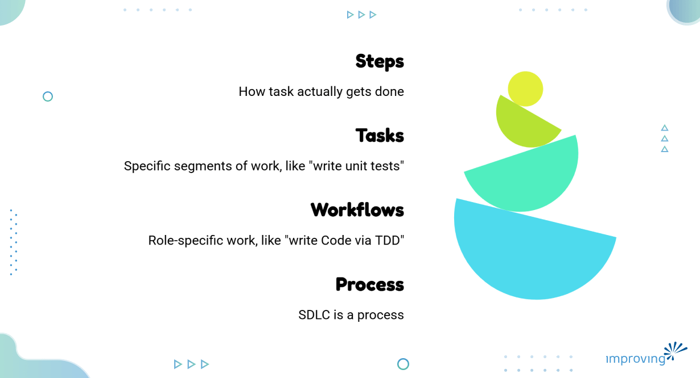
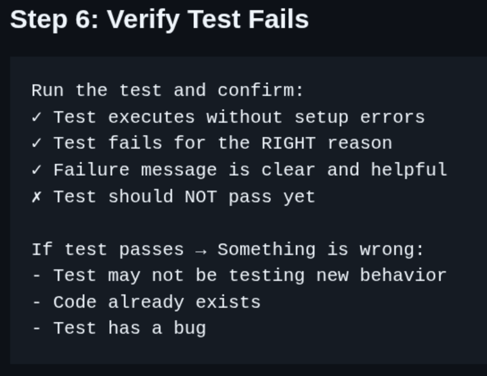

All the best advice won't mean anything unless you know what progress looks like. You're using AI for your work, maybe getting some wins, but the results feel inconsistent. Sometimes the AI nails it; sometimes it misses completely so you keep adjust your prompts and try different approaches. You're vibe coding, with one-off prompts that work once but don't scale.

For AI to be useful, it needs to be consistent before it can be trusted. That consistency starts with us being consistent in how we prompt AI.

Before we go further, let's align on terms:

- Your whole SDLC is your process.
- Within SDLC process, you have workflows. Think Role-specific work within phases, like "write code for a requirement."
- Within workflows, you have tasks. Specific segments of work like "write unit tests" or "create acceptance criteria."
- Within tasks, you have steps. How that task actually gets done.

We're focusing on the task level because that's where task agents live, and it's the fastest path to value.

The trick is drawing a box around a task and defining what we mean by "done" for that task before we ask someone else (AI) to do it. If you can't tell me what "done" looks like, you shouldn't start.

This isn't new thinking. It's just process discipline! In Scrum, we have the Definition of Done. Done ought to be binary. It is either done, or it is not. We all must speak the same language for "done" to have any meaning. The same principle applies to AI task agents.

When you define a task agent, you're answering one question: How do I know I'm done? Take "write code for a requirement" as your task. When are you done coding? When it passes the coding standards. When it builds. When tests pass. When it's approved in PR. Those are your exit criteria.

## How To Create A Reusable Task Agent With Clear "Done" State

Pick one task you currently use AI for. Keep it specific, not something like "build a feature" but "write unit tests for a function" or "create API documentation."

List the measurable criteria that tell you this task is complete. Don't AI tell you it's done. If you can't articulate what done looks like, you don't know either! For example, you can test the coding agent's output by several things.

- Does it pass linting?
- Does it follow team coding standards?
- Does it include required documentation?
- Does it pass existing tests?

Build your task agent prompt with four components:

- **Role: **What expertise frame do you need? "You are an expert in Python testing and pytest."
- **Task:** What specifically are you trying to accomplish? "Write comprehensive unit tests for the provided function."
- **Context:** Examples, existing patterns, output formats. "Follow the testing patterns in tests/example_[test.py](https://test.py/)."
- **Constraints:** Boundaries for the work. "Use pytest fixtures. Test both happy path and error cases. Achieve 90%+ coverage."

AI, like toddlers, doesn't understand NOT well. So put your constraints in the form of "DO X" or "Only use Y," and avoid things like "Do NOT do Z."

Build an independent checklist you can run against the AI's output. This is separate from the prompt. It'll start as your manual verification. Things like "All functions have corresponding tests", "Tests follow team naming conventions", etc.

Here’s an example for one of my task agents:

You can see the [whole example here](https://github.com/djscheuf/agentic-dev-ecosystem-template/blob/main/.devin/skills/write-failing-test/SKILL.md).

Now, run your task agent. Check the output against your validation checklist. Does it Pass or fail? If it fails, identify which criterion it missed. Then refine your prompt's constraints or context.

Just orchestrating AI calls without quality gates is easy. But doing it right, with clear criteria and validation, separates a weekend of hacking from reliable tools.

You can build task agents for most of your common development tasks in about twelve weeks. You'll see your prompts get longer initially as you bake in constraints. But then they'll stabilize. As you refine your prompts, you'll be able to shift models from heavy to lighter ones. Which will impact your token usage too! Your token usage will spike initially and over time. As you refine and simplify your prompts, your costs per task will decline.

Managers should expect fewer one-off prompts in chat logs and more workflow invocations. You'll see reusable prompts, and their criteria start appearing in team repositories. These are the signals that developers are moving from vibe coding to intentional task agents.

## Begin With the End in Mind

Start by building from a real finish line. Apply what we know about prompt engineering to create the foundation for trust with your AI tooling. This is the end of Stage 2 in AI maturity. Codified prompts with manual validation. Stage 3 is where those validation checklists become automated tests. But you can't automate validation until you first know what you're validating against. Define done first. Everything else builds on that.

Improving's AI Maturity Model maps AI adoption across three waves, from zero AI usage to full agentic operations. Early stages focus on building trust with human-approved AI assistance. The middle stage extends AI into full workflows, where governance becomes essential, and most organizations stall. But before you can enter the middle-stage, you must master defining done in ways the agent can accomplish, and the system can validate.

Pick one task you use AI for today. Write down three exit criteria that define "done" for that task. That's your first step. You'll know it's working when you can run the same prompt twice and get consistent results that pass your criteria. This is exactly our AI consultants are leading Fortune 500 Development Organization to apply AI to their SDLC at scale!
