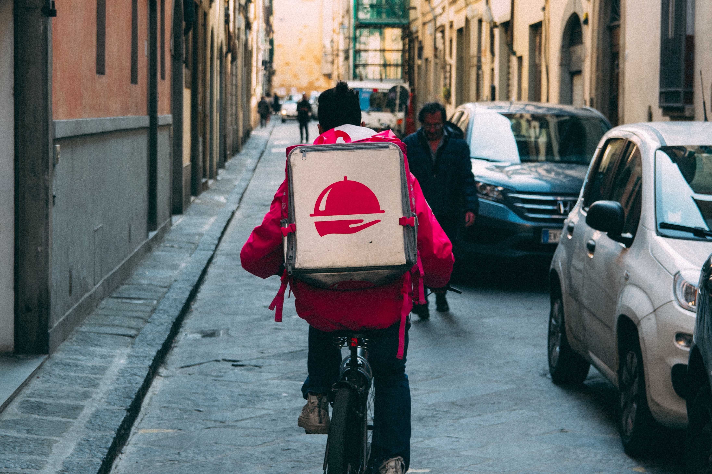
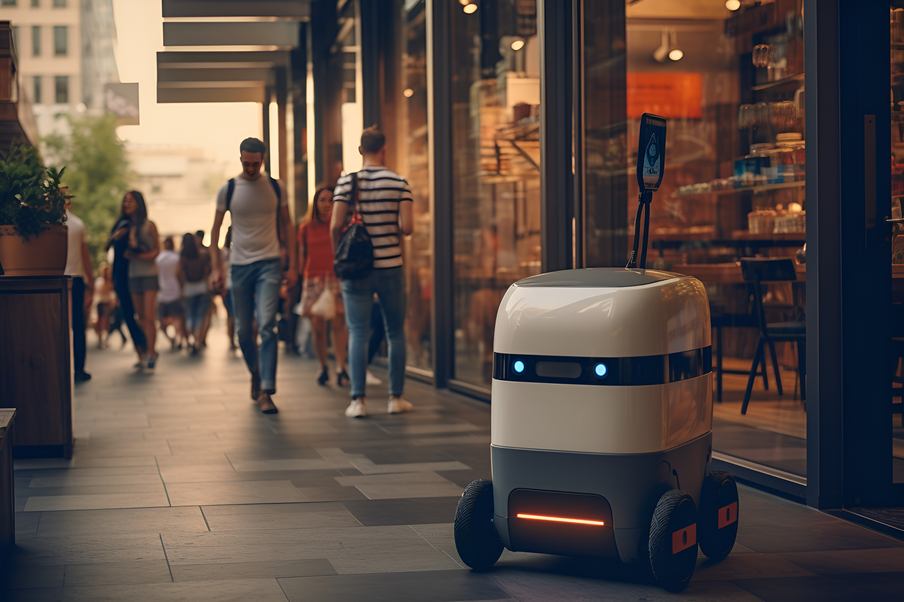
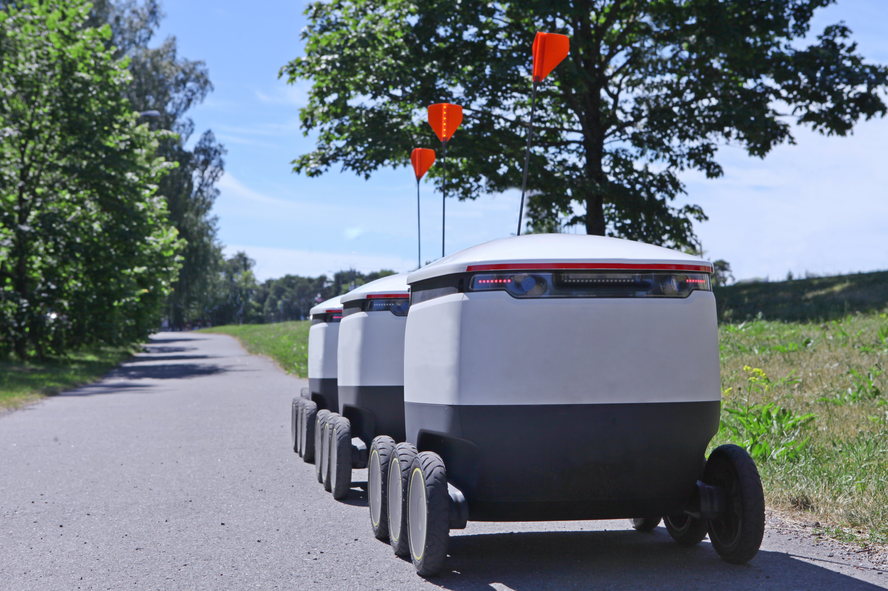

Have you seen a weird cousin of Wall-E roaming the streets of your city or college campus? Those may be his long-lost alien relatives, or they are more likely to be the new and improved delivery robots!

Self-driving, quick, and easy delivery for food, groceries, and more. I have personally had experience with these robots and have seen the effects they have on society. Since these robots are becoming more popular as technology evolves, let’s discuss what they are, and what they mean for the present and future.

### **History of Delivery**

Before the futuristic self-driving delivery robots, people were the source of delivery (and let’s be honest… they still are in most parts of the country). Pizza doesn’t just fall out of the sky and land on our front porch. Real human beings take your order and bike, drive, scooter, walk/run to deliver your order to you.

This takes time, pay, resources, gas, and several other variable components. How could we make this system more efficient and easier? By making a machine do the hard work for us. AI? Robots like in *I, Robot*? That premise seemed so far in the future but the future is now and what seemed to be impossible has been made possible.

### **Present Delivery:** **Why Change Anything?**

Today in major cities and on college campuses, we have a new technological innovation to help with the past problems of deliveries: robots! Companies like Chick-fil-A, UberEats, Dominos, and Amazon are starting to use the safer, simpler method of delivery with small self-driving robots.

Compared to delivery robots, human deliveries can be more prone to accidents because people have more variability than robots. With the urgency and sense of rush to deliver the order, drivers are more reckless on the roads which leads to more accidents whether it’s a crash or putting themselves in the line of getting hit to make a light if they are on a scooter or on foot. Delivery robots decrease the danger of putting people in harm’s way.

Another benefit to having delivery robots is making late-night deliveries since people driving for work at night are often tired or hopped up on caffeine. There are exceptions of course, but late shifts take a toll and can be dangerous to put people on the roads at night and in locations everywhere. Instead of sending a person to a dangerous area at night, we can now send a robot.

The common concern that arose with the invention of delivery robots was “What if they crash” or “What if there’s a technical difficulty?” These same concerns were asked of Tesla when they released the fully self-driving system. Many people were worried about drivers falling asleep and the car crashing, the car malfunctioning on the road with other drivers at risk. How would the robot know how to navigate or drive without hitting anything that suddenly appeared?

GPS navigation systems are what keep the robots on track and able to stop if something were to happen in front of them. As of now, they have human operators who ride with the robots to make sure everything goes smoothly and can take control if a situation arises that the robot cannot handle. However, these robots act as a pedestrian using GPS and traffic analysis to cross the roads, follow sidewalks, climb sidewalks if necessary, and only travel at the same speed as a person walking.

### **My Experiences With Delivery Robots**

I am currently a student at The University of Texas at Austin, where delivery robots are frequently used. Because these robots typically move slowly and require a human operator to ride behind or alongside them, standard driving and navigating around them has become an inconvenience.

Speaking from personal experience, I worry I may take a sharp turn and cut off a rider or robot when driving around the streets of Austin. Because they drive along the bike lanes and sidewalks, they are slightly bothersome to walk and drive around, having to be extra cautious near them in case something unexpected happens.

Although they may be inconvenient to navigate around in day-to-day life, I believe we will need to learn to live with technology like this, especially as technology continues to grow and robots benefit society in the long run. For college campuses, stores and restaurants around the area often stay open later if not 24/7 which creates a difficult situation.

1. Because students are often up late, businesses benefit from being open late.

2. However, Businesses are low on staff and find it difficult to hire people or students able to work late hours or night shifts.

A solution? You guessed it. Delivery robots! Those who are working night shifts and long hours after classes (for students working) are prone to being tired or drowsy which is dangerous if they have to make deliveries all night.

With the rise of technological advancements such as self-driving robots, what about jobs? Will robots be taking away human jobs? I think the answer is some. We are currently in the transition and breaking through deliveries, making them safer for everybody and more consistent. This may lead to some jobs disappearing in the future but may also create different job opportunities.

### **The Future of Delivery Robots**

What does all of this mean for the future? Although we need a person with the robot currently, one day in the not-so-far future, we may be fully reliant on self-driving, self-navigating delivery robots for everything that can be delivered. In the future, I think we will move towards technology incorporated into everything we experience every day. These robots are one step towards a technological future that once seemed unfathomable.

Need help with your tech journey? [Reach out!](https://www.improving.com/contact/)
