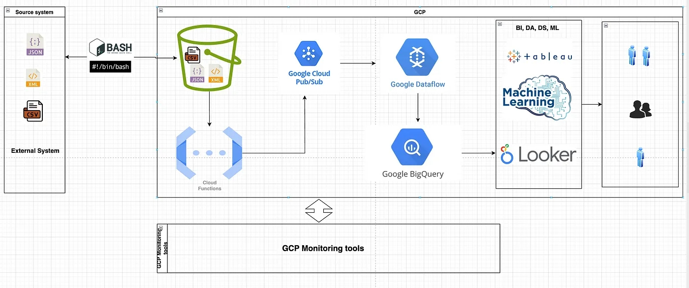

**Using Cloud Function (GCS trigger), Pub/Sub, Dataflow & BigQuery**

At Improving, we architected a cloud-native, real-time ETL pipeline on Google Cloud Platform (GCP) that could:

- Ingest 10TB of data per day
- Maintain sub-second end-to-end latency
- Remain fully serverless, reliable, and production-grade

This post details our architecture, the challenges we encountered, and how we optimized the system to meet both performance and cost-efficiency goals.

### Objectives

- **Ingestion volume**: 10TB/day (~115MB/sec sustained)
- **Latency target**: < 1 second from data upload to visibility in BigQuery
- **Design constraints**: Serverless, autoscaling, minimal ops
- **Core services**: Cloud Functions, Pub/Sub, Dataflow (Apache Beam), BigQuery

### Architecture Design & Overview

[Data Producers → GCS Upload]

↓

(Object Finalization Event) [Cloud Function Triggered by GCS]

↓

[Pub/Sub Topic (Buffer)]

↓

[Dataflow Streaming Job]

↓

[BigQuery (Analytics Layer)]

### Cloud Function Triggered by GCS Upload

Our ingestion pipeline begins when files are uploaded to Google Cloud Storage. A Cloud Function is automatically triggered by GCS “object finalized” events.

This function:

- Parses GCS metadata (bucket, filename, timestamp, source)
- Adds custom tags or schema versioning info
- Publishes a message to a Pub/Sub topic with metadata

### Optimizations

- Allocated enough memory (~512MB) to reduce cold starts
- Reused network clients to avoid socket overhead
- Enabled 1000 concurrent executions with no retry deadlocks

### Pub/Sub: Decoupling & Buffering

Pub/Sub acted as our message buffer, enabling:

- Horizontal scaling of downstream consumers
- Replay capabilities in case of downstream failure
- Backpressure protection via flow control

Each message carried metadata needed by Dataflow to load, transform, and route the data.

### Dataflow: Stream Processing Engine

We used Dataflow (Apache Beam, Java SDK) in streaming mode to:

- Fetch and parse raw file content from GCS
- Apply schema-aware transformations
- Handle deduplication using windowing and watermarking
- Write enriched data to BigQuery** **with sub-second delay

### Dataflow Optimizations

- Enabled Streaming Engine + Runner v2
- Used dynamic work rebalancing and auto-scaling (5–200 workers)
- Split large files into smaller chunks (ParDo + batching)

### BigQuery: Real-Time Analytics Layer

Data was streamed into a landing table in BigQuery via streaming insert. A separate scheduled transformation job partitioned and clustered data into curated tables.

### BigQuery Optimizations

- Partitioned by ingestion date
- Clustered by source_id, event_type
- Compacted daily files using scheduled queries
- Used streaming buffer metrics to detect lag spikes

### Bottlenecks & Challenges

### Recovery and Observability

- **Retries**: Cloud Functions and Pub/Sub retries + backoff
- **Dead-letter queues**: For malformed events or schema mismatches
- **Logging**: Centralized with Cloud Logging and custom labels
- **Metrics**: Data freshness, latency, throughput, and error counts
- **Reprocessing**: Manual or scheduled Dataflow replay from GCS + Pub/Sub

### Monitoring, Cost Optimization & Failure Recovery

Building a highly performant ETL pipeline isn’t enough; you also need observability and resilience. Here’s how we ensured visibility, cost control, and robust error handling in our 10TB/day GCP ETL pipeline.

### Monitoring the Pipeline

We leveraged Cloud Monitoring and Logging to track every component in real time:

**Cloud Function**:

- Monitored invocation count, execution duration, and error rates using Cloud Monitoring dashboards.
- Configured alerts for failed executions or abnormal spikes in duration.

**Pub/Sub**:

- Tracked message backlog and throughput via Pub/Sub metrics.
- Alerts were set to detect message backlog growth, indicating slow or failing subscribers.

**Dataflow**:

- Monitored autoscaling behavior, CPU utilization, memory usage, and system lag.
- Configured custom lag alerts to catch delays in processing (e.g., high watermarks lagging behind ingestion).
- Used Dataflow job logs to debug transformation errors, memory issues, or skewed partitions.

**BigQuery**:

- Monitored streaming insert errors and throughput using the BigQuery audit logs.
- Tracked query cost, slot usage, and latency to optimize performance and budget.

**Tooling**: Cloud monitoring dashboards were customized for our pipeline, with charts for:

- Throughput (files/min, records/sec)
- Latency (end-to-end from GCS to BQ)
- Job failure alerts
- Cost metrics per service (BQ storage/query, Dataflow VMs, etc.)

### Results

- Scaled to 10TB/day sustained load
- Achieved end-to-end latency of ~600ms on average
- Fully serverless and autoscaling with minimal ops overhead
- Real-time querying and downstream analytics are available within seconds

### Lessons Learned

- Cloud-native doesn’t mean that compromise sub-second latency is achievable with the right patterns.
- File-based triggers from GCS are reliable if you design for retries and idempotency.
- The key to performance is pre-scaling, batch tuning, and decoupling stages.

### Conclusion

GCP provides a robust foundation for building high-throughput, low-latency ETL pipelines. By combining event-driven triggers, Pub/Sub decoupling, and streaming dataflows, we were able to handle terabytes of data per day with real-time SLAs.

Whether you’re modernizing a batch system or building greenfield streaming architecture, this design can act as a blueprint. [Contact us to learn more](https://improving.com/contact) or [check out our career page](https://www.improving.com/careers/) to find out how you can be a part of the Improving team.
