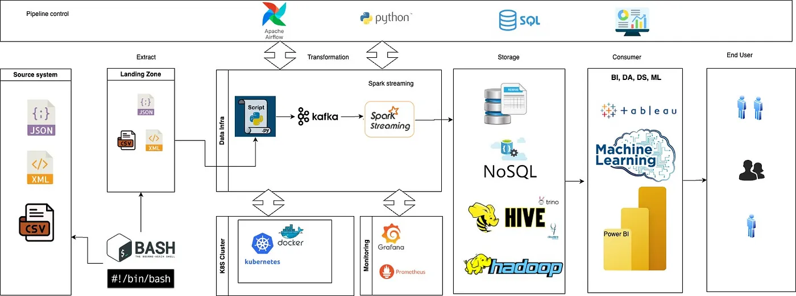

**Processing 10TB of data per day with sub-second latencies isn’t just cloud territory. Here’s how we nailed it on-prem.**

Designing a low-latency, high-throughput ETL pipeline on-premise that can process 8-10TB+ of daily data sounds like a cloud-native dream. But at [Improving](https://www.improving.com/), we built exactly that, leveraging a robust open-source stack centered around Apache Kafka, Apache Spark, Scala/Python, and Hive, all running in our on-premise data center.

In this post, I’ll walk you through how we architected a real-time system with:

- Sub-second event latency
- 100K+ events/sec throughput
- Reliability at scale
- Using Scala/Python and open-source tools

### **The Business Need**

At Improving, we needed to build an enterprise-grade ETL pipeline to handle massive unstructured telemetry data (JSON, XML) from multiple sources. The requirements were:

- Sub-second latency from event ingestion to query availability
- High availability and fault tolerance
- Ability to scale up to 10TB/day of raw event data
- Schema flexibility to support evolving IoT schemas

### **Tech Stack (On-Premise)**

We chose proven, scalable technologies:

### **On-Prem System Design:**

### **Kafka: The Real-Time Backbone**

- Partitioned topics for parallelism (100+ partitions)
- Compression enabled (LZ4)
- Replication factor = 3 for fault tolerance
- Producers send events in Avro format with Schema Registry

### **Key design for low latency**:

- Kafka is tuned for low **batch linger.ms = 1ms**, and **acks=1 **to prioritize speed (with redundancy at the storage layer).
- spark.streaming.backpressure.enabled=true

### **Spark Structured Streaming: sub-second Latency Magic**

Our PySpark streaming jobs were finely tuned for micro-batching:

- Batch size: Dynamic micro-batches, capped at ~1 second worth of data
- Stateful aggregations: enabled with watermarks
- Checkpointing: HDFS-based checkpoint directory for exactly-once

To avoid serialization overhead, we parsed messages using **fastavro** in UDFs and wrote output using DataFrameWriter with **parquet format** (great for Hive).

### **Hive: Scalable Storage with Fast Lookups**

- External partitioned tables (by dt_skey, vendor)
- Snappy-compressed Parquet to optimize I/O throughput and enable fast, columnar reads with predicate pushdown in Hive
- Tez engine optimized with: Bloom filters, Vectorized execution, Partition pruning

Every Spark batch **wrote directly to HDFS**, and Hive picked up the new data via partition repair, e.g., triggering `MSCK REPAIR TABLE` or `ALTER TABLE ADD PARTITION` (triggered by Airflow).

### **Key Optimizations**

##### **1. Micro-Batch Overhead Reduction**

Tuning spark.sql.shuffle.partitions and reusing serializers kept each micro-batch under 50ms.

*Spark Tuning Parameters:* *executor-cores=5* *executor-memory=8G* *num-executors=50* *spark.sql.shuffle.partitions=600 → optimized based on Kafka partition count* *spark.memory.fraction=0.8 → allows more memory for shuffles and caching*

##### **2. Broadcast Joins for Reference Data**

One of the major performance killers in distributed systems like Spark is shuffle-heavy joins. To mitigate this, we broadcast small reference datasets. Replaced shuffle joins with broadcast joins where lookup tables were < 100MB.

*broadcast_df = spark.read.parquet(“/hdfs/path/ref_data”).cache() ref_broadcast = F.broadcast(broadcast_df)*

*joined_df = streaming_df.join(ref_broadcast, “region_code”, “left”)*

- Spark sends the small `ref_data `to all executors.
- No need to shuffle the large streaming dataset.
- Result: Zero shuffle, faster join, sub-millisecond latency overhead.

##### **3. Parallel Kafka Reads**

Each Kafka partition was mapped to a dedicated Spark executor thread (no co-partitioning bottlenecks).

*Kafka Setup for High Throughput* *- Topic partitioning: 100+ partitions to spread ingestion* *- Replication factor: 3(for failover)* *- Compression: lz4 for lower latency and decent compaction* *- Message size: capped at 1MB to avoid blocking*

##### **4. Zero GC Pauses**

Spark is configured with **G1GC** and memory tuning to avoid JVM stalls during peak ingestion. Problem: Garbage collection pauses and memory pressure slow down micro-batch completion

***Example Usage of G1GC and set:*** *-XX:+UseG1GC -XX:InitiatingHeapOccupancyPercent=35 -XX:+ExplicitGCInvokesConcurrent*

##### **5. Data Skew Handling**

Used salting and repartitioning to prevent massive shuffle tasks on rare event types.

***Example salting and repartitioning:**** from pyspark.sql.functions import when, concat_ws, floor, rand*

*# Apply salt only to the skewed key salted_df = df.withColumn( “event_type_salted”, when(col(“event_type”) == “DELIVERED”, concat_ws(“_”, col(“event_type”), floor(rand() * 10).cast(“int”)) ).otherwise(col(“event_type”)) )*

*# Repartition to distribute load more evenly repartitioned = salted_df.repartition(10, “event_type_salted”)*

##### **6. Compacting Small Files (Hive + HDFS)**

**Parquet + Snappy** as the default format for all Spark batch/streaming outputs. Writing micro-batches every few milliseconds creates **lots of small, parquet files**, which:

- Slow down Hive queries
- Stress HDFS NameNode
- Cause memory overhead

*Optimization:* *- Run a daily/rolling compaction job using Spark to merge files* *- Use Hive-aware bucketing and partitioning logic (avoid too many small partitions)* *- Combine output using .coalesce(n) or .repartition(n) before writing*

### **Monitoring & Observability**

- Kafka: monitored using Prometheus exporters and alerting for lag
- Spark: integrated with Grafana for executor memory/CPU metrics
- End-to-end lag: measured from Kafka write timestamp to Hive write timestamp, stored in metrics DB

We built a **latency dashboard** to visually inspect where bottlenecks occurred useful for proactive tuning.

### **Testing and Benchmarking**

Before production, we: - Simulated 10TB/day ingestion using Kafka producers - Benchmarked with 3 years of historical data - Ran stress tests with synthetic burst events (3x normal load)

### **Lessons Learned**

- Always test end-to-end latency, not just per-layer performance.
- Hive can be real-time enough if you partition smartly and write efficiently.
- On-prem doesn’t mean slow with the right tuning, open-source can rival cloud-native stacks.
- Spark Structured Streaming can absolutely deliver low-latency on-prem pipelines
- Partitioning strategy matters more than compute power
- Good old Hive can still shine when tuned properly
- Kafka’s backpressure mechanisms are lifesavers under peak load

### **Conclusion**

At Improving, we believe performance engineering is a team sport. Designing an 8-10TB/day on-prem pipeline with sub-second latency was ambitious, but using Kafka + Spark + Hive with smart tuning, we made it work.

If you’re building large-scale ETL pipelines or modernizing on-prem systems, [feel free to reach out to us!](https://improving.com/contact)
