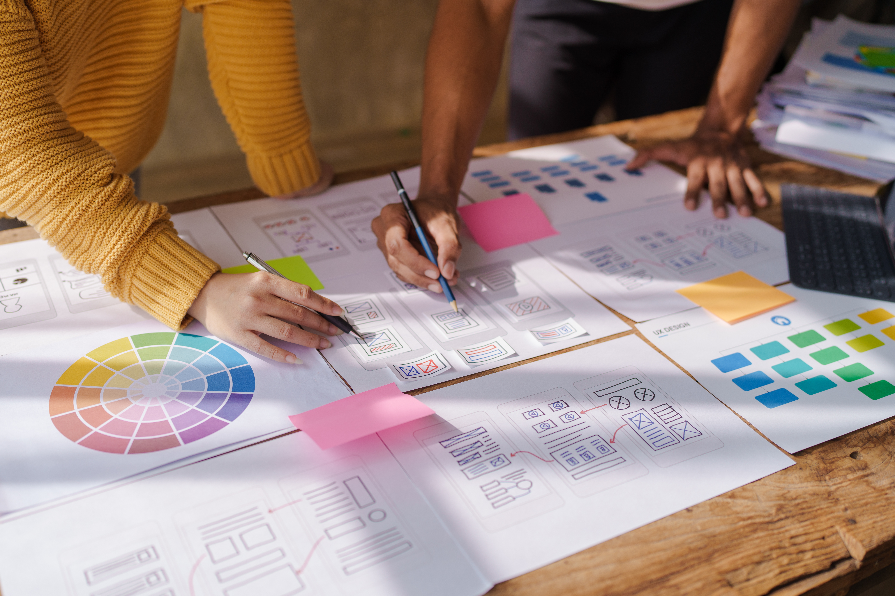

In the dynamic world of Professional Consulting Services, every project kickoff represents a pivotal opportunity. As a design leader, I’ve come to realize that success isn’t just about delivering beautiful interfaces—it’s about leveraging design leadership to align client goals, user needs, and technical feasibility. By setting the right foundation, we can achieve outcomes that resonate deeply with users and deliver measurable value to our clients and partners.

Here’s how to ensure your next project starts off on the right foot:

### **1. Discovery and Alignment: Setting the Stage**

Every project begins with understanding. Engaging stakeholders through interviews is essential to uncover their business objectives, challenges, and success metrics. These conversations provide a window into the broader vision and can highlight nuances that might otherwise be missed. For instance, during a recent project kickoff, a stakeholder interview revealed an unmet customer need that significantly shaped the project’s direction and ultimately drove higher user satisfaction.

Diving into user research is equally important. Leveraging existing data or conducting primary research helps us understand the target audience—their pain points, motivations, and behaviors. In one project, early user interviews uncovered a critical usability issue that hadn’t been documented, saving the client time and resources later.

Studying the competition offers insights into market gaps and opportunities. A competitive analysis not only identifies strengths and weaknesses but also inspires innovation. For example, in analyzing a competitor’s product, we discovered a missed opportunity for accessibility features, which we implemented to great acclaim.

Activities to achieve:

- Stakeholder Interviews
- User Research
- Competitive Analysis

### **2. Define Goals and Scope: Establishing Clarity**

Ambiguity can derail even the best intentions, so early clarity is key. Crafting a problem statement ensures the team knows exactly what they’re solving. During one project, articulating the problem statement helped align a cross-functional team that initially had conflicting priorities.

Setting project goals requires balancing business objectives with user needs. Clear, measurable goals provide a roadmap for success. For instance, a project focused on increasing engagement metrics led to a redesign that resulted in a 30% boost in user interaction.

Drawing boundaries by defining the project’s scope helps manage expectations and prevent scope creep. In one project, a well-defined scope ensured the team could deliver on time while leaving room for future enhancements.

Activities to achieve:

- Create a Problem Statement
- Set Project Goals
- Outline Project Scope

### **3. Strategy and Planning: Designing the Path Forward**

With goals in place, it’s time to strategize. Mapping user journeys allows us to visualize the experience from start to finish. This process identifies friction points and opportunities for delight. For example, journey mapping for an e-commerce client revealed a cumbersome checkout process that, once simplified, increased conversions.

Developing personas based on research helps guide empathetic decision-making. Personas bring users to life and keep their needs front and center. In one project, a persona representing an underserved user group led to features that significantly improved accessibility.

Auditing content ensures alignment with project goals. Reviewing existing materials can uncover redundancies or gaps. In a content audit for a nonprofit, we identified outdated messaging that, once refreshed, drove stronger donor engagement.

Collaborating with developers early on grounds designs in technical feasibility. Understanding system constraints and opportunities ensures designs are not only innovative but also implementable. In a recent collaboration, this approach saved weeks of development time by preemptively addressing a potential integration issue.

Activities to achieve:

- User Journey Map
- User Personas
- Content Audit
- Technical Feasibility

### **4. Collaboration and Communication: Building Momentum**

Strong collaboration is the backbone of every successful project. Hosting design workshops brings stakeholders together to co-create solutions and prioritize features. In one memorable workshop, we uncovered a hidden business priority that reshaped the project’s feature set for the better.

Establishing a communication plan with regular updates and feedback loops keeps everyone aligned. Clear and consistent communication prevents misunderstandings and fosters trust. For example, a well-executed communication plan in a global project ensured seamless collaboration across time zones.

Clarifying roles ensures everyone knows their responsibilities, fostering accountability and efficiency. In one project, defining roles early on helped avoid duplication of efforts and streamlined decision-making.

Activities to achieve:

- Design Workshops
- Communication Plan
- Clarify Roles

### **5. Deliverables: Setting the Foundation**

Early deliverables lay the groundwork for success. A kickoff presentation summarizing insights, goals, and timelines aligns the team and sets expectations. During one kickoff, presenting a unified vision inspired confidence and enthusiasm among stakeholders.

A research plan outlining the who, what, and how of user research ensures that everyone is on the same page. For example, a detailed research plan for a healthcare client led to actionable insights that directly influenced the design.

Preliminary wireframes spark discussions and gather feedback early. Sharing rough concepts helps identify potential issues before significant time is invested. In one project, early wireframes revealed a navigation challenge that, once addressed, improved user flow.

Activities to achieve:

- Project Kickoff
- Research Plan
- Share Initial Solutions

### **Design Leadership in Action**

As design leaders, our role extends beyond crafting visuals. We drive alignment, inspire innovation, and ensure that design is a catalyst for better outcomes. By leading with empathy, clarity, and a strategic mindset, we not only help clients achieve their goals but also elevate the role of design within their organizations.

When we kick off projects with intention and collaboration, we set the stage for success. Every decision—from initial discovery to final deliverables—becomes an opportunity to deliver value and build trust. That’s the power of design leadership.

How do you approach project kickoffs? [Contact us](https://www.improving.com/contact) and let’s continue the conversation on driving success through design.
