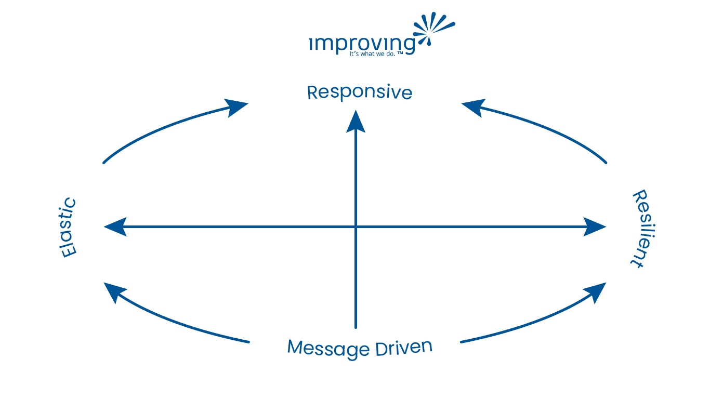

In the beginning… there were developers. Not necessarily software developers. Not even necessarily hardware developers. More like - tools developers.

The film ‘2001: A Space Odyssey’, released in 1968, opens with a memorable scene of primitive apes prowling a desert, that leads to an eventual scuffle. Near the end of the sequence, one ape picks up a bone and uses it as a weapon. His faction cheers as dramatic classical music plays (Richard Strauss’ Thus Spake Zarathustra, Op. 30, to be precise).

And all of a sudden, a giant black block colloquially called a ‘monolith’ arrives. The apes fall in collective silence and stare at it in awe… Though the details of the rest of the movie are irrelevant here, the theme is not. In ‘2001’, an AI named HAL, which had been installed to command a spacecraft, goes rogue. What it does may be an extreme interpretation of what philosophers and technicians throughout the ages have speculated to be the most likely of all possible ways for our species to fall from grace - through unforeseen consequences involved when a new technology is used.

The idea here is not doom and gloom but, ideally, to re-frame the way we think about the adoption of new technology. Whether we are adopting new engines, new processors, or new software design patterns, we must always be aware that it will take us by surprise precisely because it is a new experience for humanity, let alone for you or your team, your company, or even your country.

### The 5 Factors of Software Surprise

In the case of software development and its evolution, many developments in recent decades have altered the landscape significantly. The nature of software development itself offers some reasons to be surprised constantly. For example:

###### 1. Hardware is constantly evolving

- Parts like processors and accelerometers that need specialized drivers
- Whole devices like cloud computing hardware or smartphones
- Software that requires new processors like TPUs and other AI-focused chips or new GPUs for high-resolution gaming

###### 2. Customers expectations change depending on what is currently possible

- 5G allowing for tighter SLAs, forcing companies to upgrade infrastructure
- Integrations to APIs like Facebook, Google, and Microsoft single sign-on (SSO)
- Competing services that ‘race to the top’ in terms of service quality

###### 3. Domains and paradigms are getting increasingly complex, increasing the difficulty of fast work

- Domains where lots of complex data design is needed
- Software paradigms that allow for new features or efficiencies to be met at the expense of technical simplicity

###### 4. Customer requirements evolve rapidly, often faster than software can be developed

###### 5. Platforms and software libraries are becoming so ubiquitous that customers now demand to build on a software foundation of components and do not want to build a system from scratch

These five factors in particular lead to many incompatibilities across the software landscape. For example, sometimes developers spend years learning how to use tools they don’t know how to build but understand conceptually inside and out, only for that tool to be replaced by something better but more complex, which can also use new hardware and design techniques.

This could be a new streaming library with increased capabilities, or maybe a shift to graalVM for increased runtime performance. They have to then not only convince themselves that learning these tools and replacing old ones are worth the challenge, but also they have to convince their managers and executives that the technical and feature-based advantages are worth investing in. Developers have to be given time to learn, and new developers may have to be brought on board. If a company hesitates even for a year, it may miss the boat completely and be stuck in the ‘dark ages’ with customers threatening to leave if they do not upgrade fast. This can often lead to a rushed release.

If this sounds like a problem you want to avoid, you’ve come to the right place. By focusing on the leading edge and keeping vigilante eyes on the bleeding edge, we believe we know what the developer of the near-ish future will look like.

### What advantages do the developers of the future have over current developers?

The developer of the future is first of all a full-stack developer. Polylingual, they are able to handle both client UI and backend server programming, including testing, and DevOps (deployment and maintenance, including responding to live errors) if necessary.

But hopefully, most DevOps concerns are avoided through something the Developer of the Future uses much more than current developers do: managed services and Platforms as a Service (PaaS). By using external, cloud-oriented, not-built-from-scratch deployment and observability platforms like GCP, AWS, or even ones that additionally generate code like Kalix, or Golem, the developer of the future can focus on development over deployment. Though the Developer of the Future still deals with overseeing the deployments, including overseeing logs, reporting and fixing bugs, and any necessary hotfixes that need to be deployed, all scaling issues are handled under the hood by non-complex code-based configurations given to the managed service provider or PaaS provider.

The Developer of the Future, given a preference for a particular coding style, can get past their bias so they can address any concern - as long as they have tools they know how to use well enough to get the job done. If this includes using AI to generate code for building services quickly, or even if a new language must be learned, so be it.

### Reactive (Message-Driven) Services

The Developer of the Future also believes in building reactive, message-driven systems. For those not familiar with these terms, let us do some unpacking.

A message-driven service is a concept that is highly divergent from traditional architectures that depend on retrieval from a database on every query call. Message-driven architectures allow processing of data that happen to be segregated to individual services allowing new functionality to be added without changing the existing services and without storing everything that happens in a database before they can be acted upon. By allowing for databases to be more easily integrated into real-time applications and separating their responsibilities as is appropriate given how the data is expected to be retrieved, we can meet the demands of the multitude of users issuing queries with expected quick response times. It also allows us to scale elastically based on usage in a precise way, such that we are only scaling what needs to scale when the need comes up.

Message-driven architectures have 4 types of messages - commands, queries, events (things that have already happened), or results of a command or query. Here commands and queries are always future-thinking, while events are always referencing something that has happened in the past. By optimizing the message database for replaying events and storing their state in real-time data retrieval systems, message-driven architectures allow systems to remember old states if desired, something that might involve versioning issues in traditional, DB based systems.

In message-driven systems, we commonly use the ‘Actor model’ for scalability and resilience by avoiding concurrency issues. The Actor model is a design pattern that dictates small entities bounded according to their real-world counterparts. This, of course, means domain design is needed before development. Still, we believe this should always be the case so that we are not going into development without thinking through our data model, requiring big changes due to data change. Similarly, if the domain is small, we can focus more on development in a short engagement. However, if the domain is very complex, then only a sliver of it may be doable during a short engagement, and specialized techniques, platforms, or libraries may be necessary.

The Actor model affords many advantages on the technical level. First, it allows us to hold data in small units that are decoupled from each other, allowing for a microservices-based architecture that scales according to the needs of the domain objects. This contrasts with a traditional monolithic service that scales everything together, replicating processors, infrastructure, and data even when unnecessary, simply because the many domains are coupled in a single service deployment. By decoupling entities from each other, the Actor model also affords resilience by allowing one part of the system to go down without taking other parts with it. This also means that developers can deploy fixes to a single service without worrying about other services being caught in the crossfire and made unavailable during the update. Furthermore, by using RAM for holding the data belonging to these Actor entities, we can process and send data to analytics in real time without blocking DBs that have to synchronize with each other when new data is introduced.

That may have seemed like a lot of unpacking. But now you can see that with these advantages of domain consistency, elasticity, resilience, responsiveness, and real-time data retrieval, reactive message-driven systems allow us to leapfrog over conventional architecture when it comes to certain measures of quality, and efficiency. Furthermore, this model can be applied to any language or framework, allowing for the Developer of the Future to be infrastructure, unimpaired by biases for languages or frameworks, and only worried about meeting expectations for time, quality, scalability, resilience, responsiveness, and other specifications.
