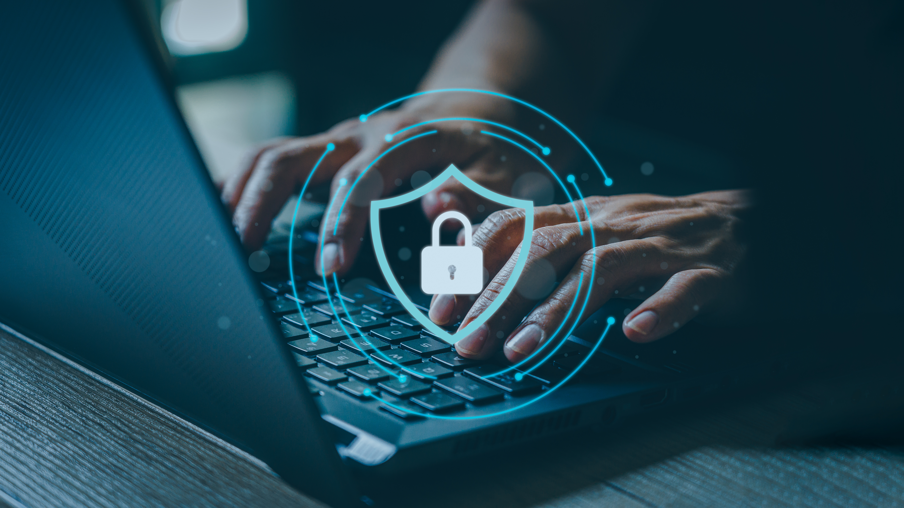

People have been asking if DevSecOps was just the fad to follow the DevOps fad. The answer: the core concepts of DevSecOps are too critical when operating a modern business for them to be a fad - no matter what you want to call it. Let's explore what these core concepts are and why any business building and running software needs to have them in place.

First, let’s consider DevOps. DevOps began as an operating principle which then got co-opted into products, teams, and other specific items. Originally, DevOps was a thing you do, not a thing you are. It was founded on the principle which says effectively operating software requires open, shared communication between those who build the software (development) and those who run the software (operations).

It’s designed to break down the silos of "Dev" and "Ops" and create a common vocabulary, set of practices, and a shared responsibility model to help these two teams be one team. Part of this includes helping developers think like ops people and ops people think a bit more like developers. The cross-pollination leads to better instrumentation, logging, and deployment methodologies on the developer side. And it brings Infrastructure as Code, Configuration as Code, and other automation practices to the operations side.

The net result is software that is easier to deploy and operate, and results in lower cost of operation and faster release cycles.

Security comes into play when we realize building software faster and operating it cheaper can create new risks. We need to find a way to make sure our Security team is included in the unified process. And ensure dev and ops teams are thinking about security as they do their jobs.

And we need to do this without slowing down business.

DevSecOps helps us by bringing the same core concepts of DevOps and includes security. Security becomes an integral part of developers’ and operations’ practices. It does so by bringing in several specific practices and technologies into the software lifecycle.

## Software Development

Software development teams have been writing secure software for decades. OWASP training and other techniques have helped architects and developers prevent major security mistakes. DevSecOps builds upon these practices through shared responsibility and automation.

Responsibility is a key tenet of DevOps and the culture change required to fully adopt DevOps. The idea is the whole team is responsible for operating the technology in the production environment and delivering value to the business. Not only is the operations team responsible, but everyone is.

DevSecOps likewise holds the whole team responsible for operating the product *securely* in production. It's not just the Cybersecurity team bolting on security at the last minute, but everyone is thinking about how to incorporate security. By creating this shared responsibility, security is no longer the team that says "no" but instead the role which answers "how."

One of the easiest ways to make software more secure without overly burdening the process is automation. As with automating the build and deployment process, we can bring in tools and technologies to automate common security requirements.

The two most common are Dynamic Application Security Testing (DAST) and Static Application Security Testing (SAST). These are products that are incorporated into your existing build and release lifecycle. SAST tests are run during the build process and look for common vulnerabilities in the code. DAST is run post-deployment against a live application (pre-production typically) and tests it for common vulnerabilities.

We aren't diving into specifics about DAST or SAST products or techniques. Because they're automated technology, they too are controlled by code. As a DevSecOps team member, you are defining how to test and what to test, including what rules to enforce, in your "Security as Code" configuration files. This joins the practices of Infrastructure as Code and Configuration as Code on the infrastructure and operations side.

Automation helps ensure we can enforce secure coding practices without significantly slowing down the development lifecycle. Shared responsibility helps make sure we have the whole team buying into the best practices and responding to findings the automated tests provide.

## DevSecOps is a Culture Change

DevSecOps isn't achieved by buying a product or hiring a specialist. These are components of successful DevSecOps but are not enough to create a successful DevSecOps culture. Instead, all levels of buy-in must be part of the plan, from the technical teams to the business leadership.

The technical teams each need to understand their unique role in creating secure software. Product Owners and other user story authors need to be thinking about how security fits into the functionality of the product. The user experience team should understand the impact of security on usability. Architects need to select secure technologies and architects. Developers must write software following secure patterns. Testers are looking at both the functional and security requirements as they develop test plans and automated tests. Operations teams have the burden of providing a secure hosting environment.

Security is woven through the entire product team. But if it also isn't part of the leadership's culture, then it will inevitably fail. When a critical deadline is coming up, will leadership look for things to cut to make the date? Will security be up for consideration? If so, is it a risk-based decision, or just a cut because the culture is not fully adopted?

## Getting DevSecOps Going

As with any corporate culture shift, DevSecOps adoption requires a champion. The champion could be from security, product, or leadership. Once the champion has accepted their role, then they must begin their culture change campaign.

The first part is understanding where the organization is at present. What DevSecOps practices are already in place? Do you already do OWASP training for developers? Are DAST or SAST solutions running? Maybe you already undergo a SOC 2 audit or are ISO 27001 certified. Any existing secure practices are the foundation upon which DevSecOps can be built. If there are none yet, then there is more work, but adopting DevSecOps can help you prioritize some quick wins in bringing security into your organization.

Building out from the foundation, the effort then is to bring all stakeholders together and help each understand what is expected of them and likewise, what the benefit will be to them. Every group will benefit from DevSecOps, and they'll need to see the reward is worth the effort. Give each group a seat at the table and allow them to share concerns. *Will DevSecOps be more expensive? Will it slow us down? Are we considering our contractual and legal obligations? Will it make our jobs harder?*

Be prepared to know answers to questions such as this, or how you would go about finding the answer. Most likely each group's concerns will need to be addressed over time. DevSecOps can't happen overnight, so picking which concerns to address first, and which will come later in your adoption roadmap, is the key to making a successful and manageable effort.

DevSecOps is critical to building and operating secure software. By understanding what it is and what it brings to an organization, you can begin to build a plan to adopt it within your organization. Realizing it is a culture shift, and knowing who is ready and who is resistant will help make it successful. The rewards will be worth it!

If you need help adopting DevSecOps or deciding if you should, the Improving consulting team can help! [Reach out to us](https://improving.com/contact/) for a quick conversation about where you’re at today and where you’d like to go!

***Erik spoke on this topic during an Improving Webinar. To watch the discussion's recording, ***[***CLICK HERE!***](https://www.youtube.com/watch?v=lkPXqlW9wj0)
