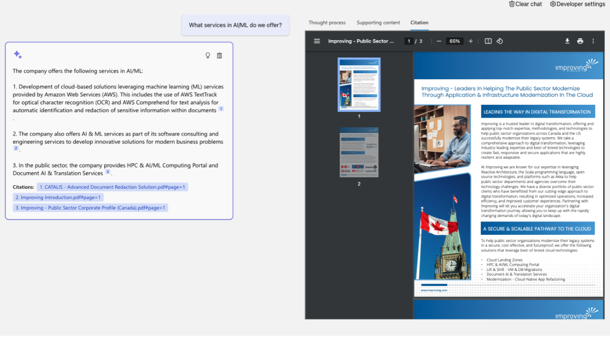

In the ever-evolving world of modern business, understanding how to effectively leverage institutional knowledge is a game-changer. At Improving, we've experienced first-hand the challenges that many organizations face in this area. We've navigated these challenges and evolved our approach many times. Recently, we found innovative solutions using technology, particularly AI, which has significantly enriched our day-to-day operations.

Institutional knowledge, the collective wisdom, and data accumulated over the years is a powerful asset for any organization. Its true value, however, lies in its effective sharing and utilization across the company. Without this, the knowledge only benefits a small percentage of the company that knows about or remembers it. Effective discovery and utilization not only enhance decision-making and efficiency, but empowers every team member to contribute to and benefit from the collective intelligence.

Our journey in enhancing knowledge flow led us to create "[Echo](https://www.improving.com/improving-echo/)", an AI-enabled knowledge base for our sales and sales support teams. We faced a challenge familiar to many: our teams couldn't remember all the unique customer stories, case studies, and win-wires we accumulated in decades of operations. Echo was our solution. Designed to redefine access to and leverage of institutional knowledge for a greater impact. We leveraged multiple cutting-edge techniques including factual grounding, retrieval, and generation (RAG), along with Microsoft, AWS, and Google cloud toolkits.

Echo is not your typical Teams, SharePoint, or database tool. It amalgamates information from these sources and more to create an intelligent partner in your quest for knowledge. Using multiple Large Language Models (LLMs) and an automated data engineering pipeline, Echo transforms how knowledge is stored, accessed, and utilized, regardless of the document format. It understands the user’s role and typical queries, providing precise and relevant information almost instantaneously through a chat interface that embeds the response collateral directly into the conversation, ensuring accurate and trustworthy answers with their backing information readily available.

The advantages of Echo are numerous:

1. Enhanced Discoverability: With Echo, the days of sifting through endless files and folders are over for our team. Its AI algorithms ensure that the right information finds you effortlessly, across dozens of sites, teams, and file shares.

2. Collaborative Knowledge Sharing: Echo fosters a collaborative environment by connecting team members with a broad array of information from across the organization, thereby breaking down silos and connecting isolated information islands.

3. Endless Versatility: We are now looking at many more knowledge abyss problems at Improving leveraging these approaches and templates. Their portability between problems allows us to solve each area rapidly.

Since implementing Echo, we've observed remarkable improvements in efficiency, responsiveness, and team satisfaction. It's more than a tool for Improving; it's a paradigm shift in how knowledge is managed and utilized. You may be thinking about places where you have this problem in your business, or that this must be incredibly expensive, or just intrigued. We built this to help us, and to help our clients as well.

Whether it is helping to prompt knowledge base articles to a call center person in the middle of the call, providing product information look-up for a sales team, or even helping your back office team onboard faster, the potential is huge. The costs, however, are approachable. This is thanks to our focus on creating meaningful value creation for minimal costs. This was done through templatization and leveraging existing cloud services in new ways.

We know that the real value of any technology is in how it helps achieve business results. If you're interested in exploring how something like Echo can transform knowledge management in your organization, [reach out to us at Improving](https://www.improving.com/contact). We're ready to explore that future with you. It can revolutionize your approach to institutional knowledge. Let's embark on this journey of knowledge transformation together.

[To learn more about Echo, click here!](https://www.improving.com/improving-echo/)
