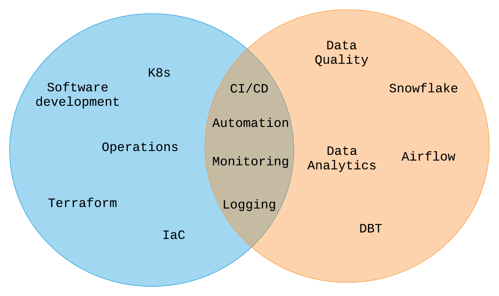
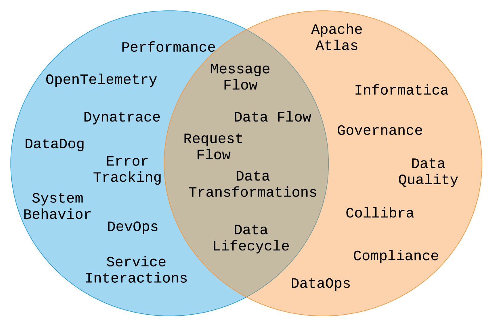
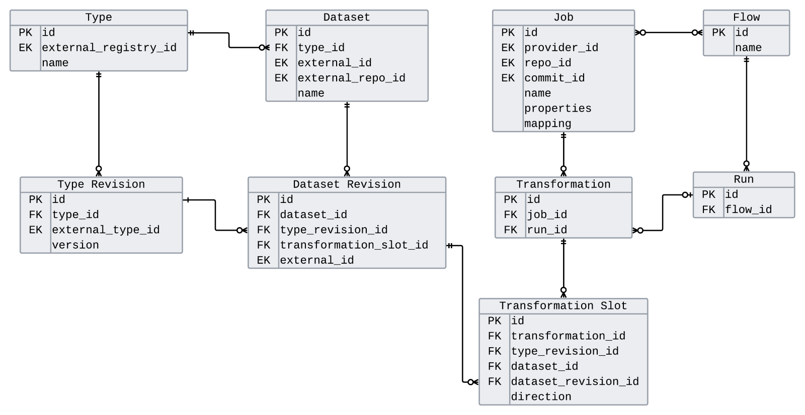
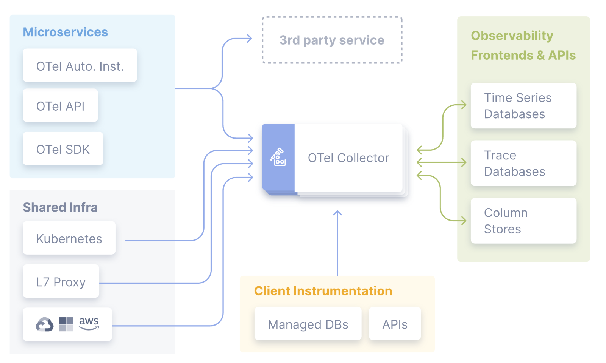
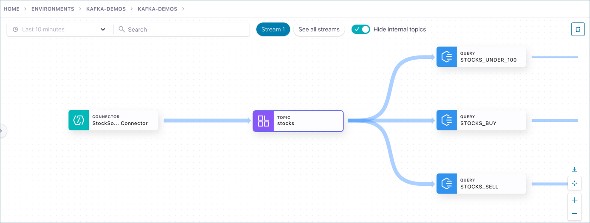
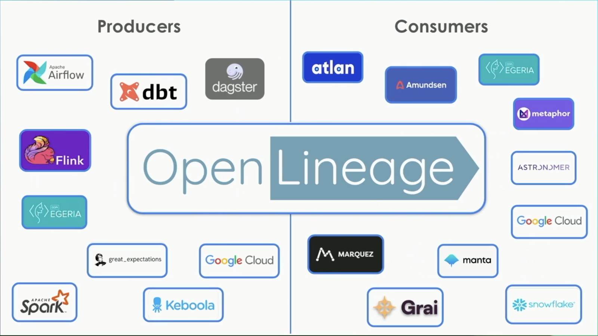

Real-time data systems have revolutionized how organizations process and respond to information, enabling everything from fraud detection to personalized recommendations. However, as these systems grow in complexity, understanding how data flows through them becomes increasingly challenging. Data lineage provides visibility into the journey of data from its origin to its final destination.

We'll explore practical strategies for implementing effective data lineage in real-time systems, examining both the technical challenges and emerging solutions that can help organizations maintain control over their streaming data architectures.

### **Understanding Data Lineage in Real-Time**

Data lineage is the process of tracking and documenting the flow of data from its origin to its final destination. It answers fundamental questions about your data: What happens to it? How does it change? Where does it move over time? Essentially, it provides a chain of custody of your data assets.

The Fundamentals of Data Engineering says it well, "As data flows …, it evolves through transformations and combinations with other data. Data lineage provides an audit trail of data’s evolution as it moves through various systems and workflows." (Reis & Housley, 2022)

Data lineage is sometimes conflated with audit logging or tracing, but it serves a distinct purpose. While traditional logging focuses on system behavior and errors, lineage specifically tracks data transformations and movement. There are several different types of lineage to consider:

- **Static vs. Dynamic**: Static lineage shows potential data flows based on code analysis, while dynamic lineage tracks actual data movement at runtime
- **Granularity levels**: Row/message level, column/field level, schema level, and change management level
- **Temporal aspects**: Point-in-time lineage vs. historical lineage tracking

### **Why Data Lineage Matters More in Real-Time Systems**

Real-time systems present unique challenges that make data lineage even more critical than in traditional batch processing environments. It's remarkably difficult to tell how data got into its current state when you're dealing with streaming architectures, and this creates nightmares for several key areas:

**Troubleshooting**: When a real-time dashboard suddenly shows incorrect data or a machine learning model's accuracy drops, you need to quickly trace the problem back to its source. Without lineage, you're essentially debugging blind.

**Data Quality**: Real-time systems often involve multiple data sources, transformations, and routing decisions. Understanding the complete data flow helps identify where quality issues might be introduced.

**Compliance**: Many industries require detailed audit trails of how data is processed and transformed. Real-time systems can't exempt themselves from these requirements.

**Change Management**: When you need to modify schemas, update transformation logic, or change routing rules, lineage helps you understand the downstream impact before making changes.

The book Data Governance: The Definitive Guide says it well, “A common need that gets answered by lineage is debugging or understanding sudden changes in data. Why has a certain dashboard stopped displaying correctly? What data has caused a shift in the accuracy of a certain machine learning algorithm?” (Eryurek, Gilad, Lakshmanan, Kibunguchy-Grant, & Ashdown, 2021)

### **A Tale of Two Disciplines**

To understand effective lineage strategies, it's important to recognize how software engineering and data engineering disciplines intersect. Both fields have evolved sophisticated approaches to observability and monitoring, but they focus on different aspects of system behavior.



Software engineering DevOps has mature practices around:

- Software Development
- Infrastructure as Code (IaC)
- Application monitoring and logging
- Kubernetes and containerization
- Operations and incident management

Data engineering DataOps has developed parallel practices focused on:

- Data quality
- Workflow orchestration (Airflow, Snowflake)
- Data analytics and transformation
- Data lifecycle management

The overlap between these disciplines includes automation, monitoring, logging, and CI/CD practices. Similarly, Software engineering has tracing and data engineering has lineage.



Tracing focuses on:

- Performance metrics
- Error tracking
- System behavior
- Service interactions

Lineage focuses on:

- Data transformation tracking
- Compliance and governance
- Data quality

And they overlap in that they track message flow, request flow, and data flow, data transformations, and data lifecycle. This is where real-time data lineage lives.

### **Real-Time Data Lineage Architecture**

Implementing effective lineage in real-time systems requires both a robust data model and a reliable collection mechanism. Let's examine each component.

#### **Metadata Data Model**

The foundation of any lineage system is a well-designed metadata model that can capture the relationships between data entities, transformations, and execution contexts.



The core entities in our lineage model include:

**Types and Type Revisions**: These track schema definitions and their evolution over time. For example, a Kafka topic might have multiple schema versions registered in a schema registry, and we need to track which version was used for each transformation.

**Datasets and Dataset Revisions**: A dataset represents a logical data container (table, topic, collection), while revisions represent individual changes or additions to that dataset. In Kafka terms, this could be individual offsets within a partition.

**Jobs and Transformations**: Jobs represent the processes that perform data transformations, containing information about the transformation logic, commit IDs, or mapping definitions. Transformations track individual executions of these jobs.

**Transformation Slots**: These represent the input/output relationships for each transformation, tracking which datasets were consumed and produced, along with their specific revisions.

**Flows and Runs**: Flows represent the overall data processing pipelines, while runs track specific executions of those flows.

Here's a simplified example of how transformation entry might look:

```json
{ 
  "transformation": { 
    "id": "transform_001", 
    "job_id": "weather_enrichment", 
    "run_id": "run_abc123", 
    "timestamp": "2024-01-15T10:30:00Z", 
    "transformation_slots": [ 
      { 

        "id": 1, 
        "dataset": "weather.raw", 
        "revision": "partition_0_offset_1847", 

        "direction": "INPUT" 
      }, 
      { 

        "id": 2, 
        "dataset": "weather.enriched",  
        "revision": "partition_1_offset_923", 

        "direction": "OUTPUT" 
      } 
    ] 
  } 
} 
```

This model is a simplified model from the paper Theoretical Model and Practical Considerations for Data Lineage Reconstruction by Egor Pushkin. Please see that paper if you need more sophistication in your metadata data model.

#### **Metadata Collection Strategy**

The data model is only as good as the metadata you collect. In real-time systems, this means instrumenting every component that touches your data.

Each lineage event should include:

- Information about the transformation itself (job info, commit ID, mapping definition).
- Input dataset references and their specific revisions.
- Output dataset references and their specific revisions.
- Useful tracing properties (timestamps, custom IDs, correlation IDs).
- Execution context (which node, which run, error states).

The key insight is that nodes in your processing pipeline should already know most of this information. The challenge is capturing it systematically and routing it to your lineage backend.

**Trace ID Propagation**: One critical aspect is implementing proper trace ID propagation throughout your pipeline. This means:

- Initializing a unique trace ID at the start of each data flow.
- Propagating this ID through message headers or context.
- Including the trace ID in all lineage events.
- Using the trace ID to reconstruct complete data journeys.

### **Leveraging OpenTelemetry for Metadata Collection**

OpenTelemetry (OTEL) provides a robust, widely adopted framework for metadata collection that can be adapted for lineage purposes. While not specifically designed for data lineage, it offers several advantages:



**Robust Collection Architecture**: OpenTelemetry provides battle-tested infrastructure for collecting, processing, and routing telemetry data at scale. OTEL collectors can gather metadata from many different systems and make that data available to many different frontends.

**Wide Adoption**: Most modern applications and platforms already support OpenTelemetry, reducing integration overhead. It has a large collection of collectors for many different APIs, SDKs, and tools.

**Dual Purpose**: You can capture both traditional application tracing and data lineage information using the same infrastructure.

**Adapting OpenTelemetry for Lineage**

OpenTelemetry does not have lineage support at the time of writing. To use OTEL for this purpose you need to implement it for lineage collection. There are some considerations to address:

**Custom Sampling**: Traditional observability sampling (often 1% or less) is probably not suitable for lineage. Typically, total information on your data lineage is needed, though your requirements may dictate otherwise. If you need to capture every data transformation, then you need to implement custom sampling policies that ensure 100% capture for lineage-tagged traces.

**Lineage-Specific Attributes**: Add custom attributes to your spans that capture lineage-specific information (per our data-model above):

```json
{ 
  "span": { 
    "name": "data_transformation", 
    "attributes": { 
      "lineage.job.id": "weather_enrichment", 
      "lineage.input.dataset": "weather.raw", 
      "lineage.input.revision": "partition_0_offset_1847", 
      "lineage.output.dataset": "weather.enriched", 
      "lineage.output.revision": "partition_1_offset_923", 
      "lineage.transformation.type": "enrichment" 
    } 
  } 
} 
```

**Custom Exporters**: To visualize our query lineage data, we need to send to an appropriate backend. Standard OTEL backends likely do not have an interface that makes it easy to understand your lineage. You will need to provide or integrate a backend that is suitable for lineage. Build [custom OpenTelemetry exporters](https://opentelemetry.io/docs/languages/js/exporters/#custom-exporters) that can route lineage-tagged traces to your lineage backend while sending other telemetry to traditional observability platforms.

#### **Tracing vs. Lineage Trade-offs**

While OTEL can work for lineage collection, it's important to understand the trade-offs: **Advantages:**

- Leverage existing infrastructure and expertise.
- Unified collection pipeline for multiple types of telemetry.
- Mature ecosystem and tooling.
- Built-in reliability and scalability features.

**Disadvantages:**

- Higher maintenance burden for customizations.
- Lack of community support for lineage-specific use cases.
- Service-oriented rather than data-oriented by design.
- May require significant customization for complex lineage requirements.

### **The Current Ecosystem**

The data lineage ecosystem has evolved significantly, but it remains fragmented across multiple disciplines and tools.

#### **Existing Solutions**

**Traditional Data Lineage Tools**: Many established platforms offer lineage capabilities:

- Apache Atlas
- Apache NiFi
- Collibra
- Egeria
- Manta
- Monte Carlo Data
- OpenMetadata
- Spline

Most of these tools can ingest lineage metadata from external sources, and some provide their own collection mechanisms. However, they're primarily designed for batch processing workflows.

**Real-Time Specific Solutions**: A smaller set of tools focuses specifically on real-time lineage:

- Confluent Stream Lineage
- Solace PubSub+ Event Portal
- Datorios



These solutions offer metadata collection and visualization out of the box, requiring minimal system instrumentation. However, they typically lack message-level lineage granularity and don't integrate well with external systems.

### **The Fragmentation Challenge**

As noted in recent research: "No complete system for data provenance exists, instead there is a patchwork of solutions to different elements of the problem" (Longpre, Mahari, Obeng-Marnu, Brannon,

South, Kabbara & Pentland, 2024). Organizations often use 3-20 different products for moving data around, with no single pane of glass for understanding the complete data flow.

This fragmentation creates multiple challenges:

- Inconsistent metadata formats across tools.
- Gaps in lineage coverage between systems.
- Difficulty correlating lineage information across platforms.

### **OpenLineage: An Emerging Standard**

OpenLineage represents a significant step toward standardizing lineage metadata collection across the ecosystem. As a graduated Linux Foundation AI & Data project, it provides:

**Standardized Metadata Format**: OpenLineage defines a common schema for lineage events, making it easier to integrate multiple systems.

**Technology Agnostic**: The standard works across different data processing engines, storage systems, and orchestration platforms.

**Growing Ecosystem**: Major tools like Apache Airflow, dbt, Apache Spark, and cloud platforms are adding native OpenLineage support.

**Real-Time Suitable**: Unlike some lineage standards that focus on batch processing, OpenLineage is designed to handle real-time workloads.

OpenLineage sports a growing ecosystem of producers (metadata collection) and consumers (lineage backends):



#### **OpenLineage Implementation Strategy**

To implement OpenLineage in your real-time systems:

1. **Choose Your Backend**: Select a consumer (lineage backend) that supports OpenLineage ingestion.
2. **Instrument Your Producers**: For systems that don't have native OpenLineage support, implement custom producers that emit lineage events in the OpenLineage format. The producers collection lineage metadata.
3. **Centralize Collection**: Use OpenLineage's HTTP transport to send all lineage events to a central collection endpoint.
4. **Extend Coverage**: Gradually expand lineage coverage across your entire data ecosystem using the common OpenLineage format.

#### **Benefits and Limitations**

**Benefits:**

- Vendor-neutral standard.
- Growing community and ecosystem support.
- Suitable for both batch and real-time workloads.
- Extensible schema for custom use cases.

**Limitations:**

- Still a relatively young project.
- Limited tooling compared to proprietary solutions.
- Community focus remains primarily on batch processing tools.
- May require custom development for advanced real-time scenarios.

### **Best Practices and Recommendations**

Based on our exploration of real-time data lineage strategies, here are key recommendations:

#### **Design Principles**

1. **Start Simple**: Begin with job-level lineage before moving to message-level granularity
2. **Prioritize Coverage**: It's better to have basic lineage across your entire pipeline than detailed lineage in just a few components
3. **Plan for Evolution**: Design your lineage model to accommodate schema changes and new transformation types.

#### **Technology Choices**

1. **For New Projects**: Consider OpenLineage from the start to ensure ecosystem compatibility.
2. **For Existing Systems**: Evaluate whether OpenTelemetry integration can provide dual benefits for observability and lineage.
3. **For Kafka-Heavy Environments**: Confluent Stream Lineage or similar tools may provide the fastest time-to-value.
4. **For Complex Heterogeneous Systems**: A combination of OpenLineage producers feeding into a unified backend may be most effective.

#### **Operational Considerations**

1. **Trace ID Strategy**: Implement consistent trace ID propagation across all system boundaries.
2. **Metadata Enrichment**: Capture business context alongside technical lineage (data owners, criticality, compliance requirements).
3. **Retention Policies**: Define appropriate retention periods for different types of lineage data.
4. **Access Controls**: Implement proper security controls for lineage data, which can reveal sensitive system architecture information.

### **Conclusion**

Effective data lineage in real-time systems requires a thoughtful approach that balances technical complexity with practical implementation needs. The key components include:

1. **Robust Metadata Model**: Design a lineage data model that can capture the relationships and transformations in your specific real-time architecture.
2. **Systematic Collection**: Implement comprehensive metadata collection that doesn't compromise system performance.
3. **Standardized Approach**: Leverage emerging standards like OpenLineage to ensure long-term compatibility and ecosystem integration.

The ecosystem is rapidly evolving, with real-time specific tooling becoming more prominent and standardization efforts gaining momentum. Organizations that invest in proper lineage strategies now will be better positioned to manage increasingly complex real-time data architectures.

Whether you choose to build on OpenTelemetry, adopt OpenLineage, or leverage existing real-time lineage tools, the most important step is to start systematically capturing your data's journey. As real-time systems continue to grow in complexity and importance, data lineage will become not just a nice-to-have feature, but a fundamental requirement for maintaining reliable, compliant, and debuggable data systems.

The future of data engineering increasingly depends on our ability to understand and trace the complex paths our data takes through our systems. By implementing effective lineage strategies today, we can build more resilient, transparent, and manageable real-time data architectures for tomorrow.
