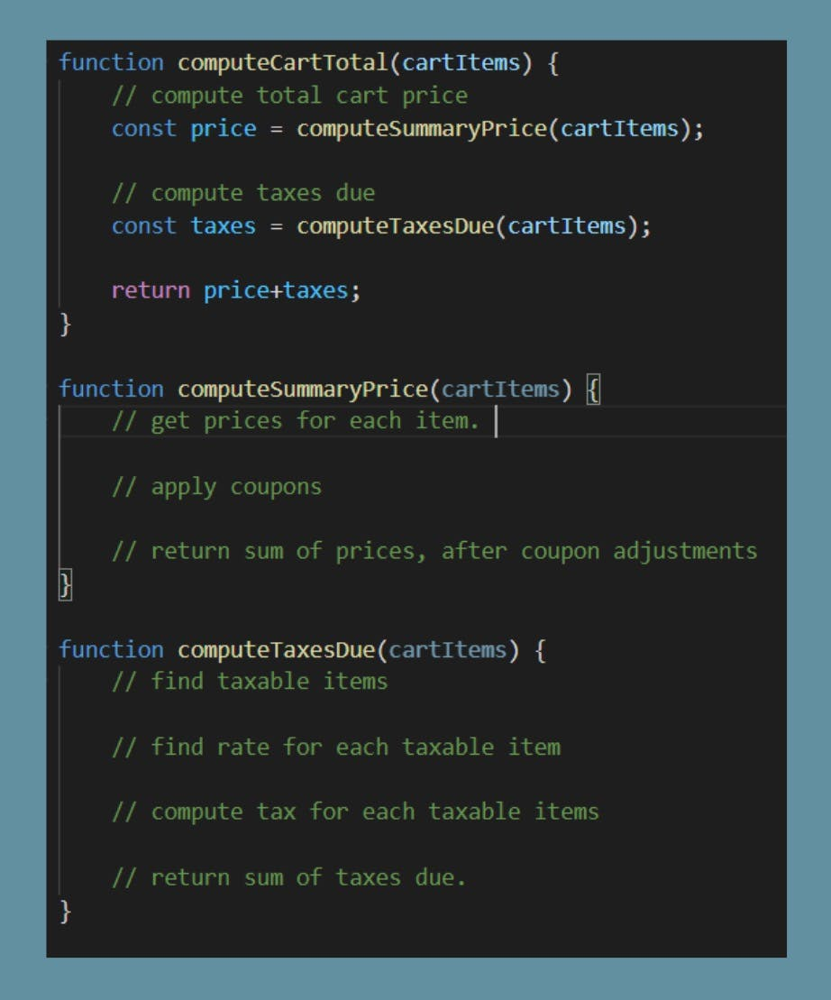

When you first join a company, there is a natural amount of anxiety. You want to perform well in the job you were just awarded. You want to establish a good reputation and be able to contribute. Add a dash of proving yourself, and you'll get a potent mix of emotions driving you towards thinking "I have to do it myself"!

But that gives rise to the concern for how, when, and even if you should ask for help when you get stuck. Are you expected to just figure it all out without disturbing your team members? And how do you figure out the difference between making sure you can contribute and being a “burden”?

## Let’s Start by Eliminating Some Misconceptions

Onboarding as a junior developer is going to take work, both on your part and on your team’s part. So, it is unreasonable for anyone to expect you to do it all on your own. But don’t worry, just because you’ll be on the receiving end of most of the instruction does not mean that you are the only one benefitting from the interaction. By teaching, the teacher learns the material better themselves.

But wait! There is even better news! With some intelligent and value-added actions, even as a new team member, you can make a positive impact. And all those actions can be summarized like this: Do everything you know how to do first. Then ask for help.

You can explore these actions by examining the onboarding experience of a Junior Developer. In this context, you, the junior engineer, can expect to know some of the job, but definitely not all of it. Given the role, it would be reasonable to assume the goal of hiring you is to take some of the junior-level work off of other team members. So, how can you, as a junior developer, act to achieve that goal most rapidly and effectively?

## Your Job is to Learn!

The shortest answer: you need to learn. You need to learn about the systems you are working on. You need to learn effective ways of working. You do not need just an answer guide. You need to develop the skills to feed yourself.

And you need to develop confidence that while you are doing all these things, you are still delivering value. Don’t fall into the trap of comparing yourself to your teammates yet. There will be a time for that, but it's not now. Instead of focusing on the differences between what you can accomplish and what the senior developers accomplish, focus on whether you are doing everything you can do or not.

Applying a “do all you know to do” mentality, you might pick up a ticket recommended for you. The first step in being able to complete the work is just knowing what to do. Can you explain in English what work needs to be done to accomplish the ticket? Do you need to change when a modal opens? Or add some input to a form?

Start by writing down what you need to do. Look for a way to articulate it. Now if you get stuck, you have still added some value. You have boiled the ticket down to a set of specific actions. What is more, it’s all in writing in a transferable form!

So, when the senior developer comes over to help, you can make sure you understand them. You didn't leave the senior developer guessing where you were on the project or what you understand. You provided a starting point, which is great. And what's more, you made the load easier without writing a single line of code yet!

Going back to the written steps... If you’re confident this is right and you know how to implement it, give it a try and write some tests for it! In this way, the computer helps confirm the code is functioning as expected. But make sure to time-box the work! Don't go off for four hours and come back to the senior to check. Instead, lean into the [Inspect](https://scrumguides.org/scrum-guide.html#inspection)-[Adapt](https://scrumguides.org/scrum-guide.html#adaptation) practice from agile. Try using a shorter iteration cycle.

## Putting "Guard Rails" in Your Process

I personally suggest using a [Pomodoro](https://en.wikipedia.org/wiki/Pomodoro_Technique#Description) Timer as a good work structure. A Pomodoro is just a simple kitchen timer. Set it for 25 minutes for focused work every half hour and use those leftover 5 minutes to evaluate what you’ve done or to get some water. You can spend one or two Pomodoros, no more than an hour, tinkering on our solution. Then get it checked. This way you can make some progress, and still get feedback on your work and on your direction from the senior developer.

Let’s say you look at the steps you wrote out again. Rather than being confident or totally confused at this juncture, you are somewhat sure it’s the right path but do not know how to do it. In such a circumstance, don't jump immediately to ask for help. Instead, take some time to research the right approach. Even just searching for 'how do I {do X}' can start to yield good results.

*There is a critical step here.* Do NOT just copy whatever answer you find into your work product. As a junior developer, the goal is to start adding value, both now and in the long term. This requires a degree of self-sufficiency to achieve. Thus, one of our work objectives must be to learn, and you don't learn if you just copy. So, take some time to understand the answers you are finding. That might mean having [StackOverflow](https://stackoverflow.com/) open in one window and the editor in another as you manually type in a version of the solution you are looking at.

Again, let’s apply the Pomodoro technique here. Time-boxing can get iterative help. And you can iteratively improve your work without constantly interrupting the senior developer. If you haven't gotten to try out the answer yet, just show and tell. This can show your senior developer where you are looking for answers, and where they can help you better as your mentor.

Now, let’s address the last outside chance you might encounter while researching. Suppose that none of the answers on the internet are really any use. Maybe they show parts of a solution but nothing directly for your challenge. That might mean that the distilled 'I need to {do X}' tactic needs refinement. Or it might be that you are doing something unique, and that's ok. Let's look for a way to keep the ball moving forward, before running to get help.

For software developers, we often run into 'pseudo-code' exercises when interviewing. I propose that you can use this same technique to augment that 'I need to {do X}' tactic. As part of any larger workflow, there are small steps.

Consider how you’d compute the price of a Cart in an ECommerce application, for example. You’ll need to complete the summary price, and the taxes due. To compute the summary price, you may need to do some simple unit price math, and then apply coupons. To get the tax, you may need to figure out which items are taxable, and what rates you need to use. Then you can compute the tax on each item. But, notice what happened there. You broke the challenge down! You took the' I want to {do X} concept which was 'Compute Cart Total' in this case and broke it into the steps to get there. You then looked at those steps and broke them down further.

Some simple signatures and comments in pseudo-code might look like this:

By breaking down the work, you put some thought into it. You added value, just like you when shared the first steps. You boiled the work down to 'I want to {do X}'. Now the senior team member can come to look at the plan for work. From here it is easy to make corrections or suggest implementations. Maybe they'll find the steps you missed. Because we listed our work steps, they'll be able to see it more easily or it will allow you to ask more specific questions. And as always, time-box this. Take a couple of Pomodoros at most to take a step forward. Then, get feedback and help.

Keep your cycles simple. Do everything you know to do, and then get help. You’ll be adding a little value at each step. You’ll get rapid iterative feedback. These allow you to balance asking for help with making good progress. By proactively taking the time to cycle between these steps, you build your team's confidence in your aptitude. You also will still get the help needed to make progress without getting stuck anywhere for too long. By taking time to work on the problem yourself, you build your aptitude for continuing to contribute in the long term. And who knows? At this rate, you just might be the one leading the next onboarding!

To learn more about Improving and our current [open positions](https://improving.com/careers), [reach out to us](https://improving.com/contact)!
