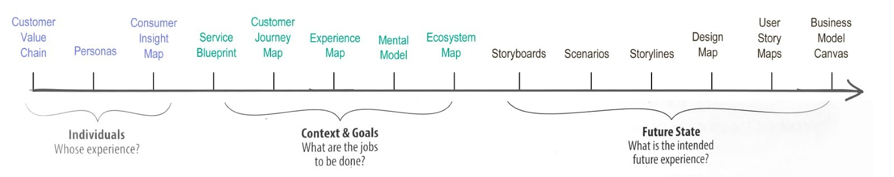
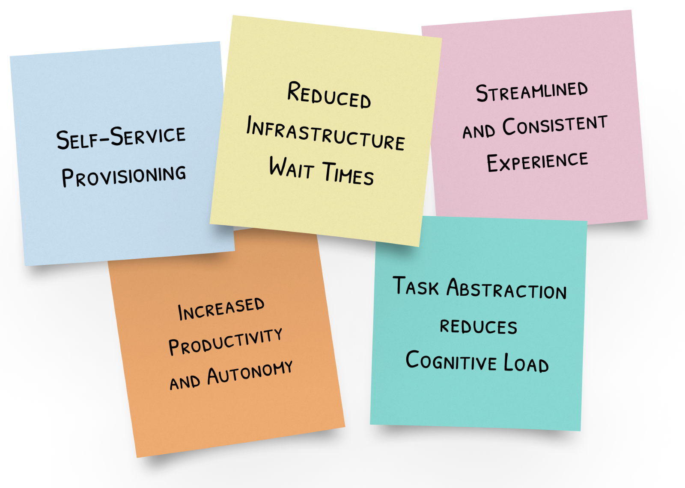
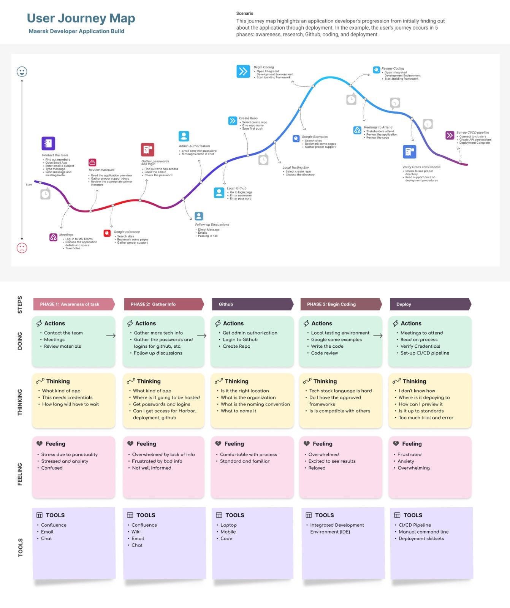

Internal Developer Platforms (IDPs) have become critical in the ever-changing software development landscape. However, there is a widespread misconception that they are merely technical tools and therefore they don’t require much effort to develop and deploy. Or that one solution should work for all businesses in the same way without thought to the people using the tools day after day. Using user-centric methodologies when developing an IDP is critical in creating an easy-to-use interface that provides responsive business solutions. In this blog, we'll examine the lessons from Maersk's journey to create a successful IDP from the ground up.

### **Establishing a Clear Vision**

The team discovered that having a clear vision from the beginning was critical. Long-term goals, feature planning, cultural shifts, and improved communication were also essential. The challenges experienced in this area highlighted the importance of ongoing monitoring to ensure a smooth adoption process from a user-centric standpoint.

### **The Timeline of Maersk Internal Developer Platform**

Building a strong IDP is a lengthy process. Maersk's project lasted 18-24 months (about 2 years), demonstrating the commitment required. Securing executive support and a budget proved critical, as significant resources were needed. From research to Minimum Viable Product (MVP) development and research, milestones ensured a distinct team alignment and user engagement.

Many possibilities are available for user-centric research, making it even more important to consider the intent of mapping. The primary goal is to tell the story of interactions to align your team.

*Kalbach, J. (2016). Mapping Experiences: A Complete Guide to Customer Alignment Through Journeys, Blueprints, and Diagrams (p. 112). O'Reilly. *

When deciding on a research method consider the type of model that best reflects the experience needed. The three types of models to follow experience.

- Individual Models: Whom are you designing for? Personas and customer insight maps are two examples.
- Contextual and Goals Models: The circumstances of interaction are described by experience maps. What are the tasks at hand? What are the user’s needs, feelings, and motivations?
- Future experience models: Develop models for the product's future state. What do solutions look like? How do we evaluate them?

### **How IDPs Add Value**

Maersk, a global shipping and logistics company, faced a major challenge with its legacy infrastructure. Developers were frequently left waiting indefinitely for critical infrastructure support. The transition to an IDP provided transformative benefits:

- Reduced Infrastructure Wait Times: The IDP streamlined development pipelines, significantly reducing infrastructure provisioning wait times. This increased efficiency improved the developer's experience right away.
- Self-Service Provisioning: Developers gained newfound autonomy by being able to provision infrastructure independently. This empowerment improved the user experience and reduced reliance on other teams.
- Increased Productivity and Autonomy: With smoother processes, developers can focus on their tasks, increasing productivity and autonomy, both critical components of a positive user experience.
- Streamlined and Consistent Experience: Maersk's IDP provided all developers with a consistent and streamlined experience, eliminating the need for external support. Consistency is a key driver of a positive user experience.
- Task Abstraction to Reduce Cognitive Load: The IDP abstracted complex tasks, such as navigating infrastructure changes and security measures. Because of the significant reduction in cognitive load, developers could focus more on actual product development, which improved their overall experience.

### **Journey Mapping**

Choosing the best application process for an IDP is a team effort. To avoid any further setbacks, I used journey mapping, among other research methods, to select technologies and tools that would work seamlessly together while giving the user everything to be fully autonomous. These decisions directly impact on the user experience, ensuring an easy-to-use interface and efficient processes.

### **Decreased Cognitive Load**

Standardization was critical in providing a positive developer experience. Maersk significantly reduced cognitive load by standardizing aspects such as security practices and commit formatting, making it easier for developers to transition to the IDP.

Throughout the process, I continued to reiterate certain concepts to keep the team user-centered and focused on providing the best experience possible. Some of these concepts were...

- User-Centered Design: Maersk prioritized user-centered design principles, ensuring that the interface and features of the IDP were created with developers in mind.
- User Onboarding: The onboarding process has been made user-friendly, with tutorials and documentation to assist developers in getting up and running quickly.
- Feedback Mechanisms: Quick and continuous feedback loops were established to improve the platform based on developer feedback.
- Performance and Speed: Efforts were made to optimize performance, ensuring a responsive and quick platform.
- Accessibility: The IDP was created with all developers in mind, including those with disabilities.
- User Support and Documentation: Extensive user support and documentation was available in the app.
- User Testing and Iteration: User testing was used to continuously improve the UX.

##### **Maersk's experience taught several important lessons:**

Collaborating with developers to implement an Innovative Development Platform (IDP) is a multifaceted endeavor that hinges on several key principles. First and foremost, the value of training and education on the subject matter cannot be overstated. Bringing experienced trainers on board to assist engineers in comprehending the intricacies of the platform and ensuring they adhere to best practices is paramount for cultivating a positive user experience. This investment in knowledge transfer not only empowers developers to harness the IDP's capabilities effectively but also instills a sense of confidence in their abilities, fostering a culture of innovation.

Another crucial aspect of IDP implementation is the delicate balance of stakeholder expectations. Managing these expectations can be challenging, as not every stakeholder's desires can be fully accommodated. It is essential to communicate the inherent limitations of the IDP, emphasizing that its successful operation requires ongoing effort to maintain and evolve. This transparency and proactive communication help set realistic expectations and pave the way for a smoother development process.

Recognizing the IDP's limitations is equally important. While it can address a wide range of development needs, it cannot possibly support every use case. Here, it becomes imperative to advise teams on alternative solutions for unique or unconventional scenarios. Providing guidance on when and how to deviate from the IDP's standard practices ensures a satisfying user experience, even in situations that fall outside its scope.

Lastly, securing executive support and budget is the cornerstone of initiating and sustaining an IDP. Starting such a platform from scratch demands significant time and financial resources. Rallying the backing of company leadership is pivotal in driving the project forward, ensuring that it receives the necessary funding, resources, and organizational buy-in. Without this top-down support, the IDP's potential may remain untapped, hindering the organization's ability to innovate and compete effectively in a rapidly evolving landscape.

### **Conclusion **

Developing a successful Internal Developer Platform is a multifaceted task involving technical and non-technical aspects, with User Experience at the forefront. The journey of Maersk with their IDP provides valuable guidance for organizations considering Internal Developer Platforms. While the journey may be difficult, efficiency and developer empowerment benefits make it worthwhile. A positive User Experience is an added benefit and a critical component of a successful IDP built using user-centric methodologies.
