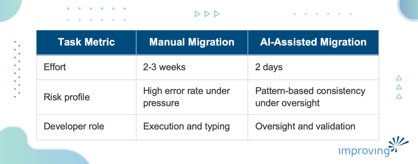

The industry is currently obsessed with "Vibe Coding," but that framing misses the point for working engineers. As architects, we need to look past the trend and towards the outcome.

We have spent decades coupled to our tools, often mistaking the act of typing for the act of engineering. AI is the latest evolution of that tension. Professional engineers must shift from a code-first to an outcome-first mindset. The move is from *Vibe Coding* to *Vibe Solving*.

Vibe Coding focuses on the engine: the syntax, the generation, the satisfying feeling of code appearing on screen. Vibe Solving focuses on the destination: the business problem resolved, the user served, the system more maintainable than before. We are not syntax curators, we are problem solvers with better tools than we have ever had.

AI is no longer an experiment for software engineers. It is becoming part of daily development workflows, from writing specs to maintaining legacy systems. In this blog post, let's cover what that shift looks like in practice: how to kill the cold start, where AI delivers its highest return, how to keep the work auditable, and why transparency with clients is no longer optional.

## Beyond the Blank Page

Thousands of hours disappear every year to the friction of sitting down to write a technical spec, a project plan, or even a well-scoped ticket and having nothing come out.

> *The greatest tax on engineering productivity is the cold start.*

To address this, I use a Voice-to-Insight workflow. The idea is simple: move into forward-only mode by capturing thoughts out loud, bypassing the internal critic that stalls written work.

The key unit in this workflow is the 30-second Wow. Instead of trying to convince people through abstract language, you quickly create something tangible, be it a rough sketch, a narrated idea, or a snapshot, and use AI to turn it into a visible output like user stories or a working prototype. The idea moves from concept to something people can see and react to, which breaks resistance and builds shared understanding.

By using MacWhisper for speaker-diarized transcription and local models, we can process raw thoughts into a "Voice Vault." Voice Vault is a structured folder of transcripts and summaries. From there, tools like Windsurf (any LLM works for it) help convert the raw thinking into actionable backlogs or technical outlines without a single minute of manual typing.

The raw material already exists in your own words. Now, AI's job is to preserve it and reshape it into something a team can act on.

## AI in Software Maintenance

Maintenance is the graveyard of most engineering backlogs. The work is pattern-heavy, rule-heavy, and boring in a way humans have always been bad at sustaining. That is also precisely why AI returns its highest ROI there.

A concrete example: I recently oversaw a migration of **3,000 tests** from *Fluent Assertions* to *Shouldly*, alongside a major version update of the *Marten* and *Lamar* libraries. Historically, that is a multi-week job, that gets deferred until it becomes a crisis.

With AI, it took me two days.

The key technique was solving the LLM's training cutoff problem. The model did not know the latest breaking API changes in Marten. Asked it to migrate your tests and it will confidently produce syntax from two versions ago. To close that gap, I used **Context7**: an MCP Server that provides up-to-date information for libraries and frameworks. The AI is no longer working from stale training data. It is working from the version of reality I just handed it.

Two things are worth being honest about. First, the developer role changed, not disappeared. My value those two days was architectural review and verification. Second, the risk profile is not automatically lower. A model operating at scale can introduce a subtle error across thousands of tests as easily as it introduces a correct pattern. Oversight is non-negotiable, as without it, AI-assisted maintenance just compresses the time to failure.

## Investigation Markdown for AI Context

When AI is doing heavy lifting on a codebase, you cannot treat it as a black box. I require an Investigation Markdown file for every non-trivial task.

Investigation MD is a ledger that captures which decision paths were tried, which were abandoned, and why. It records the questions asked, the answers accepted, and the ones overridden. When an LLM's context window clears, and it will, that Markdown file is the only thing that tells the next human or the next AI instance where the team actually stands.

I call this managing the binary hands: the AI is fast and capable, but it does not remember yesterday, does not know why a prior approach was abandoned, and does not carry the context that exists only in the heads of your team. The Investigation Markdown makes that context explicit and persistent.

A few operating rules I hold teams to when AI is in the loop:

- **Plan before touching files:** Use ‘Plan Mode’ in Windsurf (or Claude Code) to audit the AI's intended changes before it touches the file system.
- **Get a second opinion:** Spin up a separate model instance with an adversarial prompt. Ask it to find holes in the first model's plan.
- **Ground the citations: **Prompt the LLM to trace claims back to source transcripts. If the AI cannot point to an origin, the claim does not belong in the strategy.

AI also starts paying back at the leadership level when you analyze Daily Scrum transcripts for blind spots: the technical concerns that surfaced and then got ignored, the risks buried under routine updates.

A human lead cannot catch all of that across several minutes of conversation per day. A model can. The limitation is honest: this is only as good as the transcripts feeding it and the prompts guiding it. It does not replace an engineer but makes a sharp engineering manager sharper.

## Professional Obligation

Using AI goes beyond improving productivity and is a professional obligation. A consultant not using AI is showing up to a construction site with a manual screwdriver when power tools are available: slower, less accurate, and billing the client for the difference.

Transparency with clients follows from that. I do not hide that I use AI. I frame it around what they actually care about: that their budget is buying judgment rather than typing, that the oil change is happening while the car is still moving. That framing earns more trust than hiding the tool ever could.

## What the Time Buys

As Tony Robbins said, we are drowning in data and starving for wisdom. We need to stop thinking of IT as Information Technology. The real shift is toward Impact Technology: using judgment, experience, and the best tools available to deliver outcomes that actually matter.

AI's real return is not the code it writes. It is the time it gives back. Time for the things AI cannot do: empathy with a client under pressure, design decisions that account for constraints not found in any repository, the hard conversation with a team about a risk they have been avoiding.

What else will you find if you stop putting off the cleanup and start using the tools?

We regularly work with teams who are quietly folding AI into their everyday development. If you're curious about how this shows up in larger environments, you can explore [how enterprise teams are applying AI expertise in practice.](https://www.improving.com/expertise/ai/) To build your internal AI capability, our [AI training programs](https://www.improving.com/services/training/ai/) are a good place to start. For any comments or suggestions on this article, find me on [LinkedIn](https://www.linkedin.com/in/claudiolassala/).
