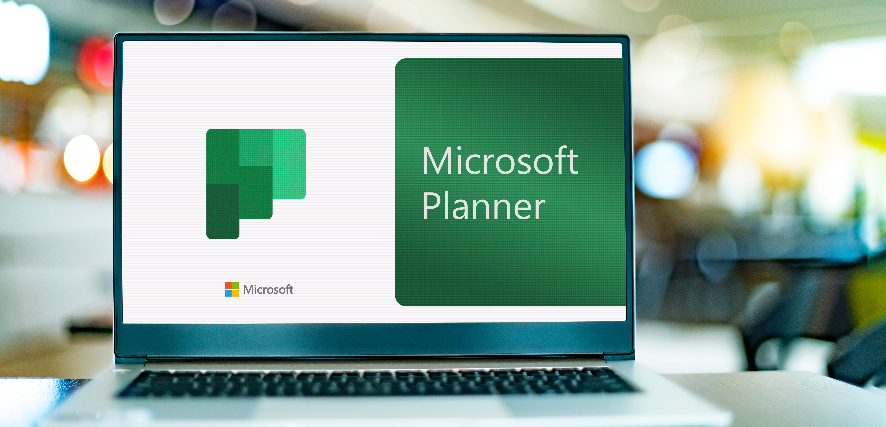

Effective project management is crucial for success in today's fast-paced business environment. As organizations grow and projects become more complex, the need for robust, scalable, and integrated project management tools becomes evident. Microsoft Planner, a cloud-native project management solution, offers a comprehensive suite of features designed to meet these needs. This blog explores the evolution of Microsoft Planner, its key features, and how it can transform your project management processes.

### **The Evolution of Microsoft Planner**

Microsoft's journey in project management tools began in 1984 with the introduction of the classic Microsoft Project. This desktop application revolutionized project management but had limitations in collaboration. The turn of the century saw the launch of Project Server, which introduced a centralized project database, enabling multiple users to work on the same project simultaneously. However, it required significant administrative effort to maintain.

The shift to cloud-based solutions began in 2011 with Project Online, which brought project management to the cloud, reducing administrative burdens and integrating with SharePoint for enhanced collaboration. Despite these advancements, Project Online eventually showed its age, leading to the development of more modern solutions.

### **Introducing the New Planner**

The new Microsoft Planner is a cloud-native project management tool built on the Power Platform. It combines the best features of its predecessors with modern capabilities, making it simple, flexible, and scalable. One of its standout features is the integration of AI through Copilot, which enhances productivity by assisting in plan creation and providing valuable insights.

### **Key Features of Microsoft Planner**

1. **Simplicity and Flexibility**: Planner offers a user-friendly interface that allows users to create and manage plans effortlessly. Whether you need a basic private plan or a more complex shared plan, Planner provides the tools to get started quickly.
2. **Integration with Microsoft Teams**: Planner is designed to work seamlessly with Microsoft Teams, the hub for collaboration in Microsoft 365. Users can access Planner directly from Teams, making it easy to manage projects where the work happens.
3. **AI-Powered Assistance**: The integration of Copilot in Planner is a game-changer. Copilot can help create new plans based on simple prompts and generate status reports, saving time and reducing the administrative burden on project managers.
4. **Comprehensive Views and Reporting**: Planner offers various views, including task boards, Gantt charts, and timeline views, to help users visualize their projects. Additionally, it integrates with Power BI for advanced reporting and analytics.
5. **Cost-Effective Solutions**: Planner provides a range of pricing options to suit different needs. Basic features are included with most Microsoft 365 licenses, while premium features are available at competitive rates, ensuring organizations only pay for what they need.

### **Practical Applications and Use Cases**

Microsoft Planner is versatile and can be used for various project management scenarios. From small teams managing simple tasks to large organizations handling complex projects, Planner's scalability makes it suitable for different environments. Its integration with other Microsoft 365 tools ensures a seamless workflow, enhancing overall productivity.

For example, a marketing team can use Planner to manage campaign tasks, track progress, and collaborate with team members in real-time. A software development team can integrate Planner with Azure DevOps to synchronize tasks and milestones, ensuring everyone stays on the same page.

### **Getting Started with Microsoft Planner**

Adopting Microsoft Planner is straightforward. Organizations can start by exploring the official documentation and product information to understand its capabilities. Comparing Planner with existing project management solutions can highlight its advantages and potential cost savings. Finally, taking advantage of the free trial for premium features allows users to experience the full potential of Planner before committing.

### **Elevate Your Project Management**

Microsoft Planner represents a significant step forward in cloud-native project management. Its combination of simplicity, flexibility, and powerful features makes it an ideal choice for organizations looking to enhance their project management processes. By leveraging the capabilities of Planner, teams can improve collaboration, streamline workflows, and achieve their project goals more efficiently.

If you're interested in exploring how Microsoft Planner can revolutionize your project management approach, we're here to help. [Contact us today](https://improving.com/contact) to learn more about implementing Planner in your organization and to get personalized support tailored to your needs.
