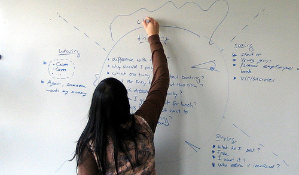

User Experience Consultant, [Tony Brown](https://www.linkedin.com/in/tonybrowndesign/), explains the steps he goes through for building empathy in the design process.

Webster defines empathy as the action of understanding, being aware of, being sensitive to, and vicariously experiencing the feelings, thoughts, and experiences of another. Some would say walking a mile in someone else's shoes. I'd say it’s the “secret sauce” of good design!

Either way, it’s seeing the world through other people’s eyes. It allows us to understand why they behave and act in a certain way. As designers, it gives us perspective on what the client wants, and better yet, what they need.

## A Short Professional Story

I recently visited a client who needed to revamp a legacy system that was built for the company about 8 years prior. Technically the system "worked" and enabled the users to do their job. However, not without a bit of consternation.

One of the features of this software, which was vital in their process, was the ability to compare system data. When discussing this part of the process, users used words like "trust," "accuracy" and "confidence" to describe what they needed at this stage of the process. However, the current system failed miserably at this.

*How would having empathy for the users at this point in the process resulted in a better solution?... [W]ould he or she put more thought into this workflow?*

The completeness of the data that users got back from the system was based on how they searched for that particular data. Things like spaces, order of search terms, and date ranges, all affected the user’s result set.

When comparing their findings with other users, they saw these as inaccuracies. To get around this, they would do separate searches, print out their individual results, and compare the lists line by line. This added hours to their workload and piled on stress and frustration.

Technically, the system was doing what it was built to do, but ultimately it did not satisfy their need for "trust" and "confidence" at this point in their workflow.

How would having empathy for the users at this point in the process resulted in a better solution? If the designer had the same opportunity I did to understand the importance of this stage, hear the frustration and empathize, would he or she put more thought into this workflow? I hope so. And so does the client.

## A Short Personal Story

An empathetic view isn't only beneficial to software design; it also can be used to improve services. I recently had to have some car maintenance done. As if car maintenance ever comes at a good time, it was particularly bad for me in this instance.

I pulled my car into the shop and noticed the attendants working like robots; busy directing traffic and taking notes from the vehicles. Oddly, no one was really talking. The first thing someone said to me was, "Who are you here to see?" He was efficient and effective at documenting mileage and tire pressure, but very impersonal. The next words were, "Do you have everything out of the vehicle?" Then I was scurried inside.

*How might my experience have been different if the associates had an empathetic view of my situation?... That I was unexpectedly handing off hundreds of dollars and not in line at an all-you-can-eat buffet? *

While there, I was coupled with an account adviser who shook my hand (kind of) and spent the rest of the time looking down at his paperwork. He read the notes, that were obviously taken from the phone call I made when setting the appointment, and I confirmed their accuracy. He started to ask if I wanted to do any of the additional services that were listed in front of him. With each service, a “cha-ching” sound went off in my head."

Are any of those things wrong with my car?" I asked. He shrugged and stated he didn't know. At that moment, I figured out what was wrong with my experience at this dealership. Everyone was just "doing their job" no one was rude or inept. Just detached.

For me I was unexpectedly, and begrudgingly, spending hundreds of dollars. To me, this visit and additional services on his list were my hard-earned Ben Franklins leaving my pocket. To my adviser, these services were just line items.

Whether or not I did these services, didn't matter to him. He didn't care. And it showed.

How might my experience have been different if the associates had an empathetic view of my situation? If they understood I didn't WANT to be there? That I was unexpectedly handing off hundreds of dollars and not in line at an all-you-can-eat buffet?

## Empathy's Role in Design

The stories above show specific examples of how an empathic view may have changed those products for the better, in hindsight. But what role could empathy play in a new project? There are a few things having an empathetic view can help with.

The first is to gain perspective. What does the user say that is most important to them? Does it fall in line with what you believe to be the most important? I've found that when the client isn't the end user, they have a preconceived notion of what is important to the user. They are often wrong. Having an empathic ear can give you context to truly understand how a user approaches their daily problems, tackles tasks, and ultimately do their jobs. This insight can serve as a foundation for the solutions you implement later in the design process. At the very least you validate, or debunk, any preconceived thoughts about the product, its users, and their needs.

## How to Create Empathy... Sorta

Now that we understand the role and importance of empathy in design, how do we go about obtaining it? As designers and developers of software, you don't always have a deep knowledge of a user’s workflow. There are many tools that can be used to accomplish this, however, I'll go over my favorites.

### EMPATHY THROUGH ROLE PLAY

Role-playing is a perfect way to experience the potential emotions your user may face and thus build empathy for their struggle. Role-playing answers questions like, as a user, what was the hardest part of the process? Were you ever confused? Was there any frustration with the process?

### EMPATHY THROUGH OBSERVATION

A surefire way to build empathy for a user is to observe the user completing the tasks at hand. Seeing where they get hung up, seeing their facial expressions, and reading their body language will help you build empathy. User observation combined with user interviews can provide invaluable information you can use to create solutions.

### EMPATHY THROUGH MAPPING

One of the most popular ways to build empathy is through empathy mapping. Empathy mapping allows us to consider a user’s feelings and thoughts while trying to solve a problem or complete a task. Divide your map into 3-5 sections: seeing, doing, hearing, feeling, and thinking.

Document as much about these sections as possible. What is the mind state of the user? Frustrated? Happy? Disappointed? Are they seeing co-workers or are they in a closed room? Are they typing, standing, walking etc... All these questions help build perspective of the user and use the context of their environment.

Empathy, a human emotion, is a valuable tool for creating GOOD products and services *for* humans. The next time you have a bad experience with a product or service, think about how empathy could have had a positive effect.
