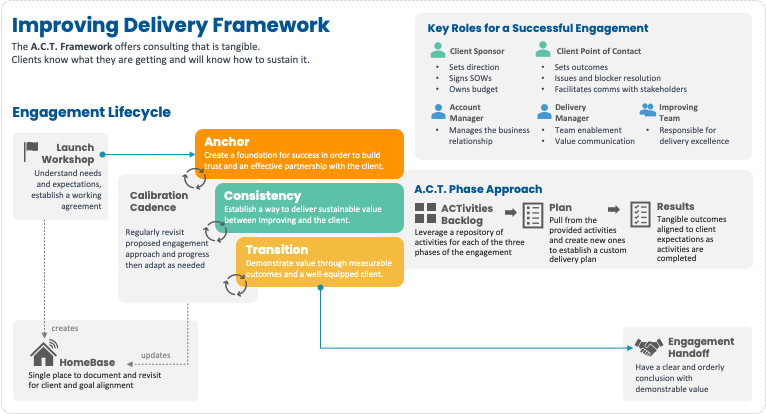

While big trends like GenAI are shaking things up for companies and their customers, businesses are working to figure out how to adapt their teams and products to keep up with the ever-changing tech landscape and savvy buyers. This constant evolution can make IT projects pretty complex. If this complexity isn’t managed well with a structured framework, it can lead to issues like poor communication, rising costs, and lower quality. That’s where modern delivery frameworks, like the **ACT Framework** from Improving, come in handy.

## **The Necessity of Modern Delivery Frameworks**

Modern delivery frameworks like ACT are super important for several reasons:

- Adaptability: They help organizations quickly respond to changes and challenges during the product lifecycle.
- Consistency: These frameworks ensure consistent delivery and reporting, building trust among stakeholders.
- Quality and Efficiency: A structured framework can boost the quality of solutions and increase feedback loops, spending less time building the wrong things.

Studies show that using structured methodologies in IT projects significantly increases their success rate. According to the [Project Management Institute](https://www.pmi.org/-/media/pmi/documents/public/pdf/learning/thought-leadership/pulse/pulse-of-the-profession-2017.pdf), organizations that use a consistent approach to project management report 38% more projects meeting their original goals than those that don’t. This is consistent with Improving’s observations managing thousands of client engagements over the years. It is important to note that this does not mean adopting cumbersome project management practices but rather emphasizes consistency in key aspects such as a shared understanding of how success is measured, clearly defined roles for both delivery teams and stakeholders, regularly scheduled communication, and visibility into how things are going.

## **Introducing the ACT Framework**

Improving’s ACT (Anchor, Consistency, Transition) Framework is a structured approach to managing projects. Originally designed to engage with clients, it is now being used internally within Improving and other organizations. Here is how each part plays a crucial role:

- Anchor: This phase focuses on building trust and understanding the vision and goals of the engagement while getting key foundational elements in place.
- Consistency: Regular value delivery and disciplined practice are key in this phase, ensuring steady progress and alignment with business objectives.
- Transition: The final phase aims for a smooth engagement conclusion, delivering measurable outcomes and equipping the client with tools for ongoing success.

## **Benefits of the ACT Framework**

Using the ACT Framework can bring numerous benefits:

- Managed Expectations: Projects are more likely to stay on track, within scope, and within budget. But more importantly, these projects will stay aligned with business goals.
- Improved Relationships: Structured engagements enhance relationships with stakeholders, leading to better communication and trust.
- Continuous Improvement: The framework encourages ongoing refinement and re-engagement, helping to adapt and improve future work.
- Visibility and Trust: Increased visibility into progress and outcomes helps build greater trust among all parties involved.

## **Implementing the ACT Framework with Improving**

For companies looking to implement the ACT Framework, Improving offers comprehensive support starting with a Launch Workshop, which includes setting up an Engagement HomeBase for continual alignment and calibration. This is followed by regular biweekly Calibration Cadence meetings to ensure the engagement remains aligned with client needs and allows for timely adjustments.

Forward-thinking companies interested in embracing this modern and streamlined delivery methodology can start by contacting Improving through their various service portals, including consulting, development, and training services. This initial step can kickstart the journey towards a successful and efficient digital transformation, leveraging the expertise and structured approach provided by Improving.

## **Final Thoughts**

In today’s competitive and ever-changing market, using a modern delivery framework like the ACT Framework is not just beneficial but essential for the success of IT projects. Improving's framework provides a structured, efficient, and collaborative approach to managing complex projects, ensuring they meet their goals and consistently deliver value.

To learn more about how the ACT Framework can transform your IT delivery, feel free to [reach out to our team](https://www.improving.com/contact/)!
