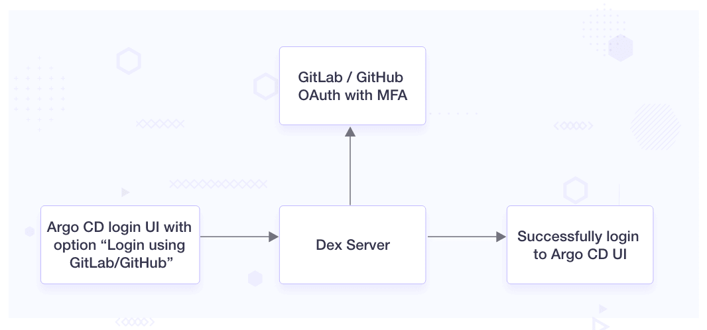
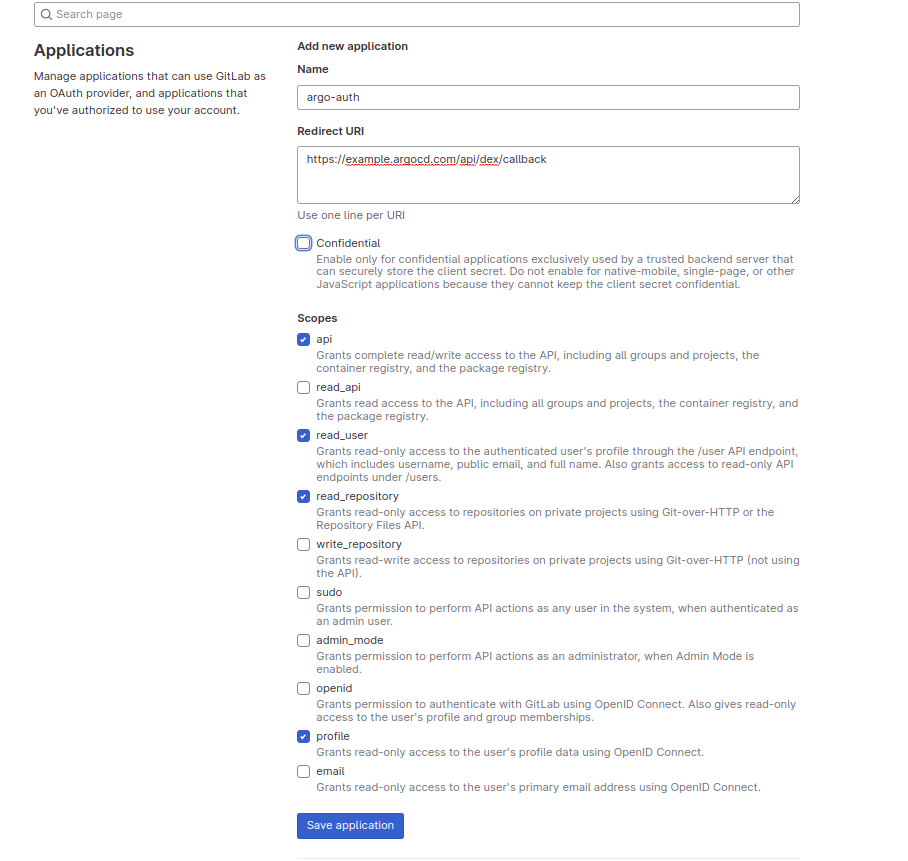
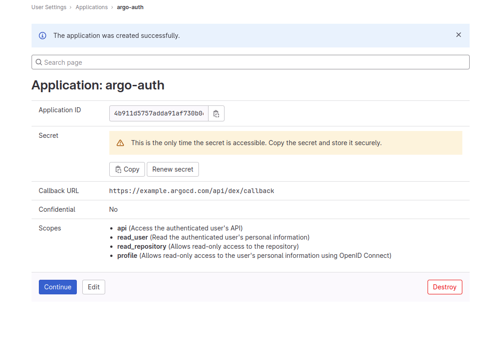
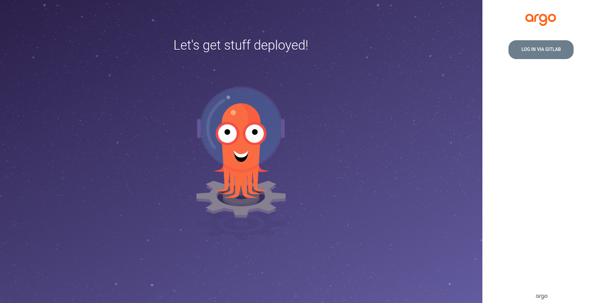

Single Sign-On (SSO) is a user authentication process that allows users to access multiple applications and services with a single login credential. Instead of having separate usernames and passwords for each system, SSO enables users to log in once and gain access to all integrated applications seamlessly. This simplifies the user experience and enhances security by reducing the need for users to manage multiple credentials.

In the fast-paced world of DevOps and Continuous Delivery, Argo CD has emerged as a powerful tool for automating application deployments and has been used by many large organizations including [Alibaba, Cisco, and Indeed](https://github.com/argoproj/argo-cd/blob/master/USERS.md). Enabling Single Sign-On (SSO) for Argo CD through popular platforms like GitHub and GitLab can simplify the developer experience and enhance access security. With SSO, users can use their existing GitHub or GitLab credentials to log in to Argo CD, taking advantage of Multi-Factor Authentication (MFA) if configured on the identity provider side.



In the context of our blog post, [Dex](https://dexidp.io/) takes center stage as an open source identity and authentication provider. It plays a pivotal role in bridging your applications with diverse identity providers such as LDAP, SAML, and OAuth2, all while implementing the essential OpenID Connect (OIDC) protocol. Importantly, when you opt to install Argo CD using the Helm chart or YAML manifest, Dex comes bundled, simplifying the setup of seamless Single Sign-On functionality.

## Problem Statement

In one of our clients' setups, we are using Argo CD. The current authentication process in Argo CD relies on individual user accounts created within the system. Manually creating and managing user accounts is time-consuming. It requires users to remember distinct credentials that may lead to friction in user experience. Additionally, it leads to difficulties in managing user access across multiple platforms, potentially exposing the organization to security vulnerabilities.

The client is interested in streamlining this process by enabling their teams to utilize their pre-existing GitHub accounts for the authentication process. SSO approach can be a big positive for users, especially those already using GitLab or GitHub as their identity provider. SSO streamlines user access, enhancing security, simplifying administration, and fostering a smoother user experience.

## Solution

The proposed solution involves integrating Argo CD with GitLab SAML, enabling users to authenticate identity through GitLab and access Argo CD without creating separate accounts. The following steps outline the implementation plan:

1. Configure GitLab SAML: Set up GitLab as an identity provider and configure SAML SSO settings. This includes creating a new GitLab application and obtaining the necessary SAML settings, such as SSO URL and SAML certificate.
2. Update Argo CD configuration: Modify the Argo CD configuration to enable SAML-based authentication. This includes defining the SAML service provider settings and updating the authentication backend to use GitLab SAML.
3. Test SSO integration: Thoroughly test the SSO integration to ensure a smooth login experience for users. Validate that users can access Argo CD using their GitLab credentials and verify that access controls are correctly enforced based on GitLab user groups and roles.
4. Handle exceptions and errors: Implement error-handling mechanisms to address potential issues during the SSO process. Provide clear error messages to users in case of login failures or other authentication-related problems.

**Note:** We assume that Argo CD has been installed using [YAML manifest](https://argo-cd.readthedocs.io/en/stable/getting_started/#1-install-argo-cd). You can make similar changes to your Helm values or Kustomize configuration with the following steps.

### Step 1: Configure GitHub or GitLab OAuth Application

To set up GitLab authentication, we will create a new application using the following steps.

**For GitLab**:

- Go to Settings > Applications > New Application
- Fill out the required details: Name, Redirect URI (https://argocd-domain.com/auth/callback), Scopes (API, read_user), etc.



- Save the changes and note down the Application ID and Secret.



### Step 2: Edit the Argo CD Configmap

We are modifying the Argo CD ConfigMap `argocd-cm` by adding the necessary configurations to enable the integration with the chosen Identity Provider GitLab for Single Sign-On (SSO) authentication.

```yaml
data:
  # …
  dex.config: |
    connectors:
    - type: gitlab
      # Required field for connector id.
      id: gitlab
      # Required field for connector name.
      name: GitLab
      config:
        # optional, default = https://gitlab.com
        baseURL: https://gitlab.com
        # Credentials can be string literals or pulled from the environment.
        clientID: $GITLAB_APPLICATION_ID
        clientSecret: $GITLAB_CLIENT_SECRET
        redirectURI: https://example.argocd.com:5556/api/dex/callback
        url: https://example.argocd.com
        users.anonymous.enabled: "false"
```

Restart the [Dex](https://argo-cd.readthedocs.io/en/stable/operator-manual/user-management/#dex) server using command `kubectl rollout restart deployment argocd-dex-server -n argocd` and the Argo CD URL will redirect to the GitLab login page.

We can see the Argo CD login UI with the option “Login using GitLab/GitHub”



## Errors that you can expect

After the setup is complete, there can be some configuration-related errors that can show up. Here are two errors that we came across, along with their solutions:

**#1 Error: Unauthenticated desc = no session information**

If the log shows this error: `Unauthenticated desc = no session information` and/or the login page is redirecting back to the login page when hitting the “Login via GitLab” button, you have to check for the call back URL. The `redirectURI` should point to Dex server: `http://argocd-dex-server:5556/dex/callback`.

```markup
time="2022-08-22T07:08:19Z" level=info msg="finished unary call with code Unauthenticated" error="rpc error: code = Unauthenticated desc = no session information" grpc.code=Unauthenticated grpc.method=List grpc.service=cluster.ClusterService grpc.start_time="2022-08-22T07:08:19Z" grpc.time_ms=3.583 span.kind=server system=grpc
```

**#2 Error: dex config unmodified**

If the configuration for the “dex” component has not changed during the noted time intervals or dex configuration is not as expected, then we need to restart it to reflect the changes of dex configuration.

```markup
time="2022-08-18T15:27:24Z" level=info msg="Notifying 1 settings subscribers: [0xc000342d80]"
time="2022-08-18T15:27:24Z" level=info msg="dex config unmodified"
time="2022-08-18T15:34:57Z" level=info msg="Notifying 1 settings subscribers: [0xc000342d80]"
time="2022-08-18T15:34:57Z" level=info msg="dex config unmodified"
```

## Community support

You can ask your doubts and queries from the community by joining the Argo CD community at [CNCF Slack](https://slack.cncf.io). `#argo-cd` channel is dedicated to all the discussion around Argo CD.

## Conclusion

By integrating Argo CD with GitLab or GitHub, the organization aims to simplify the authentication process, improve security, and enhance user experience through Argo CD with the power of SSO.

I hope this article helped you in integrating Argo CD with GitLab and GitHub for better SSO. For more posts like this one, subscribe to our weekly newsletter. I'd love to hear your thoughts on this post, so do start a conversation on [LinkedIn](https://www.linkedin.com/in/rucha-bhange-2870b1155/) :)

Looking for help with GitOps adoption using Argo CD, Do check our [Argo CD consulting capabilities and expertise](https://www.improving.com/expertise/applications/platform-engineering/) to know how we can help with your GitOps adoption journey. If you want to manage on-demand Argo CD support, check our [support model](https://www.improving.com/expertise/applications/platform-engineering/).

## References

- [Dex Connectors Documentation](https://dexidp.io/docs/connectors/)
- [GitHub issue 1](https://github.com/argoproj/argo-cd/issues/13089)
- [GitHub issue 2](https://github.com/argoproj/argo-cd/issues/13526)
