Observability provides complete insights into the health, performance, and behavior of your Kubernetes cluster and the applications deployed within it. Companies, whether or not they use Kubernetes, have leveraged open-source observability tools like Prometheus, Grafana, Loki, and OpenTelemetry (OTel) to achieve significant improvements in cost, efficiency, and incident response.

For example, companies that reduced observability costs with OpenTelemetry reported notable savings. 84% of these companies saw at least a 10% decrease in costs. CoreSite research highlights how [both large and small organizations benefit from this open-source stack](https://www.coresite.com/blog/opentelemetry-a-new-foundation-for-observability).

A real-world case study shows how [Loki helped Paytm Insider save 75% of logging and monitoring costs](https://grafana.com/blog/how-loki-helped-paytm-insider-save-75-of-logging-and-monitoring-costs/). Similarly, a 2025 survey by Apica found that [nearly half of organizations (48.5%) are already using OpenTelemetry, with another 25.3% planning implementation soon](https://www.apica.io/blog/opentelemetry-the-foundation-of-modern-observability-strategy/).

## Why Observability is important

Observability, which uses logs, metrics, and traces to provide deep system insights, is particularly crucial for navigating the complexity of modern cloud-native and microservices-based architectures. It helps organizations reduce downtime, increase efficiency, improve developer productivity, and boost revenue.

The setup combining Prometheus, Grafana, Loki, Tempo, Kube-State-Metrics, Node Exporter, and OpenTelemetry offers an open-source alternative to the ELK stack (Elasticsearch, Logstash, and Kibana), providing seamless integration across metrics, logs, and traces. It scales from local development (Minikube) to enterprise-grade clusters, making it cost-effective and easy to adopt.

In this blog post, we will understand the open source observability setup and deploy it. At the end of this blog post, we’ll deploy a sample Java application to demonstrate how to collect logs, metrics, and traces in action.

## Understanding Observability setup

Let’s dive into the observability setup with clearly understanding the role of each component.

- [**Prometheus**](https://www.infracloud.io/blogs/prometheus-architecture-metrics-use-cases/): A time-series monitoring system used to collect metrics from Kubernetes components and services. It supports powerful querying and alerting.
- **Kube-State-Metrics**: An add-on service that generates detailed metrics about the state of Kubernetes objects like deployments, pods, and nodes. These metrics are consumed by Prometheus.
- **Node Exporter**: A Prometheus exporter that exposes hardware and OS metrics from your Kubernetes nodes.
- **Grafana**: A visualization and analytics tool that connects to Prometheus and other data sources to display real-time dashboards for your metrics.
- [**Loki**](https://www.infracloud.io/blogs/grafana-loki-log-monitoring-alerting/): A log aggregation system from Grafana Labs that works seamlessly with Prometheus and Grafana. It collects logs from your Kubernetes workloads and enables easy correlation with metrics.
- [**Tempo**](https://github.com/grafana/tempo): A distributed tracing backend used to collect and visualize traces. It helps in tracking requests as they flow through different services, enabling root-cause analysis.
- **OpenTelemetry (**[**OTel**](https://www.infracloud.io/blogs/opentelemetry-auto-instrumentation-jaeger/)**)**: A collection of tools, APIs, and SDKs for collecting telemetry data (traces, metrics, and logs) from your applications. It standardizes observability data collection.

### Flow diagram

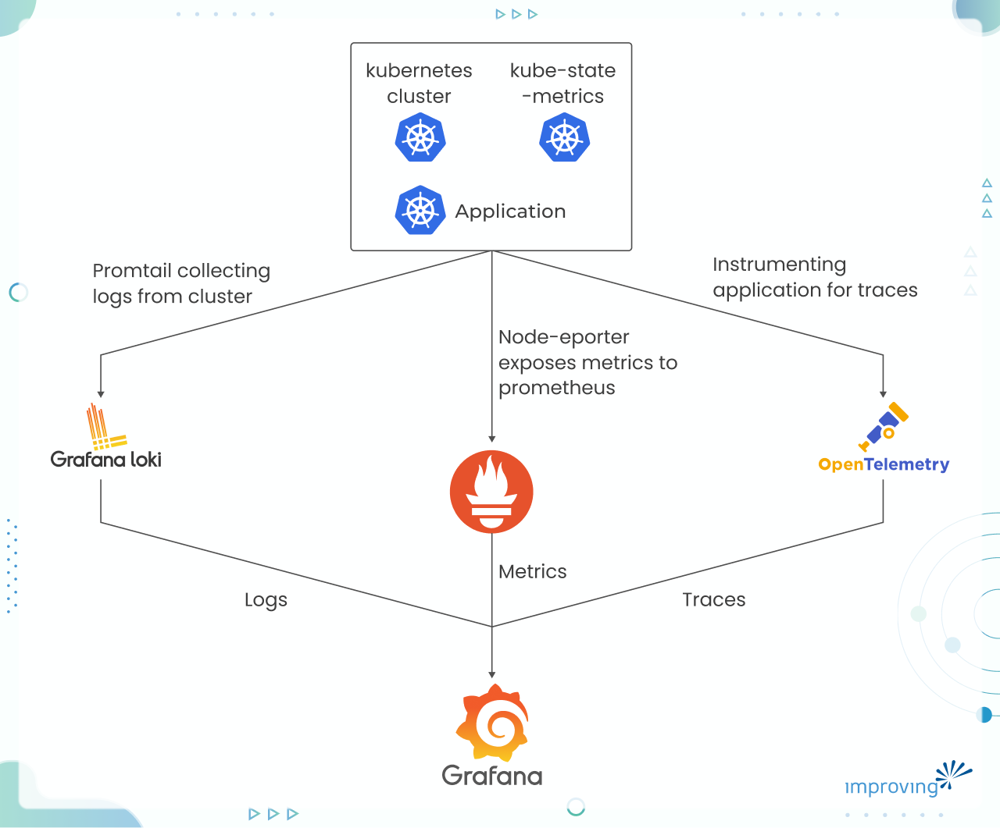

### Pre-requisite

- Minikube: We will be using it to setup local Kubernetes.
- Helm: Helm is package manager for Kubernetes.
- [App Repo](https://github.com/Saqeeb1234/calulator-webapp/tree/main): This is our test application, which we will clone.

#### **Step 1**: Installing Prometheus

Once you clone the repository, change directory to the observability folder and run the below command. Here I have created a Prometheus helm chart with custom config to get labels of all the applications to be deployed in minikube. ***Note****: The ConfigMap is configured to enable a limited set of metrics, but you can enable any metrics *[*from this list*](https://prometheus.io/docs/prometheus/latest/configuration/configuration/)* as required.*

`helm upgrade --install prometheus prometheus-helm `

#### **Step 2**: Install kube-state-metrics and Node-exporter

`helm install kube-state-metrics prometheus-community/kube-state-metrics helm install node-exporter prometheus-community/prometheus-node-exporter `

`Once both steps are completed successfully and the pods are up and running, verify that all targets are green in Prometheus by port-forwarding the service. `

`kubectl port-forward service/prometheus-service -n monitoring 9090:9090 `

`Then, access promethues at http://localhost:9090 `

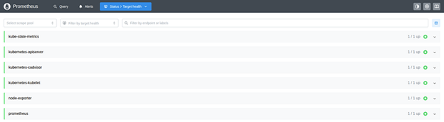

To check metrics are populating, run below queries for confirmation:

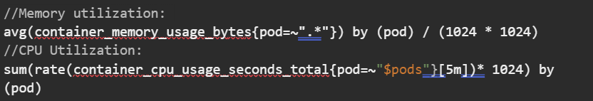

#### **Step 3**: Installing Grafana

In this step, we will install Grafana and add Prometheus as a datasource.

`helm install grafana grafana/grafana --namespace monitoring `

**After the Grafana pods are in the Running state**, port-forward the Grafana service and retrieve the login credentials from the Grafana secret:

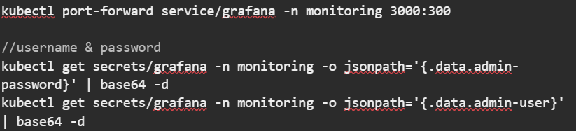

Access URL at **http://localhost:3000**, use above fetched creds to login. Navigate to **Connections → Data Sources → Add data source**. Set name “prometheus” and set connection URL as “[**http://**](https://localhost:9090/)**prometheus-service.monitoring.svc.cluster.local:9090**”, save & exit.

To verify the metrics, go to the Explore section and run the query below. You will see a time series showing the memory utilisation of all running pods.

**avg(container_memory_usage_bytes{pod=~”.*”}) by (pod) / (1024 * 1024)**

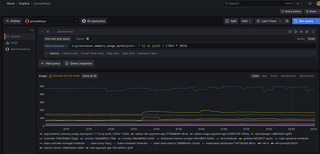

#### **Step 4**: Install Loki and Tempo

Run the following commands and wait until all pods are in the Running state:

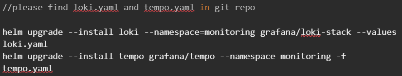

📄 ***Note:**** You can find loki.yaml and tempo.yaml in the Git repository. Promtail in Loki configuration allows you to parse log lines into labels. Refer this *[*link*](https://grafana.com/docs/loki/latest/send-data/promtail/stages/)* on how to extract labels*

Once the pods are ready, follow the same steps used earlier to add a data source (as done for Prometheus) in Grafana.

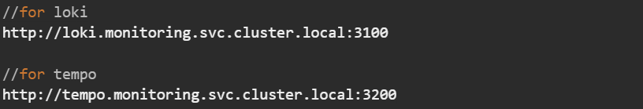

To view logs, go to “Explore” in Grafana select Loki as datasource and run the following query to fetch logs from all namespaces.

`{namespace=~".+"} |= `` `

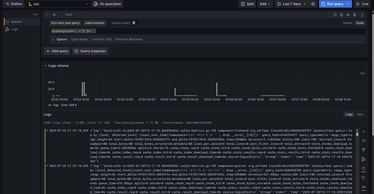

To check traces, we need to install OpenTelemetry and a sample application.

#### **Step-5 **: Install OpenTelemetry and sample application

Run the following commands to install OpenTelemetry:

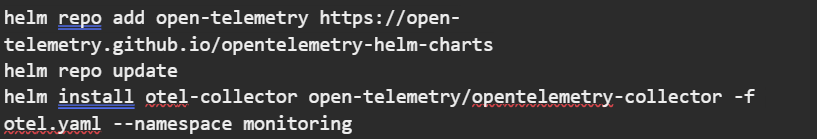

Once the OpenTelemetry pods are in the Running state, we will update the sample application’s Helm chart to include an [init container](https://kubernetes.io/docs/concepts/workloads/pods/init-containers/) for trace collection.

To deploy application, run the following command:

`helm upgrade --install calc helm-chart/ --namespace monitoring `

In the deployment.yaml file of the Helm chart, you’ll find the following init container configuration:

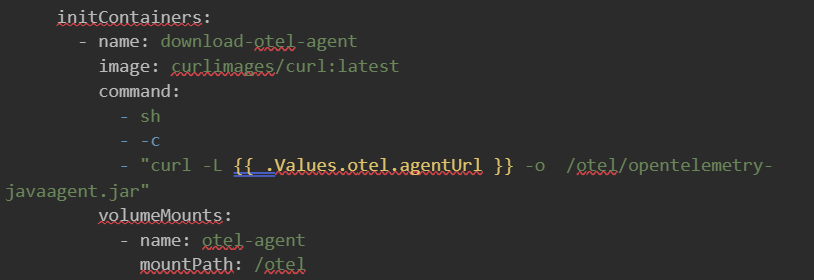

To generate traces, Port-forward the application’s service and interact with the app using some inputs to generate trace data. To view traces navigate to explore page with “tempo” as datasource **→ **query (“{}” )

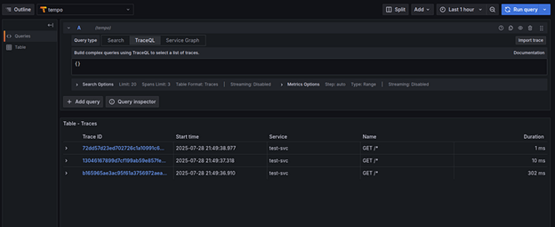

## Why Use Prometheus, Grafana, Loki, Tempo, Kube-State-Metrics, Node Exporter, and OpenTelemetry Stack

All these tools provide a specific combination that offers a modern, cloud-native, cost-efficient, and more tightly integrated observability solution compared to the *traditional *ELK stack. Some of the key advantages include:

- **Native support for metrics, logs, and traces:** One can get a unified experience and correlation across telemetry types (versus ELK being primarily log-centric).
- **Lower resource & storage cost**: Loki indexes only metadata (labels), not full log content, making it lighter and cheaper to operate.
- **Better scalability & resilience in cloud/Kubernetes environments**: These tools are built to work in distributed, elastic infrastructure.
- **OpenTelemetry compatibility & vendor neutrality**: Instrumentation is portable and standards-based.
- **Operational simplicity & lower overhead**: Fewer cluster tuning demands, simpler scaling, less heavy [JVM burden compared to Elasticsearch](https://opster.com/guides/elasticsearch/capacity-planning/elasticsearch-memory-usage/#:~:text=Elasticsearch%20memory%20requirements,is%20regularly%20accessed%20in%20memory.).

## Final Words

You cannot fix what you cannot see. With the huge amount of data and so much depth in modern tech, having a proper observability system in place is critical. In this blog post, the primary aim was to establish full-stack observability for a Kubernetes cluster by enabling metrics, logs, and traces using Prometheus, Loki, Tempo, and OpenTelemetry, and finally visualizing them with Grafana.

With Grafana, one can now monitor, visualize, and troubleshoot applications in real time using metrics, logs, and traces all in one unified observability stack. This observability setup not only enhances visibility into the cluster’s health and performance but also enables faster root cause analysis and proactive incident response, aligning with modern DevOps and SRE practices. But the setup must be executed flawlessly for mission-critical projects. You can reach out to our [cloud native and observability experts](https://www.improving.com/expertise/applications/cloud-native-development/) to learn why Fortune 500 companies trust us to build their observability and monitoring programs.
