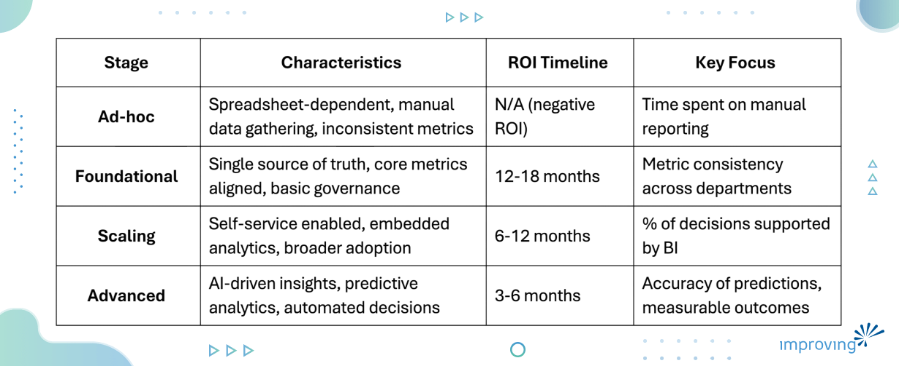

Business leaders are buried in data. Dashboards multiply. Tools are renewed year after year. Yet basic questions still trigger debate instead of answers. Which numbers are accurate? Which reports reflect the true state of the business? Which decisions require analytical evidence rather than opinion? And when should the organization move beyond hindsight reporting to predict what comes next?

Business Intelligence and Advanced Analytics are supposed to fix this. BI provides clarity on performance. Advanced Analytics reveals what's coming. When they work, teams argue less and move faster. When they fail, organizations get reporting graveyards and black-box models that no one trusts, and no one uses.

This guide is for executives who want Business Intelligence and Advanced Analytics to strengthen competitiveness, improve decision quality, and guide strategic priorities, not simply produce more reports and forecasts.

## **What is Business Intelligence & Advanced Analytics**

**Business Intelligence: The Architecture of Trust**

BI is an organization's single source of truth — the infrastructure that ensures every leader asking the same question gets the same answer. But framing BI as a reporting function understates its strategic role. What BI actually builds is institutional trust in data: the confidence to act on a number without auditing it first.

That trust is architectural. It lives in governed pipelines, standardized definitions, and models that make historical performance legible at scale. For executives, the real question isn't whether your organization has BI. It's whether your BI is trusted enough to be acted on without footnotes.

**Advanced Analytics: The Engine of Foresight**

Where BI answers *what happened*, Advanced Analytics addresses the harder question: *what should we do next?* Forecasting demand, surfacing attrition risk before it materializes, identifying segments most likely to convert — these are decisions shaped by patterns too complex for manual analysis and too consequential to leave to intuition.

The strategic value isn't the models themselves. It's the compression of uncertainty before a decision is made. Organizations with mature Advanced Analytics capabilities don't just react faster. They compete on a different time horizon, allocating resources before the signal becomes obvious.

BI tells you how well you executed yesterday's strategy. Advanced Analytics informs whether tomorrow's strategy is the right one.

## **The Semantic Layer: Missing Infrastructure Most Organizations Skip**

The semantic layer is a business-friendly abstraction between raw data and every analytics tool. It is the universal translator that ensures "revenue" means exactly the same thing in Power BI, Tableau, your CRM, and your AI agents.

Without it, Finance defines active customers one way, Marketing another, Sales a third.

Leadership meetings become reconciliation sessions. AI tools pull data from three different metric definitions to answer one question, making insights meaningless. [Organizations that unify enterprise-wide data strategies](https://www.improving.com/case-studies/unified-enterprise-wide-data-strategy/) eliminate these silos by establishing centralized semantic layers and governance patterns that ensure consistent definitions across all departments and acquisitions.

**Why it matters in 2026: **Snowflake’s [Open Semantic Interchange (OSI) initiative](https://www.snowflake.com/en/blog/open-semantic-interchange-ai-standard/) introduces a shared, vendor-neutral semantic standard to keep data definitions consistent across platforms, tools, and AI systems. This consistency improves interoperability and strengthens trust in analytics and AI outputs.

**Implementation:**

1. Start with 10-15 metrics in executive dashboards
2. Document exact business logic - not just calculations, but edge cases and why
3. Assign business owners (CFO owns revenue, not IT)
4. Build incrementally by department
5. Version control every change
6. Enable self-service within guardrails

Common mistake: Building for your BI tool instead of your business. The semantic layer should be tool-agnostic or you've just created expensive vendor lock-in.

**Why Most BI Strategies Fail: The Numbers**

[60-70% of BI initiatives fail to deliver business value](https://www.yellowfinbi.com/blog/majority-of-business-intelligence-implementations-fail) (Gartner). Not edge cases. The norm.

[90% of companies use AI in BI, yet only 39% see any profit impact](https://scoop.market.us/business-intelligence-statistics/). They're deploying sophisticated technology on broken foundations.

[Poor data quality costs the U.S. economy $3.1 trillion annually](https://hbr.org/2016/09/bad-data-costs-the-u-s-3-trillion-per-year) (IBM). Bad data creates: inventory write-offs from wrong forecasts, lost revenue from poorly targeted marketing, operational waste from misallocated resources, strategic errors from flawed metrics . [Modern data quality practices](https://www.improving.com/thoughts/empowering-your-data-estate-modern-practices-for-data-quality/) require organizations to move beyond reactive fixes toward proactive governance frameworks.

[By 2027, 80% of data governance initiatives will fail](https://www.dataversity.net/articles/why-60-of-bi-initiatives-fail-and-how-enterprises-can-avoid-it/) (Gartner). This matters because governance, the policies and accountability around data, forms the foundation BI depends on. Organizations that succeed [establish comprehensive data strategy and governance frameworks](https://www.improving.com/expertise/data/strategy-governance/) that align business goals with data capabilities before scaling BI tooling.

### What Separates Success from Failure

Five factors matter in building successful BI program:

1. **Executive sponsorship** that secures resources and prioritizes initiatives
2. **Data governance** ensuring accuracy and accessibility
3. **Analytics aligned to business KPIs**, not IT metrics
4. **User-friendly tools** matched to organizational maturity
5. **Agile iteration** with feedback loops

## How Business Intelligence Works: The Critical Layers

Business Intelligence works by moving data from operational systems into structured insights that inform decisions. This process happens across several interconnected layers, each with a distinct role.

**Data Ingestion:** Data is extracted from systems such as ERP, CRM, marketing platforms, cloud applications, and external sources, then consolidated into a central environment like a data warehouse or lake. This step ensures that data is no longer siloed and can be analyzed together.

**Data Engineering:** Raw data is cleaned, standardized, reconciled, and modeled into structured formats aligned to business definitions. This is where quality controls and governance rules are enforced. If this layer is weak, every report built on top of it becomes unreliable.

**Analytics and Modeling:** Structured data is analyzed through dashboards and reports that track KPIs and trends. Advanced analytics extend this layer by predicting outcomes, detecting patterns, and recommending actions.

**Delivery:** Insights are delivered through dashboards, automated alerts, embedded analytics, or APIs. The objective is to place intelligence directly within existing workflows.

**Operationalization:** Insights must influence real decisions. This means integrating analytics into planning, pricing, forecasting, resource allocation, and operational processes. Without this step, BI remains reporting rather than decision support.

Many organizations invest heavily in visualization while underinvesting in data engineering and operational integration. This imbalance is why analytics programs stall. [Data enablement engagements](https://www.improving.com/engagement/data-enablement/) help teams build the right data foundations focused on specific business needs, ensuring investments deliver tangible results rather than just dashboards.

## Data Readiness: The Foundation

Business Intelligence succeeds or fails on one condition: trust in the data.

When leaders do not trust the numbers in their dashboards, adoption declines. Reporting shifts back to spreadsheets; meetings turn into reconciliation sessions, and BI becomes a passive reference system instead of a decision engine.

Data readiness ensures that information is reliable, consistent, and actionable at the moment decisions are made. Data must be accurate and complete across systems, with discrepancies resolved before reports are published. Ownership must be clearly defined, so accountability exists when issues arise. Business definitions must be standardized, so the same metric produces the same result across departments. Access should be secure without creating unnecessary friction, enabling decision makers to retrieve insights quickly and confidently. Most importantly, data must be available in time to influence decisions rather than explain outcomes after the fact.

Analytics Dependency: Advanced analytics multiplies the impact of data quality issues. A 5% error rate in historical sales data might cause minor reporting discrepancies in BI dashboards, but the same error amplified through forecasting models can result in inventory planning mistakes costing millions. Organizations implementing predictive analytics without first addressing data quality see 4.2x higher model failure rates and 67% longer time-to-production.

### Five Questions Before Expanding Business Intelligence

1. Do decision makers trust the data enough to act without extra validation?
2. Is ownership defined for critical datasets and metrics?
3. Are KPIs consistent across departments and executive reports?
4. Can data be accessed fast enough to support real decisions?
5. Do business users understand what the data represents?

If most answers are no, improve data foundations before expanding BI tooling.

## The Business Intelligence Adoption Lifecycle

Business Intelligence initiatives typically do not fail because of technical implementation issues. They fail when behavior, processes, and decisions remain unchanged after launch.

### **Phase One: Foundations and Metric Alignment**

The first phase focuses on establishing a single, trusted view of the business. This requires identifying the metrics that matter most to executive leadership and aligning their definitions across departments. Every KPI should be clearly documented, including calculation logic, data sources, and ownership. Data sources must be rationalized to eliminate duplication and inconsistencies, and accountability must be assigned to ensure data is maintained correctly over time.

At this stage, the priority is alignment, not visualization. Without agreement on definitions and ownership, dashboards scale confusion rather than clarity. Strong foundations ensure that as BI adoption expands, it reinforces trust instead of creating debate.

### **Phase Two: Reporting and Dashboard Enablement**

Design role-based, outcome-driven dashboards. Executives see high-level performance and trends. Operational teams see actionable metrics tied to their responsibilities. Reports answer specific questions rather than display everything available.

Performance, reliability, and ease of use matter as much as visual design. Slow, inconsistent, or confusing dashboards kill adoption.

### **Phase Three: Adoption and Decision Integration**

True adoption occurs when insights integrate into regular business processes. Dashboards used in planning meetings, operational reviews, and performance discussions. Manual reporting reduced or eliminated. Teams trained not just on how to use dashboards, but how to make decisions with them.

Change management is critical. Users must understand why BI exists, how it supports their goals, and how it replaces older ways of working.

### **Phase Four: Scaling and Continuous Improvement**

Automate and monitor data pipelines. Ensure governance processes keep new metrics consistent with existing definitions. Measure performance and usage so BI evolves based on how it's actually used.

At this stage, organizations can extend toward advanced analytics when there's clear business demand. This progression is driven by readiness and value, not hype.

## AI-Augmented BI: What Actually Works

[74% of executives achieve ROI from AI agents within the first year. 39% of organizations have deployed 10+ AI agents](https://cloud.google.com/transform/roi-of-ai-how-agents-help-business) (Google Cloud). This signals that AI in analytics is no longer experimental. Enterprises are operationalizing AI at scale. The takeaway is clear: organizations that treat AI as a structured capability, not a feature, are seeing returns. But scale does not guarantee success. Governance maturity determines the impact. These AI agents are evolving from reactive assistants into proactive collaborators that monitor systems, surface risks, and recommend actions in real time. systems, surface risks, and recommend actions in real time.

### Natural Language Processing

Modern NLP engines understand business terminology, resolve ambiguous queries, and generate accurate SQL. Instead of learning analytics tools, users can ask, “Which product categories underperformed in Q3?” and get instant answers.

The [NLP market is expected to grow at a 47.1% CAGR](https://www.technavio.com/report/natural-language-processing-market-analysis) from 2026 to 2030 (Technavio), signaling rapid adoption of natural language analytics. But NLP only works on well-governed data. Applied to poorly structured data, it accelerates errors rather than insights.

### What AI Delivers

- **Anomaly Detection:** Continuously monitors metrics, learns normal patterns, alerts when things deviate. Detects quality issues, behavior shifts, system problems before humans notice.
- **Pattern Recognition:** Identifies correlations across high-dimensional data manual that analysis can't surface. Reveals which product combinations predict higher lifetime value, which operational conditions lead to failures, which marketing sequences drive conversion.
- **Automated Governance:** [ML systems can fix approximately 60% of data-related BI failures automatically](https://www.dataversity.net/articles/why-60-of-bi-initiatives-fail-and-how-enterprises-can-avoid-it/). They learn expected patterns, detect anomalies real-time, correct issues before they impact analytics.

### The Reality Check: AI Amplifies Foundations

The reality check is not about whether AI works. It works. The question is whether the underlying data environment is ready. Organizations that implement AI before resolving governance and data quality gaps often [waste an average of $1.2 million and experience failure within 6 to 18 months](https://www.dataversity.net/articles/why-60-of-bi-initiatives-fail-and-how-enterprises-can-avoid-it/). AI amplifies existing capabilities. Strong data foundations produce strong AI outcomes. Weak foundations produce faster failures.

Enterprises that treat AI as a long-term capability built on structured governance and aligned metrics consistently achieve measurable returns.

Timeline to AI-augmented BI:

- 6-12 months: Establish data foundations if not already mature
- 3-6 months: Implement initial NLP or automated insights
- 6-12 months: Achieve broad adoption and measurable ROI

## The True Cost of Business Intelligence Failure

When BI fails, the visible cost is wasting technology investment. But these direct costs represent a fraction of total impact.

**Opportunity cost:** While competitors act on insights, failed BI organizations debate which numbers are correct, delay decisions pending manual analysis, miss market opportunities.

**Trust erosion:** When executives burn months and millions on BI that delivers dashboards nobody trusts, they resist future analytics initiatives for years. This cultural barrier is harder to overcome than technical challenges.

**Talent drain:** Data professionals don't join organizations to reconcile spreadsheets. Failed BI programs where analysts waste time on low-value activities drive attrition. Replacing them costs 50-200% of annual salary while institutional knowledge disappears.

**Strategic misalignment:** Different departments optimize different metrics, creating internal conflicts. Sales chases volume, Finance wants margin. Marketing claims success on engagement, Sales sees no pipeline impact.

**Analytics Opportunity Loss**: The hidden cost is analytical capability never developed. Organizations stuck in BI failure cycles miss the window to build predictive capabilities that competitors leverage. By the time they establish reliable BI, market leaders are already using prescriptive analytics to optimize operations in real-time. This capability gap compounds: organizations 18 months behind in analytics maturity take an average of 4.2 years to catch up, losing an estimated $12-47M in unrealized efficiency gains depending on industry.

## Business Intelligence Maturity: Where You Stand and What Comes Next

### Progression Strategy

**Ad-hoc to Foundational (12-18 months):** Identify 10-15 metrics in executive decisions. Document exact definitions. Assign ownership. Establish single authoritative sources. Build simple, reliable dashboards focused only on these. Investment: $150K-$500K.

**Foundational to Scaling (12-18 months):** Implement semantic layer. Deploy self-service for trained users. Embed analytics into workflows. Establish governance for new metrics. Build data literacy programs. Investment: $300K-$1M.

**Scaling to Advanced (12-24 months):** Implement predictive analytics for high-value use cases. Deploy AI-augmented analytics. Build real-time streaming for time-sensitive decisions. Integrate BI into automated systems. Investment: $500K-$2M.

Common mistake: Attempting to jump from ad-hoc to AI-powered predictive analytics. Organizations waste millions deploying sophisticated technology on unreliable foundations.

## What to Consider Before Choosing a Business Intelligence Consulting Partner

Choosing how to build Business Intelligence, whether in-house, with a consulting partner, or through a hybrid model, is not a procurement decision. It is a strategic choice that directly affects how leaders make decisions and how much trust the organization places in its data.

When done well, BI efforts align analytics with business outcomes, strengthen data foundations, and drive adoption across teams. This can be achieved with internal teams, external partners, or a combination of both. When done poorly, BI initiatives result in polished dashboards that look impressive but fail to influence real decisions, regardless of who builds them.

Before engaging a BI consulting firm or scaling an internal BI team, decision makers should evaluate more than technical capability. They should assess how the approach supports strategy, governance, enablement, and long-term sustainability. The question is not who builds BI, but whether the organization can maintain trust, consistency, and adoption as analytics scale.

Successful BI initiatives start with a deep understanding of the business context. This means examining decision workflows, defining clear ownership for metrics, and honestly assessing organizational maturity before selecting tools or architectures. Strong teams, whether internal or external, are transparent about data quality challenges, realistic about timelines, and measure success by business impact rather than the number of dashboards delivered.

Analytics Partnership Considerations: When evaluating consulting partners for advanced analytics, assess their approach to model governance, MLOps practices, and analytical methodology. Partners focused only on BI dashboards may lack the statistical rigor required for predictive modeling. Improving's approach to business intelligence and advanced analytics emphasizes both foundational BI and the analytical capabilities needed to progress toward predictive and prescriptive insights.

### 18 Critical Questions to Ask Business Intelligence and Advanced Analytics Leader or Consultants

The following questions help distinguish partners who build scalable, insight-driven BI and advanced analytics capabilities from those who focus only on short-term reporting and dashboard delivery.

1. How do you define success for a BI and analytics initiative beyond dashboard delivery?
2. How do you align, standardize, and govern business metrics across departments?
3. What is your approach to data quality, governance, and ownership at scale?
4. How do you drive BI and analytics adoption among executives and operational teams?
5. How do you integrate BI and analytical insights into day-to-day decision-making workflows?
6. What experience do you have with organizations at our current BI and analytics maturity level?
7. How do you balance self-service analytics access with governance and control?
8. How do you ensure performance and scalability as data volumes and analytical complexity grow?
9. How do you measure the business value of BI and analytics after go-live?
10. What role does change management play in analytics-led BI transformations?
11. How do you enable internal teams to own, extend, and evolve analytics over time?
12. What does a successful first 90 days look like for both BI and advanced analytics delivery?
13. How do you prevent metric and model drift as new dashboards, reports, and analytical use cases are introduced?
14. How do you approach data security, privacy, and access control in analytics environments?
15. How do you keep BI and advanced analytics aligned with evolving business priorities and strategy?
16. How do you identify and prioritize advanced analytics use cases that deliver measurable business impact?
17. How do you validate, monitor, and explain analytical models to ensure trust in insights and recommendations?
18. How do you transition teams from descriptive BI to predictive and prescriptive analytics over time?

Partners who can answer these questions clearly and concretely are far more likely to deliver durable results.

### Red Flags to Avoid When Evaluating Partners

- Leading with BI tools or platforms before understanding business goals
- Downplaying data quality, governance, or metric ownership challenges
- Promising rapid BI transformation without an adoption strategy
- Treating dashboard delivery as the definition of success
- Lacking a clear plan for change management and enablement
- Inability to explain how BI impact will be measured post-launch
- Over-customized solutions that are difficult to maintain internally
- No clear knowledge transfer or long-term ownership model
- No experience with statistical model validation or MLOps
- Treating all problems as machine learning opportunities
- Inability to explain analytical methodology in business terms

## 10 Common Business Intelligence Mistakes That Waste Millions

Business Intelligence failures tend to follow familiar patterns. Avoiding these mistakes does not require perfection. It requires discipline, clarity, and accountability.

1. Buying BI tools before defining business objectives
2. Failing to standardize KPIs and metric definitions
3. Ignoring data quality and governance foundations
4. Overbuilding dashboards with no clear decision purpose
5. Treating BI as an IT initiative instead of a business capability
6. Assuming self-service BI guarantees adoption
7. Measuring dashboard usage instead of decision impact
8. Neglecting performance and scalability planning
9. Lacking clear ownership for data and reports
10. Letting inconsistent metrics proliferate over time

## Business Intelligence & Advanced Analytics Trends to Watch in 2026

The Business Intelligence landscape is evolving rapidly. [The global BI market will grow from $29.3 billion in 2025 to $54.9 billion by 2029](https://www.intelegain.com/top-10-analytics-and-business-intelligence-trends-for-2026/), a 13.1% compound annual growth rate according to MarketsandMarkets. Here's what's driving that growth.

- **AI-Augmented BI Becomes Standard: **Natural language processing is no longer experimental. Over 80% of enterprises are adopting NLP queries and automated insights, cutting analysis time in half. Users ask questions in plain English instead of writing SQL. AI surfaces patterns human analysts would miss. This shift democratizes analytics—but only when data quality supports it.
- **Semantic Layers Move from Nice-to-Have to Essential: **As AI systems pull from multiple platforms simultaneously, consistent metric definitions become critical infrastructure. Snowflake's Open Semantic Interchange and similar initiatives signal the industry recognizes this. Without semantic layers, AI-powered analytics produce contradictory insights that destroy trust.
- **Lakehouse Architectures Unify Data and Analytics: **Platforms like Databricks and Confluent combine data warehouse structure with data lake flexibility, enabling real-time analytics 10x faster on unified data. Organizations no longer choose between governance and speed—modern architectures deliver both.
- **Embedded Analytics Captures Market Share: **Standalone dashboards are losing ground to analytics embedded directly in operational workflows. [The embedded analytics market reaches $77.52 billion in 2026](https://www.businesswire.com/news/home/20211117006072/en/Global-Embedded-Analytics-Market-2021-to-2026---Growth-Trends-COVID-19-Impact-and-Forecasts---ResearchAndMarkets.com). Sales reps see insights in Salesforce, not separate BI portals. Supply chain managers get recommendations in procurement systems. Context-aware insights delivered where work happens drive higher adoption and faster decisions.
- **Automated Governance Prevents More Failures: **Machine learning now handles data quality monitoring that previously required manual effort. [ML systems automatically fix approximately 60% of data-related BI failures,](https://www.businesswire.com/news/home/20211117006072/en/Global-Embedded-Analytics-Market-2021-to-2026---Growth-Trends-COVID-19-Impact-and-Forecasts---ResearchAndMarkets.com) detecting anomalies, correcting issues, maintaining lineage. This automation makes scale possible without proportional increases in data engineering headcount.
- **Conversational BI Goes Mainstream: **Voice and text-based queries are growing 40% year-over-year. [By year-end, 40% of analytics queries will use natural language](https://scoop.market.us/business-intelligence-statistics/) rather than traditional interfaces. The barrier to insight drops dramatically when non-technical users can simply ask questions conversationally.
- **Real-Time Streaming Becomes Operationally Critical: **Kafka, IoT platforms, and event streaming deliver sub-second alerts for manufacturing quality control and logistics optimization. Batch processing still handles strategic analysis, but operational decisions increasingly demand real-time data. The infrastructure to support this at scale is now mature and accessible.
- **Mobile BI Expands Beyond Executives: **[Mobile BI reached $19.93 billion in 2025 and is growing at 22.8% annually](https://scoop.market.us/business-intelligence-statistics/). Field service technicians, sales teams, and operations managers need insights on phones and tablets, not just desktop dashboards. Mobile-first design is now standard, not an afterthought.
- **Data Mesh Gains Interest but Requires Organizational Maturity: **Decentralized, domain-oriented data ownership promises to solve central bottlenecks. Marketing owns customer data. Supply chain owns inventory data. Each domain treats data as a product. The concept is compelling, but most enterprises lack the distributed data engineering skills and organizational culture to execute it. Early adopters are learning hard lessons about coordination overhead.
- **Real-Time Predictive Analytics Merge with Operational Systems**: Predictive models embedded in transaction systems enable instant credit decisions, dynamic pricing, fraud detection. Latency requirements drive architectural changes, models must score predictions in milliseconds, not batch overnight.

## Final Thoughts

Business Intelligence delivers value only when it changes how decisions are made. Dashboards, reports, and tools are table stakes. What matters is whether leaders trust the data, teams align around the same metrics, and insights are used consistently to guide action.

Organizations that succeed with BI treat it as a core business capability. They prioritize data readiness before scale, establish clear ownership for metrics, and design BI around real decision workflows rather than static reporting. Adoption is intentional, governance is pragmatic, and success is measured by impact, not output.

As organizations grow more complex and data volumes increase, the role of Business Intelligence becomes even more critical. It is no longer just about visibility. It is about confidence. Confidence in the numbers. Confidence in alignment across teams. Confidence that decisions are informed, timely, and defensible.

Improving helps organizations build Business Intelligence programs that move beyond reporting to support better decisions at every level of the business.

Ready to strengthen your BI foundation and turn insight into action?** **Explore how Improving’s [Business Intelligence services](https://www.improving.com/expertise/data/business-intelligence/) help organizations build trusted, scalable analytics that drive measurable business outcomes.

## **Frequently Asked Questions**

1. **How long does it take to implement Business Intelligence successfully?** It depends on the current level of BI maturity at any org. Organizations relying on ad-hoc reporting or spreadsheets typically need 12 to 18 months to establish foundations such as data quality, metric alignment, and governance. Organizations with an existing data infrastructure can implement core BI in 6 to 9 months. Advanced capabilities like AI-driven analytics or real-time streaming usually require an additional 12 to 24 months. Most organizations reach full BI maturity in 3 to 5 years, but foundational BI can deliver ROI within 12 to 18 months if implemented correctly.
2. **What’s the difference between Business Intelligence and Data Analytics?** Business Intelligence focuses on descriptive insight. It explains what happened, when it happened, and why, using dashboards, reports, and KPIs to track performance. Data Analytics, particularly Advanced Analytics, is predictive and prescriptive. It identifies what is likely to happen next and recommends actions using statistical models, machine learning, and forecasting. Modern platforms combine both. What matters is having historical visibility and forward-looking insight aligned to business decisions.
3. **Can small businesses benefit from BI, or is it only for enterprises?** Small businesses benefit significantly from Business Intelligence and often see faster returns than large enterprises. They do not need complex architectures, but they do benefit from consistent metric definitions, simple dashboards for revenue and profitability, and automated reporting that replaces spreadsheets. Cloud BI tools generally cost $20 to $50 per user per month, with foundational implementations starting around $25,000 to $75,000. The key is starting with a small set of critical metrics and expanding only when adoption is consistent. For the finance side of that first set, revenue and profitability views often already exist inside [automated financial reporting software](https://www.sage.com/en-us/accounting-software/financial-reporting/), which can carry the basics while the broader data foundations are built.
5. **How do you measure BI success beyond dashboard usage?** Dashboard views are not success metrics. Real BI success shows up in:
    1. **Decision speed:** Faster pricing, planning, or operational decisions
    2. **Decision quality:** More accurate forecasts and targeting
    3. **Operational efficiency:** Reduced manual reporting and reconciliation
    4. **Revenue impact:** Improved conversion rates, ROI, or retention
    5. **Cost reduction:** Lower inventory, waste, or operational inefficiencies A simple test: ask leaders whether BI changed a real decision in the past 30 days—and how.
   **What’s the most common reason BI projects fail even with executive sponsorship?** The most common reason is poor data quality and inconsistent metric definitions. Executive sponsorship secures budget and visibility, but it does not resolve conflicts where departments define metrics differently. BI tools surface these inconsistencies rather than hiding them. Successful programs use executive authority to enforce standard definitions and data ownership before expanding dashboards.
6. **Should we build our own BI solution or buy a commercial platform?** In most cases, organizations should buy a commercial BI platform. Custom BI solutions typically require $200,000 to $500,000 upfront and $100,000 to $200,000 annually for maintenance. Commercial platforms such as Power BI, Tableau, Looker, and Qlik already provide scalability, security, and integrations at $20 to $50 per user per month. Custom development only makes sense when requirements cannot be met by existing tools, when strong in-house engineering capacity exists, or when analytics must be embedded in a product you sell.
