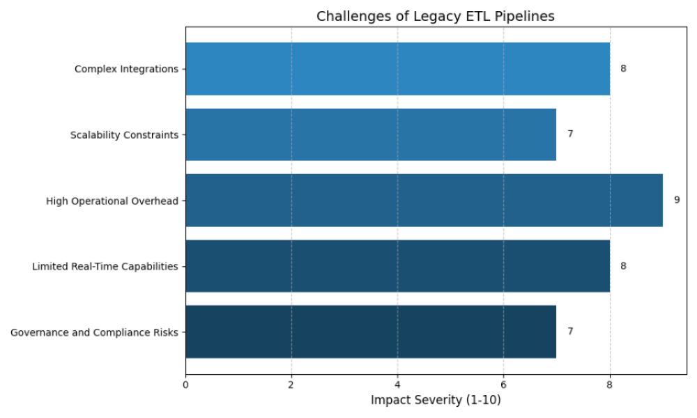
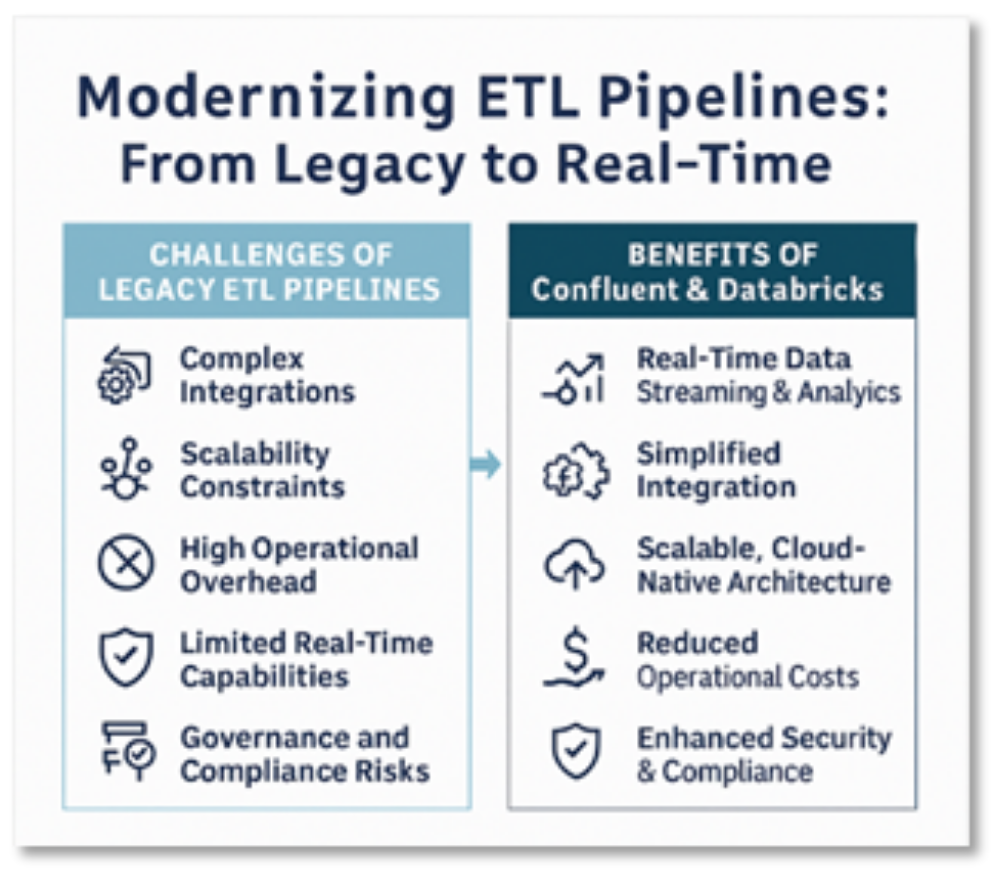
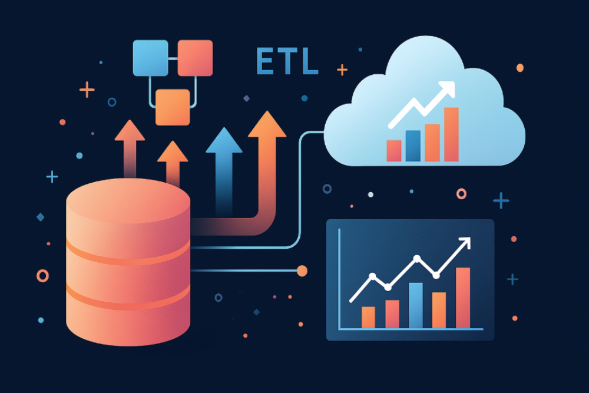

Increasingly, organizations are under immense pressure to deliver timely insights, drive innovation, and remain agile in the face of constant change, including the need to integrate diverse data sources that feed into complex AI and analytics pipelines. Yet, for many enterprises, legacy ETL platforms such as Informatica are increasingly becoming a bottleneck rather than an enabler. As we move into 2025 and beyond, the limitations of traditional, batch-oriented ETL pipelines are more apparent than ever, prompting leaders to rethink their data strategies and embrace modern, cloud-native solutions.

## The Challenges of Legacy ETL Pipelines

Legacy ETL platforms such as Informatica were designed for an era when data volumes were manageable, integrations were relatively simple, and business decisions could wait for overnight batch jobs to complete. However, the reality for most organizations today is vastly different. Data is being generated at unprecedented rates, business requirements are evolving rapidly, and the need for real-time analytics is now a competitive necessity.

According to McKinsey, by 2025, nearly all employees will leverage data to optimize their work, and organizations that embed real-time data into every decision will outperform their peers. Despite this, many enterprises are still grappling with the following challenges:

- **Complex Integrations:** Informatica environments often involve tightly coupled integrations that are difficult to modify or extend. This complexity leads to data silos and slows down the ability to adapt to new business requirements.
- **Scalability Constraints:** As data volumes and velocity increase, scaling Informatica solutions can be both costly and operationally intensive. The platform’s architecture is not optimized for elastic, cloud-native scaling.
- **High Operational Overhead:** Maintaining on-premises Informatica infrastructure requires specialized skills and ongoing investment. This diverts valuable resources away from innovation and strategic initiatives.
- **Limited Real-Time Capabilities:** Informatica’s batch-oriented processing delays insights, making it challenging for organizations to respond quickly to changing market conditions or customer needs.
- **Governance and Compliance Risks:** Legacy systems often lack robust, built-in governance and monitoring capabilities, increasing the risk of compliance issues and data breaches.

These challenges are not just technical; they have real business implications. Slow, inflexible ETL pipelines can hinder agility, delay decision-making, and ultimately impact an organization’s ability to compete in a fast-moving market.

## The Opportunity: Migrating to Databricks Using Confluent

The shift toward cloud-native architectures and real-time analytics presents a unique opportunity for organizations to modernize their data infrastructure. Migrating ETL workloads from Informatica to platforms like Confluent and Databricks enables enterprises to unlock new capabilities and position themselves for future growth. **How Companies Are Overcoming ETL Challenges:** Forward-thinking organizations are leveraging proven migration frameworks to transition from legacy ETL platforms to modern, scalable solutions. Improving’s Informatica to Confluent & Databricks Migration offering exemplifies this approach:

- **Assessment & Planning:** The migration journey begins with a deep-dive analysis of existing Informatica pipelines, dependencies, and business requirements. This ensures a clear understanding of the current state and identifies opportunities for optimization.
- **Code & Process Modernization:** Using accelerators like Code Explorer, legacy ETL logic is rapidly analyzed, documented, and refactored for Databricks compatibility. This step streamlines the migration process and reduces risk.
- **Real-Time Enablement:** Confluent Cloud is deployed as the backbone for streaming data, hydrating Databricks with high-quality, real-time data. This enables organizations to process and analyze data as it is generated, rather than waiting for batch jobs to complete.
- **Seamless Integration:** Custom connectors and orchestrated data flows ensure smooth integration between source systems, Confluent, and Databricks. This breaks down data silos and enhances accessibility.
- **Security & Governance:** Robust data governance, compliance, and monitoring are built in from day one, ensuring that data is managed securely and meets regulatory requirements.

## The Benefits of Migrating Away from Legacy ETL Pipelines

Migrating ETL workloads from Informatica to Confluent and Databricks delivers a host of benefits that go beyond technical improvements:

- **Real-Time Data Streaming and Analytics:** Immediate insights drive faster, more informed decisions. Organizations can respond to market changes, customer needs, and operational issues in real time.
- **Simplified Integration:** Modern platforms make it easy to connect across diverse data sources and destinations, supporting a unified data strategy.
- **Scalable, Cloud-Native Architecture:** Databricks and Confluent are designed to scale effortlessly, handling growing data volumes and business demands without the operational headaches of legacy systems.
- **Reduced Operational Costs:** Managed services eliminate infrastructure management, freeing teams to focus on innovation and strategic initiatives.
- **Enhanced Security and Compliance:** Built-in governance and monitoring capabilities help organizations meet regulatory requirements and protect sensitive data.

For example, Improving’s migration service offering provides organizations with best-in-class engineers and solution architects, tailored Kafka connectors, automation tools, and hands-on training to ensure a smooth transition. Companies in insurance, healthcare, and manufacturing have already realized significant gains in agility and operational efficiency by making this move

## Elevating Enterprise Data Strategy with Confluent and Databricks

An ETL pipeline built on Confluent and Databricks can fundamentally elevate an enterprise’s data strategy. Real-time data streaming enables organizations to process and analyze data as it’s generated, providing immediate insights and enabling predictive analytics. Databricks’ Lakehouse architecture supports advanced analytics, AI/ML, and secure data collaboration, while Confluent’s managed services ensure scalability and reliability without the operational burden of legacy systems.

According to BCG, companies that leverage real-time analytics and cloud-native data platforms are 2.5 times more likely to report significant improvements in decision-making speed and business outcomes.

## Why Choose Improving as Your Migration Partner

Improving is a trusted partner for organizations seeking to modernize their data infrastructure and accelerate digital transformation. Our deep expertise, proven track record, and innovative approach set us apart in delivering successful Informatica to Confluent and Databricks migrations:

- Confluent’s Elite Systems Integrator Partner with $40M+ in event streaming solutions delivered since 2013
- Global reach with 2,400+ consultants across North America, South America, and India
- Proven success across industries including insurance, healthcare, and manufacturing
- End-to-end service: assessment, migration, enablement, and ongoing support
- Innovation accelerators such as Code Explorer for rapid modernization

## Conclusion

Legacy ETL platforms like Informatica served organizations well in the past, but the demands of modern business require a new approach. Migrating to Confluent and Databricks unlocks real-time data streaming, simplifies integration, and empowers enterprises to scale and innovate. With proven migration frameworks and deep expertise, partners like Improving are helping organizations realize the full potential of their data and accelerate their digital transformation.

## Ready to modernize your legacy ETL pipelines?

[Get in touch with our team](https://www.improving.com/contact/) to kickstart your migration journey and unlock the power of real-time data!

### Co-Authors:

- **Alex Brekken** - Director of Consulting, Improving Minnesota
- **Nick Larson** - VP of Technology, Improving Omaha
- **Mark Soule** - Principal Consultant, Improving Minnesota
