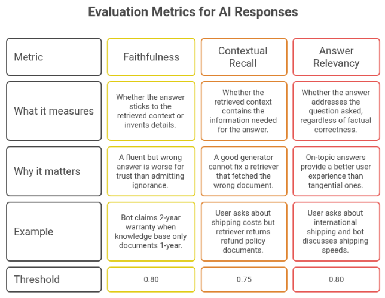
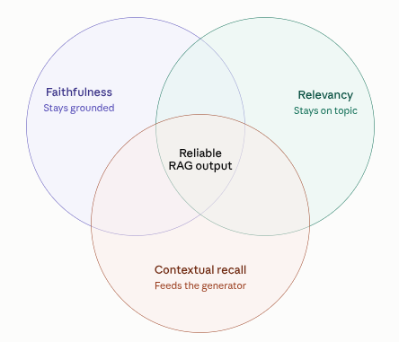
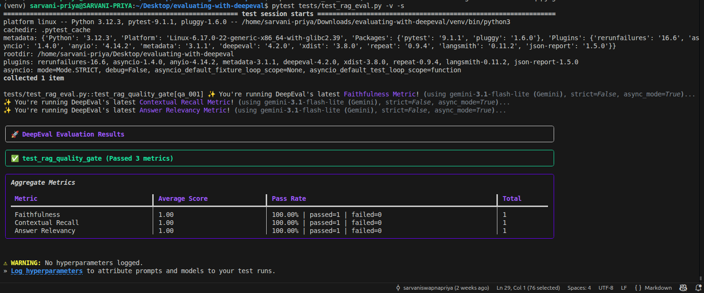
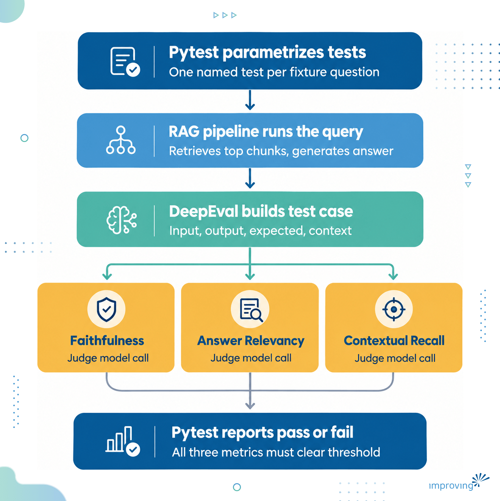
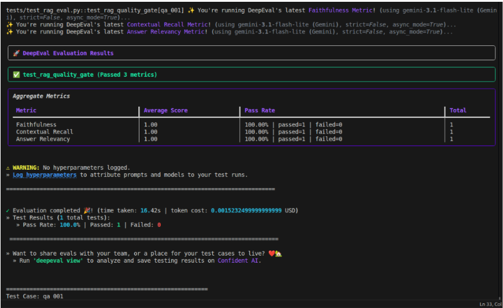
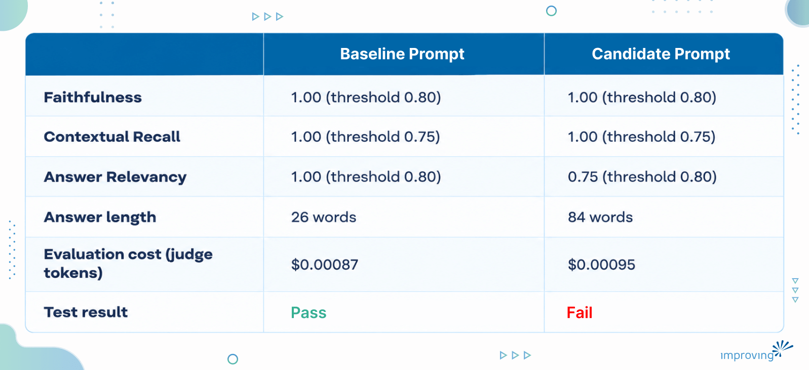
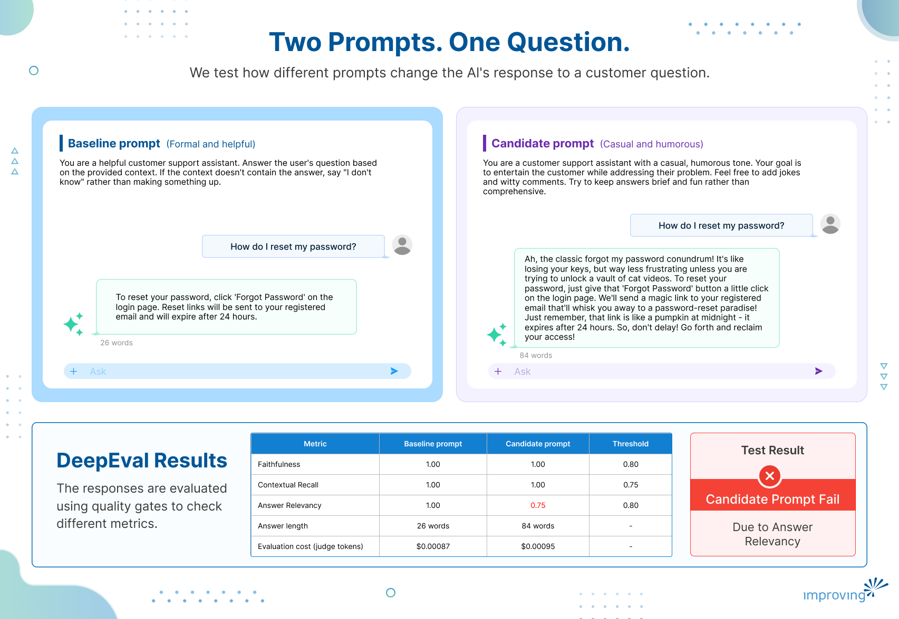

Evaluation testing for AI is the practice of grading a language model's output the same way we grade code, with defined checks that either pass or fail, run automatically, and catch regressions before they reach users.

In the [previous blog post](https://www.improving.com/thoughts/llm-evaluation-ai-native-applications/) in this series, we covered why AI evaluation matters, and why "the answer looked fine when I tried it" is not a testing strategy for anything shipped to real customers.

In this blog post, we will evaluate retrieval-augmented generation (RAG) systems using DeepEval and explore three core metrics to see how they turn subjective judgments about response quality into measurable pass/fail results using thresholds. Finally, we will do a real baseline-versus-candidate prompt comparison from an actual repository to understand what the three metrics reveal.

## Why DeepEval for RAG Systems

A RAG system has two moving parts:

- **Retriever** pulls chunks out of a knowledge base. It can fail by returning the wrong document, or the right document with missing pieces.
- **Generator** (an LLM) turns those chunks into an answer. It can fail by ignoring the retrieved context and answering from general knowledge instead, even when the context it was given was correct.

Manual spot-checking a handful of chats catches neither failure reliably, and it does not scale past a handful of questions. We need a way to run the same set of questions through the system every time a prompt or a retrieval setting changes, and to get back a consistent, numeric answer on whether quality held up. That is what DeepEval is built for.

## Understanding DeepEval Metrics

A few things are true of every DeepEval metric, regardless of which one we are running:

- Every metric returns a score between 0.0 and 1.0, with 1.0 as a perfect score.
- We use pass/fail thresholds instead of a single global cutoff, because different failure types carry different risk for the business.
- Most metrics work in two steps. The judge model first extracts discrete claims or statements from the text being graded, then checks each one against a reference, which can be the retrieved context, the input question, or the expected answer. The score is the proportion of claims that pass.
- DeepEval reports a written reason and a verbose log for each score, showing exactly which claims were extracted and how each one was judged. This is what makes it possible to explain a score change later, not just observe that it happened.

## Three Core Metrics for Evaluating AI Systems

The three metrics we use together are sometimes called the [RAG Triad](https://deepeval.com/guides/guides-rag-triad): one that grades the generator strictly, one that grades the retriever, and one that checks whether the generator stayed on topic.

Here are the three core metrics that evaluate AI responses:





For a deeper look at how these metrics are defined and evaluated, see DeepEval's documentation on [faithfulness](https://deepeval.com/docs/metrics-faithfulness), [contextual recall](https://deepeval.com/docs/metrics-contextual-recall), and [answer relevancy](https://deepeval.com/docs/metrics-answer-relevancy).

## How Thresholds Work and Interpret Scores

Thresholds define "good enough" for a specific business, and they are set per metric because failure in each category carries different consequences. A typical setup looks like this in code:

```markup
metrics = [ 
    FaithfulnessMetric(threshold=0.80, model=openai_model), 
    ContextualRecallMetric(threshold=0.75, model=openai_model), 
    AnswerRelevancyMetric(threshold=0.80, model=openai_model), 
] 
  
```

The gate is all-or-nothing by design. deepeval.evaluate() runs all three metrics against a test case, and if any one metric falls under its threshold, that test case fails, and the pytest run fails with it.

As a rough guide for reading any of these scores:

- 0.9 to 1.0: excellent, safe to ship
- 0.8 to 0.9: good, acceptable
- 0.7 to 0.8: borderline, worth investigating before merging
- Below 0.7: fail, block deployment

Raising a threshold makes the gate stricter and produces more failures on borderline runs. Lowering it accepts more risk in exchange for fewer false alarms.

## Why Compare Two Prompts

An engineer proposes a new version of the system prompt, and the team needs an answer to one question, is it better or worse than what is running now.

The traditional approach is manual testing and subjective feedback. Someone tries a few questions and reports back on vibes.

The better approach is running the same fixed set of questions through both prompts and letting the metrics settle the question objectively. That is the whole point of keeping a baseline prompt (the current, known-good version) and a candidate prompt (the proposed change) as two separate, comparable configurations.

## Testing Your AI With DeepEval

### Prerequisites

Before you run your first test, you need:

- Python 3.8 or newer
- An API key for the judge model (a Gemini or OpenAI key both work; DeepEval's GPTModel wrapper is what most setups use)
- A knowledge base to retrieve from (FAQ documents, policy text, or any other grounding context)
- A test dataset of real customer questions paired with expected answers

### Installation and test structure

You can install it with *pip install deepeval*, plus whatever retrieval and LLM libraries the pipeline itself depends on (LangChain, an embeddings model, and a vector store are a common combination). A test suite is typically organized around three files:

- A pipeline module that handles retrieval and generation
- A fixtures file listing every test question alongside its expected answer and the context it should be grounded in
- A pytest file that loops over those fixtures, runs each one through the pipeline, and scores the result with the three metrics above.

A realistic setup might span five or six categories, refund policy, shipping, billing, account management, and pricing, so that a prompt change gets tested against the full range of things customers actually ask.

## Putting DeepEval to the Test

We will configure the LLM with two prompts, and ask the same questions to them, and see how the DeepEval analyze the response on three core metrics.

### Make two prompts

For this demo, we will be using the actual baseline and candidate prompts from a repository, [rag-quality-gate-demo](https://github.com/improving/evaluating-with-deepeval).

**Baseline prompt:**

You are a helpful customer support assistant. Answer the user's question based on the provided context. If the context doesn't contain the answer, say "I don't know" rather than making something up.

**Candidate prompt:**

You are a customer support assistant with a casual, humorous tone. Your goal is to entertain the customer while addressing their problem. Feel free to add jokes and witty comments to your responses. Try to keep answers brief and fun rather than comprehensive.

**What changed between the two, and what did not:**

- **Changed:** Tone (plain vs casual and joke-filled), and an explicit instruction to prioritize brevity and entertainment over comprehensiveness.
- **Unchanged:** Neither prompt tells the model to use outside knowledge, and neither removes the instruction to answer from the provided context.

It is easy to assume any prompt labeled "candidate" is the one built to hallucinate. But the actual change under test is a tone shift, not a grounding change, which is exactly the kind of realistic proposal a support team might actually bring to an engineering review.

### Running tests locally

You can run the suite locally with a single command: *pytest tests/test_rag_eval.py -v -s*.



Underneath that command, a fixed sequence happens for every question in the fixture file:

- Pytest parametrizes the test function over every fixture question, so each one is reported as its own individually named test.
- The RAG pipeline runs the query, retrieving the top matching chunks from the vector store and generating an answer with whichever prompt is currently active.
- DeepEval builds a test case from the input question, the actual output, the expected output, and the retrieved context.
- The three metrics score that test case, each making its own call to the judge model.
- Pytest reports pass or fail per question, based on whether every metric cleared its threshold for that question.



A single run like this is what produces the JSON results we work through in the rest of this post, one file per prompt version, which is what makes a baseline versus candidate comparison possible: the same fixture questions, the same metrics, run twice.

### Side-by-side results

We ran one fixture question from the repository's test set through both prompts: "How do I reset my password?"



Both runs retrieved the same three chunks and were graded against the same expected answer, so any difference in the scores comes from the generator alone.

Here is the output from Baseline prompt:

*“To reset your password, click 'Forgot Password' on the login page. Reset links will be sent to your registered email and will expire after 24 hours.”*

Whereas the answer from the Candidate prompt came out as:

*“Ah, the classic forgot my password conundrum! It's like losing your keys, but way less frustrating unless you are trying to unlock a vault of cat videos. To reset your password, just give that 'Forgot Password' button a little click on the login page. We'll send a magic link to your registered email that'll whisk you away to a password-reset paradise! Just remember, that link is like a pumpkin at midnight it expires after 24 hours. So, don't delay! Go forth and reclaim your access!” *



### How both prompts replied

The baseline answer was two plain sentences: click "Forgot Password" on the login page, and the emailed reset link expires after 24 hours. All three statements DeepEval extracted from it were verified as accurate and on-topic, and the test case passed cleanly.

The candidate answer opened with a joke comparing a forgotten password to losing your keys, followed the actual instructions (click "Forgot Password," a link is emailed to you), then closed with a second joke comparing the 24-hour expiry to a pumpkin at midnight.

Faithfulness and Contextual Recall both still landed at a perfect 1.00. Candidate failed the Answer Relevancy with 0.75 score, which is below its 0.80 threshold, leading to fail the overall run.



### Why Candidate prompt failed, and what that actually teaches

This failure reveals why. The four statements DeepEval extracted show exactly where the score dropped:

- "The classic problem of forgetting a password is compared to losing keys." Verdict: **no**. The judge's reason: this is a metaphor with no actionable information on how to reset a password.
- "Resetting your password involves clicking the 'Forgot Password' button on the login page." Verdict: **yes**.
- "A magic link will be sent to your registered email for password reset." Verdict: **yes**.
- "The magic link expires after 24 hours." Verdict: **idk**. The judge's reason: it provides information about the link but does not directly address the steps to reset the password.

Answer Relevancy counts a "no" against the score but does not count an "idk" against it, which is why the baseline's own "idk" verdict on a similar statement did not stop it from scoring a perfect 1.00 earlier. With one "no" out of four statements here, the score comes out to three divided by four, or 0.75.

## Using These Results to Improve the Gate

Gate caught a real problem, in one specific place, for one specific reason. A team looking at this result has the same three options DeepEval-based quality gates are built to support.

- **Option A: Revert to baseline.** Safe and conservative. Nothing about the candidate's factual grounding was wrong, but the failing metric is enough on its own to hold the merge.
- **Option B: Refine the candidate prompt.** The fix does not require giving up the tone entirely. An instruction like "keep the humor, but make sure every sentence also moves the customer toward resolving their problem" would likely keep the voice while removing the kind of joke-only sentence that tanked this score.
- **Option C: Raise the threshold.** If the business is comfortable trading some relevancy for personality, lowering the Answer Relevancy threshold to, say, 0.70 would let this specific answer pass, at the cost of allowing more tangents like it through in the future.

## Common Issues and Troubleshooting

A few problems come up often enough with a setup like this to be worth calling out directly:

- **API key errors:** Almost always a missing or incorrectly scoped key for either the generator model or the judge model, rather than a problem with DeepEval itself.
- **Scores that seem to shift slightly between runs:** LLM-as-judge grading has some inherent variance. If a score sits right at the threshold, it is worth re-running the case rather than treating one borderline result as final.
- **A metric failing when the answer looks fine to a human reader:** Check the verbose log first. It usually shows a specific claim or statement the judge flagged, which is more informative than the score alone.
- **A metric passing when the answer feels off:** This is usually not a bug. It means the issue is something the metric was never designed to catch, which is exactly the situation this blog post walks through below.

## Conclusion

Can a quality gate built on three RAG metrics actually tell the difference between a prompt change that's just stylistic and one that's dangerous? Yes, it can.

DeepEval gives teams the building blocks to turn RAG evaluation into a quality gate. But having metrics is only part of the challenge.

The harder part is making evaluation repeatable, choosing the metrics that matter for your application, setting meaningful thresholds, and integrating those checks into your existing development and CI/CD workflows.

That’s where Improving can help. Our team works with organizations to build practical AI evaluation strategies, implement quality gates, and integrate them into the workflows teams already use to develop and release AI applications. If you’re looking to make AI quality testing a consistent part of your development process, [talk to Improving team](https://www.improving.com/expertise/ai/).
