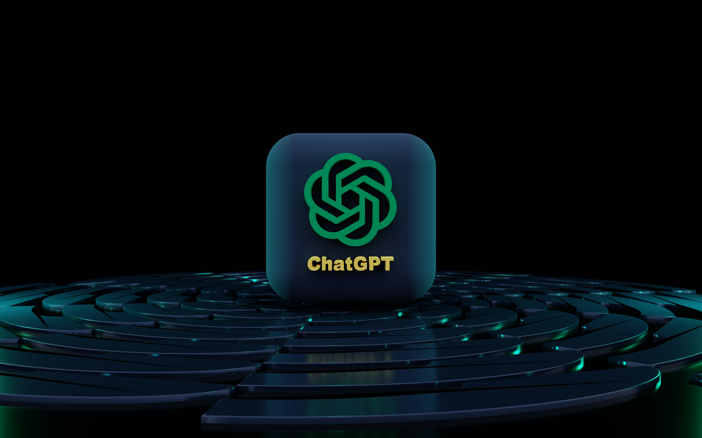
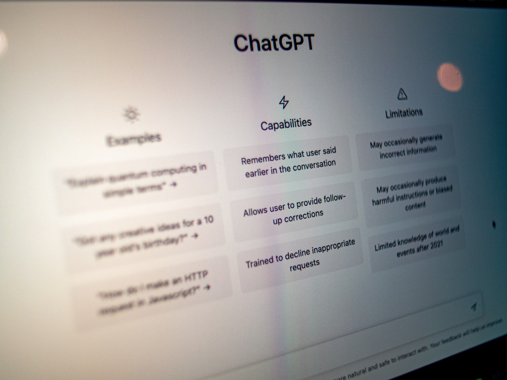

Over the last few decades, the concept of Artificial Intelligence (AI) has been gaining rising amounts of popularity due to its immense capabilities. Part of its popularity can be largely credited to the famous Hollywood film series “Terminator” which skyrocketed the concept of AI in pop culture. This concept that was once thought by many to never leave the world of fiction has now been made a reality.

With technology rapidly evolving, Gen Z is at the forefront of a digital revolution in a world where AI and its applications are everywhere. Gen Z has a unique perspective on the possibilities and implications of AI because we are the first generation to be raised surrounded by smart devices, virtual assistants, and chatbots.

With Gen Z being a pivotal cohort in today's rapidly evolving technological landscape, our perspectives on Artificial Intelligence (AI) and its effect on our futures in a world where technology is becoming more and more advanced, it is important to understand the relationship between this generation and Artificial Intelligence programs like ChatGPT.

### **Gen Z’s Usage of ChatGPT**

Gen Z’s own upbringing is very different from the previous generations before them. We grew up in an age where the most advanced technology is readily available at their fingertips: smartphones, touchscreen tablets, the latest models in laptops, etc. With all these different types of portable and handheld computers ready to be used anytime and anywhere, we’ve got access to so many online resources filled with information that we’ve never encountered before.

This generation’s relationship with technology has undergone a radical shift as a result of AI programs. The natural language processing capabilities of AI like Chat GPT have changed exchanges into more complex and lively conversations as opposed to the constrained and predictable nature of traditional chatbots. This change has been wholeheartedly welcomed by Gen Z, who enjoys having conversations with AI that can offer individualized responses, make suggestions, and even engage in imaginative storytelling.

With AI technology also evolving at an exponentially fast level, programs such as ChatGPT are able to solve the most complex questions asked to them by users in a matter of seconds, and depending on how these queries given to them are worded, it’s been used by students all over the country to solve homework, quizzes or test problems in the blink of an eye, when previously without AI it could take them up to multiple hours of researching on their own. Gen Z’s growing usage of ChatGPT has become so common that it’s become a cause for worry at schools and universities around the country as officials believe it to be a form of academic dishonesty and are implementing programs to limit students' use of AI in academic settings.

### **Gen Z’s Perspectives on AI are...**

With our generation’s increasing usage of AI, our own experiences, ideals, and worries have molded their various viewpoints on AI. Most of us are excited about AI and to be able to use an advanced program that can interact with us and present information like never before. A lot of us view it as a device that has the potential to transform numerous industries, increase productivity, and drive innovation. We also are aware of how AI can simplify our lives, automate tasks, and offer tailored experiences.

Because Gen Z was raised as a very tech-savvy generation it has allowed us to become easily adaptable to evolving technology and AI platforms that allow access to copious amounts of information instantly. However, there have been some concerns raised by Gen Z that challenge the ethics and security of AI. Regarding the ethical concerns that AI raises, Gen Z does worry about the increased use of AI in jobs and in turn the decreased risk of creativity that is associated with its use.

In May of this year, many writers who were a part of the Writers Guild of America organized a strike in order to receive fair compensation and job security in their work. Part of the reason for the strike was the use of Artificial Intelligence programs like ChatGPT in the writing process as the writers only wanted its use to be limited to researching and generating script ideas rather than just replacing them, as much of Gen Z believes that there is a limit to the creativity that AI can present and that it can’t reach the level of creativity that humans can.

Another concern of Gen Z is Data privacy and security concerns. As Gen Z becomes increasingly aware of the importance of their data privacy and security, this has led them to worry about how AI systems gather, store, and use personal data. With the rise of AI, Gen Z wants transparency, moral practices, and measures to defend their right to privacy.

### **What Programs such as ChatGPT Mean for Gen Z’s Future**

Generation Z's career paths could be potentially changed by the rise of AI. Certain careers may be replaced by AI as automation becomes more common, while fresh opportunities are created in the fields of AI development, data science, and human-AI interaction. We will have to adjust and adapt, embrace lifelong learning, and develop abilities like critical thinking, emotional intelligence, and creativity that work alongside AI. By offering individualized and flexible learning opportunities, AI programs have the potential to change education.

ChatGPT and related programs can serve as intelligent instructors by providing quick feedback, individualized instruction, and access to huge databases of information. The use of AI detection programs that have started to develop also has an effect on Gen Z’s use of AI as it will limit their use of programs like ChatGPT in their academic studies.

In conclusion, Gen Z’s use of Artificial Intelligence is something that has revolutionized the way we interact with technology and the way that future generations will interact. AI is also evolving at a rate where soon most of the world will embrace and use it.

Want to learn more about AI and how you can be ahead of the competition with this growing asset? [Reach out to us.](https://improving.com/contact)
