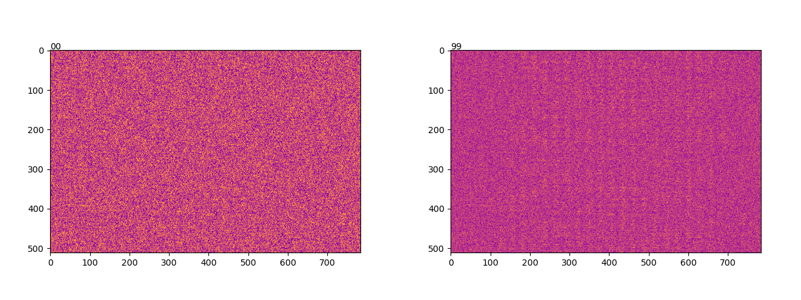
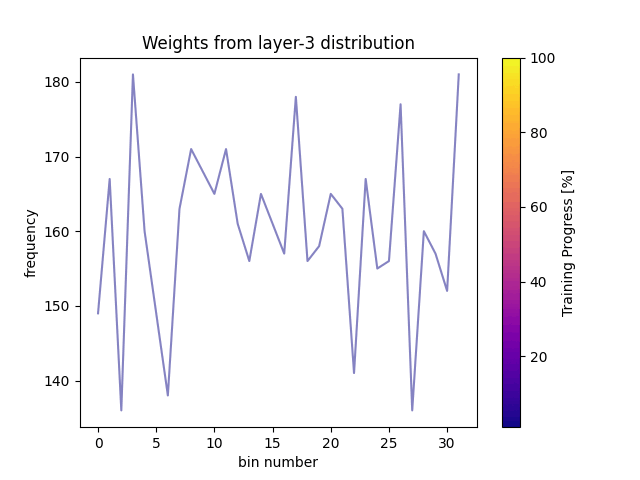
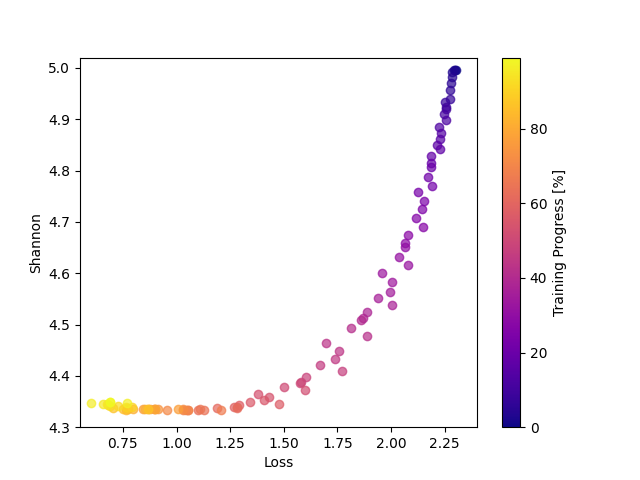
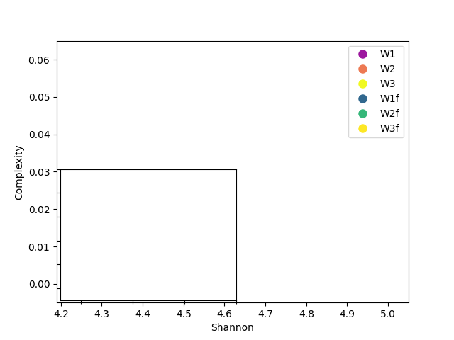

Neural networks have revolutionized machine learning, achieving remarkable performance in tasks ranging from image recognition to natural language processing. However, the inner workings of these powerful models often remain a mystery, earning them the moniker “black boxes.” In this blog post, we’ll shed light on the learning process of neural networks by examining the evolution of weights in a statistical space during training.

Using a simple yet revealing experiment with MNIST and fMNIST classification, we’ll explore how concepts from information theory—namely entropy and statistical complexity— can provide insights into the dynamics of neural network learning. By the end, you’ll have a new perspective on how these artificial “brains” organize information and adapt to solve complex problems and provide insights into how neural networks adjust their parameters to enhance performance and generalization, offering valuable perspectives for optimizing network design and functionality.

## Introduction

In the field of artificial intelligence (AI), a deep understanding of neural network (NN) models is crucial for improving their performance and applicability. This year’s Nobel Prize in Physics, awarded to John Hopfield and Geoffrey Hinton for their groundbreaking work in neural networks, underscores the importance of this technology in transforming both science and society. One of the less explored but highly significant aspects is how the weights of the NN change throughout the training process. These weight adjustments, much like the concepts pioneered by Hopfield and Hinton, not only reflect the model’s learning but also provide valuable insights into its behavior and generalization capability.

With this in mind, we look into how the weights of a neural network change during training. We used an MNIST and fMNIST image classifier with a simple three-layer neural network with dimensions of 28x28 (input data/image), 512, 512 (two layers of 512), and a final layer of 10 neurons representing the classifier’s labels. This approach allows us to analyze how the weights of one of the simplest networks adjust throughout the training and how these affect the model’s performance.

## Methodology

The first step was to store the weights of the three layers at 10 selected training steps (for 60,000 training batches) over 10 epochs. If we plot the first layer as a 28*28*512 matrix, where each column represents a 28*28 flattened image, and each row represents the weight value of the first layer, we can observe the initialization of the weights as uniformly distributed. If we compare this with the same image after training, we can clearly see band-like patterns appearing along the columns.

*Figure 1: Distribution of the weights a) at the beginning and b) at the end of training.*

It is precisely this dynamic that we aim to quantify in order to better understand it. One of the best tools for describing these states is the Shannon entropy, which roughly measures the dispersion of distributions, providing a value for each possible permutation (a numerical value or macrostate of all associated microstates). Thus, Shannon entropy is a measure of uncertainty in a probability distribution. Mathematically, it is defined as:

Where *p(x*≀) is the probability of event *x*≀ in the context of neural networks, entropy can be interpreted as a measure of dispersion in the distribution of synaptic weights. A high entropy value indicates a more dispersed distribution, while a low value suggests a more defined one.

However, for each entropy value, we have many distributions with the same level of dispersion. It would be extremely difficult to interpret what may appear to be noise, so we opted to use tools designed to understand systems with these characteristics. For this, we use **statistical complexity**, as defined by Lopez-Ruiz (1995), as a product of information “H” and a distance measurement “D” between distributions. In this case, we use Shannon entropy as a measure of information and the **Jensen-Shannon divergence** as the distance. The complexity C(X) is then mathematically expressed as:

Where *U* is the uniform distribution and *D(X||U) *measures the distance between the weight distribution and the uniform distribution and *H *is the normalized Shannon entropy. This concept allows us to quantify the balance between disorder and order in the neural network, thus reflecting the network’s ability to efficiently organize information.

At the beginning of the training, the weight histograms show a dispersed distribution, indicating greater variability in the weight values. However, as training progresses, we observe that the weight distribution becomes more ordered and concentrated. The decrease in entropy suggests that the weights are being organized more efficiently. On the other hand, the increase in complexity indicates an improvement in the network’s ability to represent information more accurately.

*Figure 2: Evolution of the weight distribution in the third layer throughout the training. The figure illustrates the transition towards a more ordered distribution as it gets trained.*

These findings highlight the process of weight adjustment during training. The transition from a dispersed distribution to a more organized one reflects how the model improves its classification and generalization capabilities. Understanding these changes is crucial for optimizing neural networks and developing more effective models.

To evaluate the learning in the neural network’s weights, we use entropy as a fundamental metric. As mentioned earlier, in the context of neural network weights, entropy helps quantify the variability in the weight distribution over time.

*Figure 3: Entropy in the weight distribution at different stages of training. The figure shows how entropy decreases as the neural network is trained.*

### Introduction to Complexity:

Along with entropy, statistical complexity provides a more complete view of the organization of the weights. Complexity is calculated as the product of Shannon entropy and Jensen-Shannon divergence. The Jensen-Shannon divergence is defined as:

Here, *q* is a normalization constant. The uniform distribution is used as a comparison for the divergence.

### Application of Complexity:

In our analysis, entropy measures the “randomness” in the weight distribution, while complexity combines this measure with the divergence between distributions. As we can see in FIg4, at the beginning of training, entropy is high and complexity is low, indicating a low concentration in weight values. As training progresses, entropy decreases, and complexity increases reflecting a more balanced organization in the weight distribution.

Something really interesting is that we can also observe that in both dataset training, the third layer makes a stop and correction. This means it reached some appropriate distribution but needed to refine the weights, by changing the distribution even with the same entropy.

*Figure 4: Evolution of weight complexity during training, showing an increase in complexity as the model adjusts. Shows the three layers from the two datasets analyzed.*

## Results

In analyzing the evolution of neural network weights, we have observed how the weight distribution changes over time, transitioning from an initial sparse configuration to a more ordered distribution. The reduction in entropy and increase in statistical complexity reflect a process of model adjustment and optimization during training.

These results have several important implications for the design and implementation of neural networks:

1. **Model Performance Improvement:** The transition towards a more ordered distribution in weights suggests that the model is learning to better classify images. The model’s ability to adjust its weights more efficiently is crucial for improving its performance in classification tasks.
2. **Parameter Optimization:** Understanding how entropy and complexity change during training can help developers adjust model parameters, such as the number of layers or learning rates, to obtain more accurate and efficient results.
3. **Interpretation of Weight Changes:** The analysis of entropy and complexity provides a useful tool for interpreting changes in weights and understanding how the model is learning and adapting. This is especially important for developing models that can generalize well to unseen data.

## Real-World Applications:

The techniques of entropy and complexity analysis are not only relevant for adjusting neural networks in image classification tasks but also have applications in a wide range of real-world problems:

- **Anomaly Detection: **In anomaly detection systems, high entropy can indicate greater variability in the data, which could be useful for identifying unusual behaviors or errors in the data.
- **Optimization of Production Models: **For models in production, such as recommendation systems or natural language processing applications, understanding the evolution of weights can help improve model stability and efficiency.
- **Development of New Architectures: **Insights gained from these analyses can guide the development of new neural network architectures that are more robust and capable of handling variability in the data.

The analysis of weight evolution, entropy, and complexity offers a better understanding of how neural network models learn and adjust during training. These techniques provide valuable tools for optimizing model performance and applying this knowledge to a variety of practical problems. Effectively interpreting and adjusting weights is essential for developing more accurate and efficient artificial intelligence models.

If you're looking to optimize your neural network models or need expert guidance on your machine learning projects, [reach out to us!](https://www.improving.com/contact)
