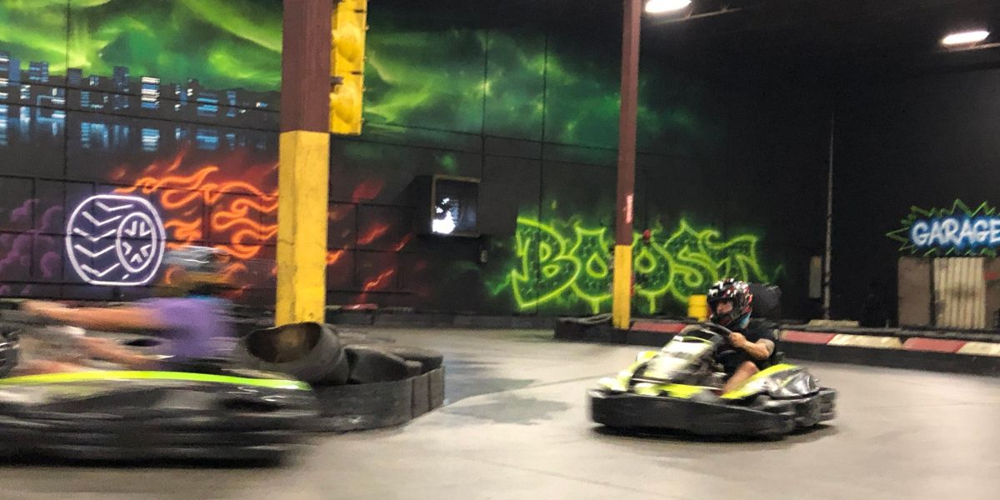
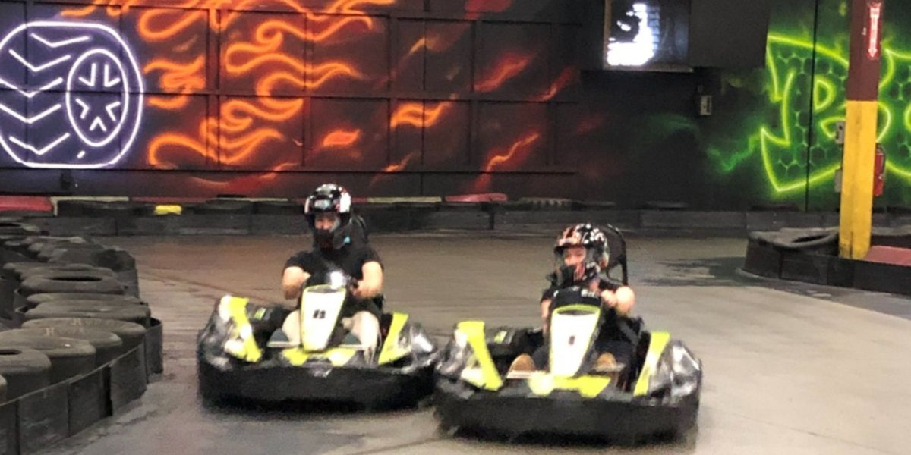

Improving Vancouver enjoys playing as hard as we work and go-karting has been on our bucket list for a very long time, so we finally got around to tearing up the track and letting our competitive juices flow! To kickstart our weekend, we headed over to TBC Racing to zoom around in go-karts together.

TBC Racing boasts some of Metro Vancouver's fastest karts, with some reaching speeds of up to 75 km/hr! As we zoomed around the track, skillfully navigating the curves and drifting with (questionable) finesse, the rush of adrenaline was undeniable. Time seemed to fly by, and before we knew it, it was time to eat!

To refuel our bodies (pun intended), we grabbed some burgers and spent the rest of the night figuring out who bumped who out, and debating who really had the fastest lap. We can’t wait to do this all over again next time!

Want to join our team? Check out our current job openings [here](https://improving.com/careers).
