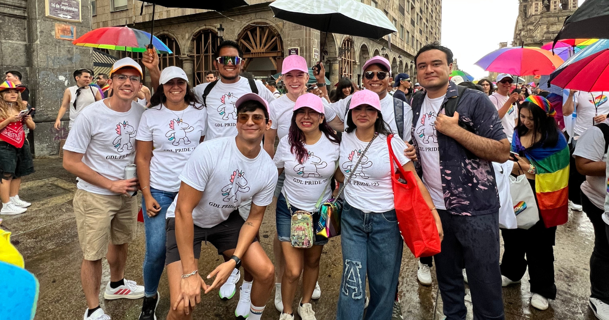

The first time I went to Guadalajara Pride with Improving, I didn’t really know what to expect. It was only the second or third Pride event I had ever attended.

As someone who grew up in a small city, I was used to Pride events that were much smaller. The sense of community was always there, but the scale felt very different from what you see in larger cities.

So, when Improving announced that they would help cover travel expenses for anyone who wanted to attend, I didn’t hesitate. I immediately started looking for flights. Not only was it a reminder of the kind of company that Improving strives to be, but it felt like an opportunity that I simply couldn’t miss.

Living in Mérida, MX, time sometimes feels like it moves at a different pace. It’s a beautiful place, but socially it can still be quite conservative. Change happens, but slowly. Growing up in an environment like that teaches you to move through certain spaces cautiously, always a little aware of the looks, comments, or silences that might appear.

I arrived in Guadalajara feeling nervous and unsure… but incredibly excited. And I quickly realized I hadn’t been prepared for what I was about to experience.

If I’m honest, I expected at least a few judgmental glances, the kind of murmurs that aren’t quite whispered, or subtle pointing that you learn to recognize even when no one says anything directly. Part of me even expected the familiar discomfort that sometimes surrounds Pride events in more conservative places.

At the very least, I imagined seeing employees from other companies showing up out of obligation — people there to fill a quota for June, checking the “inclusion” box before moving on and forgetting about it for the rest of the year.

But it wasn’t anything like that. What I found instead was a true celebration. A vibrant, joyful space that somehow felt like home.

There were genuine hugs, warm smiles, and conversations that flowed easily between people who may have just met but clearly shared something deeper. There was an energy in the air, with a real desire to celebrate diversity, not just tolerate it or reluctantly accept it, which is what many people in the community are often used to experiencing.

In many ways, it felt healing.

For a moment, it reminded me that we are not just a token or a checkbox to mark during Pride Month. That there are people who truly care about our community, our rights, and our place in the world.

That day I marched, I sang, I celebrated… and I connected with my fellow Improvers. I truly connected with people, and in a way, that’s hard to explain. This 30-year-old sapphic woman felt like she had been waiting to meet these people her whole life.

And when I returned home, I brought back more than just memories. I came back with hope. Hope in knowing that spaces like this exist. That there are people out there who see us, who support us, who celebrate us. That there are places that can feel like home, even from far away — places we can look toward when things feel difficult or heavy.

And I’m deeply grateful to have experienced that. To have had the chance to refill my heart with hope, and to know that I can return and see those people again — my people — year after year.

That sense of belonging doesn't happen by accident, and it's something Improving actively works to build. Through moments like this Pride march — and the everyday culture that makes them possible — Improving creates a community where people are not just included, but genuinely celebrated for who they are.

[Learn more about Improving’s culture here.](https://www.improving.com/careers/inclusion-diversity/)
