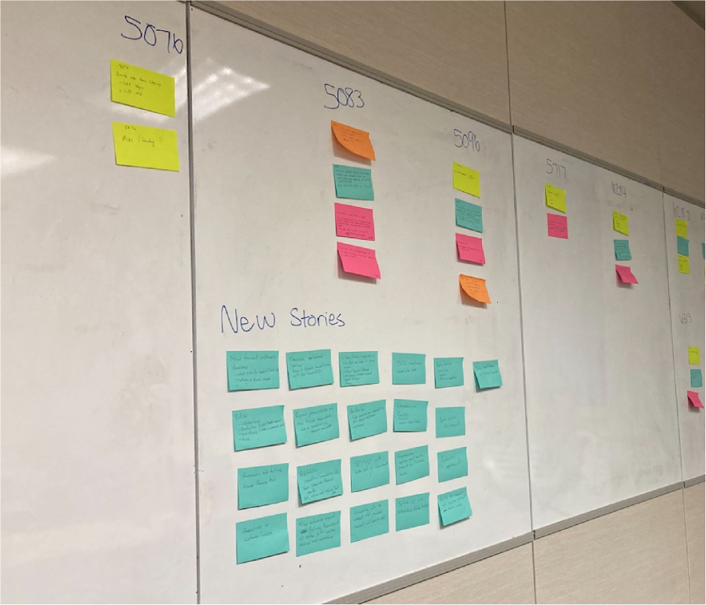
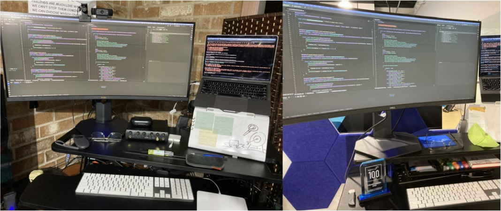
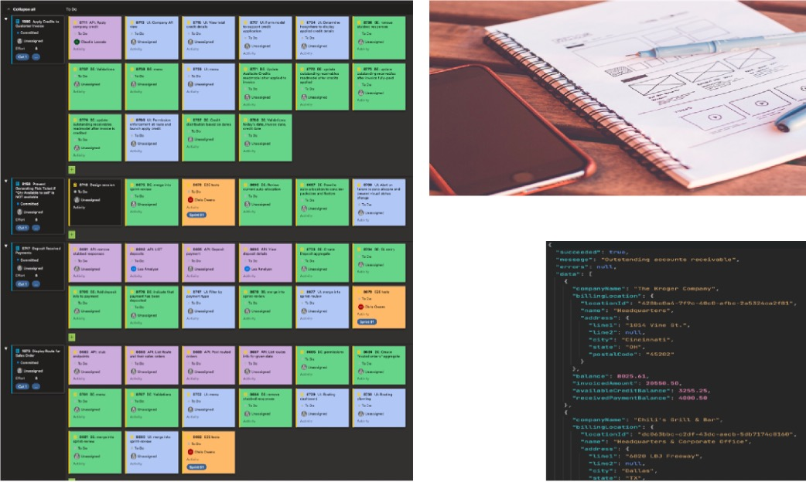
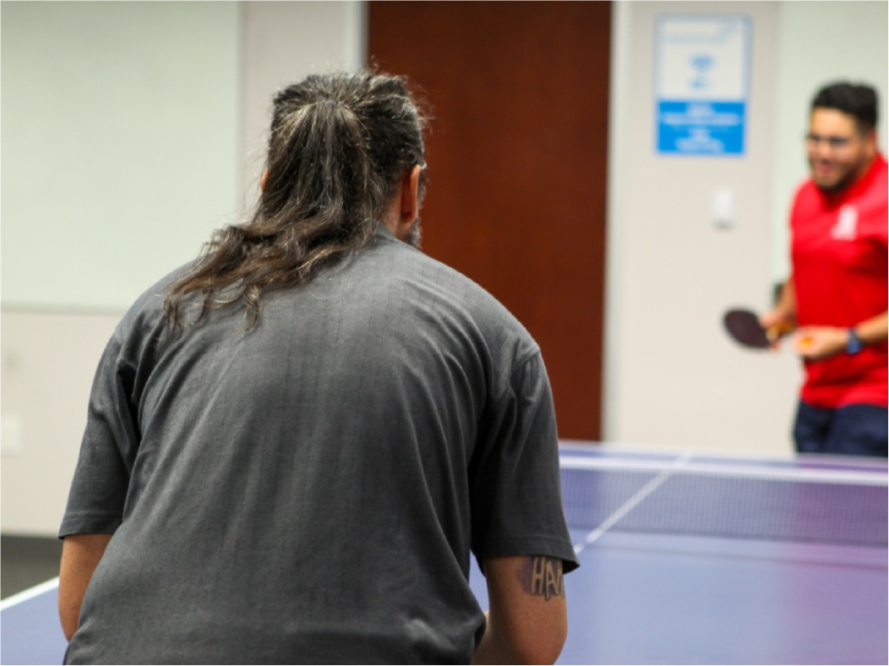
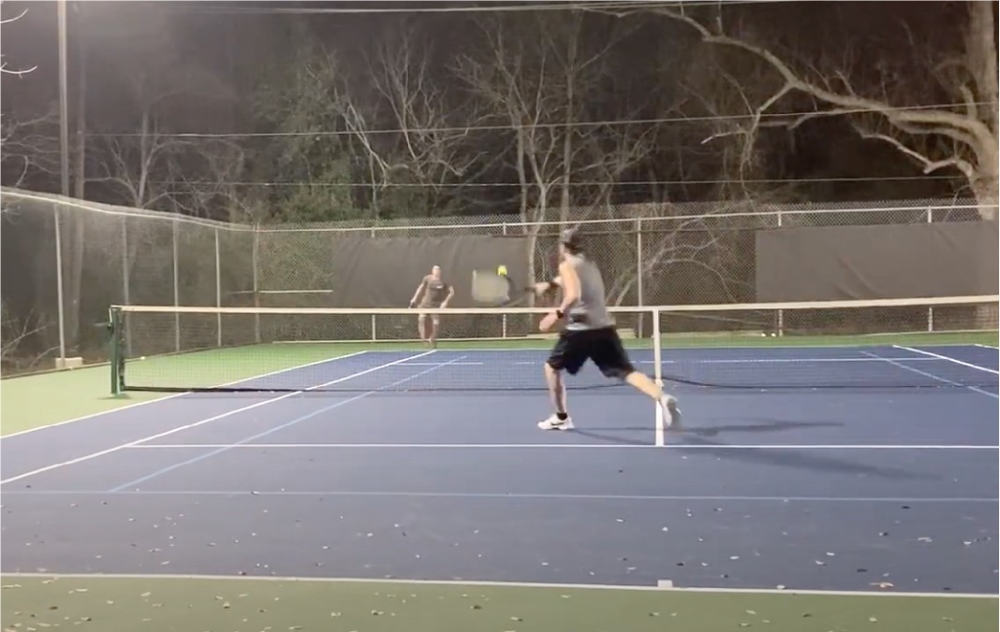

I often hear polarized comments and discussions about employees returning to the office in this post-pandemic world. During a dinner in 2022, an old colleague asked if I had gone back to the office and what my thoughts were about that. My team had just spent a few days in Phoenix, AZ, visiting our client's client, so it was easy for me to share some words. Now, I'll now share them with you.

This team, which started all-remote in July of 2020, asked four months into the project if we could come into the office for some of our meetings (sprint planning, review, retro, backlog refinement, and design sessions). That's what we've been doing ever since. Our presence in the physical space facilitated our **communication** and **collaboration** among ourselves and our stakeholders.

With everyone invested in asking questions to understand our client's goals better, listening attentively, and delivering results with minimal trips "back to the drawing board," we earned their trust. That's when we were presented with the rare opportunity to have the team visit one of their clients, see their operations up close, talk to their employees freely, and experience first-hand what challenges they face in doing their work and conducting their business. We all wore the hats of UX Designers (a role that wasn't the primary for us).

On our way back from this visit, everyone on the team wrote down tons of sticky notes with our observations and insights that we gathered from talking to people and looking around to see what they had in their offices, computer screens, desks, and whiteboards. We then met for a few days in the office to review everything and discuss it with our product owner. We couldn't have collaborated more effectively if we had been staring at our computers while working from home. Virtual tools have evolved a lot, but still can't beat the experience of people walking up to the gigantic whiteboards, moving stickies around, where everybody can see and interact with each other.

When we work remotely, we often pair program, design, code, and design review, work in 25-minute time boxes, taking breaks together. When we went back to being in the office for our meetings, we were in the same room for 2 to 6 hours, taking breaks as necessary. Important fact: This was the first time anyone in this group had worked together before this project! Doing meaningful, collaborative work in person sped up our bonding.

I enjoy working from home and in the office and am productive in both environments. I set them to my liking, with standing desks, kneeling chairs, multiple screens, whiteboards, and a laptop lift that's also a whiteboard. Oh, and I have an acoustic guitar at arm's length. However, I want to highlight the importance of being in an environment with colleagues and how it still has benefits.

### "A week in the life of..."

I journaled my thoughts on the topic the morning after the dinner I mentioned earlier. So, I looked at that week on my calendar, the meetings and activities I had, and the notes I took for each, and I wrote down what I found out. I'll share a snapshot of what that week looked like for me. No two weeks are the same, thanks to the many challenges, opportunities, circumstances, and interactions.

Here we go...

Monday: I'm in the office with the team for sprint planning and design discussions. We start at 10 a.m. and end around 3 p.m. We eat our lunch together, share stories from the weekend, and come out of the meetings feeling and knowing that we have a good plan for the current sprint.

After that, I have a quarterly meeting with one of my direct reports. We walk up to the whiteboard and sketch out ideas and thoughts. We can see and hear each other with the best resolution possible!

Tuesday: I'm working from home. I run a book club in Spanish with Improvers from many offices across the US, Mexico, and Canada, with a good mix of people who speak primarily either Spanish or English.

Later in the afternoon, I have a virtual retrospective meeting for another book club titled "A Complaint-Free World". Book club members from Houston chat about this topic whenever we are in the office together, and we share our failures and successes in the challenge of living our days without complaining.

Wednesday: I work from home in the morning. I am entirely focused, working on tasks that require deep thinking. During my lunch break, I attend a Come Together virtual event, which gets my mind off work while providing food for thought in other areas of life.

Then, I go to the office in the afternoon and have hallway chats that wouldn't happen if we were online. That's a chance to catch up with others. It's common for me to share exciting ideas from books I'm currently reading and experimenting with.

In the evening, we have an in-person ImprovingU class: Ping-Pong 101! That was a lot of fun, and I learned what other Improvers are interested in ping pong. I come out of it thinking about what a 102 class would look like.

Thursday: The team is in the office with our product owner from 9 a.m. to noon for design reviews and backlog refinement. We thoroughly use the big screen, whiteboards, and in-person collaboration. Everybody has a chance to ask questions and clarify assumptions, and we make sure we're on the same page and on the right track.

Later in the day, there was another in-person ImprovingU. This one is on Songwriting. Some Improvers worked from home all day and drove to the office to join that class.

It's Friday. I'm working from home. In the morning, I attend my Trust Pod (an internal initiative), and I take note of thoughts I want to journal later. In the afternoon, there is a lot more deep-thinking work.

See the difference between my work-from-home time versus office interactions?

### Life Beyond Work

Remember those hallway conversations? In one, two of us learned that we enjoyed playing tennis. Another person overheard the conversation and joined in. We plan out when we can play together and where.

We have played weekly through summer and winter for the last two and a half years. It's an excellent workout for the body and mind, and we have a great time evolving skills together. It's a deliberate practice, and we have been seeing good progress. It's one of the activities we look forward to every week. We would never have started without that conversation.

As I was putting these thoughts together, I wrote down several ideas for office activities I'm considering doing to leverage the incredible opportunity I have to hang out with great people! Ideas include pair programming and refactoring sessions with people not on my project, songwriting, and Improv, to name a few. Connection, collaboration, communication... Some conversations with people at work improve me; sometimes, I help others improve. It's a win-win in my book.

## To Summarize

Flex work balances remote work and in-office collaboration, fostering communication, bonding, and creativity while allowing for deep work at home and collaborative sessions at the office. If you want to learn about Improving's hybrid initiatives, [reach out to us](https://www.improving.com/contact) to learn more. You can also find out more about our culture [here](https://www.improving.com/careers/culture/).
