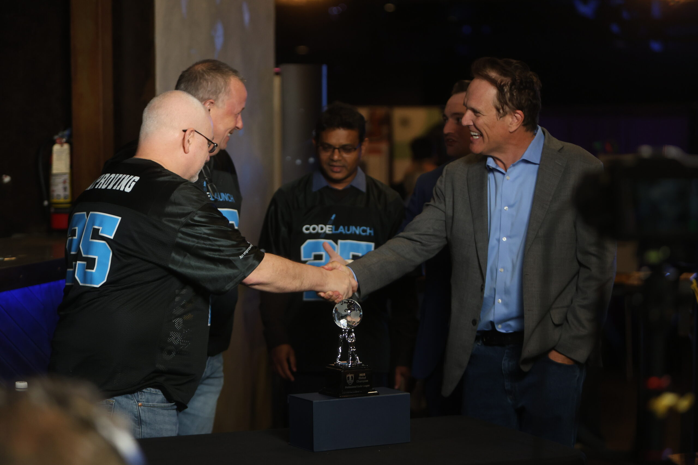
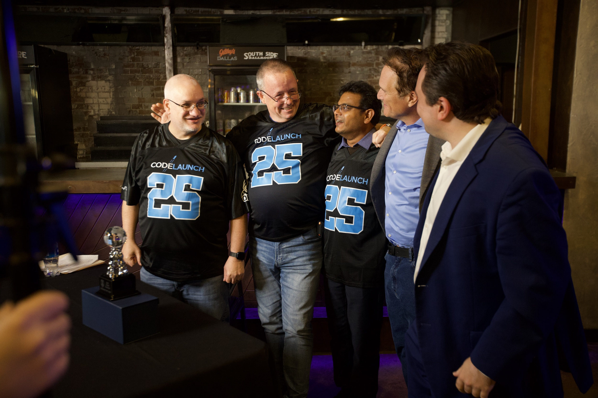
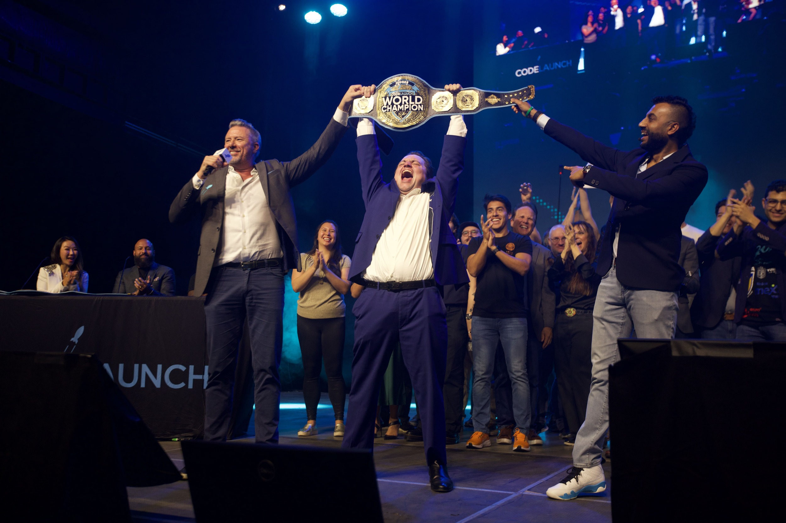

Walking into a CodeLaunch event is a little like stepping backstage at a rock concert. Well, if that rock concert also happened to be “the biggest startup show on earth”. You can hear the energy of the event before you see it, with rumbles of conversations in the expo area and the bass from the preshow playlist.

I arrived early at the CodeLaunch World Championship, thinking I’d beat the crowd. I didn’t.

The doors had barely opened and the lobby was already packed. Startup teams adjusted their signage, investors scanned the room for familiar faces, and CodeLaunch alumni gave newcomers that knowing look: *You’re about to experience something unforgettable.*

But nothing sets the tone quite like the moment the theater lights dim, the music volume rises, and the crowd shifts from scattered conversations to collective anticipation. That’s when you realize: you’re not at a typical pitch competition. You’re at a live show and the founders are the headliners.

## **Powered By Improving**

CodeLaunch is a *free*, *zero‑equity*, *high‑velocity* startup accelerator that pairs early-stage founders with professional software development teams. These PCL (Professional Coder League) teams donate two full days of engineering horsepower, building real MVPs, prototypes, and product features at no cost to the founders.

Here’s the part most people don’t see from their seats in the theater: Improving doesn’t just support CodeLaunch, we produce it.** **Every moment of organized chaos is coordinated by Improvers who pour their talent into making this the most founder‑focused stage in North America.

At the heart of that effort is the *Professional Coder League*, a roster made up entirely of Improvers. These aren’t weekend hobbyists or student teams. They’re seasoned engineers, architects, designers, and technical leaders who volunteer for two days of high‑intensity development to build real product features for every finalist.

When the PCL teams walk into the venue on show day in jerseys, grouped by office, buzzing with pride, they are rightfully treated like athletes. The audience cheers for them too, and the finalists show their gratitude. Watching a founder show off a feature the PCL built just 48 hours earlier is one of the most electric moments of the entire event for me as an Improver.

## **Now Back to the Show**

Spotlights beam across the room. The screens flicker to life with motion graphics that look like they belong at an esports championship. Anything that felt “startup formal” dissolves into extreme fun.

Finally, the finalists walk out and pitch their startups one by one. CodeLaunch pitches aren’t dry rehearsals. They're paced performances, punctuated by cheers, applause, and between-round commentary that brings the audience deeper into the story behind each startup. The judges fire off questions to the founders. Sometimes they’re tough, sometimes technical, but always direct.

In those moments, you understand exactly why CodeLaunch exists. It’s about creating opportunities that change what’s possible for early-stage startups.

## **A Finale That Feels Like a Championship Game**

By the time the final two startups take the stage, the crowd is fully invested, debating products between pitches and getting hyped up for the ones they resonate with. And then comes the moment everyone waits for: the winner announcement.

Everyone in the room goes crazy as Well Water Finders takes home every award! They were awarded $50,000 as the Judges Champion, Investors Champion, and Launch Kings Audience World Champion. This is what makes CodeLaunch unforgettable, as everyone watches lives change in real time. From the floor to the finale, my experience wasn’t just watching founders compete for a title. It was watching them step into a story much larger than themselves; one built on courage, collaboration, and the belief that early-stage ideas deserve a stage worthy of their ambition.

If you’ve never attended CodeLaunch, consider this your invitation. Bring your curiosity, energy, and friends! Once you’ve experienced it, you’ll understand why everyone keeps coming back.

Want to be a part of the sensation that is CodeLaunch? [Apply to be a part of the competition or become a sponsor today!](https://codelaunch.com/)
