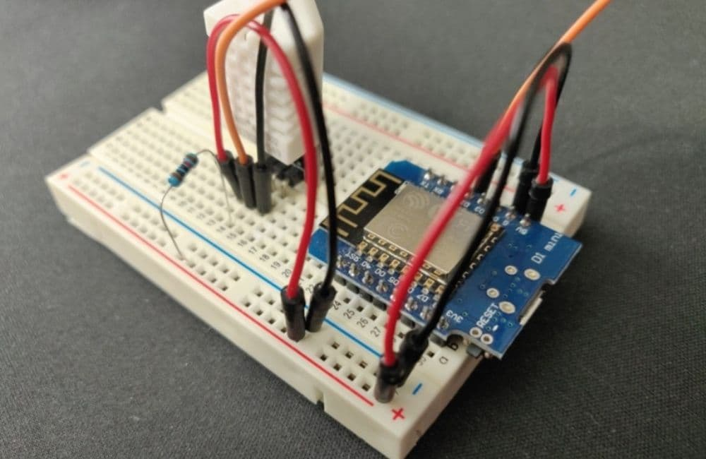
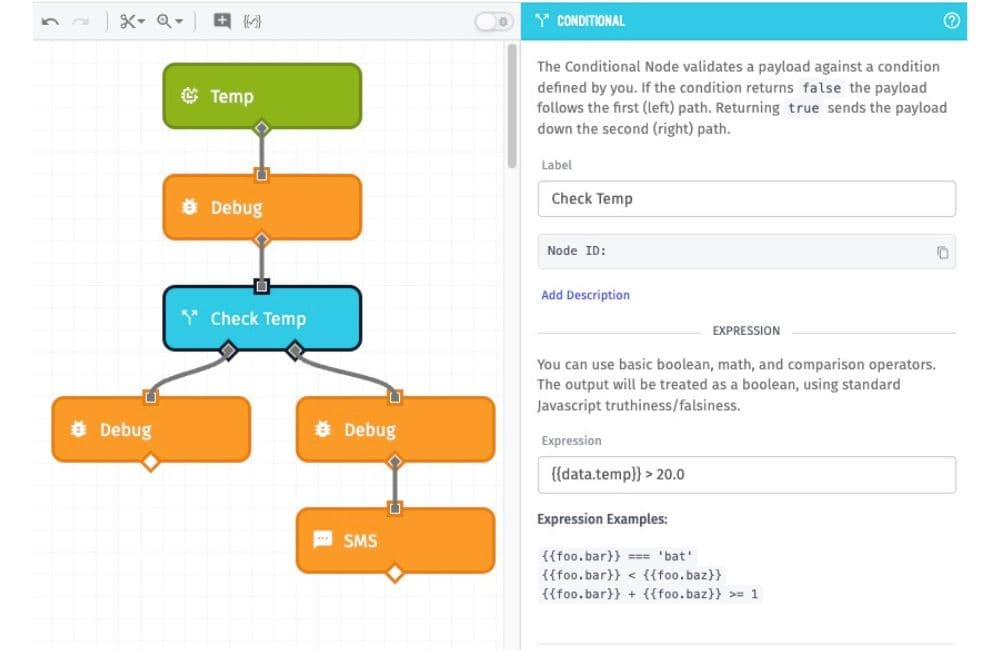
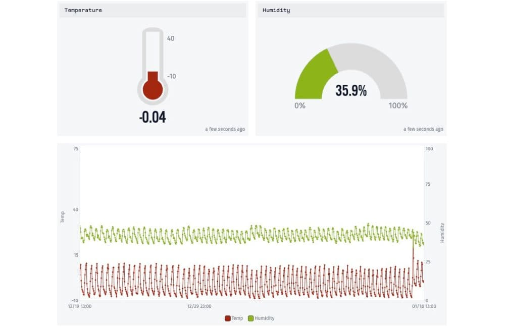
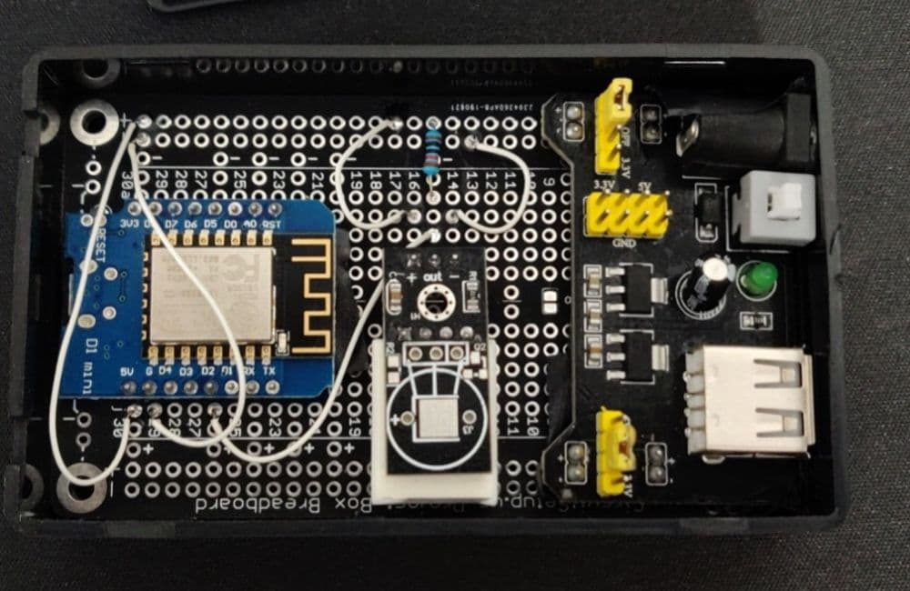
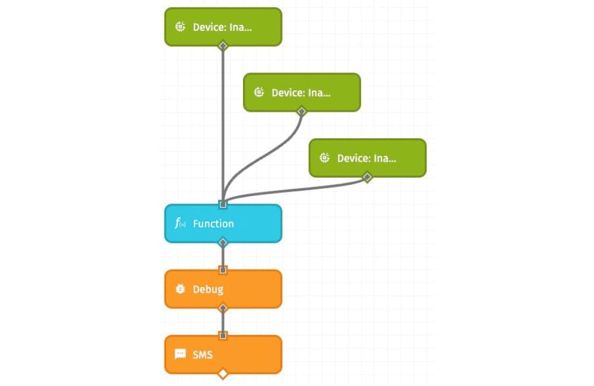

The Internet of Things continues to grow and become more accessible. My first job out of college, long before IoT was an acronym, involved integrating hardware with software. Most of my career since then has been software focused, but I often look back with fond memories of that first job and writing software that directly interfaced with custom hardware. I recently had the opportunity to experiment with a couple of IoT maker projects around my home.

## Using IoT to Make a Deep Freezer Sensor

My first problem was a deep freezer in the basement that is plugged into a GFCI outlet. These types of outlets can trip, often easily and unexpectedly, and when that happens they need to be manually reset in order to restore power to whatever is plugged into them. While it doesn’t happen as often now, there was a time when the power in my area was less than reliable. After a power interruption, this GFCI outlet had a tendency to trip leaving the freezer without power.

I was talking to a friend who had a similar problem but his freezer actually failed, spoiling all the food inside. He told me about his project, which I decided to copy. Basically, it is a temperature sensor that resides in the chest freezer and it will notify me whenever the temperature rises above a set threshold or if the power goes out.

The project is based on the [Wemos D1 Mini](https://siytek.com/guide-to-the-wemos-d1-mini/) [Arduino](https://www.arduino.cc/) board. It is an inexpensive microchip with onboard WiFi based on the [ESP8266](https://siytek.com/everything-you-need-to-know-about-esp8266/) chip. You can typically purchase multiples for less than $3 each. At this price, you won’t feel bad when you fry one, which I have done more than once.

That all sounds neat, but how does it help solve my freezer issue? [When paired with a DHT22 temp/humidity sensor, the Wemos D1 Mini can be programmed to report the current temperature](https://chewett.co.uk/blog/1476/using-the-dht22-temperature-sensor-with-a-wemos-d1-mini-esp8266/).

Here is my simple breadboard prototype with the Wemos D1 Mini connected to a DHT22 temp sensor. Using the free Arduino IDE, I was able to flash the microchip with custom software that reads data from the temp sensor.

This is cool, but how can I easily integrate notifications and reporting? [Losant](https://www.losant.com/) offers an IoT platform for exactly this type of thing and even provides a handy [guide](https://www.losant.com/blog/getting-started-with-the-esp8266-and-dht22-sensor). Losant also provides a free developer sandbox to get started.

I flashed another version of the software that sends the sensor data to Losant every 30 seconds. The intuitive Losant interface allowed me to create a simple workflow to send me a text message whenever the temperature rises above 20 degrees (Fahrenheit).

Losant also provides a dashboard view and a suite of widgets I can customize to quickly check the current status of my freezer and historical data.

The final solution consists of a small plastic box with all the components soldered onto a PC BreadBoard and a 5v DC power supply. Please forgive my crude hardware skills. I’m not an electrical engineer, but [I did stay at a Holiday Inn Express](https://www.youtube.com/watch?v=8dOHEw8izno) once.

I started this whole experiment with the concern of an A/C power outage, but my sensor is plugged into A/C power. So, if the power goes out, my sensor will stop reporting data to Losant and I won’t be notified. Ugh, that’s not going to work! I suppose I could power it directly with a battery, but then I need to remember to change the batteries. I could also plug it into a UPS, but that seems like an expensive solution. I wonder if Losant has anything that could help. The answer is yes! I can use workflow triggers to alert me whenever the IoT device is inactive for extended periods of time. In this example, I have 3 triggers for 15, 30, and 60 minutes.

I now have a simple temperature sensor that alerts me whenever the temp in my freezer is above 20 degrees due to a mechanical failure in the freezer. And I will also be notified if the sensor goes offline for extended periods of time (e.g. power outage). I’m happy!

I hope you found this interesting. Please feel free to leave a note with any suggestions or share a cool maker project you’ve worked on recently.

In [part 2](https://improving.com/thoughts/fun-with-iot-part-2/) of my Fun with IoT series, I use IoT to build a driveway alarm. By leaning on what I learned above, I was able to combine two Wemos D1 Minis in a crude client/server configuration with a 3-axis magnetometer sensor to alert me when vehicles were traveling along my rural driveway.
