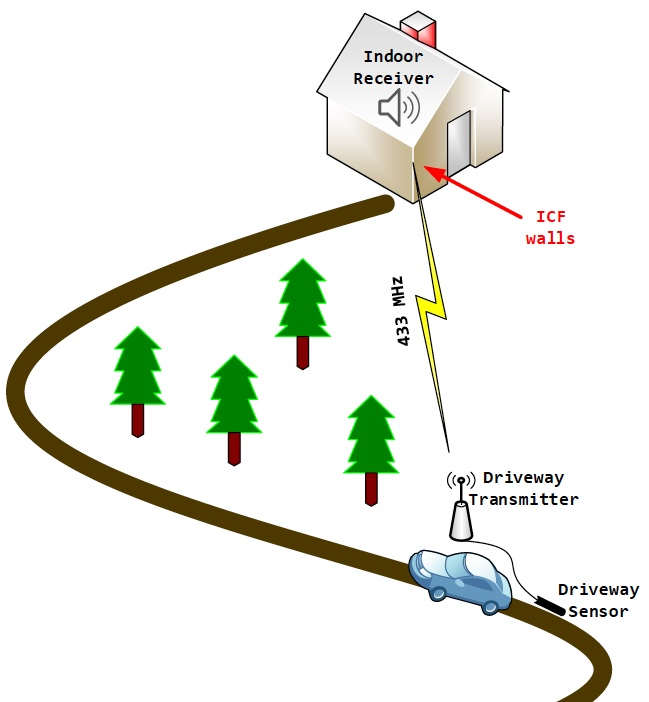
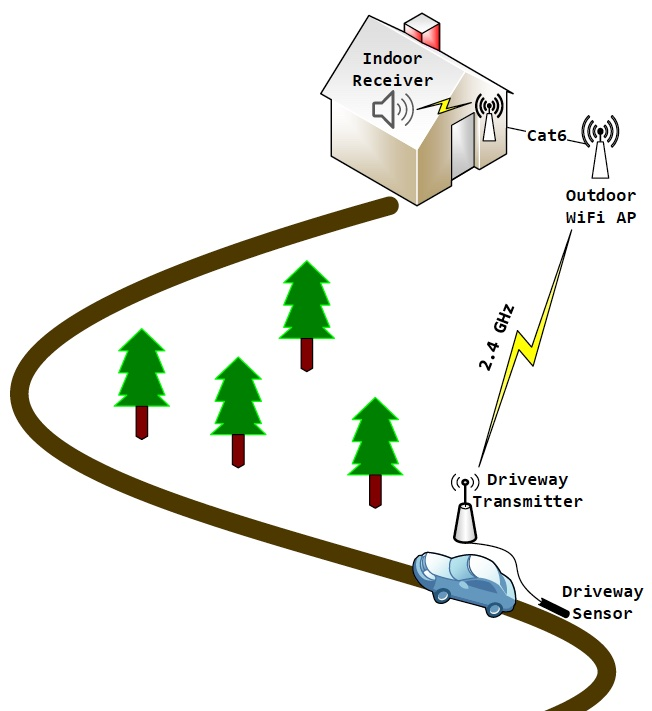
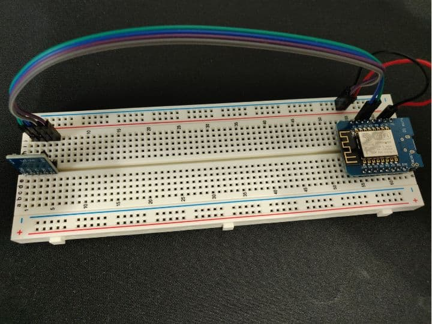
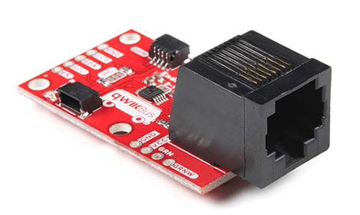
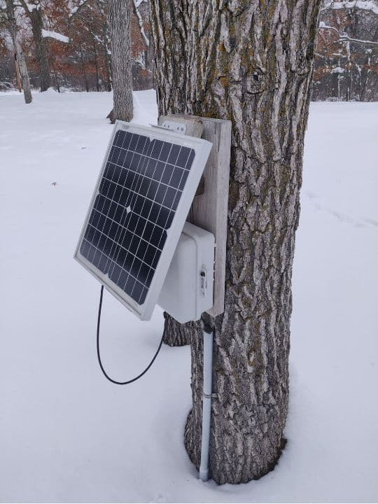
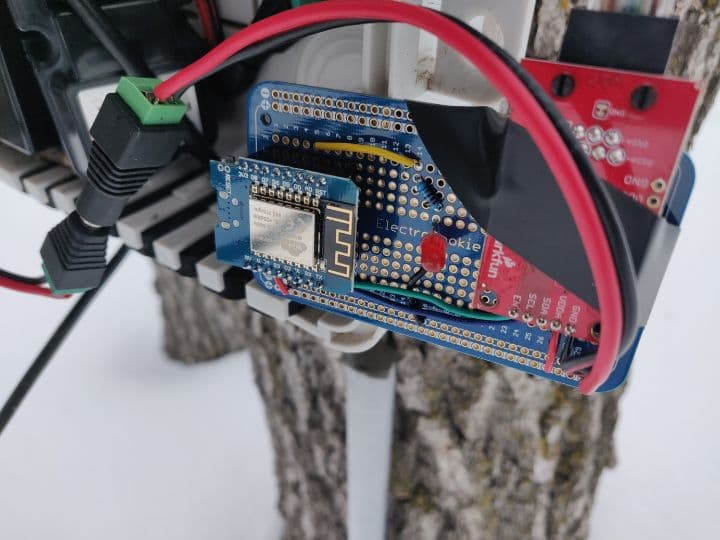
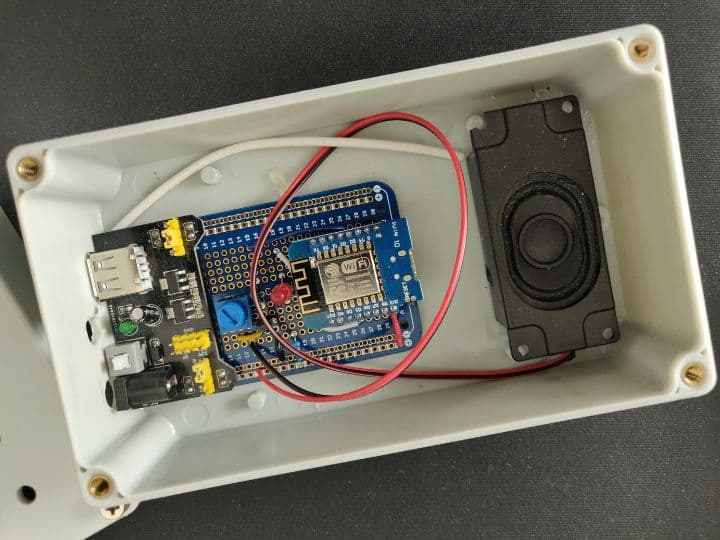
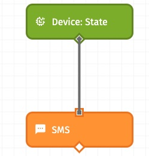

In [part 1](https://improving.com/thoughts/fun-with-iot/) of my experimentation with the Internet of Things, I made a simple alarm that alerts me when my deep freezer stops working as expected. In this next part, I’m sharing my adventure of creating a driveway monitor that alerts me when vehicles are approaching my home.

## Using IoT to Make a Driveway Monitor

My rural property has a relatively long driveway and I wanted to know when someone was approaching the house from the main road. There are a couple of retail products available, so I decided to try one - the [Mighty Mule driveway monitor](https://www.mightymule.com/fm231/).

The Mighty Mule product consists of an outdoor sensor connected to a wireless transmitter. When a vehicle is detected by the sensor, the transmitter sends a signal to an indoor receiver which then plays a sound. Easy peasy! The installation looks something like this:

I installed the Mighty Mule, but I couldn’t get the indoor receiver to acknowledge a sensor transmission. This is a great product and will likely work for 99% of homes. Unfortunately, my home falls into the other 1%.

The exterior walls of our single-story home are constructed with insulating concrete forms (ICF). It is common to find ICF in basement construction, but ours has it on the main floor also. Well, radio waves don’t pass through ICF walls very well. In fact, after we built this house, I had to install a [4G LTE signal booster to get cell phones to work inside](https://logixicf.com/blog/insight-and-advice/how-to-prevent-cellular-signal-issues-in-icf-homes-and-buildings/). So, I should have known better, but I was hoping this product might have more success penetrating the walls of our home (which I jokingly refer to as a “pseudo” faraday cage). I’ll say it again. I believe that the Mighty Mule product is great, but it just didn’t work for me due to the unique constraints of my installation topology. So, now what do I do?

Before I begin, I’ll admit that my final solution might invoke thoughts of a Rube Goldberg contraption. Perhaps a signal repeater would have made more sense to extend the range of the Mighty Mule product. For me, it was as much about the learning opportunity as it was about my desire to overcome this problem.

So, I started with the goal of building a driveway monitor, like the Mighty Mule, but that uses an alternate method to get a radio signal into the house from outside. I had previously installed an outdoor WiFi access point to serve the internet to my outbuildings. This outdoor WiFi access point is hard-wired to my LAN. Hmmm, this is one way to get a radio signal into the house. And I had some experience working with the [Wemos D1 Mini](https://siytek.com/guide-to-the-wemos-d1-mini/) microchip which has built-in WiFi (see part 1 of this blog). This could work! The WiFi configuration looks something like this:

Next, I needed to find a sensor to integrate with the Wemos D1 Mini that would do the trick. I hemmed and hawed for a while about the type of sensor to use.

1. Infrared – uses an infrared beam that would trigger when a car passes through the beam. After considering the abundant wildlife in my area and the potential for false alarms, I decided against this approach.
2. Magnetic – uses a magnetic field to detect vehicle proximity, like a fast-food drive-through might use. Better yet, since it should only detect ferrous metal, wildlife wouldn’t trigger the alarm. This would be my choice.

After some research, I settled on the GY-271/[QMC5883L](https://www.filipeflop.com/img/files/download/Datasheet-QMC5883L-1.0%20.pdf) 3-axis magnetic sensor. It is a relatively inexpensive sensor, and there is a nifty [Arduino library](https://github.com/mprograms/QMC5883LCompass) available. Here is the development prototype.

The first step was finding a way to use this sensor to detect a passing vehicle. The QMC5883L library makes interfacing with the sensor easy. The sensor is designed to give an X, Y, and Z reading based on the current position – useful for compassing, navigation, etc. My approach was to use the sensor in a stationary position to detect changes to the magnetic field around it. So, I normalized the X, Y, and Z sensor readings into a single value that can be used for comparison. My software polls the sensor and stores the normalized value in a buffer containing the last N readings. The buffer allows me to calculate an average that is relative to current conditions. If the latest reading deviates too much from the average, then it is assumed to be a vehicle passing by. There is a bit more to it, but that is the high-level concept.

My use of averaging to allow for changing current conditions was a result of experimenting with the prototype. If I set a metal object next to the sensor, it’ll trigger the alarm. I can leave the metal object there, and the code will adjust to that new normal without constant trigging but still detect other legitimate changes to the magnetic field. It also helps mitigate slight movements of the sensor itself, which I observed when placing the sensor loosely into a PVC pipe.

Designing it for outdoor deployment was a bit of a challenge. The sensor, contained within a PVC pipe, is buried next to the driveway. The Wemos D1 Mini doesn’t have a super powerful antenna, so it needs to be above ground to clearly communicate with the WiFi access point. I chose to connect the above/below ground components using outdoor rated Cat-6 that I had on hand. However, in doing so I learned that the Wemos D1 mini uses [I2C communication](https://en.wikipedia.org/wiki/I%C2%B2C). I2C is designed for components to be located on the same PCB relatively close to each other. My design requires that the microchip and sensor be separated by many yards of Cat-6 cable. Oops, my Wemos D1 mini can’t communicate with the sensor! Hmmm, what to do?

After some more research, I found this neat product that [extends the range of the I2C communication](https://www.sparkfun.com/products/16988). And as a bonus, it already has an RJ-45 connector, so it’ll work perfectly with my Cat-6 cable.

The product details state that it can extend I2C range to distances up to 100ft. I’m happy to say that I have it working at around 150ft! Why so far? I have my Wemos D1 mini outdoor transmitter fitted to a South facing tree w/ battery & solar power. The best tree for this purpose was about 150ft away.

I won’t get into the specifics of the battery & solar configuration here – that was a whole different learning experience for me and maybe I’ll write about it someday (12v vs 6v, chargers, panel types, step-down regulators, etc.). Let’s just say that this phase of the project resulted in me purchasing a fair number of “replacement” components. J

So, now I have an outdoor Wemos D1 mini connected to a QMC5883L sensor via ~150ft of Cat-6 with an I2C range extender at each end. I wish I had a picture to share of the PVC pipe with the threaded cap that contains the sensor. I never took pictures when I built it, and the ground is too frozen to dig it up this time of year. Below is my “finished” outdoor transmitting station.

I also added a LED indicator to help me troubleshoot problems when deployed (can’t communicate with sensor, can’t connect to WiFi, etc.). Upon detection of a passing vehicle, the outdoor Wemos D1 mini (client) sends a simple request to a static IP address on my LAN. And listening to that static IP address is the indoor Wemos D1 mini (server) configured as the alarm.

The logic on the indoor device is relatively simple. It plays a random musical tone and sends data to [Losant](https://www.losant.com/) so I am notified via text message.

Admittedly, this project cost me more than the retail product I started with in both time and treasure. And I’m sure it could be greatly simplified. But I had a lot of fun learning and experimenting. Integrating the various hardware components and writing custom software to give them purpose was very satisfying. I hope you enjoyed reading about this project. Please feel free to leave a note with any suggestions or share a cool maker project you’ve worked on recently.
