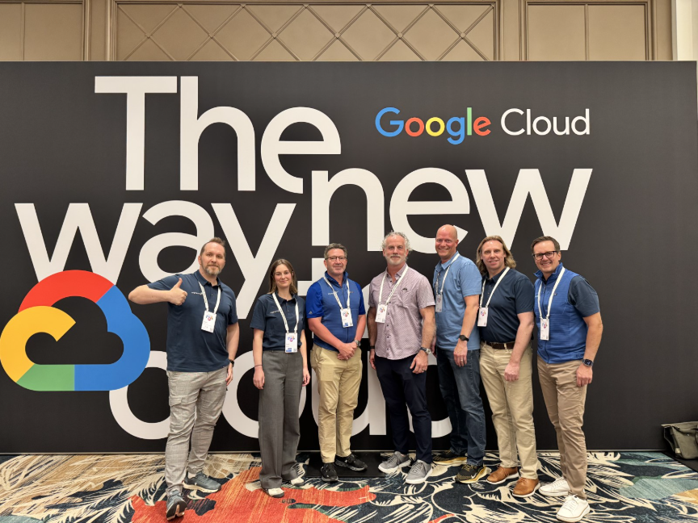
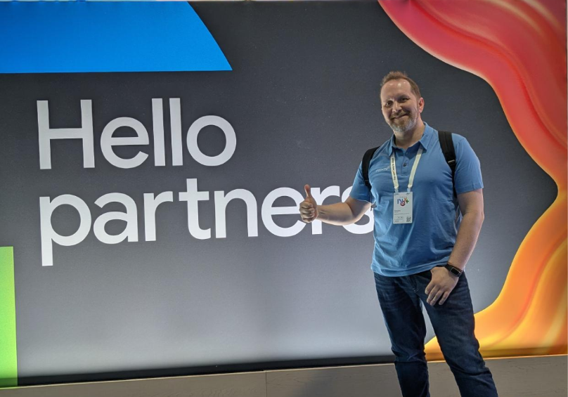
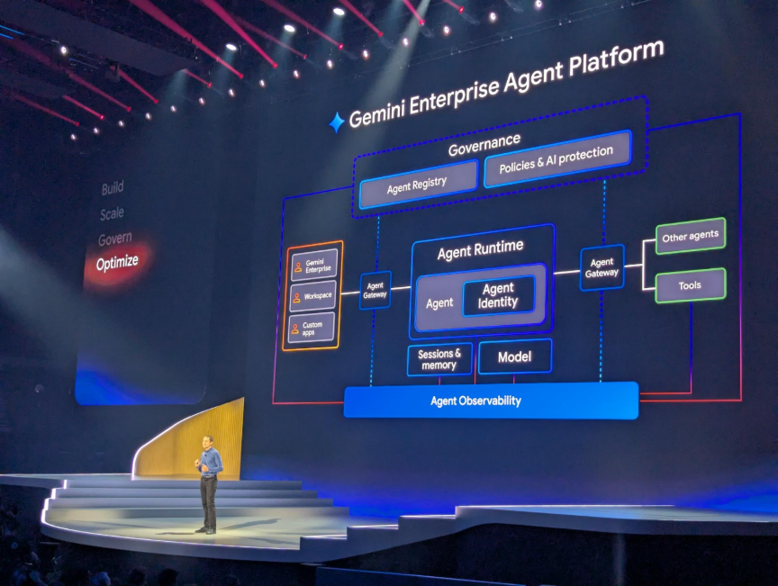
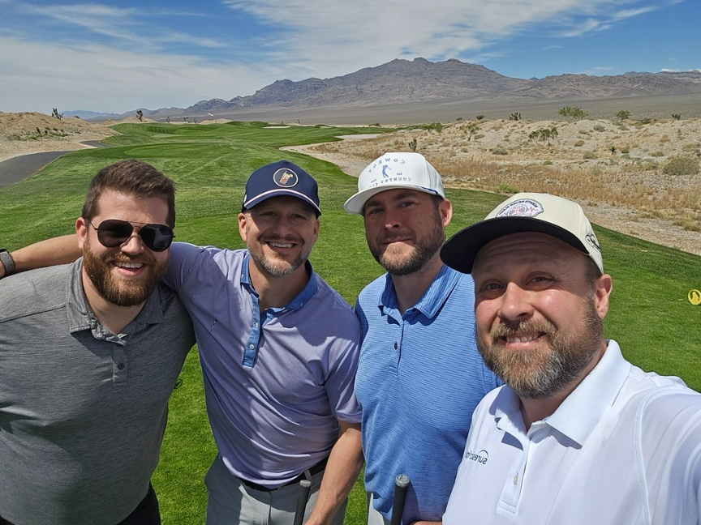
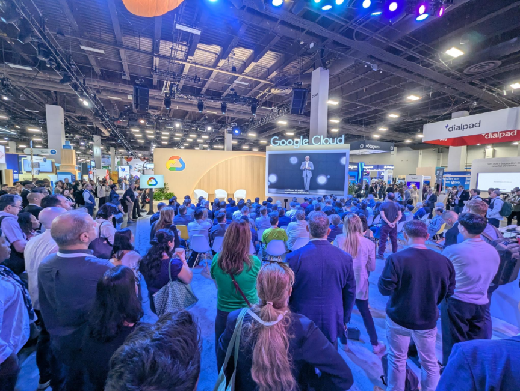

Coming out of Google Cloud Next ’26, the Improving team in Las Vegas welcomed a pivotal shift for enterprise AI by Google Cloud, indicating a clear transition from an emphasis on experimentation to real-world Agentic adoption at scale. For Improving’s Google practice leaders, Sergey Vershinin, Technical Director – Google Practice Lead, and Ehren Seim, Global Lead of Alliances, the event provided both validation of market direction and a renewed sense of momentum, optimism, and excitement for the year ahead.

This blog outlines their key insights, including what stood out heading into the event, major announcements across Gemini Enterprise and the Gemini Enterprise Agent Platform, conversations with customers and partners, and how Improving’s strategic partnership with Google Cloud is evolving into 2026 and beyond coming out of Next ‘26.

## **Heading Into Google Cloud Next ’26**

Heading into Google Cloud Next ’26, our team arrived with a stronger foundation than in previous years. With multiple years of attendance and deeper alignment to Google’s go-to-market priorities, the team entered the event with a clear strategy to maximize impact.

As Sergey explained:

*“From an improving side, we’re that much more experienced across our Google Practice in regards to delivery and strategy, and had a strong and cohesive plan to make the most out of the event based on our desire to help our clients succeed with solutions on Google Cloud.”*

This maturity reflected not only in how the team navigated the event, but also in how they engaged with partners, clients, and emerging opportunities tied to AI and data transformation.

For Ehren, the value of the event extended beyond sessions and announcements:

*“Google Next is an opportunity for us to connect in person with potential clients, partners, and folks at Google Cloud that share the same excitement and passion for innovations in the Agentic AI, Data, and Cloud space… It’s a great way for us to build relationships and rapport by sharing the exciting projects our teams have been involved in on Google Cloud.” *

## **Google Cloud Next ’26 Announcements: Enterprise AI Takes Centre Stage**

#### **From AI Exploration to Enterprise-Ready Execution**

A consistent theme across Next ’26 was the evolution of AI from experimentation to enterprise-grade deployment. While previous years focused on demonstrating AI capabilities, this year emphasized trust, governance, and operational readiness.

According to Sergey Vershinin, this shift involved:

“*A truly solidified move into an enterprise focus… the conversation evolved from how do I introduce AI and Agentic AI in particular to the enterprise world, so that serious people doing serious work can use it and rely on it.” *

This transition is critical for organizations moving from pilots to production, especially in highly regulated industries such as the public sector and healthcare.

## **Gemini Enterprise and the Rise of the Agentic AI Era**

One of the most impactful developments highlighted in Las Vegas was the advancement of **Gemini Enterprise** and the introduction of the **Gemini Enterprise Agent Platform, **a rebrand of Google Cloud’s Vertex AI platform, which our teams had utilized extensively to drive digital transformations forward across the public sector, healthcare, and retail verticals in Canada and the US.

These offerings represent Google’s commitment to enabling **Agentic AI**, where intelligent agents can autonomously execute workflows, interact with systems, and deliver business outcomes.

**Some key highlights and innovations from Google Cloud’s keynote at Next ‘26 include:**

- Enterprise-grade governance, security, and observability
- Agent identity frameworks for authentication and accountability
- Auditability and traceability for AI-enabled and Agentic AI-driven workflows
- Integration across Google Cloud services and enterprise environments

As Sergey noted:

*“A lot of the focus was on security, identity, authentication… making sure integration of Agentic systems build on Gemini Enterprise Agent Platform are secure, auditable, and workable in an enterprise environment.” *

### **Infrastructure, Hardware, and AI Platform Advancements**

Google also reinforced its leadership across the full AI stack, from infrastructure and hardware to applications. This includes continued innovation in custom silicon, such as Tensor Processing Units (TPUs), and optimization for model training and inference.

Sergey added that:

*“Google does their own silicon… they introduced 8th generation TPUs… which are custom made for training and serving models.” *

These advancements support the scalability and efficiency required for large-scale AI adoption across industries.

## **Agentic AI and Public Sector Readiness**

A major area of focus for Improving is the application of **Agentic AI** within the public sector and healthcare, where compliance, security, and data sovereignty are critical.

Google’s advancements in **Gemini Enterprise Agent Platform, which is a rebrand and evolution of Vertex AI**, directly address these requirements.

In addition to his observations earlier, Sergey highlighted that:

*“All of the things that were announced are very much in line with making AI usable to enterprise… public sector is essentially enterprise with additional security and sovereignty requirements.” *

He further emphasized that:

*“Gemini Enterprise Agent Platform, which was formerly Vertex AI, and Gemini Enterprise are very well positioned for public sector use… offering mature security tooling, compliance, and data sovereignty capabilities.” *

These capabilities are particularly relevant for Canadian public sector organizations navigating governance frameworks, compliance mandates, and secure AI adoption strategies.

## **Conversations at Google Cloud Next ’26: AI, Data, and Real-World Challenges**

### **Customers Are Ready, But Need Structure**

Across discussions with customers and prospects, a consistent theme emerged: organisations are eager to adopt AI but require structured frameworks to do so responsibly.

The emphasis on governance, security, and operational tooling in Google’s announcements directly aligned with these needs.

### **Partners Are Central to Google’s Go-To-Market Strategy**

One of the most significant insights from Ehren Seim was the evolving role of partners in Google Cloud’s ecosystem.

*“Every opportunity for a digital transformation that they’re talking about or every account… needs to have a partner attached. For us… what an opportunity to showcase our AI, Data, and Application experience on Google Cloud.” *

This shift positions partners like Improving as essential enablers of customer success, particularly in complex AI and data initiatives.

He added:

*“One of the core focuses for our team was building relationships so we can be attached to those transformative opportunities and accounts… that was pretty prevalent talking with the reps.” *

### **Strengthening the Improving–Google–Confluent Ecosystem**

Engagements with both Google and partners such as Confluent reinforced the importance of ecosystem-driven innovation. These conversations highlighted opportunities to deliver integrated data and AI solutions that span:

- Real-time data streaming
- AI-powered analytics
- Enterprise-grade agent architectures

The result is a more cohesive value proposition for customers seeking end-to-end transformation.

## **What Comes Next: Translating Momentum into Action**

Looking beyond Google Cloud Next ’26, both leaders emphasized bringing the latest insights from the innovations announced into real-world transformations for both our clients and partners.

This includes:

- Refreshing demos aligned to Gemini Enterprise and Agentic AI
- Advancing go-to-market strategies with Google
- Converting pipeline opportunities into active engagements

## **The Future of the Improving–Google Partnership**

The outlook for the partnership between Improving and Google Cloud is highly optimistic.

According to Ehren, regarding our partnership with Google Cloud:

*“It’s a real opportunity for us to start to scale this partnership… there’s a significant opportunity in front of us right now.” *

### **Key priorities for Improving in 2026 and beyond include:**

- Expanding presence across Google Cloud accounts
- Deepening alignment with Google’s partner-led GTM model
- Scaling AI and data capabilities around Gemini Enterprise
- Driving measurable business outcomes for customers

## **Final Thoughts: From Innovation to Impact**

Google Cloud Next ’26 highlighted a defining moment in the evolution of AI, especially in Agentic AI. With **Gemini Enterprise**, **Gemini Enterprise Agent Platform**, and a clear focus on **Agentic AI**, Google Cloud is enabling organizations to move from experimentation to enterprise-wide transformation.

For the Improving team, the event reaffirmed not only the strength of our passion and technical expertise across AI and data, but also the strategic importance of our partnership with Google Cloud.

With strong alignment, growing market demand, and a clear path forward, the opportunity is now to turn insight into impact.

[Learn more about our Google partnership today.](https://www.improving.com/partners/google-cloud/)
