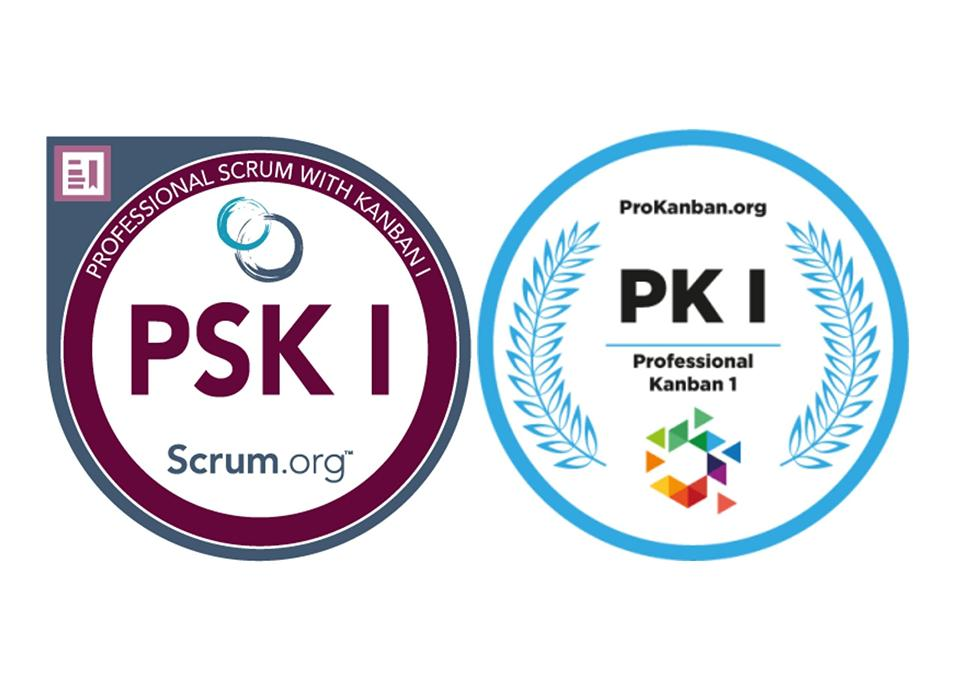
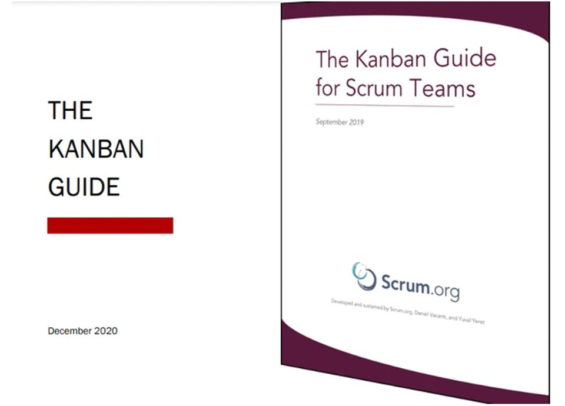

Before I launch into the specifics of these training classes, the first thing I want people to consider is why they should attend a class at all. Will attending [Applying Professional Kanban](https://improving.com/services/training/applying-professional-kanban) (APK) or [Professional Scrum with Kanban](https://improving.com/services/training/professional-scrum-kanban) (PSK) two-day classes make someone an expert in the subject? The short answer is no. However, I believe there is value in attending either of these classes.

One of my goals as a trainer is that students will gain a foundational understanding of the concepts of Kanban and leave the class feeling inspired and encouraged to make positive changes when they return to work. Students in the classes develop their understanding through more than just a presentation. They develop the understanding through discussions, discovery, and the shared experience that happens in the class.

If students are interested in the certifications that accompany these training courses (PK I for the APK, and the PSK I for PSK), the training helps them associate learning objectives targeted in the assessments with interactions in the class. These interactions and activities are more memorable than a slide in a presentation. They can use these learning experiences as a basis to build on whenever they leave the classroom and return to the specific context of their work environment.

## Why APK and PSK?

One of the reasons I really like the approach of [ProKanban.org](https://prokanban.org/) (for APK) and [Scrum.org](https://scrum.org/) (for PSK) is that both organizations recognize that the context that individuals and teams operate in make prescriptive approaches unrealistic. The alternative is providing a minimalistic set of instruction and practices with the understanding that the people will build upon those practices to meet the goals of their organization while working within the constraints of context and challenging them when appropriate.

The source for the APK class is The Kanban Guide and the source for the PSK class is The Kanban Guide for Scrum Teams.

Both of these guides were created by practitioners and experts. They focus on the necessary practices to implement and manage a Kanban system that continuously improves the flow of value. The guides are very similar in how they describe the practices of Kanban. The primary distinction is that The Kanban Guide for Scrum Teams addresses how Scrum Teams can approach applying the practices to the Scrum Framework.

The APK and PSK courses are designed, maintained, and updated by professional trainers who use the feedback of students and other trainers to create interactive learning experiences. These help students learn through a variety of methods. In both classes, students can expect to participate in full classroom discussions, small group discussions, simulations, and explorations into scenarios and problem-solving, applying the content that is shared by the instructor.

For students that are planning on pursuing certification, both organizations provide free open assessments on their websites that allow students to practice applying their knowledge before they take the official assessments. Once students achieve the PK I or PSK I certification, the certifying organization does not require that they pay an ongoing fee to keep their certification. Neither the PK I nor PSK I certifications expire.

## What Makes the Classes Different? How to Decide Between APK and PSK

Deciding which class to take will be based on the context and setting that the individual is working in. Though both classes are a great introduction to Kanban, they have a different focus depending on how work is currently getting done.

If someone is currently working on a Scrum Team and looking to apply Kanban practices to improve the way that their Scrum Team operates, the Professional Scrum with Kanban class is a great place to get started. However, The Professional Scrum with Kanban class is not designed for students to come learn Scrum *and* Kanban. The PSK course assumes that students already have a good understanding of Professional Scrum as it is described in the [Scrum Guide](https://scrumguides.org/scrum-guide.html). The classes that can help students get a foundational knowledge of Scrum to build on are the [Applying Professional Scrum](https://improving.com/services/training/applying-professional-scrum) and [Professional Scrum Master](https://improving.com/services/training/professional-scrum-master) classes.

One of the greatest strengths of the PSK class is that it helps Scrum Practitioners see how to apply the practices of Kanban to the accountabilities, events, artifacts (and their commitments) of Scrum. Scrum is a process framework that invites teams to add what is helpful to achieve their goals and create value.

If someone is not currently working on a Scrum Team and wants to learn about how Kanban can help improve the flow of value, the Applying Professional Kanban class will be a better option for them. The focus of the APK class is on learning and applying the essential practices of Kanban. There is no prerequisite understanding of Scrum required because Kanban can stand alone as a system that individuals and teams can use to visualize, manage, and improve the work they are doing. The APK class provides a learning experience that is more focused on the Kanban practices because it does not spend time building connections to the Scrum Framework. While those connections are invaluable in the PSK, for students with no Scrum knowledge working outside the framework those connections can be a distraction.

## Continuous Improvement through Kanban

Kanban system team members are expected to continuously improve. Improving the workflow is one of the required practices of Kanban. The improvements are focused on the flow of value in the system.

Scrum Teams are also expected to continuously improve. In the Scrum Framework, teams have an event that is focused on improving quality and effectiveness in the Sprint Retrospective. They also have a Scrum Master who is focused on the effectiveness of the Scrum Team and encourages them to improve their practices. Continuous improvement also reflects the Scrum Value of Commitment, as Scrum Team members are committed to doing their best every day.

The APK and PSK classes can be a great step to get teams excited about learning how Kanban can improve the flow value they produce. When team members see how they are making a difference for their customers and their organization, it can be a source of motivation. The ideas, practices, and discussions that take place in the APK and PSK classes can be a catalyst for positive change, not only for the individuals and teams but also for the organization when they return from class.

Sign up for our public classes [here](https://improving.com/services/training/full-schedule/) or [reach out](https://improving.com/contact) to learn more about these courses.
