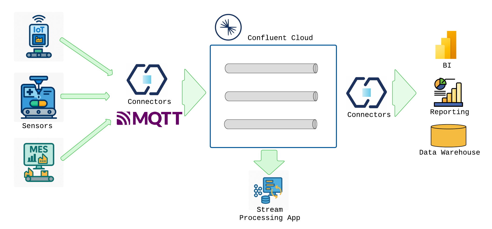

The healthcare industry currently faces numerous challenges, especially in the manufacturing of medical devices. The complexity of production processes, the need for high-quality standards, and the demand for efficiency are just a few of the hurdles that manufacturers must overcome. One global healthcare manufacturer, Medtronic, has embarked on a transformative journey to address these challenges by leveraging real-time IoT insights. This blog explores how Medtronic transformed its production lines, the technical best practices involved, and the lessons learned from this significant transformation.

### The Challenges in Medical Device Manufacturing

Medtronic, a leading manufacturer of medical devices, serves over 78 million people and treats more than 70 health conditions. With 95,000 employees across 350 sites worldwide, the scale of their operations is immense. However, this scale also brings several challenges:

1. Manual and Paper-Based Processes: Traditionally, data collection at various manufacturing sites involved manual entry into spreadsheets and clipboards. This method was prone to human error, slow, and inefficient.
2. Limited Visibility and Data Silos: Production data was scattered across disconnected systems, hindering comprehensive, real-time operational visibility and global optimization.
3. High Scrap Rates: Quality defects were often identified too late in the production process, leading to wasted materials and resources.
4. Reactive Maintenance: The inability to proactively identify equipment issues resulted in high downtime and reliance on historical data for maintenance decisions.
5. Inefficient Production Management: Difficulty in managing workloads and production lines affected throughput and product quality, with bottlenecks often going unnoticed.

### The Solution: Real-Time IoT Insights

To address these challenges, Medtronic partnered with Improving and [Confluent](https://www.improving.com/partners/confluent/) to implement a solution based on real-time IoT insights. The approach consisted of three pillars:

1. Capturing Real-Time Data: Data was captured directly from IoT devices, sensors, and systems on the factory floor, including Manufacturing Execution Systems (MES) and MQTT brokers.
2. Implementing Real-Time Data Pipelines: The captured data was streamed into Kafka, enabling automated reporting, analytics, and real-time applications. Kafka Streams applications embedded business logic into these real-time streams.
3. Scalability and Standardization: Building on Confluent Cloud ensured reliable scalability as new manufacturing locations were added. Standardization across the enterprise was crucial for efficient data aggregation.

### The Technical Architecture

The solution's architecture involved several key technologies:

- IoT Devices and Sensors: Data from production lines was ingested using Kafka Connect and MQTT connectors.
- Kafka and Confluent Cloud: Data streams were created for different domains and purposes, transforming and enriching the data as needed.
- Power BI and Data Warehouses: Downstream systems for analytics and reporting utilized the processed data.
- Kafka Streams: Real-time applications were built to act on insights directly.

This architecture transformed manual, batch-based processes into automated, real-time processes, enabling applications and reporting systems to act on data as it happened.

### Benefits of Real-Time IoT Insights

The implementation of real-time IoT insights brought several benefits to Medtronic:

1. Improved Data Visibility: Real-time data visualization allowed for quicker and better decision-making.
2. Enhanced Operational Efficiency: Automated data collection streamlined processes, reducing the need for manual entry and increasing speed.
3. Cost Savings: Reduced equipment downtime and optimized production lines led to significant cost savings.
4. Optimized Production Throughput: Real-time visibility helped identify and resolve bottlenecks, improving production efficiency.
5. Proactive Maintenance: Real-time analytics enabled predictive maintenance, reducing downtime and lowering costs.
6. Scalability: The architecture scaled efficiently as new sites were added, without performance loss or extensive rework.

### Lessons Learned

The transformation journey was not without its challenges. Key lessons learned included:

1. Patience in Transformation: Gradually introducing digital practices ensured smooth adoption and integration with existing capabilities and culture.
2. Designing for Scale: Planning for scalability from the outset prevented performance degradation as new sites were added.
3. Standardization: Establishing standard data models, naming conventions, and integration practices was crucial for efficient data aggregation.
4. Effective Use of Partnerships: Leveraging the capabilities of partners like Confluent was essential for success.
5. Predictive Capability: Real-time data enabled predictive maintenance, significantly reducing downtime and boosting operational efficiency.

### The Impact

The transformation of Medtronic's production lines through real-time IoT insights has had a profound impact on their ability to optimize the production of life-changing and life-saving medical devices. By leveraging advanced technologies and best practices, Medtronic has improved efficiency, reduced costs, and enhanced the quality of its products. This journey serves as a valuable example for other manufacturers looking to unlock the value of real-time data in their operations.

To learn more about how Improving can help transform your production lines with real-time IoT insights, [contact us today!](https://www.improving.com/contact)
