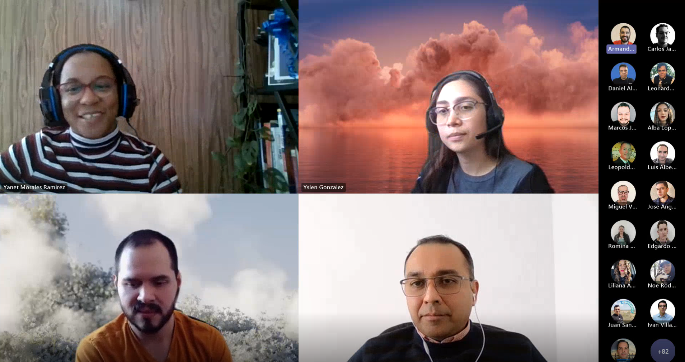
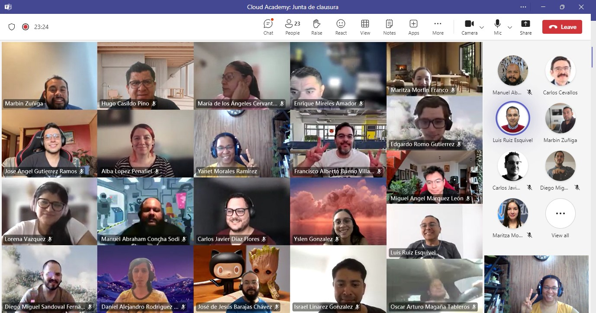

Every month, I receive an email from Microsoft Viva Insights promising to "Discover trends in my work habits". The latest one informed me that in the past four weeks, I organized 45 meetings and was invited to 57 meetings. Although I didn't attend all of them, it seems I attempted to multitask during 34 of them. This report isn't just based on my scheduled meetings. It also mentions that I sent 38 emails, read 152 emails, and was involved in 459 chats and non-scheduled "just-a-quick" calls.

### Improving Team Learning Through Self-Managed Learning Teams

For technical directors or team managers, finding time to run an internal academy to enhance the skills of the team is challenging. Traditional methods suggest creating a learning plan, preparing class content, exercises, labs, and maybe some assessments. Then, dedicating time to teach the classes, answering questions, and ensuring everyone is learning at a sustainable pace. You might have help, but anything can happen during the Academy like important meetings, client visits, or urgent matters that require your full attention. Frustration may arise and rescheduling sessions can delay the program's end. But, helping team members to grow is essential, so trying hard is necessary.

What if you could split attendees into teams, give them just learning objectives, and meet with them once a week to check doubts and review what they learned? What if teams were self-managed enough to develop their own learning process and improve it in every cycle? What if each team had a leader ensuring everyone is learning and helping with impediments? Does this sound familiar?

I personally faced the time availability dilemma and the need of supporting internal learning programs until I "discovered" eduScrum. I pitched the idea of using it in our last Javascript Academy in Mexico, involving 20 junior developers and we decided to use it. After some iterations, we realized it was working! At that moment, the main effort was in creating weekly learning goals and collecting a suggested list of learning materials.

Every learning cycle lasted a week. Every team had daily calls to check their plan and progress toward the learning objective. At the end of the week, we reviewed their progress, they presented what they learned, and every team conducted a retrospective to improve. Attendees learned teamwork, problem-solving, and self-management. They discovered additional materials and even did mini projects weekly!

### **Empowering Learning through Internal Development Programs**

A little while ago, we recognized the need to create an internal Cloud academy for developers. The organizing committee developed the entire program within just three weeks and conducted three 30-minute meetings to outline the learning objectives for each week while compiling a list of suggested learning materials. An additional week was allocated to announce the academy to all Improvers in Mexico and facilitate registration. Subsequently, the academy commenced with approximately 60 Improvers. We have adopted a similar strategy this time and invited a junior Scrum Master to oversee the nine self-created teams. These internal Academies serve as invaluable opportunities for junior Scrum Masters to cultivate experience and confidence within a safe environment, however this topic merits its own blog post. We are currently immersed in the first of six learning cycles. Rest assured; I am committed to sharing the feedback collected upon its completion.

What did I learn from these experiences? To embrace a challenge with an Agile mindset using its values and principles as a foundation to navigate through it. I learned to be creative, innovative and open to alternative and experimental solutions. This approach not only fosters unique perspectives but also will lead to powerful and transformative solutions.

Explore the world of Agile by browsing our class schedule and enrolling in one of our [courses](https://www.improving.com/services/training/) today! You can also [reach out to us](https://www.improving.com/contact) for more details.
